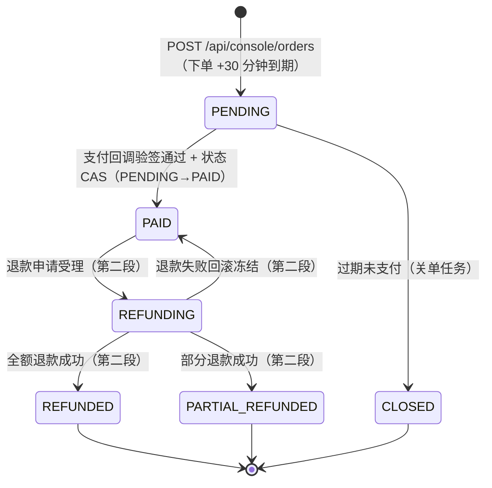
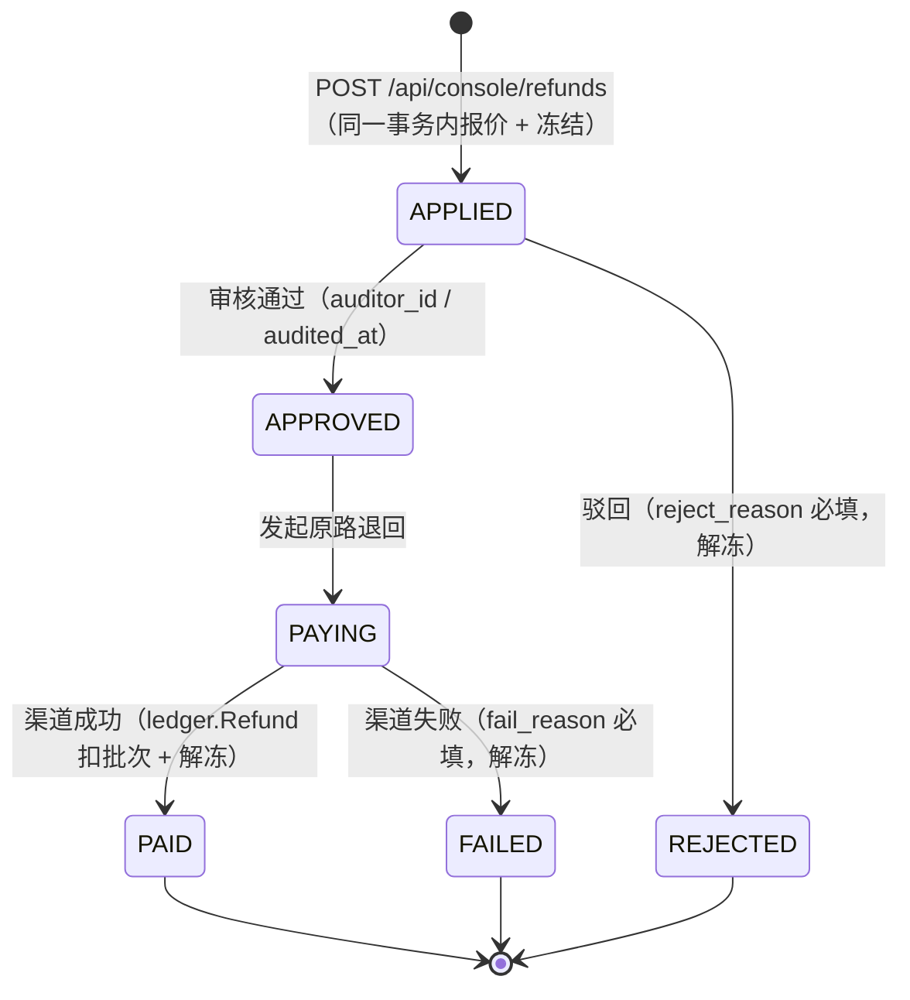
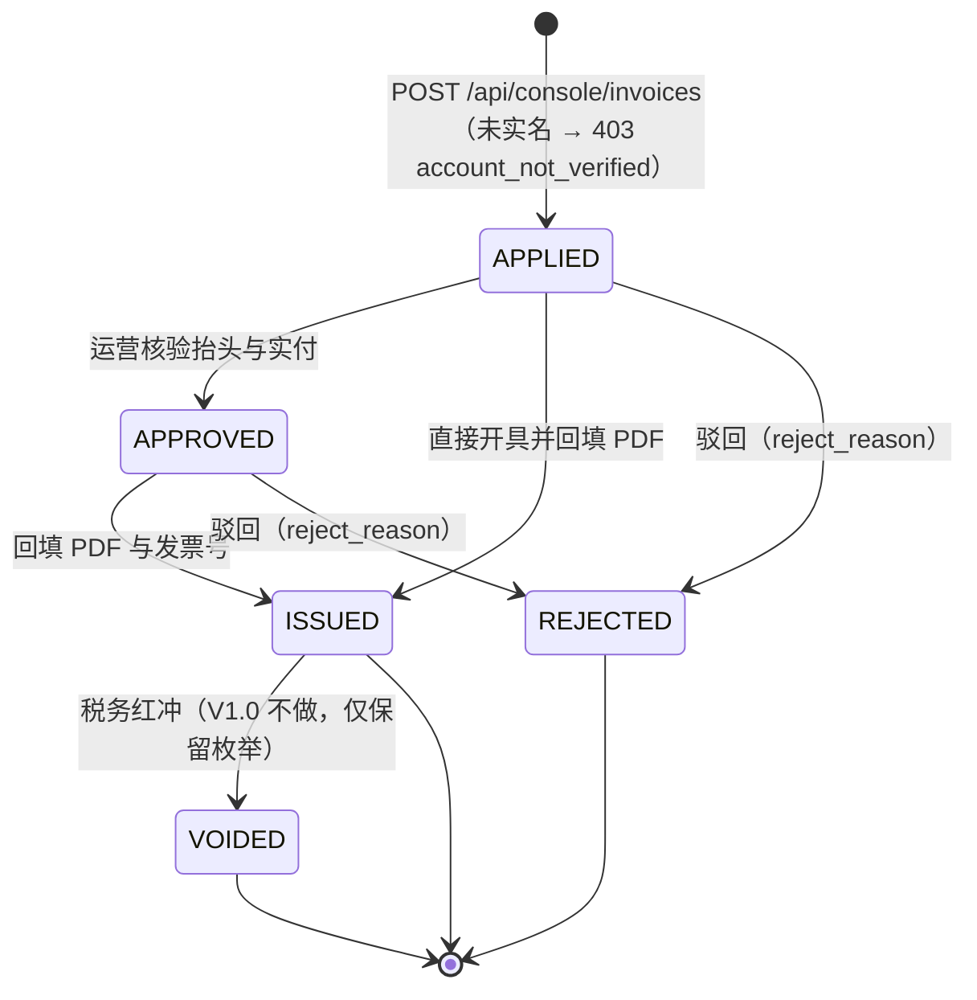
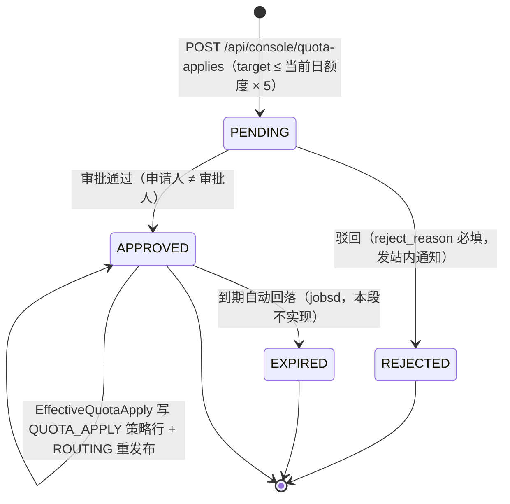

# 资金状态机（fund flow）

真相源：`t_recharge_order` / `t_refund_order` / `t_invoice_apply` / `t_quota_apply` 的 DDL 枚举
（`internal/platform/migrate/sql/mysql/0003_fund_usage_ops.sql`）。**代码枚举以 DDL 为准**；
本文件与代码的一致性由 `internal/control/fund/flow_doc_test.go` 断言（集合相等，不是"看起来一样"）。

机器可读锚点（测试逐行解析；改动时文档与代码枚举必须同步改）：

```
fundspec:order-states PENDING,PAID,CLOSED,REFUNDING,REFUNDED,PARTIAL_REFUNDED
fundspec:refund-states APPLIED,APPROVED,REJECTED,PAYING,PAID,FAILED
fundspec:invoice-states APPLIED,APPROVED,ISSUED,REJECTED,VOIDED
fundspec:quota-states PENDING,APPROVED,REJECTED,EXPIRED
```

> T13 第二段补齐退款 / 发票 / 提额三张图。退款状态机的卡面写法
> `PENDING→APPROVED→REFUNDING→REFUNDED/REFUND_FAILED` 与 DDL 的
> `APPLIED|APPROVED|REJECTED|PAYING|PAID|FAILED` 不一致，**以 DDL 为准**（勘误 E-26），
> 卡面五个状态名一个都不出现在实现里。

## 1. 订单状态机（`t_recharge_order.state`）



### 每次迁移的副作用

| 迁移 | 触发 | 副作用（同事务） | 事务外 |
| :--- | :--- | :--- | :--- |
| `[*] → PENDING` | `POST /api/console/orders` | 写 `t_recharge_order`、`t_admin_audit_log(ORDER_CREATE)` | 无（**积分不动**） |
| `PENDING → PAID` | `POST /api/v1/pay/callback/{channel}` | `pay_txn_id` / `paid_at` / `refundable_micro` 落库、**充值批次 + 赠送批次**、**两条流水**、`t_rate_limit_policy` 生效（套餐单）、`t_user.plan_id`、审计 `ORDER_PAID` | `DEL K26`、`cfg:snap:ROUTING` 重发布 |
| `PENDING → CLOSED` | 关单任务（T14/T22） | 仅状态位 | 无 |
| `PAID → REFUNDING` | 第二段 | 冻结 `frozen_refund_micro` | 无 |

### 幂等的不变量（G-03）

1. `uk_ro_pay_txn(pay_channel, pay_txn_id)`：同一渠道流水号只能绑定一个订单；
2. `UPDATE ... WHERE id = ? AND state = 'PENDING'`：**状态 CAS**，同一订单只有一次入账机会；
3. `uk_le_idem`（`recharge:{order_id}` / `bonus:{order_id}`）：重复入账在账本层再被拒绝一次。

三层都在**同一个事务**里，没有"先查后写"的空窗。重放 N 次的结果：
余额只加一次、批次恰好 2 个、流水恰好 2 条（充值 1 + 赠送 1，PRD G-03 Then.3）。

## 2. 分账（每个 PAID 订单）

| 批次 | `batch_type` | `refundable` | `expire_at` | 流水 `biz_type` |
| :--- | :--- | :--- | :--- | :--- |
| 充值积分 | `RECHARGE` | 1 | **NULL（长期有效）** | `RECHARGE` / `PLAN_GRANT` |
| 赠送积分 | `BONUS` | 0 | **支付成功 + `billing.bonus_expire_days` 天** | 同上 |

兑换码入账走 `batch_type=REDEEM`（不可退），`biz_type=REDEEM`。

## 3. 套餐权益（`t_rate_limit_policy` + `t_user.plan_id`）

- 升档（`sort_order` 更大）：四项规格**整体覆盖**，`effective_to = NULL`（付费档永久）；
- 同档重复购：规格不变，积分按批次累加，赠送到期日各按自身；
- 低档订单（V1.0 不卖降档，仅兼容历史遗留）：四项**逐项取高**，`NULL` 日额度视为无穷大；
- 体验档：`effective_to = 支付时刻 + plan.trial_days`，到期回落默认档（余额不清空）。

## 4. 回调对外契约（`POST /api/v1/pay/callback/{channel}`）

| 响应 | 含义 | 渠道侧动作 |
| :--- | :--- | :--- |
| 200 `credited=true` | 首次入账成功 | 停止重投 |
| 200 `replayed=true` | 重复通知，已入账过 | 停止重投 |
| 200 `reason=ORDER_*` | 语义异常（订单不存在 / 已关闭 / 已退款 / 流水冲突），已写审计 | 停止重投，转人工 | 
| 400 `invalid_request_body` | 字段非法或**验签失败**（`message` 指明字段） | 告警，修正后重投 |
| 503 `config_unavailable` | 验签密钥未配置（`YUNSHU_PAY_CALLBACK_SECRET_{CHANNEL}`） | 退避重试 |

验签串：`out_trade_no|trade_no|amount_fen|status`，算法 `hex(HMAC-SHA256(secret, 串))`。
金额参与签名，防止"小额回调结大额订单"。

## 5. 退款状态机（`t_refund_order.state`）



| 迁移 | 触发 | 同事务副作用 | 事务外 |
| :--- | :--- | :--- | :--- |
| `[*] → APPLIED` | `POST /api/console/refunds` | `t_refund_order` 插入（`apply_micro` / `refund_micro` / `refund_fen` / `fee_fen`）、`t_credit_account.frozen_refund_micro += apply_micro`、`t_recharge_order.state = REFUNDING`、审计 `REFUND_APPLY` | 无 |
| `APPLIED → APPROVED` | T16 审核中心 | `auditor_id` / `audited_at`、审计 `APPROVE`；申请人 == 审批人时只写 `result=REJECTED`（`reason=SELF_AUDIT`）后返回 `ErrSelfAudit` | 无 |
| `APPLIED → REJECTED` | T16 驳回 | `reject_reason`、**解冻**、`t_recharge_order.state = PAID`、审计 `REJECT` | 无 |
| `APPROVED → PAYING` | 打款流程 | 仅状态位 + 审计 | 无 |
| `PAYING → PAID` | 渠道成功回调 | `ledger.Refund`：每批次一条 `REFUND` DEBIT、余额扣减、本单冻结解除、`state = PAID` / `paid_at`；随后回写 `pay_txn_id`、订单 `REFUNDED`（可退余额 0）或 `PARTIAL_REFUNDED` | 站内通知 `REFUND_ARRIVED` + 邮件 |
| `PAYING → FAILED` | 渠道失败 | `fail_reason`、**解冻**、`t_recharge_order.state = PAID`、审计 `REFUND_FAILED` | 站内通知 `REFUND_ARRIVED` + 邮件 |

状态机不变量：

1. `frozen_refund_micro` 只由 `internal/ledger` 的 `FreezeRefundTx` / `ReleaseRefundTx` / `Refund` 改动，`fund` 包不直接 UPDATE 余额表；
2. 同一账号同时最多一条 `APPLIED / APPROVED / PAYING` 退款单（冻结额是账户级，不按单拆分）；
3. `FAILED` / `REJECTED` 不产生任何 `t_ledger_entry`，余额总量不变（A10）。

## 6. 发票状态机（`t_invoice_apply.state`）



| 迁移 | 触发 | 同事务副作用 | 事务外 |
| :--- | :--- | :--- | :--- |
| `[*] → APPLIED` | `POST /api/console/invoices` | `t_invoice_apply` 插入；`amount_fen ≤ pay_amount_fen − invoiced_fen`；同订单已有 `APPLIED/APPROVED/ISSUED` 则拒绝 | 无 |
| `APPLIED/APPROVED → ISSUED` | `IssueInvoice`（T16） | `state=ISSUED`、`issued_at`、`invoice_url`、`t_recharge_order.invoiced_fen += amount_fen`；重复调用为幂等空操作 | 站内通知 `INVOICE_PROGRESS` + 邮件 |
| `ISSUED → VOIDED` | 财务红冲（V1.0 不做） | 仅枚举保留 | 无 |

金额口径：`pricing.tax_rate_multiplier` 固定 `1.00`（Q-03），`taxRateBP` 恒返回 `10000`，
**不做价税分离**；改动该键在 V1.0 只产生 WARN，不改变开票金额。

## 7. 提额状态机（`t_quota_apply.state`）



| 迁移 | 触发 | 同事务副作用 | 事务外 |
| :--- | :--- | :--- | :--- |
| `[*] → PENDING` | `POST /api/console/quota-applies` | `t_quota_apply` 插入（`current_quota_micro` / `used_at_apply_micro` / `target_quota_micro` 快照）、审计 `QUOTA_APPLY` | 无（额度不变） |
| `PENDING → APPROVED` | `ApproveQuotaApply`（T16） | `approved_quota_micro`、`effective_from = 批准日次日 00:00 (UTC+8)`、`effective_to = effective_from + 30 天`、`auditor_id` / `audited_at` | 调用 `EffectiveQuotaApply` |
| `APPROVED → 生效` | `EffectiveQuotaApply` | `t_rate_limit_policy(scope=USER, source=QUOTA_APPLY)` 插入，`fallback_policy_id` 指向生效时刻在用的策略行 | `PublishRoutes`：SET `cfg:snap:ROUTING` → `INCR cfg:ver` → PUBLISH |
| `PENDING → REJECTED` | `RejectQuotaApply`（T16） | `reject_reason`、`auditor_id` / `audited_at`、审计 | 站内通知 `QUOTA_AUDIT` |
| `APPROVED → EXPIRED` | jobsd 到期任务 | 不写策略；回落到 `fallback_policy_id` | 无 |
