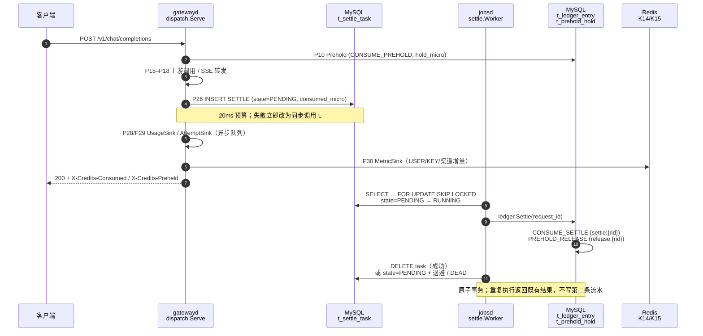

# 结算、清算与对账

`t_ledger_entry` 是资金的唯一事实源。网关在 P14 之后不再同步扣款：它把结算参数写入 `t_settle_task`，由 `jobsd` 的 worker 在同一事务里写 CONSUME_SETTLE 与 PREHOLD_RELEASE。Redis 只做拦截与指标累加，任何 Redis 失败都不改变资金结果（GR-02）。

## 1. 资金闭环时序

| 步骤 | 实际调用位置 | 说明 |
| :--- | :--- | :--- |
| 入队 | `internal/dispatch/settle.go:53` → `internal/settle/enqueue.go:70` | 超时 20ms（`enqueueTimeout`，`internal/dispatch/settle.go:21`）；`ON DUPLICATE KEY UPDATE updated_at` 使重复入队无副作用 |
| 同步回退 | `internal/dispatch/settle.go:83` → `ledger.Store.Settle` | 入队失败时执行，预算 5s；只有同步回退也失败才返回 503 `settlement_unavailable` |
| 任务消费 | `cmd/jobsd/main.go:101` → `internal/settle/worker.go:79` | 每个 jobsd 副本一个 worker；`ProcessOne` 用 `FOR UPDATE SKIP LOCKED` 领取 |
| 结算事务 | `internal/settle/worker.go:120` → `internal/ledger/settle.go` | `request_id` 即幂等键；held 状态已 SETTLED/RELEASED 时直接返回既有结果 |
| 用量日志 | `internal/dispatch/dispatch.go:144` → `internal/dispatch/usagerecord.go:15` → `internal/settle/usagewriter.go:171` | `Serve` 的 defer 保证每条终态请求恰好一行 `t_usage_record`；批刷 3s / 500 行，队列满丢弃并 WARN |
| 指标 | `internal/dispatch/usagerecord.go` 末段 → `internal/settle/metrics.go:123` | K14 `m:{USER|KEY}:{id}:{min_epoch}` 与 K15 `m:ch:{channel_id}:{min_epoch}`，TTL 300s |
| 积压闸门 | `internal/gw/p085_backpressure.go:124` | `SettleBacklog().Exceeded()` 在 P08.5、占用 in-flight 槽之前执行；只影响新请求 |
| 选主 | `cmd/jobsd/main.go:119` → `internal/jobs/election.go:206` | `t_job_lock` 租约 90s、每 20s 续约、剩余 < 30s 可接管；K25 `job:heartbeat:{instance}` TTL 60s |

### 1.1 失败分支

| 条件 | 行为 | 资金结果 |
| :--- | :--- | :--- |
| 入队成功 | 请求立即返回，worker 异步结算 | 最终 `balance_micro = 初始 - consumed_micro` |
| 入队失败、同步 `Settle` 成功 | 请求正常返回 | 同上，无任务残留 |
| 入队失败、同步 `Settle` 失败 | 503 `settlement_unavailable` | 预扣仍 HELD；`t_upstream_attempt` 与悬挂预扣扫描可定位 |
| `consumed_micro = 0` 且无 `prehold:{rid}` 流水 | `settle.Releaser.Release` 拒绝并 WARN，计数 `Rejected()` | 不新增任何流水，余额不变 |
| worker 重跑 / 任务重复投递 | `ledger.Settle` 返回既有结果 | 只有一条 `settle:{rid}` 与一条 `release:{rid}` |
| 连续失败 5 次 | `state=DEAD`，`last_error` 截断 512 字符 | 不再自动执行，转人工核查（TDS §5.4 R-01 偏差流程） |

`t_settle_task.state` 只使用 `PENDING` / `RUNNING` / `DEAD`；成功的任务直接删除，不保留 DONE 行（`uk_st_request_type(request_id, task_type)` 已保证重复入队收敛到一行）。

## 2. 日对账 8 条断言

以下 8 条为任务卡原文，由第二段的 `internal/recon/daily.go` 执行。本段只建立 `t_reconcile_diff` 的落库契约：`diff_key = sha256(biz_date|diff_type|subject)`，其中 `subject` 编码断言与被比较的主体，`diff_type` 保持 TDS §5.4.1 冻结的四值，不新增枚举。

| # | 断言（原文） | 判定 SQL 口径 | `subject` / `diff_type` | 阈值 |
| :--- | :--- | :--- | :--- | :--- |
| 1 | 金额守恒 | 自然日内 `SUM(流水) + 期初 = 期末`，按 `user_id` 分片 | `<user_id>` / `AMOUNT_MISMATCH` | 任何差额 P0 |
| 2 | 流水和 == 余额 | `t_credit_account.balance_micro <> SUM(t_ledger_entry.amount_total_micro)` | `<user_id>` / `AMOUNT_MISMATCH` | 任何一行 CRITICAL |
| 3 | 批次余额和 == 账户余额 | `SUM(t_credit_batch.remaining_micro) <> balance_bonus_micro + balance_recharge_micro` | `<user_id>` / `AMOUNT_MISMATCH` | 任何一行 CRITICAL |
| 4 | 无孤儿流水 | `t_ledger_entry.user_id` 在 `t_credit_account` 无行；或 `idem_key` 无对应业务单据 | `<ledger_id>` / `MISSING_UPSTREAM` | 任何一行 CRITICAL |
| 5 | 无未结算成功请求 | `t_usage_record.result='SUCCESS' AND consumed_micro>0` 且无 `settle:{request_id}` | `<request_id>` / `MISSING_UPSTREAM` | 1 小时内未收敛即 P0 |
| 6 | 上游账单差 ≤ 阈值 | `t_upstream_bill` 与 `t_usage_record` 按渠道/日汇总的差额 | `<channel_id>:<biz_date>` / `AMOUNT_MISMATCH` | 单笔 > 1 元或日汇总 > 100 元 P0，其余 P1 |
| 7 | 日额度快照一致 | `t_user_daily_quota.used_total_micro` 与当日 `SUM(t_usage_record.consumed_micro)` | `<user_id>:<biz_date>` / `TOKEN_MISMATCH` | 偏差 > 100 微积分 HIGH，> 10,000 微积分 CRITICAL |
| 8 | 配置版本可回溯 | `t_usage_record.config_version` 在 `t_config_publish` 有记录；缺失即为不可回溯 | `<request_id>` / `MISSING_LOCAL` | 任何一行 HIGH |

`match_mode`：单笔按 `request_id` 命中写 `EXACT`；只能用时间窗 + 模型 + token 数近似匹配时写 `APPROX`；汇总断言写 `DAILY`。

## 3. 差异处置路径

`t_reconcile_diff.status` 只有三个值，转换不可跳跃：

| 起点 | 终点 | 条件 | 操作 |
| :--- | :--- | :--- | :--- |
| `OPEN` | `HANDLING` | 值班人认领事件单 | 冻结受影响账户的提现与退款，不冻结调用 |
| `HANDLING` | `CLOSED` | 双人复核 + 冲正完成 | `t_ledger_entry` 追加 `biz_type='ADJUST'` 反向分录，引用原流水 ID 与事件单号 |
| `OPEN`/`HANDLING` | 保持 | 原因未定位 | 禁止补正向调整掩盖差异 |

重跑幂等：同一 `(biz_date, diff_type, subject)` 只保留一条；`CLOSED` 记录仅在 `delta_micro` 变化时重新打开（更新原行，不新增行）。

P0 触发条件：单笔 `|delta_micro| > 1,000,000`（1 元）、当日汇总 `|delta_micro| > 100,000,000`（100 元），或 `MISSING_LOCAL` 笔数 > 0。

对账任务只读外部账单；`t_reconcile_diff` 是它唯一的写入目标。代码中不存在 `UPDATE t_credit_account SET balance_micro = ?` 路径。

## 4. 边界

- `internal/recon/`、`internal/jobs/{expire_batch,purge_log,rollup}`、悬挂预扣恢复任务属于 T09 第二段，本段未实现；`prehold_release` 等任务名已在 `cmd/jobsd/main.go:35` 注册并持有租约，任务体在第二段接入。
- 本段不计算 `consumed_recharge_micro` / `consumed_bonus_micro` 的拆分；`t_usage_record` 两列写 0，扣款构成以 `t_ledger_entry.amount_*` 为准。
- `t_settle_task` 的 `release_reason` 只记录在 JSON payload 中，供第二段悬挂恢复任务归因。
