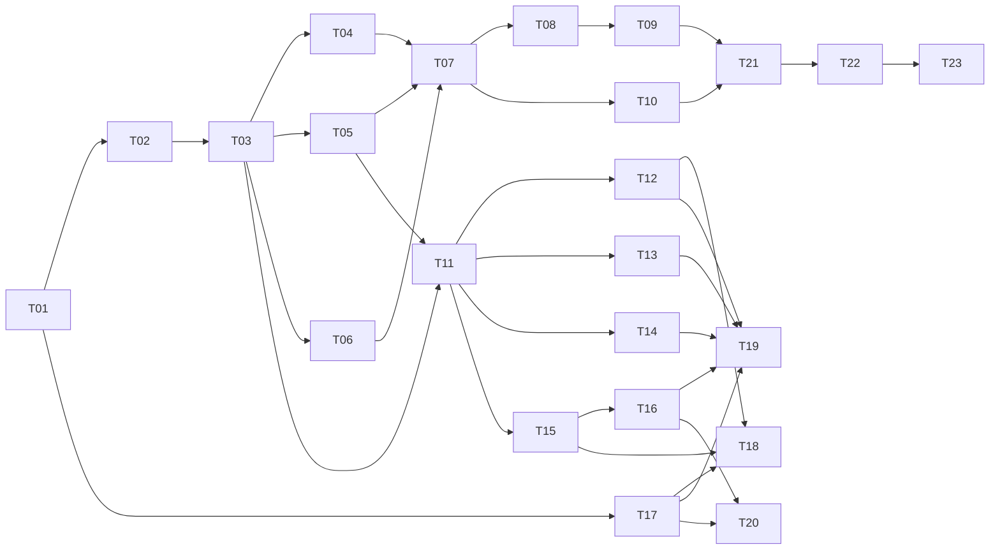

# 云枢 API · 任务卡总览与交付台账

> 本目录是**唯一派单入口**。需求真相源：`docs/_API 中转站 · 需求文档 V1.2.md`（下称 PRD）；技术真相源：`docs/技术架构设计文档 V1.2.md`（下称 TDS）。
> 任务卡只做三件事：**切边界、给硬约束、定验收**。任何与 PRD/TDS 冲突之处以源文档为准，并回头改卡。

| 项 | 值 |
| :--- | :--- |
| 需求基线 | PRD V1.2（2026-10-25） |
| 技术基线 | TDS V1.2（2026-10-25） |
| 任务卡版本 | T-1.0（2026-10-26） |
| 卡片总数 | 26 张（阶段 0–6，含补口卡 T24/T25 与防线卡 T26） |
| 交付总监（需求拆分 / 派单 / 验收） | 齐活林（本会话主理人） |
| 实现方（按卡执行） | Claude Code（`claude_code_run`） |

---

## 一、协作机制（本项目已定，不再变动）

| 角色 | 职责 | 不做 |
| :--- | :--- | :--- |
| 交付总监（我） | 拆需求 → 出卡 → 派单 → 代码巡检 → 验收 → 打回/放行 | 不代写业务代码 |
| Claude Code | 按卡实现，跑通卡内自检命令，回填「完成回执」 | 不自行改需求、不擅自扩范围、不跳过自检 |

**一次只派一张卡**。上一张卡验收结论为「通过」后才派下一张；存在 `依赖` 未满足的卡不得提前派。

**验收三件事**（每卡必做，缺一不签）：

1. **交付物核对**：卡内「交付物清单」的每一条路径必须真实存在且承担其声明的职责；
2. **自检命令复跑**：卡内「自检命令」由我独立复跑，不采信 Claude 的转述；
3. **硬约束抽样**：从「硬约束」中抽 3 条以上做源码级对照（grep / 读文件），记录证据。

**打回格式**：`编号 + 证据（文件:行 / 命令输出）+ 期望`。无证据不受理，不接受「大致符合」。

**回执归档（2026-10-26 修正的流程缺陷）**：此前派单时要求实现方"不要把回执写进任务卡"，回执只留在本文件的验收记录里，导致**单看一张卡会以为卡没执行**。现行规则：
1. 实现方在最终答复里输出回执（不改卡）；
2. 交付总监验收后，把**实测结果 + 偏离 + 遗留**写入该卡末尾的「完成回执（已归档）」小节；
3. 本文件的验收记录只保留**总监视角的复核证据与裁定**，不重复卡内回执。

已按此补档：T01、T02、T03、T04、T05、T17、T18。后续每张卡验收通过即归档，不再积压。

---

## 二、关键技术决策（减少派单期反复问询）

| 编号 | 决策 | 依据 / 理由 | 影响卡 |
| :--- | :--- | :--- | :--- |
| D-01 | 本仓库为**全新实现**（当前仅有 docs + assets），但数据库迁移编号**严格沿用 TDS §8.6 裁定表**：创建 `0001`–`0006`、`0009`、`0010`–`0017`；`0007`/`0008` **永久预留不创建** | TDS §8.6 声明编号表为唯一真相源，且 0007/0008 已被 0006/0009 注释写死为 `t_model.enabled→listing_state` 的 Expand-Contract。全新建库无历史 `enabled` 列，故 `t_model` 直接以 `listing_state` 建表，两个号保持空置 | T02、T03 |
| D-02 | 接入层用 Go 标准库 `net/http` + `ServeMux`（Go 1.22+ 路由），**不引入 Gin**；业务层不绑任何 Web 框架 | TDS §0.2 / U-01 建议项；减少依赖面，SSE 用 `http.Flusher` + `ResponseController.SetWriteDeadline` 完全可控 | T07、T11 |
| D-03 | 协议转换层独立为可独立构建的 module：`relaykit/`（自带 `go.mod`），验证命令 `GOWORK=off go build ./...` | TDS ADR-002 | T07、T08 |
| D-04 | 前端：Vite + React 18 + TypeScript + Tailwind，**自研轻量组件**（不引 MUI/AntD），图表用 Recharts；**SPA，不做 SSR** | 设计 token 已由 PRD §1.4 与原型固化（`--primary:#4F46E5` 等），第三方主题库适配成本高于收益；SSR 非任何验收项 | T17–T20 |
| D-05 | 前端**禁止**把价格、限流额度、套餐数值写进 bundle，一律运行时经 API 拉取 | PRD 附录 D F1-2 / F1-3（bundle 中搜不到价格字面量） | T18、T19 |
| D-06 | 本地开发环境：`docker compose` 起 `mysql:8.0` + `redis:7`；**不实现 SQLite 单机模式** | 偏离 TDS GR-01 的「提供 SQLite 单机开发模式」。理由：账本 CAS 走 SQLite 串行化路径属第二套正确性实现，V1.0 无验收项依赖它，成本高于收益。列 Q-01 待确认 | T01、T02 |
| D-07 | 金额全链路 `bigint` 微积分（`MICRO_PER_CREDIT=10000`），唯一舍入点 `(tokens_in*p_in + tokens_out*p_out + 999) / 1000`；禁止 `float`/`double`/`decimal` 承载金额 | TDS §0 / §0.1 | T04、T10 |
| D-08 | 配置键共 **45** 个（TDS §3.7 正文写 34 是过期计数，见 errata E-07），命名空间归属按 TDS §3.7；`quota.overdraft_warn_days` 不归属任何命名空间、写入即 `config_value_invalid`；`/admin/config` 运行时可写白名单仅 12 个键 | TDS §3.7（2026-10-19 收口 + TA-1.1） | T05、T15 |
| D-09 | **前端展示结构以 `ref-frontend-structure.md` 为「参考」，不是规范**（对标 kmitu.com/products/llm-api）。区块与功能点仍以 PRD §4.1–§4.5 为基线：区块一条不能少、**顺序与形态可自行取舍**、不为"像参考站"新增区块或组件。参考站中与 PRD 冲突的元素（送现金/折扣/资质墙/调用排行/配置助手/代理入口）属**禁写项**，已列在该文档 §4–§5 | 用户 2026-10-26：「参考，不用照抄照搬」；禁写项本身来自 PRD 合规与范围条款 | T18（参考）、T19/T20（版式可选） |
| D-10 | **金额单位双轨**：账本与积分一律 `_micro`（微积分）；**支付金额用 `_fen`（分）**。T04 的「禁浮点/禁 decimal」检查不得把 `_fen` 判为违规 | `t_plan.price_fen` 按 TDS 定义即「分」；若统一写成微积分，"99 元"会变成 99000000，支付对账反而易错 | T02、T04、T13、T15 |
| D-20 | **`t_request_body` 延期到 T22 建**（迁移 `0022`）：V1 先建单表（`id / request_id / user_id / ciphertext / body_key_id / created_at`），物理分片留到对象存储选型定稿。T09 的 `purge_log` 已按此表名实现，A11 用测试内建 fixture 表验证 | 该表在 TDS §5.7 有定义却从未被建（E-16）；但 `log.body_mode` 默认 `meta_only`，默认配置下不存在正文行，所以不阻塞 T09 的其余验收 | T22（建表）、T15（日志详情页读正文） |
| D-22 | **T11 第一段改为「最小可跑通闭环」**：控制面骨架 + 登录/会话 + 3 个权限点 + **ROUTING 快照与 K13/K19 的生产方**（`internal/boot`）+ `cmd/seedctl` 本地种子。验收从「单测绿」升级为「真实 curl → 200 → 落 usage → 余额减少」。快照生产方原本属 T15、Key 创建属 T12，此处**临时提前并只做最小实现**，完整版仍归那两张卡 | T01–T10 全部只有单测证据，网关至今无法走到 P12 选路（快照与 Key 都无生产方）。先把这条链路打通，后面 T12–T16 才有真实回归基线；否则错误会在更晚、更贵的位置暴露 | T11 第一段、T12、T15 |
| D-21 | **悬挂恢复 C 态按 TDS §5.3 执行，不采用卡内「延长 `expires_at` 等下一轮」的写法**：C 态（attempt 为 `SUCCESS` 或 `phase='STREAM_BODY'` 且无结算记录）**立即**写 `t_settle_task` + `t_notification(RECONCILE_MANUAL)`，不静默释放、不延长等下一轮 | TDS 是权威且理由更强：C 态意味着上游可能已经计费，等下一轮只会让资金悬挂更久、且仍拿不到 token 数；立即入队 + 运营待核查能把「平台承担成本差额」这件事显式暴露出来。卡内 ③ 的「上游仍活」与 TDS 的 C 态并非同一条件，已按 TDS 收敛 | T09 已实现 |
| D-19 | **内部一致性违例也落 `t_reconcile_diff`**，但用自己的命名空间：R-01~R-08 违例写 `diff_type` = `R01_BALANCE_MISMATCH` … `R08_COST_MARGIN_MISMATCH`，且 `match_mode` = `INTERNAL`；外部账单比对才用 TDS 的 4 个枚举（`TOKEN_MISMATCH` / `AMOUNT_MISMATCH` / `MISSING_LOCAL` / `MISSING_UPSTREAM`）配 `DAILY` / `HOURLY` / `APPROX` | TDS 第 692 行明确要求内部不一致也写入 `t_reconcile_diff` 并 P0 告警，但 §5.4.1 的 4 个 `diff_type` 只描述外部账单差异。若混用同一组枚举，统计外部差异时会把内部违例算进去 | T09 第二段、T15（后台差异列表按 `match_mode` 分栏） |
| D-18 | **`settle.Worker` 不走选主，允许每副本运行**：以 `FOR UPDATE SKIP LOCKED` 领任务 + `ledger.Settle(request_id)` 幂等保证「一任务一结算」，正确性不依赖租约；若改为选主独占，主节点故障时结算停摆至租约接管（≤60s），用户资金多冻一段时间 | 硬约束 15「有副作用必须选主」的本意是防重复执行；这里已由 SKIP LOCKED + 幂等满足，选主只会换来可用性损失 | T09、T21（需补一条「 Worker 多副本不重复结算」的并发用例） |
| D-17 | **补迁移 `0021`：建 `t_job_lock` 与 `t_reconcile_diff` 两张表**（纯 Expand）。表总数 **54 → 56**；迁移数 18 → 19。`t_reconcile_diff` 用 `uk_rd_key(diff_key)` 保证「同 `(biz_date, diff_type, subject)` 只落一条」——`diff_key = sha256(biz_date|diff_type|subject)`，避免在可空列上做唯一键；`t_job_lock` 以 `uk_jl_job(job_name)` 保证一任务一租约 | 两张表在 TDS §4.6 / §5.4.1 有定义却从未被建（见 errata E-15）。选主与日对账是 T09 的核心，不能靠内存假实现 | T09 |
| D-16 | **网关上游 Transport 不继承环境代理**（`Proxy: nil`）。不做 `ProxyFromEnvironment`：V1 上游全部 `region=DOMESTIC`，继承运维环境里的 `HTTP_PROXY` 会让客户请求体多穿一跳第三方、per-channel 超时预算失效。验收时就是因为本机 `HTTP_PROXY=127.0.0.1:62934` 导致 `no-such-host.invalid` 被代理接管、A5 的 DNS 用例判错才发现 | 若将来需要按渠道走代理，必须是显式配置项，不得依赖环境变量 | T08 已实现、T22 部署需复核 |
| D-14 | **ROUTING 快照的渠道载荷按 TDS §1.4 选路 SQL 补齐**：`base_url`、`upstream_key_enc`、`timeout_connect_ms`/`timeout_first_byte_ms`/`timeout_total_ms`、`retry_max`、`stream_usage_mode`、`upstream_model_name_map`。T07 的 `ChannelEntry` 只取了路由判定所需子集，T08 必须按此扩字段。**两个易错点（勘误 E-17 / E-20）**：①`upstream_key_enc` 存的是 `v1:` 信封**字符串本体**，不得再整体 base64 一次——dispatch 按 `v1:` 前缀判定后直接解封；②`upstream_model_name_map` 为 NULL 时必须序列化为 `{}`，否则 dispatch 判字段缺失、整个渠道不可用 | TDS §1.4（1679–1692 行）的选路 SQL 原文就选了这 8 列；硬约束「渠道 Key 只从配置快照解密取用」也要求密文进快照。T11 按原措辞实现时首轮真实请求 503，是这两点共同导致的 | T08 实现、T11/T15 发布 |
| D-15 | **`relaykit/ir` 是全项目唯一的 IR 定义**：`internal/gw/ir.go` 的 `IRRequest` 等结构**删除**，`Ctx.IR` 改为 `*ir.IRRequest`，P04/P09 与相关测试随之调整。禁止保留两套 IR | T07 已经为了 P04 解析自建了一份 IR，T08 又要建 relaykit 的 IR。两套并存必然字段漂移——而本卡硬约束 3 恰恰是「未知字段必须保留」，两套结构下这条守不住 | T08 |
| D-13 | **执行顺序调整：T10 提到 T07 之前**。T10 是纯库（65 码 + 写出口 + 响应头 + SSE 错误帧），不依赖流水线；而 T07 的每个失败分支都要产出这些码。若按原图先做 T07，错误处理会先写一套临时实现、T10 再返工 | 依赖图原标 T10 依赖 T07，是把它当成"流水线的错误出口"；实际它是被流水线**消费**的库 | T10、T07 |
| D-12 | **幂等租约补列走方案 A**：新增迁移 `0020` 给 `t_idempotency_record` 加 `fence_token char(36)` + `lease_expires_at datetime(3)`（纯 Expand，只加不删，可回滚为 `DROP COLUMN`）；不做「用 `request_id` 当 fence」的凑合方案 | 幂等 fencing 的语义一旦凑合，后续排查「谁抢了租约」时无从下手；现在只是一条 DDL。编号超出 TDS §8.6 裁定表，已在 `docs/schema.md` 登记待回写 | T06（补正）、T07 |
| D-11 | **套餐发票/SLA 口径**（原 Q-06）：`invoice_supported` 付费三档（STANDARD / PRO / ENTERPRISE）= `1`，`TRIAL` / `FREE_DEFAULT` = `0`；`sla_text` 付费三档填「7×24 工单受理，不承诺可用性百分比」，其余为空串 | 开票是 PRD G-07 功能点，若五档全 0，定价页会渲染成"全部不支持发票"，与产品事实相反；但开票需实名且需实际支付，体验版与默认档无可开票金额 | T03（0018 种子）、T18（定价页展示） |
| D-23 | **T16 的「模型主数据」并入 `internal/control/ops/`，不新建 `internal/control/modelmaster/`**；交付根改为 `internal/control/ops/{model,alias,listing}.go`。T16 卡面写的 `modelmaster/` 作废 | T15 已经交付了模型管理（`ops/model.go`：CRUD、三态、推荐权重、公告草稿、F16-7 未配价不得上架），路由占着 `GET/POST /api/admin/models`。若按卡面另建 `modelmaster/`，同一个资源会有两套 handler 与两套状态机校验——这正是 D-15 禁止的「两套 IR」同类问题，必然字段漂移 | T16 第二段 |

## 三、待确认事项（不阻塞派单，默认按右列执行）

| 编号 | 事项 | 默认执行 | 出现在 |
| :--- | :--- | :--- | :--- |
| Q-01 | 是否真需要 SQLite 单机开发模式 | 不实现（D-06） | T01 |
| Q-02 | 提现（PRD C9 分销代理） | V1.0 不做，接口不预留 | T13 |
| Q-03 | 税率口径 `pricing.tax_rate_multiplier` | 固定默认 `1.00`，代码标 `TODO(Finance)`，**不得**自行取税率 | T05、T13 |
| Q-04 | 逻辑专属对外文案 | 仅落 `i18n.DedicatedCopyPublic` 常量，标 `TODO(Legal)`，禁用词 CI 扫描 | T08、T22 |
| Q-05 | 参考站的「近 24h 调用排行」是否在 V2.0 引入 | V1.0 不做（需对外披露真实调用量，口径未定） | T18 |
| Q-06 | `t_plan` 的 `invoice_supported` / `sla_text` 各档取值 | ✅ **已裁定（2026-10-26）**：按 D-11 执行 | T03、T13、T18 |

## 三之二、参考文档

| 文档 | 用途 |
| :--- | :--- |
| [`ref-frontend-structure.md`](ref-frontend-structure.md) | 前端展示结构参考（对标 kmitu）：可选借鉴项、**不采纳清单**、禁写红线。**参考非规范**，T18 的区块与验收仍以 PRD 为准 |
| [`errata.md`](errata.md) | 源文档勘误登记（E-01 起）+ 金额单位/无上限等实现口径备忘。**回写 PRD/TDS 前，以本文件为执行依据** |

---

## 四、任务卡清单

状态图例：⬜ 未开始　🟨 进行中　🟦 待验收　✅ 通过　❌ 打回

### 阶段 0 · 工程基线

| 卡 | 标题 | 依赖 | 交付根 | 状态 |
| :--- | :--- | :--- | :--- | :--- |
| [T01](T01-工程基线与本地环境.md) | 工程基线与本地环境 | — | `go.mod`、`cmd/`、`internal/platform/`、`deploy/` | ✅ |

### 阶段 1 · 数据层

| 卡 | 标题 | 依赖 | 交付根 | 状态 |
| :--- | :--- | :--- | :--- | :--- |
| [T02](T02-迁移框架与核心Schema.md) | 迁移框架与核心 Schema（0001–0006、0009） | T01 | `internal/platform/migrate/` | ✅ |
| [T03](T03-幂等与增量迁移.md) | 幂等与增量迁移（0010–0017）+ 配置种子 | T02 | `internal/platform/migrate/sql/mysql/` | ✅ |

### 阶段 2 · 核心域

| 卡 | 标题 | 依赖 | 交付根 | 状态 |
| :--- | :--- | :--- | :--- | :--- |
| [T04](T04-账本与计费内核.md) | 账本与计费内核 | T03 | `internal/ledger/`、`internal/billing/` | ✅ |
| [T05](T05-配置快照与策略注册表.md) | 配置快照与策略注册表 | T03 | `internal/config/` | ✅ |
| [T06](T06-Redis键空间与四维限流.md) | Redis 键空间与四维限流 | T03 | `internal/redisx/`、`internal/ratelimit/` | ✅ |

### 阶段 3 · 网关数据面

| 卡 | 标题 | 依赖 | 交付根 | 状态 |
| :--- | :--- | :--- | :--- | :--- |
| [T07](T07-网关流水线P01-P14.md) | 网关流水线 P01–P14 | T04,T05,T06 | `cmd/gatewayd/`、`internal/gw/` | ✅ |
| [T08](T08-上游分发与SSE转发.md) | 上游分发·协议转换·SSE（P15–P25） | T07 | `relaykit/`、`internal/dispatch/` | ✅ |
| [T09](T09-结算清算与对账.md) | 结算清算与对账（P26–P31 + jobsd） | T08 | `internal/settle/`、`cmd/jobsd/` | ✅ |
| [T10](T10-错误码与响应契约.md) | 错误码与响应契约（65 码） | —（**已前移到 T07 之前**） | `internal/apierr/` | ✅ |

### 阶段 4 · 控制面

| 卡 | 标题 | 依赖 | 交付根 | 状态 |
| :--- | :--- | :--- | :--- | :--- |
| [T11](T11-控制面骨架与RBAC.md) | 控制面骨架·会话鉴权·RBAC | T03,T05 | `cmd/controld/`、`internal/control/` | ✅ 两段完成 |
| [T12](T12-用户密钥与模型域API.md) | 用户 / 密钥 / 模型域 API | T11 | `internal/control/user/`、`.../key/`、`.../model/` | ✅ |
| [T13](T13-资金域API.md) | 资金域 API（订单/退款/发票/提额/套餐） | T11,T04 | `internal/control/fund/` | 🟨 有条件通过（缺 QA） |
| [T14](T14-用量账单与日志API.md) | 用量·账单·请求日志 API | T11 | `internal/control/usage/`、`.../logq/` | ✅ 两段完成 |
| [T15](T15-运营后台API.md) | 运营后台 API（渠道/模型/定价/分组/公告/风控） | T11,T05 | `internal/control/ops/` | ✅ 两段完成 |
| [T16](T16-工单审核与模型主数据API.md) | 工单·审核中心·模型主数据 API | T15 | `internal/control/ticket/`、`.../review/`、`ops/`（D-23） | ✅ 两段完成 |

### 阶段 5 · 前端

| 卡 | 标题 | 依赖 | 交付根 | 状态 |
| :--- | :--- | :--- | :--- | :--- |
| [T17](T17-前端基线与设计系统.md) | 前端基线·设计系统·品牌资产 | T01 | `web/` | ✅ |
| [T18](T18-官网5页.md) | 官网 5 页 | T17,T12,T15 | `web/src/pages/site/` | ✅ |
| [T19](T19-控制台9页.md) | 控制台 9 页 | T17,T12,T13,T14,T16 | `web/src/pages/console/` | ✅ 9/9（3 项受后端缺失限制） |
| [T20](T20-运营后台8页.md) | 运营后台 8 页 | T17,T15,T16 | `web/src/pages/admin/` | ✅ 8/8（11 项受后端缺失限制） |

### 阶段 6 · 质量与交付

| 卡 | 标题 | 依赖 | 交付根 | 状态 |
| :--- | :--- | :--- | :--- | :--- |
| [T21](T21-测试与CI.md) | 测试与 CI（14 条必进 CI + G-01–G-12） | T09,T10,T12–T16 | `**/*_test.go`、`e2e/`、`.github/workflows/` | ✅ 两段（含 Playwright 3 条） |
| [T24](T24-运营与控制面后端补口.md) | 运营与控制面后端补口（T19/T20 反查 16 项） | T15,T16,T19,T20 | `internal/control/`、`internal/ledger/`、`api/openapi.yaml`、`web/src/pages/admin/` | ✅ 两段完成（11 项） |
| [T25](T25-日志请求正文落库.md) | 日志请求正文落库（迁移 0022 + 写入端 + 解密接线） | T14,T22 段1/2,T24 | `internal/platform/migrate/`、`internal/settle/`、`internal/logq/` | ✅ 一次通过（2026-10-28） |
| [T26](T26-行尾一致性与迁移校验守卫.md) | 行尾一致性与迁移校验守卫（防 checksum 跨平台漂移） | T25 | `scripts/`、`.gitattributes`、`docs/dev-setup.md` | ✅ 通过（2026-10-28） |
| [T22](T22-部署与可观测.md) | 部署·可观测·灰度回滚 | T09,T21 | `deploy/`、`internal/obs/` | 🟨 段 1–3 ✅（指标 / 日志+trace / 容器化+灰度）；段 4 未开始 |
| [T23](T23-验收对照与交付.md) | 验收对照与交付（82 项功能点） | 全部 | `docs/tasks/acceptance/` | ⬜ |

---

## 五、依赖图



**关键路径**：T01 → T02 → T03 → T04 → T07 → T08 → T09 → T21 → T22 → T23。
**可加速点**：T05/T06 与 T04 并行；T11 可在 T04 完成后与 T07 并行；T17 可在 T01 后立即并行。

---

## 六、验收矩阵（PRD 附录 D → 卡片）

| 需求组 | 功能点 | 主要落点 | 验收卡 |
| :--- | :--- | :--- | :--- |
| 官网首页 / 定价 / 文档 / 工具集成 | F1-1–F1-7、F2-1–F2-2、F3-1–F3-3、F4-1–F4-5 | `web/src/pages/site/` | T18 |
| 控制台概览 / 密钥 / 密钥详情 / 模型广场 | F5-2–F5-3、F6-1–F6-7、F7-1–F7-4、F8-1–F8-4 | `internal/control/{key,model}` + `pages/console` | T12、T19 |
| 用量账单 / 充值 / 日志 / 调试台 | F5-1、F9-1–F9-3、F10-1–F10-5、F11-1–F11-3、F12-1–F12-3 | `{fund,usage}` + 网关 | T13、T14、T19 |
| 运营：渠道 / 定价 / 公告 / 风控 | F14-1–F14-6、F16-1–F16-7、F17-1–F17-3 | `internal/control/ops` | T15、T20 |
| 工单 / 审核中心 / 模型主数据 | F19-1–F19-4、F20-1–F20-4、F21-1–F21-3、F22-1–F22-6 | `{ticket,review}` | T16、T19、T20 |
| 资金与对外承诺 GWT | G-01–G-12 | `ledger`/`billing`/`ratelimit`/`apierr` | T04、T06、T10、T21 |
| 接口契约 | TDS §6.1（8 接口）、§6.2（65 错误码） | `internal/gw`、`apierr` | T07、T10 |
| 非功能 / 合规 | PRD §9、§10；TDS §8 | `obs`、`deploy`、风险任务 | T21、T22 |

---

## 七、进度台账（每次验收后更新本表 + 卡片状态）

| 卡 | 派单时间 | 交付时间 | 验收结论 | 遗留问题 | 备注 |
| :--- | :--- | :--- | :--- | :--- | :--- |
| T01 | 2026-10-26 | 2026-10-26 | ⚠️ **有条件通过** | 2 项环境债（已清零） | 工程约定基线；详见下方记录 |
| T17 | 2026-10-26 | 2026-10-26 | ✅ **通过** | 4 项非阻塞 | 前端基线；186 turns / 1149s / $11.37 |
| T02 | 2026-10-26 | 2026-10-26 | ⚠️ **有条件通过** | 3 项（1 项须在 T03 内处理） | 47 张表 + 迁移引擎；55 turns / 294s / $3.84 |
| T18 | 2026-10-26 | 2026-10-26 | ⚠️ **有条件通过** | 4 项（均非阻塞） | 官网 5 页 + 预览数据层；213 turns / 1365s / $18.13 |
| T03 | 2026-10-26 | 2026-10-26 | ✅ **通过**（含一次返工） | 3 项非阻塞 | 17 迁移 / 54 业务表 / 45 键；107+33 turns / 567s / $8.77 |
| T04 | 2026-10-26 | 2026-10-26 | ✅ **通过** | 4 项非阻塞 | 账本与计费内核；169 turns / 1392s / $25.24 |
| T05 | 2026-10-26 | 2026-10-26 | ✅ **通过** | 3 项非阻塞 | 配置快照与策略注册表；115 turns / 1093s / $12.92 |
| T06 | 2026-10-26 | 2026-10-26 | ✅ **通过**（两轮补正） | 5 项（1 项须 T07 前决） | 26 键 + 四维限流；103+32+16 turns / 1117s / $12.59 |
| — | 2026-10-26 | 2026-10-26 | ✅ 0020 幂等租约（D-12） | — | 补 fence_token/lease_expires_at；18 条迁移 |
| T10 | 2026-10-26 | 2026-10-26 | ✅ **通过** | 4 项非阻塞 | 65 码 + 写出口；84 turns / 633s / $6.74 |
| T07 | 2026-10-26 | 2026-10-26 | ✅ **通过** | 14 项（4 项需 T11/T08 联调） | 网关前置段；157 turns / 1045s / $20.27 |
| T08 | 2026-10-26 | 2026-10-26 | ✅ **通过** | 5 项（真实上游与 ROUTING 快照待 T11） | relaykit + dispatch + stream；149 turns / 833s / $9.97 |
| T09 | 2026-10-26 | 2026-10-26 | ✅ **通过**（两段） | 4 项（1 项须 T22 建表） | 0021 两表 + 结算闭环 + 对账内核；327+307 turns / 3158s / $40.75 |
| T11 第一段 | 2026-10-27 | 2026-10-27 | ✅ **通过**（D-22 最小闭环） | 6 项 R-07 待回写源文档 | 控制面骨架 + 快照/K19/K13 生产方 + seedctl；**首次真实 curl 打通并扣钱**；248 turns / 1983s / $20.94 |
| T11 第二段 | 2026-10-27 | 2026-10-27 | ✅ 通过（含两次收尾） | 6 项 | CSRF 双提交、登录限流与账号锁定（新增第 76 码 `login_locked`）、改密踢出全部会话、审计查询 + 迁移 0024 补索引、`docs/control-api.md` |
| T21 第一段 | 2026-10-27 | 2026-10-27 | 🟨 有条件通过 | 4 项 | 14 条 CI + 12 条 GWT 全绿；覆盖率门禁按实测对齐；两个 workflow；迁移 checksum 双重守卫；e2e 待前端页面就绪（见 T21 §10）|
| T19 第一段 | 2026-10-27 | 2026-10-27 | ✅ 通过 | 5 项 | 概览/密钥列表/密钥详情 + 7 组件 + useRealtimeMetric；CSRF 头统一注入 |
| T19 第二段 | 2026-10-27 | 2026-10-27 | ✅ 通过 | 5 项 | 模型广场/用量账单/充值；导出 202→轮询→下载；厂商筛选与退款金额受契约限制 |
| T19 第三段 | 2026-10-27 | 2026-10-27 | ✅ 通过 | 8 项 | 日志/工单/调试台；调试台流式与内容申诉预选受**后端缺失**限制，已显式降级不造假 |
| T12 | 2026-10-27 | 2026-10-27 | ✅ **通过**（含一次 P0 修复） | 12 项非阻塞 | 用户/密钥/模型域 9 个接口；E-21 码表 65→69 落地、P0 修复追加第 70 码 `key_limit_reached`；A1–A14 独立复跑，A7/A11 仅单测；277+44 turns / 2204s / $29.43 |
| T13 | 2026-10-27 | 2026-10-27 | 🟨 **有条件通过**（两段已交付，**缺 QA 独立验证**） | 6 项遗留 + 7 条勘误 | 第一段 `a1e096a`（回调幂等/分账/兑换码）、第二段 `1d256c4`（退款/发票/提额/防刷）；`fund` 覆盖率 64.0%→66.7%；QA 首轮 429 中断 |
| — | 2026-10-27 | 2026-10-27 | ✅ E-28 审计列宽（P1） | — | 迁移 `0023` 放宽 `result` 到 `varchar(24)`；`0022` 仍留 T22；修复被拒登录审计静默丢失 |
| T15 第一段 | 2026-10-27 | 2026-10-27 | 🟨 已交付，待验收 | 5 项 | 状态码收敛 70→74、权限点 19 个 + 四角色矩阵、渠道 6 路由、模型主数据 5 路由；「10 角色」实为 4（E-30） |
| T15 第二段 | 2026-10-27 | 2026-10-27 | 🟨 已交付，待验收 | 5 项 | 定价（地板整数交叉相乘/7 天公示期/唯一真相源）、分组、公告、风控、用户、配置白名单；`resource_not_found` 收口，码表 74→75 |
| T15 补丁 | 2026-10-27 | 2026-10-27 | ✅ F16-7 未配价不得上架（E-34） | — | 409 `resource_state_conflict`；缺省 `listing_state` 改 `CATALOG_ONLY` |
| T16 第一段 | 2026-10-27 | 2026-10-27 | ✅ 通过 | 4 项 | 工单中心 8 条路由；三态无 AUTO_CLOSED；SLA 假时钟证明不自动关闭；越权三类同一 404；三条审计分写 |
| T16 第二段 | 2026-10-27 | 2026-10-27 | ✅ 通过 | 5 项 | 审核中心（升序队列/驳回必填/自审 403/审批幂等）+ 模型主数据并入 ops（别名/改名/筛选）；给 withQuotaTx 补死锁有界重试 |
| T14 第一段 | 2026-10-27 | 2026-10-27 | ✅ 通过 | 3 项 | 日志域 3 路由；365/180 双窗口；越权逐字相同；EXPLAIN 命中 idx_ur_user_created；正文表缺失降级 404 |
| T14 第二段 | 2026-10-27 | 2026-10-27 | ✅ 通过（含一次口径修正） | 3 项 | 用量/账单/异步导出/metrics；成功率改为「成功÷总请求」而计费仍只算 SUCCESS；导出无对象存储，用 Exporter 接口 + 文件落盘 + HMAC 令牌 + K27 单任务锁 |
| T20 | 2026-10-28 | 2026-10-28 | ✅ **通过**（三段 + 一次返工） | 4 项（手工验收 7 条待真实后端） | 8 页 7069 行 + 5 组件 718 行 + 契约层 + fixtures；tsc 0 / vitest **43 文件 161 用例** / build 双门禁；返工内容见下 |
| T21 段2 | 2026-10-28 | 2026-10-28 | ✅ 通过 | 2 项（CI 首跑待确认） | Playwright 三条 e2e（F4-2/F7-1/F19-1）真栈 **3 passed 13.0s**；`playwright.config.ts` + `e2e` CI job + `scripts/e2e-backend.sh`；test-matrix 守卫仍绿 |
| T24 段1 | 2026-10-28 | 2026-10-28 | ✅ 通过 | 2 项（`-race` 由 CI 覆盖、段 2 未做） | 5 项只读接口（overview / 工单详情 / key_count / 成功率 / 审计 target 过滤）；容器内全 control 包 `ok`；vitest **44 文件 163 用例**；`types.ts` 补生成 5205 行（存量欠账） |
| T24 段2 | 2026-10-28 | 2026-10-28 | ✅ **通过** | 4 项非阻塞 | 6 项写接口（余额调整全链路 / 公告 effective_from+offline / model_ids / clear_fields / recommend_weight≤1000 / 注销）；迁移 0025 两表、checksums 已重生；`go build/vet/test ./internal/...` `EXIT=0`（**串行口径**，`-p 2` 本机假红）、vitest **44 文件 169 用例**、构建两道门禁通过；四处偏离见卡 §11.4 |
| T22 段1 | 2026-10-28 | 2026-10-28 | ✅ **通过** | 3 项（1 项须段 3 前定） | 指标子系统：`internal/obs/metrics` 1625 行（Registry/Recorder/A8 门禁）、23/23 项在真实调用点打点、三进程挂 `/metrics`；热路径栈上拼 key + `atomic.Pointer[map]` 命中、无锁无分配；counter 窗口增量与快照累计双通道；桶编码累加成 `le` 语义；`TEST_EXIT=0`（4m58s，`-p 1`）、`lint.sh` 绿；**遗留 P1：三进程共用 `GATEWAY_METRICS_ADDR`（默认 :9090），同机双进程会绑不上端口** |
| T22 段2 | 2026-10-28 | 2026-10-28 | ✅ **通过**（打回 1 项已修） | 5 项（1 项 P1 须 T23 裁定） | 请求级+尝试级两型固定 schema（35/24 字段，键序全比对）、W3C traceparent 单点解析、六个掩码函数；`TEST_EXIT=0`（5m10s）、A10/A11 全 PASS。打回 R-1：首版 traceparent 解析在 gw 里是死代码（中间件已先写 Meta），已下沉到 `httpsrv.RequestID` 并补端到端测试；**遗留 P1：无 traceparent 时 `X-Request-Id`(UUIDv7) ≠ `X-Trace-Id`(派生 32hex)，与 TDS §5.2 不符** |
| T22 段3 | 2026-10-28 | 2026-10-28 | ✅ **通过**（打回 2 项已修） | 4 项需真集群演练 | 镜像 30.4/31.2/28.7MB（均 <60）、非 root、单二进制；k8s 11 资源、探针 4/4 绑定 healthz/readyz、jobsd `Recreate`；nginx 双段分流 `nginx -t` 通过；`deploy.sh --dry-run` 输出四指标且不改配置；`TEST_EXIT=0`。打回：R-1 派生镜像 68.1MB→30.4MB；R-2 灰度池 `gateway-canary` 的 Service/Deployment 缺失（会 502）。**段 1 的 P1（三进程抢 :9090）已解**。遗留：k8s schema 校验与 A3–A6 演练需 CI/真集群 |
| T26 | 2026-10-28 | 2026-10-28 | ✅ **通过**（一次过） | 2 项 | `scripts/check-eol.sh` 守卫 46 个 SQL + `checksums.golden` 的 CR 检测，接入 `lint.sh` 第 10 条；`.gitattributes` 补 `*.lua eol=lf` 并归一 6 个 Lua；`dev-setup.md` 补 Windows 行尾说明。零依赖、无 xargs（本机 xargs 假阴性）、有 `checked==0` 保护。独立复跑：造 CRLF→`EXIT=1` 精确点名、恢复→`EXIT=0` 静默、**按其给出的修复命令原样执行确能修好且不误改内容**、`LINT_EXIT=0`。实测 HEAD 中 46 个 SQL 全为纯 LF，证明故障纯由旧工作区未 renormalize 造成。遗留：镜像产物的 embed checksum 仍未校验，待单独立项 |
| T25 | 2026-10-28 | 2026-10-28 | ✅ **通过**（一次过，无需打回） | 3 项 | 补齐空缺的迁移 **0022**（`t_request_body` 7 列 + 3 索引）、正文写入落在 `settle.UsageWriter` 异步批（**不进 gw 热路径**，零命中审计通过）、读取端接上 `LOG_BODY_KEK` 独立信封解密；`BUILD_VET_OK`、四包 `EXIT=0`、测试库业务表 **59**。三处偏离已核实接受，其中**卡面 §5.1 的 `CHAR(26)` 是错的**（全项目实为 `char(36)`），实现方正确纠错。过程拦截：42 个历史迁移文件被 Windows 换行符重写（零内容改动）已还原，避免 `checksums.golden` 失效 |

**T15 全卡验收结论（交付总监复核）**

| 复核项 | 结果 | 证据 |
| :--- | :--- | :--- |
| 编译/静态 | ✅ | `go build` / `go vet` 零错误 |
| 控制面全量测试 | ✅ | control(+ops)、auth、fund、key、model、mw、units、user + apierr + ledger 共 11 包全绿（`-count=1`） |
| `lint.sh` 8 条 | ✅ | `all hard constraints hold` |
| 码表 75 | ✅ | `grep "Code: Code"` = 75；`docs/error-codes.md` 76 行 `\| \`` = 1 表头 + **75 数据行** |
| 状态类债清偿 | ✅ | `fund` 包只剩 2 处 `invalid_request_body`，均为真·body（改小金额/额度即可成功） |
| 毛利地板 | ✅ | 读码确认 `lhs := 3*price*ratioBP` vs `rhs := 40000*cost`，`floorScale=30000` 用于展示 `ceil(4C/3)`；`grep 1.25\|1.333\|float` 为空；A11 实测 `850 < 1067` 差额 217、`cost=600` 通过 |
| 越权 | ✅ | 13 条 `/api/admin/*` 对 `PERSONAL` 全 403（`-v` 逐条确认） |
| 迁移/配置 | ✅ | 全卡零迁移、零新增配置键 |
| **全仓测试** | ⚠️ **非全绿** | `internal/recon` 与 `internal/jobs` 在共享库 `yunshu_test` 上红；见下 |

**全仓测试红灯的定性（重要，不是 T15 引入）**

用 `git stash` 在 `2dd0fd4`（无本次改动）复跑，**同样两包红**，证明与 T15 无关。进一步对照：

| 库 | `internal/recon` | `internal/jobs` |
| :--- | :--- | :--- |
| `yunshu_test`（累积数据） | ❌ `R01_BALANCE_MISMATCH` 601 条差异（`biz_date=2026-10-20`） | ❌ `TestPurgeLogRetentionBoundaries` + `TestRollupBuildsAllFourTables` |
| `yunshu_clean`（全新库 + `migrate up`） | ✅ **全绿** | ❌ 仅 `TestRollupBuildsAllFourTables`：`read channel health: sql: no rows in result set` |

结论两条：
1. **`recon` 是测试隔离缺陷**：它扫描整天全库，共享库累积的历史行被当成「内部不一致」。T09 的「通过」只在新库成立，与 T06 遗留 #4「测试共用 Redis DB 15」同一类问题。
2. **`jobs` 的 rollup 用例在干净库上仍红**，是真实缺陷（或依赖种子的隐式假设），非数据污染。

两项均记入待修。

### T15 第一段验收记录（交付总监复核，2026-10-27）

| 复核项 | 结果 | 证据 |
| :--- | :--- | :--- |
| 迁移/配置未动 | ✅ | `git status` 无 `migrate/**`、无 `internal/config/**` |
| `go build` / `go vet` | ✅ | 零错误 |
| `go test -count=1` | ✅ | control(+ops)、auth、fund、key、model、mw、units、user + apierr + ledger + apikey 共 12 包全绿 |
| `lint.sh` 8 条 | ✅ | `all hard constraints hold` |
| 码表 74 | ✅ | `docs/error-codes.md` 75 行 `\| \`` = 1 表头 + **74 数据行** |
| 状态类收敛 | ✅ **只剩 2 处** | `grep CodeInvalidRequestBody internal/control/fund/*.go` → `invoice.go:294`（超额，改小即可成功）与 `quota_apply.go:136`（目标额超 5 倍，同上），均为真·body |
| 越权矩阵 | ✅ **13/13** | `TestPersonalAccountGets403OnEveryAdminRoute` 13 个子测试全 PASS：`whoami` + 渠道 6 条 + 模型 6 条，`PERSONAL` 全 403 `permission_denied` |
| 上游 Key 不泄漏 | ✅ | `channelView` 出参只有 `UpstreamKeyMask`，无 `upstream_key`/信封字段；明文仅存在于 `channelCreateRequest`/`channelPatchRequest` 入站 DTO |
| 无浮点 | ✅ | `grep float32\|float64 internal/control/ops/` 为空 |

**两条我自己确认过的判断题**：

1. **`admin.read` 该不该加**——加。若后台读接口复用 `model.read`，`PERSONAL` 就能读到模型 `cost_*` 成本价和渠道 `base_url`，直接违反 B-48「成本价仅运营可见」。已登记 E-31。
2. **「10 个角色」**——不存在。PRD §6.3、TDS 1209 行、openapi `UserRole` 三处都只有 4 个。照卡面的「10 个」写会让实现方编造角色名，一旦落库就是 `PermissionsFor` 返回空集、登录后全 403 且极难排查。按 4 个实现，登记 E-30。

### T13 验收记录（交付总监复核，2026-10-27）

**分两段执行**（按 T09/T11 先例）：第一段「钱能进来且只进来一次」，第二段「钱怎么退、怎么开票、怎么提额」。

| 复核项 | 结果 | 证据 |
| :--- | :--- | :--- |
| 迁移未动 | ✅ | `git status` 无 `internal/platform/migrate/**`；`0022` 仍留给 T22（D-20） |
| 配置键未动 | ✅ | `internal/config/` 零改动，仍 45 键（验签密钥与 `FP_HMAC_KEY` 走环境变量，不进配置表） |
| `go build` / `go vet` | ✅ | 零错误 |
| `go test -count=1` | ✅ | control/key·model·user·auth·mw·units·fund + apierr + ledger + apikey 共 10 包全绿（含 T12 的 21 个 key 用例、70 码表断言） |
| `lint.sh` 8 条 | ✅ | `all hard constraints hold` |
| 无直写余额 | ✅ | `grep "UPDATE t_credit_account" internal/control/fund/` 仅 1 行注释 |
| 无浮点 | ✅ | `grep float32\|float64 internal/control/fund/` 为空 |
| 幂等实现（读码） | ✅ | 行锁 `FOR UPDATE` → 状态 CAS 判 `RowsAffected` → `uk_le_idem` 三重；**无「先查后写」** |
| 退款冻结（读码） | ✅ | 报价、建单、冻结同在**一个事务**；订单 `PAID→REFUNDING` 用 CAS；冻结只经 `ledger.FreezeRefundTx` |
| 覆盖率 | ⚠️ 66.7% | 当前最低的包。按用户决定暂不打回，T21 前与 F-07 门禁一并处理 |

**QA 层缺失（必须记账）**：首轮 QA 于 2026-10-27 启动 34 秒后因模型侧 429（用量超频率限制）中断，**未产出任何验证结论**，工作树无残留改动。因此本轮验收只有交付总监的复跑与读码，**没有**第二层的「时序重放 / 验签绕过 / 反向验证」证据。已建待补任务，推迟到 T21 前。

**本轮发现并登记 7 条勘误**：E-23（`max_bonus_ratio_bp` 分母不明）、E-24（卡面 A2 流水条数写反）、E-25（PRD 的 `SUCCESS` 状态不存在）、E-26（退款状态机五名不符）、E-27（`invalid_request_body` 误报 JSON 语法错，已修）、**E-28（审计 `result` 列宽 16 vs 枚举 17 字符，实测 `Error 1406`，已确认 `login.go` 6 处命中且错误被吞 → 被拒登录长期无审计）**、E-29（PRD G-04 消耗拆分自相矛盾）。

E-28 是本轮最有价值的发现：它不是 T13 引入的，是 T11 遗留的静默审计缺口。

### T01 验收记录（交付总监独立复核，2026-10-26）

**复核方式**：不采信实现方转述，独立复跑编译/测试/静态断言 + 源码级抽查探针语义。

| 复核项 | 结果 | 证据 |
| :--- | :--- | :--- |
| 交付物 17 项存在性 | ✅ | `go.mod`、`Makefile`、`.env.example`、`cmd/{gatewayd,controld,jobsd}/main.go`、`deploy/{docker-compose.yml,README.md,mysql/}` 均在 |
| `go build ./...` | ✅ | 零错误 |
| `go vet ./...` | ✅ | 零告警 |
| `go test ./...` | ✅ | health / log / db / env / httpsrv 五个包全绿 |
| `encoding/json` 隔离 | ✅ | grep 为空，仅 `internal/jsonx` 导入 |
| `QuantumNous` | ✅ | grep 为空（AGPL 合规） |
| `context.Background()` | ✅ | 仅 3 处，均在 `cmd/*/main.go` 进程根，无请求路径 |
| `time.Now()` 单一入口 | ✅ | 仅 `internal/platform/clock/clock.go:17`，返回 UTC |
| `/healthz` 不探测依赖 | ✅ | `health.go` 中 `Healthz` 方法体仅写 `{"status":"ok"}`，注释写明 "must never inspect r.checks" |
| `/readyz` 并发探测 + 503 | ✅ | 逐 check 超时、`down` 汇总、drain 时门闸置 false |
| compose 镜像与排序规则 | ✅ | `mysql:8.0` + `--collation-server=utf8mb4_0900_as_cs`；`redis:7` + AOF everysec；端口 3306/6379 |

**判定为「有条件通过」的三项**：

| # | 项 | 性质 | 处置 |
| :--- | :--- | :--- | :--- |
| 1 | 本机无 GNU `make`，`make up` / `make check` 未逐字执行 | 环境 | ✅ **已解决（2026-10-26）**：新增 `scripts/dev.sh` 作为 Makefile 的等价入口（`up/down/ps/env/check/migrate/run-*`），T02 已用它跑通全部自检；Makefile 保留 |
| 2 | 宿主机 3306/6379 被本机 MySQL 8.4 与其他容器占用，`docker compose up` 本机会端口冲突 | 环境 | ✅ **已解决（2026-10-26）**：新增 `deploy/docker-compose.portmap.yml`（`ports: !override` → 13306/16379），`dev.sh up` 自动探测并套用；实测 MySQL 8.0.46 healthy、`/readyz` 三依赖全 ok。基础 compose 仍为 3306/6379，未改用本机 8.4 |
| 3 | 实现方自报的「gatewayd `/readyz` 与 TDS §5.4 有差异」 | 误判 | **已驳回该偏离登记**：TDS §6.1 API-07 明确 `/readyz` 返回 `checks:{redis,mysql,config}`，本卡实现与文档一致，非偏离 |

**复核中追加的一条正向发现**：实现方主动报告「本机默认 go1.27.1 有 7 条标准库可达漏洞，go1.27.3 下为 0」，并只在 `GOTOOLCHAIN` 下验证、未擅改系统 Go。该处理正确，已纳入 T22 的发布前置条件（CI 固定 go1.27.3+）。

### T17 验收记录（交付总监独立复核，2026-10-26）

| 复核项 | 结果 | 证据 |
| :--- | :--- | :--- |
| 工程可构建 | ✅ | `npm ci` 308 包；`npx tsc --noEmit` 0 错误；`npm run build` 3.87s 成功 |
| 单测 | ✅ | 3 个测试文件 / 9 个用例全绿（Table 3、Modal 1、format 5） |
| 路由 22 条 | ✅ | `grep -oE "path: '[^']*'"` 计 22 条，含 `/console/keys/:id` 与 8 条后台路由 |
| 品牌名规范 | ✅ | `grep -rE "云枢API\|云枢api\|云枢_API" src` 为空 |
| `<head>` 四声明 | ✅ | `index.html` 第 11–14 行：favicon.svg / favicon-32 / apple-touch-icon / `theme-color #4F46E5` |
| bundle 无价格字面量 | ✅ | `dist/assets/*.js` 扫描为空；`vite.config.ts` 另有构建期 `assertNoPricingLiterals` 门禁 |
| 无裸色值 | ✅ | 仅 `tokens.css` 与 SVG 命中 |
| 页面无二次换算 | ✅ | `grep -rn "/ 100" src/pages` 为空；换算单点在 `lib/format.ts` |
| Logo 自托管 | ✅ | `web/public/assets/logo/{svg,png}/` 齐备，与 `assets/logo/` 逐文件 `cmp` 一致；无 CDN/base64 |
| 换算单测 | ✅ | `12345 积分 → 123.45 元`、`1500 微积分 → 0.15 积分` |
| i18n 法务占位 | ✅ | `DedicatedCopyPublic` + `TODO(Legal)` 齐备 |
| 首屏体积 | ✅ | 入口 gzip 9.50 KB，初始 payload 89.14 KB（阈值 300 KB） |

**两条需要我认账的事**：

| # | 事项 | 性质 | 处置 |
| :--- | :--- | :--- | :--- |
| 1 | 本卡 §3「环境事实」原写「5 个 SVG 缺失」——**实为误判**，成因是我首次盘点用了 `ls -R \| head -40`，输出截断在 `svg/` 之前；`git log` 证实 7 个文件在初始提交 `8facf7d` 即存在 | 我的错误 | 已在 T17 卡片 §3 顶部加**勘误块**（保留原文 + 修正说明），并把 A12 与交付物第 13 项从「补齐 5 个」改为「核验 6 个变体 + 偏差修正」。实现方发现并纠正了此误判，记一次正向 |
| 2 | 派单提示词里我把渐变写成 `#6366F1 → #4F46E5`——**PRD 第 94/117/426 行明确是 `145deg #5B52F0 → #3B32C9`**，`#4F46E5` 仅是主色与 `theme-color` | 我的派单错误 | 实现方按 PRD 执行并当场报回，处理正确。已把该端点写进 T17 §3 环境事实，防止再错 |

**四项遗留（均不阻塞 T18–T20）**：① 逐页服务端权限校验待各接口接入时落地；② `api/openapi.yaml` 仅为最小骨架，待 T11 后端契约扩充后 `npm run gen:api` 重生成；③ `Recharts` 已封装但页面骨架未引用，charts chunk 待 T19 接入；④ 仓库尚无 CI 配置，`npm run verify` 需在 T21 接入流水线。

### T02 验收记录（交付总监独立复核，2026-10-26）

| 复核项 | 结果 | 证据 |
| :--- | :--- | :--- |
| 迁移清单 | ✅ | `ls sql/mysql/` 14 个文件 = 7 组 up/down；`0007`/`0008` 未创建 |
| `schema_migrations` | ✅ | 7 行（0001–0006、0009），全部 `APPLIED / CHECKSUM MATCH` |
| 业务表数 | ✅ **47** | `information_schema` 计 48，减去 `schema_migrations`；与 §4 逐表清单 `8+11+26+2` 一致 |
| 排序规则 | ✅ | 47 张表 collation 例外数 = 0（全 `utf8mb4_0900_as_cs`） |
| 账本三唯一键 | ✅ | `PRIMARY(id)` / `uk_le_idem` / `uk_le_entry_no`，**均不含 `created_at`** |
| 禁用项 | ✅ | `timestamp` 0 命中、`FOREIGN KEY` 0 命中；`decimal` 仅 `success_rate` 一处 |
| 种子数值 | ✅ | TRIAL 0/0/7000、STANDARD 99/9900/2000、PRO 299/29900/9000、ENTER 999/99900/40000；RPM/TPM/并发/日额度逐列与 PRD §3.2.1 一致；`FREE_DEFAULT` 日额度 `NULL` |
| 中文数据 | ✅ | `t_plan.name` 读出「体验版/标准版/专业版/企业版/默认档」，无乱码（此前显示 `???` 是控制台字符集问题） |
| up/down 对称 | ✅ | 8/8、11/11、26/26、2/2 张表成对 |
| 引擎测试 | ✅ | 28 个 `RUN/PASS` 事件（14 条用例）0 失败；`go build`/`go vet` 全绿 |
| 两条防回归 | ✅ | checksum 篡改报错退出码 1；重复版本号报错文案含两个文件名，探针已清理 |

**必须认账的一条**：表数 46 是**我卡片的算术错误**（心算 `8+11+26+2` 时漏了 `t_config_publish`，该表 TDS §1.8 有定义、§1.2 分层清单未收录）。实现方发现后**没有删表凑数**，原样交付并报回，处置正确。已修卡（§1 与 A2 改为 47）并登记 E-05。

**三项遗留**：

| # | 项 | 处置 |
| :--- | :--- | :--- |
| 1 | `t_rate_limit_policy.daily_quota_micro` 仍是 `NOT NULL DEFAULT 0`，与 T03 的 A8（期望 `NULL`）冲突 | **已写入 T03 硬约束 15**：0018 内补 ALTER，`NULL` 为唯一「无上限」编码（E-04） |
| 2 | `t_plan.stackable=0`（TDS 注释「同档不可重复购买」）与 PRD「允许重复购买」相反 | 已登记 E-02，并在 T03 硬约束 16 明确 **T13 不得用该列拦单** |
| 3 | `invoice_supported` 全 0、`sla_text` 空串 → 定价页会显示"全部不支持发票" | 已登记 **Q-06**，待产品确认各档取值；T18 前需有结论 |

另：账本账号的 `UPDATE`/`DELETE` 权限未落（本机只有 root），已按卡内要求留到 T22 部署阶段。

### T18 验收记录（交付总监独立复核，2026-10-26）

| 复核项 | 结果 | 证据 |
| :--- | :--- | :--- |
| 五页交付 | ✅ | `pages/site/{Landing,Pricing,Docs,Login,Integrations}Page.tsx`；`components/site/` 15 个组件 |
| 类型检查 | ✅ | `npx tsc --noEmit` 0 错误 |
| 单测 | ✅ | 19 个测试文件 / **63 个用例**全绿（含 F4-2 安全用例） |
| 构建 | ✅ | `npm run build` 6.85s 通过；两道构建门禁（`assertNoPricingLiterals` / `assertNoFixtures`）生效 |
| 页面可访问 | ✅ | `/`、`/pricing`、`/docs`、`/integrations`、`/login` 均 200 |
| 禁写项 | ✅ | `代理\|加盟\|许可证\|折\|送…元` 在 `pages/site` 为 0 命中 |
| 无二次换算 | ✅ | `grep -rn "/ 100" src/pages` 为空 |
| 品牌名 | ✅ | `云枢API\|云枢api\|云枢_API` 为空 |
| bundle 无价格字面量 | ✅ | `dist/assets/*.js` 0 命中 |
| fixtures 未入产物 | ✅ | `dist` 中无 fixture 标记 |

**四处遗留（均非阻塞）**：

| # | 项 | 处置 |
| :--- | :--- | :--- |
| 1 | PRD 表里 Hero 要求「在线渠道数 / 模型数 / 成功率」，但公开健康检查与成功率 API 都还没实现 | 实现方按 F1-4 不编造状态，改为「已上架模型 / 接入线路 / 兼容协议」。**接受**——写假成功率比不写更糟；渠道数与成功率待 T15/T22 有数据后回填 |
| 2 | 文档页实际显示 8 章（fixtures 无 LISTED 图像模型，第 5 章按 PRD §4.3 条件隐藏） | **正确行为**，非缺陷；单测用合成图像模型覆盖了 9 章状态 |
| 3 | 新增两个假定契约：`/api/public/integration-links`、`/api/v1/integrations/import-credentials`，尚未进 `api/openapi.yaml` | T11/T15 落地时并入契约；深链模板需按客户端真实格式核对（现有为 fixture 样例） |
| 4 | 我卡内 §4.19 原写「10 万体验积分」 | **是我的错误**：PRD 第 1510 行已定档 **7,000**，并明确「原 10 万口径作废」；10 万只残留在附录 E.1 的错误码 hint 里。已修卡并登记 **E-06**；实现方按 7,000 渲染并主动报回 |

**预览机制（本卡新增，供后续卡复用）**：`web/src/fixtures/` + `VITE_USE_FIXTURES=1`，仅开发态生效；生产构建由 `assertNoFixtures` 断言剔除。这样后端接口未就绪时也能看完整页面，且不会把假数据带进产物。

**本地预览**：`cd web && VITE_USE_FIXTURES=1 npx vite --port 5180`，访问 `http://127.0.0.1:5180/`。

### T03 验收记录（交付总监独立复核，2026-10-26）

**一次返工**：首轮交付 34 个配置键（TDS 正文写「34 个键」），复核时发现 TDS §3.7 **键表实际有 45 个唯一键**（正文计数过期，E-07）。已要求补 11 键并重建本地库，第二轮通过。

| 复核项 | 结果 | 证据 |
| :--- | :--- | :--- |
| 迁移条数 | ✅ 17 | `schema_migrations` 17 行；`0007/0008` 仍未占用；文件 34 个（17 up + 17 down） |
| 业务表 | ✅ 54 | `information_schema` 55（含 `schema_migrations`） |
| 配置键 | ✅ **45** | PRICING 21 / UPSTREAM 9 / FEATURE 8 / RATELIMIT 6 / UNASSIGNED 1 = 45 |
| 关键键抽检 | ✅ | `gw.stream_first_byte_ms=30000`（E-01 执行值）、`gw.retry_threshold_ms={"unary":65000,"stream":45000}`、`billing.prestimate_safety_bp=11000`、`quota.free_max_active_keys=3`、`site.recommend_limit=8` |
| 幂等 Contract | ✅ | `SHOW INDEX` 仅 `PRIMARY` + `uk_idem_key`，**无 `uk_idem`**；`api_key_id NOT NULL DEFAULT 0` |
| `0013` 不可回滚 | ✅ | 直接执行 down → `ERROR 1644 (45000) 0013 不可回滚，只能前滚`，退出码 1 |
| 分组三档 | ✅ | `internal=0` / `contract=8500` / `standard=10000`；`internal` 的 remark 写明「不计费」 |
| 限流五档 | ✅ | 与 PRD §3.2.1 逐列一致；`FREE_DEFAULT` 日额度 **NULL**（E-04 落实） |
| 发票口径 | ✅ | `t_plan.invoice_supported` = TRIAL 0 / STANDARD 1 / PRO 1 / ENTERPRISE 1 / FREE 0；付费三档 `sla_text` 长度 48（D-11 落实） |
| 新增 7 表 | ✅ | `t_arrears`、`t_ticket`、`t_ticket_reply`、`t_review_task`、`t_upstream_bill`、`t_channel_dedicated_user`、`t_content_policy_hit` 均在 |
| 本地种子 | ✅ | 1 渠道 / 2 模型 / 2 路由 / 2 价目（`ENV=local` 生效） |
| 迁移测试 | ✅ | `go test ./internal/platform/migrate/...` 全绿，条数断言 17 |

**三处需要记住的事**：

| # | 项 | 处置 |
| :--- | :--- | :--- |
| 1 | TDS §3.7 正文「34 个键」与键表「45 个」不一致 | 登记 **E-07**；同时发现 `idem.*` 与 `site.*` 两组前缀在命名空间归属表里**没有归属**，裁定归 `FEATURE`，登记 **E-08** |
| 2 | 我卡内 A6/A14 要求「全量 down 到空库」，与 `0013` 不可回滚**自相矛盾** | 已修卡：A6 限定在未应用 `0013` 的库上验；A14 改为「`0013` 之后重建走 DROP DATABASE → up」 |
| 3 | `0018` 已应用后 checksum 锁定，改种子只能重建库 | 本轮已用「DROP 两个 schema → `ENV=local migrate up`」重建并验证；后续若再改 `0018` 需同样操作 |

**三项遗留（非阻塞）**：① `t_review_task` 的 `CANCELLED` / 发票 `ISSUED` / 退款 `REFUNDED` 等状态落在哪张表待 T16 裁定；② `t_upstream_bill` 唯一键取 `(channel_id, bill_period, bill_no)`，待对账任务确认；③ `t_protocol` 只 seed 3 条，TDS 初始 4 行含 `CUSTOM(enabled=0)`，V1.0 不接线，留待 T15 补。

### T04 验收记录（交付总监独立复核，2026-10-26）

资金内核，按最严口径验收：**每条 GWT 都自己跑一遍并核对断言值**，不接受"测试通过"四个字。

| 复核项 | 结果 | 证据 |
| :--- | :--- | :--- |
| 构建与静态检查 | ✅ | `go build` / `go vet` 全绿；`gofmt` 干净 |
| 单测 | ✅ | `ledger` 85.4% 覆盖、`billing` 83.6%，全 PASS |
| **竞态检测** | ✅ | 本机无 gcc 无法跑 `-race`，改用容器补跑：`golang:1.24` + `CGO_ENABLED=1`，`TEST_DB_DSN` 指向宿主 13306 → **两包 -race 均 PASS** |
| **G-02 准入** | ✅ | `Admit(6000,6500)=true`、`Admit(7200,6500)=false` → 证明准入看 `raw_est` |
| **G-02 预扣额** | ✅ **3250** | `min(est 7200, 6500×50%) = 3250`；**我卡片原写 3600 是错的**，见下 |
| **G-02 截断** | ✅ | 成本 2,000,000 → 扣 900,000、欠费 1,100,000、余额 −500,000、置 `FROZEN_OVERDRAFT`；充值 2,000,000 → 抵扣 1,100,000、余额 400,000、回 `NORMAL` |
| **G-04 可退** | ✅ | 可退 7,900 积分；退款 **7,110 分（71.10 元）**、手续费 790 分；退后充值批次剩 0、赠送剩 1,000 积分 |
| **G-01 精度** | ✅ | `CostMicro(1200,800,1500,4500)=5400`；0.15 积分/千 token × 1000 tok = 1500 micro |
| **批次顺序** | ✅ | 3 条 DEBIT 流水 batch 850/851/852，`SUM=-3000`，余额归零 |
| **并发不超扣** | ✅ | 余额 1000、两笔 600 并发 → 仅 1 笔成功，余额 400 |
| **地板** | ✅ | `std=1000, ratio=8500, cost=600` 通过（850≥800）；`cost=800` 拒绝，`shortfall=217`；`ratio=0` 跳过；`cost=nil` 返回 `MissingCost` |
| 领域层无基础设施依赖 | ✅ | `grep net/http|redisx|internal/gw` 为空 |
| 唯一舍入点 | ✅ | `999` 仅在 `billing/cost.go` 的 3 行（2 注释 + 1 公式） |
| 无浮点 / 用 clock | ✅ | `float32|float64|decimal` 与 `time.Now()` 均 0 命中 |

**三处文档矛盾（这轮又挖出两个，含一个 100 倍金额错）**：

| 编号 | 冲突 | 裁定 |
| :--- | :--- | :--- |
| 我的错 | T04 卡 A3 写「hold==3600（=6500×50%）」 | 6500×50% 是 **3250**，3600 是 `est×50%`。按 PRD「预扣 ≤ 可用余额×50%」取 **3250**。实现方坚持 3250 并报回，**做对了**。卡已修 |
| **E-09** | TDS §1.5 写 `refund_fen = apply_micro × 9/1000`，并称「1 积分 = 100 分」 | 该换算自相矛盾（1 元 = 100 积分 = 100 分 ⇒ 1 积分 = 1 分）。按其公式 7,900 积分要退 **7,110 元**，PRD G-04 要求 **71.10 元**，差 100 倍。**按 PRD**：`× 9/100000` |
| **E-10** | PRD G-04 Then 第 3 条括注「余额中剩余的 2,000 充值积分」 | 与同条 Given（充值剩 7,900、退 7,900）矛盾，退完应剩 0。**以 Given 为准**：退后充值剩 0、赠送剩 1,000 |

**四项遗留（非阻塞）**：① 真实 tokenizer 未绑定，`billing.InputCounter` 留了注入缝，T07 提供实现；② `long_ctx_prehold_guard_bp` 的取阶梯价策略属 T07 编排；③ 冻结退款与透支并存的批次不变量边界未覆盖，T13 补；④ `t_recharge_order` 的 `REFUNDED/PARTIAL_REFUNDED` 流转属 T13（T04 只把退款单置 `PAID`）。

**环境事项**：本机缺 C 编译器 → `go test -race` 不可用。已用容器验证通过，并据此在 T21/T22 要求 **CI 与发布构建必须在 Linux 环境跑 `-race`**。

### T05 验收记录（交付总监独立复核，2026-10-26）

| 复核项 | 结果 | 证据 |
| :--- | :--- | :--- |
| 键数 | ✅ **45** | `KeyCount=45`，测试与 `t_config_item` 种子逐键比对通过 |
| 运行时白名单 | ✅ 12 | `RuntimeKeyCount=12`；`quota.overdraft_warn_days`、`pricing.cache_billing_enabled`、`gw.retry_max`、`pricing.min_margin_bp` 写入均被拒 |
| 架构方向 | ✅ | `go list -deps ./internal/config` 中无 `internal/{gw,ledger,control,redisx}` —— 注册方向未倒转 |
| 键字面量 | ✅ | 除 `key.go` 外全仓无 `"billing./pricing./quota./gw./..."` 字面量 |
| 单测 | ✅ | 79.7% 覆盖，全 PASS |
| **竞态** | ✅ | 容器内 `-race` 跑 `config` + `ledger` 两包均 PASS |
| 版本偏斜 | ✅ | 「新 `cfg:ver` + 旧快照」→ 重拉 3 次后回退旧指针、打 WARN、不崩 |
| 30s 兜底 | ✅ | 订阅失败 / 收不到消息时，轮询仍使版本生效 |
| 快照不可变 | ✅ | 全私有字段 + `atomic.Pointer`；读路径 bench `22.66 ns/op`、**0 allocs** |
| 体积上限 | ✅ | 256 KB 恰好拒绝、少 1 字节接受；超限时在碰 DB/Redis 前就报错 |
| K19 只存标准价 | ✅ | `TestPriceCacheStoresStandardPriceOnly` |
| 税率默认锁定 | ✅ | 改 `pricing.tax_rate_multiplier` 默认值测试即失败（`TODO(Finance)` 在位） |
| Redis 隔离 | ✅ | 测试用 DB 15 并 `FLUSHDB`，本地开发态 DB 0 的 `cfg:*` 未被污染 |

**实现方额外加的两道防护（超出卡片要求，我认可）**：① 发布时用 MySQL `GET_LOCK('yunshu:config_publish')` 串行化多副本发布；② 首次发布时若 `cfg:ver` 低于种子行版本，先把基线修到 DB 最大版本再 `INCR`——否则「首次发布版本号 1 == 已装载版本 1」会让节点跳过新快照。

**三项遗留**：

| # | 项 | 处置 |
| :--- | :--- | :--- |
| 1 | `StartupCheck` / `Watcher.Run` **未接入 `cmd/*/main.go`** | 是我划的边界（本卡只做 `internal/config`）。启动期门禁已在库层验证；**T07 必须在监听器启动前调用 `config.StartupCheck` 并起 `Watcher`**，已写入 T07 待办 |
| 2 | 8 个策略族的内置实现未接入 T04 账本 | 行为等价（V1 各只有一档），T04 未改动。若后续要真正切换实现，由业务包 `init()` 注册 |
| 3 | 只装载 `scope='GLOBAL'`，`CHANNEL`/`USER` 覆盖行留待后续 | 与 TDS §1.8 的 Expand-Contract 顺序一致，非缺陷 |

**一个口径提醒**：TDS 把 `pricing.tier_chain` / `pricing.group_switch_mode` 标为 C3，卡内要求纳入 C2 注册表。按卡执行（两者 V1 均单一取值，行为等价），不另开例外。

### T06 验收记录（交付总监独立复核，2026-10-26）

| 复核项 | 结果 | 证据 |
| :--- | :--- | :--- |
| 键空间 | ✅ | K1–K26 构造函数齐备；`maxmemory-policy=noeviction` 启动自检 |
| 命令能力边界 | ✅ | 无 `XAUTOCLAIM`/`FUNCTION`/`GETDEL`/`GETEX`；`ZADD` 无 `GT/LT/NX` |
| L1 判定 | ✅ | 次序 清租约→读四维→并发>RPM>TPM>日额度→ZADD 先再写计数 |
| **判定与报码分离** | ✅ | 四维全满：`[2]=concurrency_limit_exceeded`、`OutwardCode()=daily_quota_exceeded`、`[3..5]=1000/700/300`、`[6]=[8]=` 次日 00:00 |
| 平手一致 | ✅ | 23:59:30 与分钟末尾两种平手场景，slots 与对外码同维度 |
| TPM 五条 | ✅ | 占位 1000→800；跨分钟不补偿；桶过期不重建；无 usage 按「已输出+预估输入」=300 |
| fail-close | ✅ | 停 Redis → `rate_limiter_unavailable`，**不是放行** |
| 并发降级 | ✅ | `perKeyLocal=ceil(10/3)=4`，K1/K2 仍 Redis |
| 日额度 TTL | ✅ | 23:00 → **00:10** 过期（E-11 修正后） |
| K26 | ✅ | 只有 `DEL` |
| 覆盖率 | ✅ | ratelimit 68.5 / lock 91.7 / logq 84.0 / balance 82.8 / idem 77.4 / breaker 75.3 / redisx 77.1 |
| **竞态** | ✅ | 容器内 `-race` 七个包全部 PASS |

**两轮补正（都是我发现的真缺陷，不是收尾优化）**

| 轮 | 缺陷 | 后果 |
| :--- | :--- | :--- |
| 1 | 日额度 TTL 按字面算成 00:20（TDS K4 与 L2 注释相差 10 分钟，E-11） | 跨日补偿窗口多 10 分钟，与对账口径不一致 |
| 1 | `[3]`–`[6]` 描述的是"优先级首个触顶维度"（并发 `+3s`），而对外码是日额度 | 客户端看到「日额度超了，3 秒后重试」→ **必然再被拒**，正是 PRD §3.3 要避免的（E-13） |
| 2 | Lua 平手取先评估者、Go 取日额度，两套规则不一致 | 23:59 那一分钟 / 每分钟最后 3 秒，响应体里的 `reset_at` 与 `code` 指向不同维度 |

**五项遗留**，其中第 2 项会挡住 T07：

| # | 项 | 处置 |
| :--- | :--- | :--- |
| 1 | L1 的 ARGV 由 10 个扩到 14 个 | 8 下标返回不变，可接受 |
| 2 | **幂等 DB 适配器缺列**：`t_idempotency_record` 无 `fence_token` / `lease_expires_at` | ✅ **已解决（D-12 方案 A）**：`0020` 补两列 + `internal/idemstore/mysql.go` 适配器。库内 18 条迁移；并发抢锁/租约过期换 fence/同键异体复用/完成回放/DB 写失败不放行 五条用例全绿。另把租约过期判定从 `NOW(3)` 改为 `UTC_TIMESTAMP(3)`，不再依赖会话时区 |
| 3 | `ratelimit.degrade.mode` 不是 45 键之一（E-12） | 暂由构造参数注入，T07 读启动参数 |
| 4 | 限流与配置测试共用 Redis DB 15 | CI 需 `-p 1` 或分库 |
| 5 | 指标 `dim` 取 `[2]` 而非对外维度 | 四维全满时指标与响应体不一致，**T10/T22 裁定** |

### T10 验收记录（交付总监独立复核，2026-10-26）

按 D-13 前移到 T07 之前执行：T10 是纯库，T07 的每个失败分支都要消费它。

| 复核项 | 结果 | 证据 |
| :--- | :--- | :--- |
| 码数 | ✅ **65** | 临时用例打印 `specs=65 codes=65` |
| 关键码状态 | ✅ | `invalid_api_key`/`key_expired` 均 401 但是两个码；`model_not_available`/`upstream_capacity_exceeded` 均 **503**；`insufficient_credits`/`account_frozen_due_to_overdraft` 均 402 |
| 402 头体一致 | ✅ | 头 `X-Credits-Remaining: -12.34` = 体 `remaining: -12.34` |
| 429 语义 | ✅ | 四维全满 → `code=daily_quota_exceeded`、`limit/remaining/reset_at` 同维度、`message` 列出其余三维 |
| SSE 错误帧 | ✅ | `event: error` + `credits_consumed`；流式头无 `X-Credits-Consumed` |
| `request_id` 兜底 | ✅ | 头体同值、UUIDv7 形态、写回结构体；注入 CR/LF 或超长值会重新生成 |
| 泄露 | ✅ | 上游 URL/Key/SQL/堆栈在体、日志、`Error()` 中均不出现 |
| 覆盖率 | ✅ | 91.2% |

**一处必须交接的接线项**：`Verdict` 只描述了主维度，而 PRD §6.3 要求「即使触顶 RPM 也要回日额度头」。所以 **T07 必须调 `apierr.WithRateLimitSnapshot(...)`** 补齐 RPM 与日额度两组头，否则 429 响应头不完整。

**四项遗留**：① `docs/error-codes.md` 已由我从 `MarkdownTable()` 生成（65 行，标注不得手改）；② 429 完整头依赖 T07 接线；③ `-race` 未跑（本包无并发，CI 统一补）；④ 唯一写出口 grep 命中 2 条，是 `obs/health` 的探针输出，建议加白名单。

### T07 验收记录（交付总监独立复核，2026-10-26）

| 复核项 | 结果 | 证据 |
| :--- | :--- | :--- |
| 执行顺序 | ✅ | 实测调用序列 `[P05 P08.5 P12 P09 P11 P10]`，非编号顺序 |
| P07 五步 | ✅ | `CATALOG_ONLY` 在授权之前停下；授权在分组之前 |
| G-02 准入 | ✅ | `raw_est=6000 est=7920 available=6500` 放行；`available=5000` → 402 |
| 选路过滤 | ✅ | 5 条路由 → 候选 `[5,1]`，境外/非名单专属/分组外剔除 |
| 权重分布 | ✅ | 90/10 十万次 → `0.9001` |
| 端口 | ✅ | `:8082`，`grep ":8080"` 无命中 |
| 探针 | ✅ | `/healthz` 200、`/readyz` 三依赖 ok、无鉴权 401、未知路径 404 |
| 启动门禁 | ✅ | `config.StartupCheck` 在监听前调用，Watcher 已启动（补齐 T05 遗留） |
| 覆盖率 | ✅ | 76.4% |

**追清的一处数字疑问**：T07 报 `est=7920`，而 T04 示例写 `est=7200`。核对后确认链路正确——`est = raw × 1.1(安全) × 1.2(预扣倍率)`，`HoldMicro` 只做 `min(est, 可用×50%)`，**没有重复乘系数**。是我 T04 卡片的示例值少乘了安全系数，已修正（两种取值下 `hold` 都被 50% 上限截断为 3250，断言不变）。

**四项需要后续联调**：① ROUTING 快照与 K19 价格目前**没有生产方**，T11/T15 落地前网关只能返 503/500；② P10 之后的终端是临时补偿（返 503 + 释放预扣），**T08 必须替换，不能保留**；③ K13 不含账户状态，`account_disabled`/`account_frozen` 暂无判定来源；④ tokenizer 是占位实现，替换点在 `billing.InputCounter`。

### T08 验收记录（交付总监独立复核，2026-10-26）

| 复核项 | 结果 | 证据 |
| :--- | :--- | :--- |
| relaykit 独立可构建 | ✅ | `GOWORK=off go build ./...` + `go test ./...` 全绿，57 条 RUN，仅标准库依赖 |
| 三协议双向 | ✅ | OpenAI 64 / Anthropic 63 / 百炼 55 个已建模字段，其余走 `Extra` |
| 未知字段透传 | ✅ | `logprobs`、`top_logprobs`、`metadata.user_id`、`enable_search` 跨三轮仍在 |
| 单一 IR（D-15） | ✅ | `internal/gw/ir.go` 已删除，`Ctx.IR` 指向 `relaykit/ir`；`go build ./...` 通过 |
| 重试矩阵 | ✅ | A3 attempts=1/503；A4 2 次尝试且 settle=1；A5 1 次/502/DNS；A6 1 次/504 |
| 上游 429 不转客户端 429 | ✅ | `upstream_capacity_exceeded` + `retry_after=30`，attempt 仅 1 行 |
| SSE 解析后重发 | ✅ | A7 半帧拼接、A8 无 `[DONE]`、`TestVendorFrameIsNotForwarded`（非标帧不透传） |
| 首 token 口径 | ✅ | A9 `role` 帧不计，取内容帧 |
| 断连部分结算 | ✅ | A10 `consumed=405 released=595` |
| 流式头 | ✅ | A12/A13 均无 `X-Credits-Consumed`，有 `X-Credits-Preheld` |
| 渠道 Key 加密 | ✅ | 库内 `v1:` 前缀 59 字节，mask 正确；`keytool seed-channel` 非 local 环境拒绝执行 |
| 临时终端 | ✅ | `NotWiredTerminal` 已删除，`main.go` 传真实 `dispatcher`；网关实测 401 走新链路 |
| 覆盖率 | ✅ | dispatch 67.5% / stream 73.6% / cryptobox 93.0% |
| **竞态** | ✅ | 容器内 `-race` 跑 dispatch/stream/cryptobox/gw 四包全 PASS |
| 禁用项 | ✅ | `QuantumNous` 0、`internal/stream` 内 `io.Copy` 0、`:8080` 仅 env 默认值 |

**验收时我改的一处代码（D-16）**：`Proxy: http.ProxyFromEnvironment` → `nil`。理由是生产语义问题而非测试便利：客户请求体不该穿过运维环境里随手 export 的代理。详见回执。

**五项遗留**：① 真实境内上游未联调（`local.invalid` 占位）；② ROUTING 快照与 API Key 都还没有生产方，真实端到端要等 T11；③ 本轮实际交付超出派单范围（只派了 relaykit 一段，交付了整张卡），内容复核通过但口径不一致；④ Anthropic 错误对象内部 Extra 未保留；⑤ `image_url.detail` 等字段上提层级，已在契约文档标注。

---

### T12 验收记录（交付总监独立复核，2026-10-27）

首轮 277 turns / $29.43，判定「有条件通过」并挂 1 项 P0 必修；本轮 44 turns 修复后转「通过」。

**首轮复核（摘要）**

| 复核项 | 结果 | 证据 |
| :--- | :--- | :--- |
| 空库重来 + 四进程 | ✅ | 清空开发库与 Redis 后 seedctl 起链路 |
| 9 个接口在位 | ✅ | `server.go` 路由逐条声明权限点，无 `role ==` 旁路 |
| A2 脱敏 | ✅ | 详情仅 `key_masked`；`t_api_key` 明文列 0 |
| A4 越权 | ✅ | 他人 key 的 GET/PATCH/audit/rotate/delete → 全 404 `key_not_found` |
| A5 `group_code` | ✅ | 创建/PATCH 携带 → 400，DB 仍 `standard` |
| A8 排序 / A10 价格 / A12 写穿 / A13 审计 / A14 分页 | ✅ | 逐条实测 |
| **A3 免费档** | ❌ | 第 4 个 Key 返回 400 `invalid_request_body` +「请求体不是合法 JSON：count」——见必修 |

**必修项（P0）与修复**

| 项 | 裁定 |
| :--- | :--- |
| 免费档超限复用 `invalid_request_body` | 违反硬约束 2 文案要求，且属误导性诊断（合法 body 被报成非法 JSON）。根因：`mw.InvalidField()` 被当通用拒绝出口 |
| 修复 | 新增第 70 码 `key_limit_reached`（409 / `conflict_error` / `BUSINESS` / 不可重试），上限从 `quota.free_max_active_keys` 运行时取；`InvalidField` 文档收窄为 body 专用 |
| 29 处 `InvalidField` 审计 | 改造 1 处（免费档），保留 38 处（均为真·body：`confirm` 缺失、`count` 越界、`expire_at` 非未来、`ip_allowlist` 非法、`group_code` 注入等） |

**本轮复核（不采信成员转述）**

| 复核项 | 结果 | 证据 |
| :--- | :--- | :--- |
| 改动面 | ✅ 8 文件 | `git status --short` 与回执逐条一致，无未跟踪文件 |
| `go build` / `go vet` | ✅ | 零错误 |
| `go test -count=1 ./internal/control/... ./internal/apierr/... ./internal/apikey/...` | ✅ | 8 个包全绿（禁用缓存） |
| `lint.sh` 8 条 | ✅ | `all hard constraints hold` |
| 码表一致性 | ✅ 70 | `TestCodeCountIs70` / `TestCodeConstantsCountIs70` / `TestEveryCodeMatchesPRDE1` / `TestEveryCodeBodyShape` 全 PASS；`docs/error-codes.md` 71 行 `\| \`` 命中 = 1 表头 + **70 数据行** |
| **反向验证** | ✅ | 出口临时改回 `mw.InvalidField("count")` → 3 条用例变红（`want 409, got 400`）、`TestBodyErrorsStayInvalidRequestBody` 仍绿；还原后 SHA256 `52548e3cff72…` 与改动前逐字节一致（我独立复核该指纹，与 QA 报告一致） |
| 真实 HTTP E2E | ✅ | 独立库 `yunshu_e2e` + 真实 `controld:8081`：3×201 → 第 4 个 **409**（body 见卡内回执）→ 停用 1 个 → **201** → 轮换已停用 Key **409** → `count=11` 仍 **400** |
| 配置驱动 | ✅ | `quota.free_max_active_keys` 3→5 → 可建 5、第 6 个 409 且文案变「最多 5 个」→ 已还原 3 |
| 拒后副作用 | ✅ | 被拒创建 3→3、被拒轮换 4→4；越权仍 404（新码不泄露他人 key 存在性） |
| 环境清理 | ✅ | `:8081` 无监听；`yunshu_e2e` 已 DROP；未污染 `yunshu_test` |

**十二项偏离（全部成立，按卡内表处置）**：`count` 1–20→1–10、用户不可选永不过期、软删截断 58 字符、响应形状 `{items,count,warning}`、OpenAPI cookie 名 `yunshu_session`→`sid`、IP 白名单与快照 4 分钟缺口（已加 `PublishRoutes`）、`gofmt` CRLF 遗留等。其中 TDS 待回写 2 处（审计 `RENAME`/`EXPIRE_CHANGE`、软删截断），列入 T23 前的文档回写清单。

**遗留（均非阻塞）**：A7 批量 10 与 A11 触顶预测仍只有单测证据（免费档上限 3 挡住批量、`FREE_DEFAULT` 无日额度使 ETA 走 `NO_DAILY_QUOTA`，后者是正确行为）；`-race` 留 T21 Linux CI；`TestFreeTierThreeActiveKeys` 的「3」是固化预期值。

---

---

### T20 验收记录（交付总监独立复核，2026-10-28）

分三段派单：段 1 = admin 契约层 + dev fixtures + 5 组件 + 概览/渠道/模型；段 2 = 定价/公告/用户；段 3 = 审核/工单 + 全卡门禁。段 3 后**一次返工**，判定「违反不得为过门禁改源码」。

| 复核项 | 结果 | 证据 |
| :--- | :--- | :--- |
| 交付物 | ✅ 12 类 | 8 页共 7069 行 + 5 组件 718 行 + `api/admin.ts` + `fixtures/admin.ts` + `pricingUtils.ts` + 6 个测试文件；`grep PageScaffold src/pages/admin` = **0** |
| `tsc` | ✅ | 0 error |
| 单测 | ✅ | **43 文件 / 161 用例**，EXIT=0（含 admin 6 文件 19 用例） |
| 构建 | ✅ | 5.28s；两道构建门禁通过 |
| 契约准确性 | ✅ | 抽检 `group_scope_mode`、`overdue=true`、`state`/`biz_type`、价格 `sort` 四列白名单、`decisionRequest{reason,invoice_url}` 均与 Go 源码一致 |
| 上游 Key | ✅ | 写路径唯一（`ChannelsPage.tsx:291`，且仅 create 或「重新填写」）；PATCH 未重填时 body 不含该字段（有负向断言） |
| 涨价判定 | ✅ | `resolvePriceDirection` 与 `isPriceIncrease`（`pricing.go:673-685`）同维度：只比客户侧价格，不比成本价 |
| 类型化价格约束 | ✅ | 与 `validatePriceValues`（`pricing.go:594-625`）逐条一致（TEXT per_call=0、IMAGE in/out=0、EMBEDDING out=0/per_call=0） |
| 公告草稿条件 | ✅ | 仅 `LISTED ↔ CATALOG_ONLY`，与 `model.go:649-655` 一致；其余转换明确「不生成」 |
| 自审类型归一 | ✅ | `String(applicant) === String(user)`；避开 `CurrentUser.id`(string) 与 `applicant_id`(number) 的静默失效，有专测 |
| 审计刷新 | ✅ | 7 个写操作页均接 `AuditTrail`（概览为只读页，无需） |
| V2.0 菜单 | ✅ | `代理管理|提现` 0 命中；`ADMIN_NAV`/`ROUTES` 未新增 |
| 敏感信息 | ✅ | 字面量密钥扫描 0 命中；渲染层只有 `upstream_key_mask` |

**返工详情（值得记住）**：段 3 为实现"让 grep 过"做了四处改写——`channelKeyMask()`/`CHANNEL_KEY_MASK_FIELD`、`MASKED_INPUT_TYPE`/`NEW_MASKED_AUTOCOMPLETE`、`UPSTREAM_KEY_FIELD`/`withUpstreamKey`（段 1 埋下且未自报）、测试名拆成字符串拼接。已全部回退为直接写法。

我的两份责任同样要记：
1. `grep -v "masked"` 对字段名 `upstream_key_mask` **恒不成立**（少一个 d），等于门禁常开；
2. A20 用 `password` 裸词会误命中 `type="password"` 这种正常 HTML 属性，逼着实现方做间接层。

**修正后的正式门禁**（后续前端卡沿用）：

```bash
grep -rn "upstream_key" src/pages/admin | grep -v "upstream_key_mask" || echo "OK"
grep -rnEi "(api[_-]?key|password|secret)\s*[:=]\s*['\"][^'\"]{8,}['\"]" src/pages/admin src/components/admin src/fixtures/admin.ts || echo "OK"
grep -rn "AUTO_CLOSED" src/pages/admin | grep -vE "\.test\.|不得|没有|不存在|不会" || echo "OK"
```

**环境噪声（非本卡缺陷）**：复跑偶发 `EXIT=1` + `EPERM ...\AppData\Local\Temp\workbuddy-update-x64-workbuddy\...\web\<hash>`，是文件代理拦截 vitest 临时写盘，不是断言失败；表现为测试文件数在 42/43 之间抖动。连续 5 次采样中 1 次触发。**T21 需在 CI 上验证 `npm test` 连续 3 次稳定**。

---

### T20 反查的后端缺口（并入 T24）

T20 交付时前端已按「不造假」原则显式降级，但下列 11 项需要**后端补口**才能闭环。与文末「待派卡（T19 反查）」的 5 项一并归入同一张 T24，建议在 T22 前派发：

| # | 缺口 | 阻塞的功能点 | 前端现状 |
| :--- | :--- | :--- | :--- |
| 1 | 无 `GET /api/admin/overview` 运营聚合 | PRD §6.1 今日调用/收入/成功率、对账差异告警 | 四张卡显示「运营侧暂未提供该指标」，不填 0 |
| 2 | 无 `GET /api/admin/tickets/{id}` 运营详情（含 replies） | F21-1..3、PRD §5.9 工单对话 | 只展示列表字段 + 本会话新提交记录，明示「历史对话不可读」 |
| 3 | 无余额调整端点（追加分录 + 理由 + 审计） | PRD §6.3 用户管理 | 余额只读，「调整余额」disabled |
| 4 | `admin.userView` 无 Key 数 | PRD §6.3 详情 | 显示 `—` + 注明；未越权调控制台接口 |
| 5 | 公告写入无 `effective_from`、无撤回/下线 | F17-1..3 | `effective_from` 只读；不提供删除/下线 |
| 6 | `audit-logs` 缺 `target_type`/`target_id` SQL 过滤 | F14-3/F16/F20-3/F21-3 的「按对象查变更」 | 返回页内客户端过滤 |
| 7 | 价格 PATCH 无法显式清除可选字段（`*int64` 分不清 null 与缺省） | F16-2/4/5 | 「留空 = 不修改」 |
| 8 | `channelView.success_rate` 缺失 | F14 渠道列表成功率 | 显示 `—` |
| 9 | 公告读接口不返回 `model_ids` | F16-4/F17 调价与活动冲突 | 只做 7 天时间窗粗提示 |
| 10 | `recommend_weight` 无业务上限 | F22-5 | UI 用 `int unsigned` 上限兜底，后端只校负数 |
| 11 | 无配置中心页面所需的部分键读写（T20 未做该页，卡面第 12 条为条件项） | PRD §6.7（若有入口） | 本次未做，留待确认是否进 V1.0 |

---

## 七之二、全卡体检（2026-10-26，交付总监）

对 23 张卡 + 台账 + 勘误做了一次一致性审计：**状态回填、数字口径、依赖完整性、自检命令可执行性**四类。共修 9 处，其中 3 处是**代码回归**（不是文档问题）。

| # | 问题 | 影响 | 处置 |
| :--- | :--- | :--- | :--- |
| F-01 | **23 张卡的头部「状态」全是 `⬜ 未开始`**，包括 12 张已交付的 | 单看一张卡会以为整条链没动过（与之前"回执没落回卡内"是同一类问题） | 12 张回填为 `✅ 已交付（日期）`，并按实注记（含返工/两轮补正/两段/前移执行） |
| F-02 | **`internal/apierr` 三个文件直接 import `encoding/json`** | T01 立的规矩是「业务代码统一走 `internal/jsonx`」，T10 实现时破了这条，而我**从 T01 之后就没再复跑过那条 grep** | 改为 `jsonx.Marshal`（`write.go` / `sse.go` / `error.go`） |
| F-03 | **`internal/dispatch/probe.go` 有 `context.Background()` 兜底** | 「请求路径禁止 `context.Background()`」被一个 `contextOrBackground` 辅助函数绕开了——正是这类兜底会把上下文丢失的 bug 藏起来 | 删掉该函数；`ctx == nil` 时打 WARN 并跳过写库，不伪造上下文 |
| F-04 | T05 卡仍写 **34 键**（3 处） | 已登记 E-07 但只改了台账，卡片没改——照卡实现会少建 11 个键 | 全部改为 **45 键**并标注 E-07 |
| F-05 | T09 自检命令仍查 **`t_recon_diff`**（错表名） | 照抄会查一张不存在的表，看起来"0 差异" | 改为 `t_reconcile_diff`，并按 D-19 同时输出 `match_mode` 分组 |
| F-06 | T02/T03 仍写 **54 张表** | 实际 56（另有 57 待 T22 建） | 改为 56 并就地标注 E-15 / E-16 的漏项来源 |
| F-07 | **T21 的自检命令是 `make ci`，本机没有 make**；且要覆盖率为 ≥85% 而 `billing` 实测 83.6% | 这张卡一开工就会两条都红 | 新增 `scripts/dev.sh ci`（build → vet → test `-p 2` → lint）与 `Makefile ci`；卡内改用它，并补三条：`-race` 必须在 Linux、测试固定 `-p 2`、覆盖率门禁先对齐现状 |
| F-08 | T12–T16 的依赖里**没有 T10**，但它们每个失败分支都要产错误码 | 依赖图不完整，排期时可能把 T10 当成可跳过 | 五张卡依赖均补 **T10** |
| F-09 | T07/T08/T10 的自检 curl 用 `localhost:8080`，本机网关在 **8082** | 复跑验收会连不上 | 全部改为 `:8082` |

**顺手补的基建**：`scripts/lint.sh`（8 条硬约束扫描，零依赖，`dev.sh ci` 的最后一步）。它当场抓出了 F-02 与 F-03——这两条**在 T10 与 T08 的验收里都漏掉了**，说明"验收时跑一遍 grep"不能靠记性，必须有常驻脚本。

**结论**：23 张卡的状态、依赖、数字口径现在与台账一致；`bash scripts/dev.sh ci` 端到端可跑（lint 8/8 通过，全量测试绿）。

---


### 待派卡（后端缺口，由 T19 前端实现时反查得出）

前端已按「不造假」原则显式降级，但以下三项 PRD 功能点需要**后端补接口**才能闭环。建议合成一张新卡（T24）在 T22 前派发：

| # | 缺口 | 阻塞的功能点 | 现状 | 需要的接口 |
| :--- | :--- | :--- | :--- | :--- |
| 1 | **无控制台侧边代理端点** | F12-1 调试台流式、F12-3 余额不足拦截 | `grep -rn playground internal/ cmd/` 零命中，`openapi.yaml` 无此端点。浏览器不能拿会话 Cookie 直接调 gatewayd，前端也不能伪造扣费 | `POST /api/console/playground/chat`：会话鉴权 + 扣本人额度 + 转发 gatewayd + 透传 SSE |
| 2 | **无内容命中记录查询端点** | F19-3 内容申诉自动带出规则 ID | T16 的 `create.go` 能在提交时从 `t_content_policy_hit` 带出，但用户**无法在提交前看到并选中**该请求——被策略拦截的请求不写 `t_usage_record`，因此也不在 `/request-ids` 里 | `GET /api/console/policy-hits`：本人 90 天内被拦记录（request_id + 规则 + 分类） |
| 3 | **无注销账号端点** | F19-4 存在未结工单阻止注销 | T16 已交付 `CheckAccountCancellable`（可导出且有用例），但**没有调用它的接口**，前端无从展示「存在未结工单无法注销」 | `POST /api/v1/auth/cancel`：先调 `CheckAccountCancellable`，未结工单则 409 并列出工单号 |

| 4 | **无邮件/短信投递通道** | 找回密码（F 登录页）、验证码登录 | 前端曾直接调 `/api/v1/auth/password-reset` 与 `/api/v1/auth/verification-codes`，后端从未实现，点击即 404 | 已改为前端显式提示「暂未开放，请联系客服」，不再发无效请求。要真做，先定邮件/短信服务商 |
| 5 | **一键导入凭据无实现** | F4-2/F4-3 导入流程 | `/api/v1/integrations/import-credentials` 仅存在于前端类型定义，无页面调用、无后端 | 需先定「一次一密临时 Key」还是「用户粘贴已有 Key」的产品方案 |

另有三项**契约限制**（非缺陷，需产品决策）：`t_model` 无 vendor 列（厂商筛选只能按协议）、退款金额由服务端报价不能前端填、下单接口不返回支付链接（未接支付网关）。

## 八、风险登记

| 编号 | 风险 | 触发条件 | 应对 |
| :--- | :--- | :--- | :--- |
| R-01 | 文档体量导致实现方漂移（PRD 2306 行 / TDS 4942 行） | Claude 只读片段就动手 | 每卡「必读」列到**行区间**，要求开工前先报「已读章节 + 提炼的 5 条硬约束」 |
| R-02 | 迁移编号被重复占用（P0 上线阻断） | 新增迁移不复核对 §8.6 | T02 起每张动迁移的卡必须跑 `migrate_test` 编号唯一性断言 |
| R-03 | 金额精度实现偏离（浮点 / per-token 舍入） | 未按 D-07 | T04 交付后强制 code review：`grep -rn "float64\|float32\|decimal" internal/ledger` 须为 0 命中 |
| R-04 | 网关与控制面耦合（网关读主库） | 图省事直接用主库 DSN | T07 校验网关只持 `gw_write_dsn`（8 连接上限、单事务 200ms） |
| R-05 | 前端把价格写死进 bundle | 开发期图快 | T18 起每卡跑 `grep -rE "[0-9]+ ?积分|[0-9]+\.?[0-9]* ?元/千" web/dist` 须无命中 |
| R-06 | 文档既有偏差被抹平 | 实现方「顺手修正」不符数字 | 错误码条数以 TDS §6.2 枚举表**实际行数**为准并断言（TDS 头部声明 65） |
| R-07 | **派单前的「环境事实」断言本身出错**（T17 已发生过一次：`head -40` 截断导致误判 5 个 SVG 缺失） | 盘点多文件目录时用了会截断的管道 | 卡片里的环境事实一律用**完整输出**核对（`ls -1` 不看 `head`），并在卡内标注核验命令；实现方发现卡片与实测不符时**必须当场报回**，不得迁就卡片执行 |

### 全仓红灯修复（2026-10-27）

首次对 `./internal/...` 做全量回归，发现 `internal/recon` 与 `internal/jobs` 红。用 `git stash` 在无改动状态复现，确认**与 T15 无关**，而是两处既有缺陷。

| # | 缺陷 | 性质 | 修法 |
| :--- | :--- | :--- | :--- |
| 1 | `rollup.go:291` 用 `UNIX_TIMESTAMP(created_at) DIV 60` 给渠道健康度分桶 | **真 bug**。`UNIX_TIMESTAMP` 按**会话时区**解释 datetime，本机为 `+08:00`，实测同字面量差 28800s → 渠道健康度看板整体偏移 8 小时。全仓仅此一处用它 | 改为 `TIMESTAMPDIFF(SECOND,'1970-01-01 00:00:00',created_at) DIV 60`，与时区无关；新增用例用独立连接池显式 `time_zone='+08:00'` 锁死桶仍落在 UTC 整分。**反向验证**：改回旧 SQL 该用例变红 |
| 2 | `internal/recon` 的 R01/R02/R04 按账户全表扫描、不按 `biz_date` | 测试隔离。共享库累积的历史脏账户在每个 `biz_date` 都被报出来（实测 601 条，subject 是别的测试造的用户），T09 的「通过」只在新库成立 | `Daily`/`Hanging` 增加 `UserLo/UserHi` 作用域，**零值 = 全量**（生产路径语义与 SQL 结果不变），测试传自己的 fixture 范围；断言意图未放宽 |

**连带修正**（同属共享库累积状态，均为测试侧）：`purge_log_test` 的全表计数加 `user_id` 限定；`idemstore` 三处把 `NOW(3)` 改为 `UTC_TIMESTAMP(3)`（生产判定用 UTC，测试用会话时区写租约导致「租约其实没过期」）；`config/publish_test` 的版本断言改为读基线后递增。

**结果**：`go test -count=1 ./internal/...` 在**脏库** `yunshu_test` 上 **35 包全绿、0 失败**；`lint.sh` 8 条通过。

**教训**：此前每次验收只跑 `control/apierr/ledger/apikey`，把 `recon` 的假绿放过了近一整天。全量回归必须跑，且要区分「共享库污染」与「真缺陷」——方法就是换一个干净库对照。
