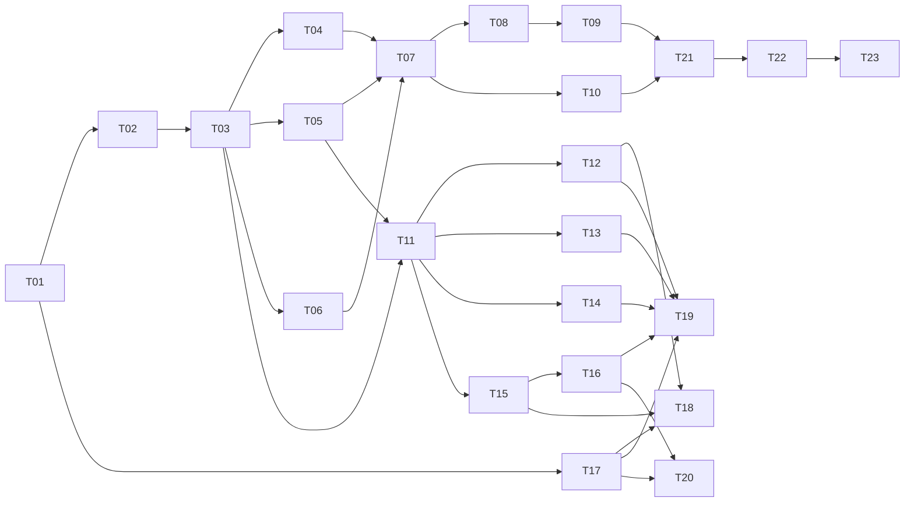

# 云枢 API · 任务卡总览与交付台账

> 本目录是**唯一派单入口**。需求真相源：`docs/_API 中转站 · 需求文档 V1.2.md`（下称 PRD）；技术真相源：`docs/技术架构设计文档 V1.2.md`（下称 TDS）。
> 任务卡只做三件事：**切边界、给硬约束、定验收**。任何与 PRD/TDS 冲突之处以源文档为准，并回头改卡。

| 项 | 值 |
| :--- | :--- |
| 需求基线 | PRD V1.2（2026-10-25） |
| 技术基线 | TDS V1.2（2026-10-25） |
| 任务卡版本 | T-1.0（2026-10-26） |
| 卡片总数 | 23 张（阶段 0–6） |
| 交付总监（需求拆分 / 派单 / 验收） | 齐活林（本会话主理人） |
| 实现方（按卡执行） | Claude Code（`claude_code_run`） |

---

## 一、协作机制（本项目已定，不再变动）

| 角色 | 职责 | 不做 |
| :--- | :--- | :--- |
| 交付总监（我） | 拆需求 → 出卡 → 派单 → 代码巡检 → 验收 → 打回/放行 | 不代写业务代码 |
| Claude Code | 按卡实现，跑通卡内自检命令，回填「完成回执」 | 不自行改需求、不擅自扩范围、不跳过自检 |

**一次只派一张卡**。上一张卡验收结论为「通过」后才派下一张；存在 `依赖` 未满足的卡不得提前派。

**验收三件事**（每卡必做，缺一不签）：

1. **交付物核对**：卡内「交付物清单」的每一条路径必须真实存在且承担其声明的职责；
2. **自检命令复跑**：卡内「自检命令」由我独立复跑，不采信 Claude 的转述；
3. **硬约束抽样**：从「硬约束」中抽 3 条以上做源码级对照（grep / 读文件），记录证据。

**打回格式**：`编号 + 证据（文件:行 / 命令输出）+ 期望`。无证据不受理，不接受「大致符合」。

**回执归档（2026-10-26 修正的流程缺陷）**：此前派单时要求实现方"不要把回执写进任务卡"，回执只留在本文件的验收记录里，导致**单看一张卡会以为卡没执行**。现行规则：
1. 实现方在最终答复里输出回执（不改卡）；
2. 交付总监验收后，把**实测结果 + 偏离 + 遗留**写入该卡末尾的「完成回执（已归档）」小节；
3. 本文件的验收记录只保留**总监视角的复核证据与裁定**，不重复卡内回执。

已按此补档：T01、T02、T03、T04、T05、T17、T18。后续每张卡验收通过即归档，不再积压。

---

## 二、关键技术决策（减少派单期反复问询）

| 编号 | 决策 | 依据 / 理由 | 影响卡 |
| :--- | :--- | :--- | :--- |
| D-01 | 本仓库为**全新实现**（当前仅有 docs + assets），但数据库迁移编号**严格沿用 TDS §8.6 裁定表**：创建 `0001`–`0006`、`0009`、`0010`–`0017`；`0007`/`0008` **永久预留不创建** | TDS §8.6 声明编号表为唯一真相源，且 0007/0008 已被 0006/0009 注释写死为 `t_model.enabled→listing_state` 的 Expand-Contract。全新建库无历史 `enabled` 列，故 `t_model` 直接以 `listing_state` 建表，两个号保持空置 | T02、T03 |
| D-02 | 接入层用 Go 标准库 `net/http` + `ServeMux`（Go 1.22+ 路由），**不引入 Gin**；业务层不绑任何 Web 框架 | TDS §0.2 / U-01 建议项；减少依赖面，SSE 用 `http.Flusher` + `ResponseController.SetWriteDeadline` 完全可控 | T07、T11 |
| D-03 | 协议转换层独立为可独立构建的 module：`relaykit/`（自带 `go.mod`），验证命令 `GOWORK=off go build ./...` | TDS ADR-002 | T07、T08 |
| D-04 | 前端：Vite + React 18 + TypeScript + Tailwind，**自研轻量组件**（不引 MUI/AntD），图表用 Recharts；**SPA，不做 SSR** | 设计 token 已由 PRD §1.4 与原型固化（`--primary:#4F46E5` 等），第三方主题库适配成本高于收益；SSR 非任何验收项 | T17–T20 |
| D-05 | 前端**禁止**把价格、限流额度、套餐数值写进 bundle，一律运行时经 API 拉取 | PRD 附录 D F1-2 / F1-3（bundle 中搜不到价格字面量） | T18、T19 |
| D-06 | 本地开发环境：`docker compose` 起 `mysql:8.0` + `redis:7`；**不实现 SQLite 单机模式** | 偏离 TDS GR-01 的「提供 SQLite 单机开发模式」。理由：账本 CAS 走 SQLite 串行化路径属第二套正确性实现，V1.0 无验收项依赖它，成本高于收益。列 Q-01 待确认 | T01、T02 |
| D-07 | 金额全链路 `bigint` 微积分（`MICRO_PER_CREDIT=10000`），唯一舍入点 `(tokens_in*p_in + tokens_out*p_out + 999) / 1000`；禁止 `float`/`double`/`decimal` 承载金额 | TDS §0 / §0.1 | T04、T10 |
| D-08 | 配置键共 **45** 个（TDS §3.7 正文写 34 是过期计数，见 errata E-07），命名空间归属按 TDS §3.7；`quota.overdraft_warn_days` 不归属任何命名空间、写入即 `config_value_invalid`；`/admin/config` 运行时可写白名单仅 12 个键 | TDS §3.7（2026-10-19 收口 + TA-1.1） | T05、T15 |
| D-09 | **前端展示结构以 `ref-frontend-structure.md` 为「参考」，不是规范**（对标 kmitu.com/products/llm-api）。区块与功能点仍以 PRD §4.1–§4.5 为基线：区块一条不能少、**顺序与形态可自行取舍**、不为"像参考站"新增区块或组件。参考站中与 PRD 冲突的元素（送现金/折扣/资质墙/调用排行/配置助手/代理入口）属**禁写项**，已列在该文档 §4–§5 | 用户 2026-10-26：「参考，不用照抄照搬」；禁写项本身来自 PRD 合规与范围条款 | T18（参考）、T19/T20（版式可选） |
| D-10 | **金额单位双轨**：账本与积分一律 `_micro`（微积分）；**支付金额用 `_fen`（分）**。T04 的「禁浮点/禁 decimal」检查不得把 `_fen` 判为违规 | `t_plan.price_fen` 按 TDS 定义即「分」；若统一写成微积分，"99 元"会变成 99000000，支付对账反而易错 | T02、T04、T13、T15 |
| D-13 | **执行顺序调整：T10 提到 T07 之前**。T10 是纯库（65 码 + 写出口 + 响应头 + SSE 错误帧），不依赖流水线；而 T07 的每个失败分支都要产出这些码。若按原图先做 T07，错误处理会先写一套临时实现、T10 再返工 | 依赖图原标 T10 依赖 T07，是把它当成"流水线的错误出口"；实际它是被流水线**消费**的库 | T10、T07 |
| D-12 | **幂等租约补列走方案 A**：新增迁移 `0020` 给 `t_idempotency_record` 加 `fence_token char(36)` + `lease_expires_at datetime(3)`（纯 Expand，只加不删，可回滚为 `DROP COLUMN`）；不做「用 `request_id` 当 fence」的凑合方案 | 幂等 fencing 的语义一旦凑合，后续排查「谁抢了租约」时无从下手；现在只是一条 DDL。编号超出 TDS §8.6 裁定表，已在 `docs/schema.md` 登记待回写 | T06（补正）、T07 |
| D-11 | **套餐发票/SLA 口径**（原 Q-06）：`invoice_supported` 付费三档（STANDARD / PRO / ENTERPRISE）= `1`，`TRIAL` / `FREE_DEFAULT` = `0`；`sla_text` 付费三档填「7×24 工单受理，不承诺可用性百分比」，其余为空串 | 开票是 PRD G-07 功能点，若五档全 0，定价页会渲染成"全部不支持发票"，与产品事实相反；但开票需实名且需实际支付，体验版与默认档无可开票金额 | T03（0018 种子）、T18（定价页展示） |

## 三、待确认事项（不阻塞派单，默认按右列执行）

| 编号 | 事项 | 默认执行 | 出现在 |
| :--- | :--- | :--- | :--- |
| Q-01 | 是否真需要 SQLite 单机开发模式 | 不实现（D-06） | T01 |
| Q-02 | 提现（PRD C9 分销代理） | V1.0 不做，接口不预留 | T13 |
| Q-03 | 税率口径 `pricing.tax_rate_multiplier` | 固定默认 `1.00`，代码标 `TODO(Finance)`，**不得**自行取税率 | T05、T13 |
| Q-04 | 逻辑专属对外文案 | 仅落 `i18n.DedicatedCopyPublic` 常量，标 `TODO(Legal)`，禁用词 CI 扫描 | T08、T22 |
| Q-05 | 参考站的「近 24h 调用排行」是否在 V2.0 引入 | V1.0 不做（需对外披露真实调用量，口径未定） | T18 |
| Q-06 | `t_plan` 的 `invoice_supported` / `sla_text` 各档取值 | ✅ **已裁定（2026-10-26）**：按 D-11 执行 | T03、T13、T18 |

## 三之二、参考文档

| 文档 | 用途 |
| :--- | :--- |
| [`ref-frontend-structure.md`](ref-frontend-structure.md) | 前端展示结构参考（对标 kmitu）：可选借鉴项、**不采纳清单**、禁写红线。**参考非规范**，T18 的区块与验收仍以 PRD 为准 |
| [`errata.md`](errata.md) | 源文档勘误登记（E-01 起）+ 金额单位/无上限等实现口径备忘。**回写 PRD/TDS 前，以本文件为执行依据** |

---

## 四、任务卡清单

状态图例：⬜ 未开始　🟨 进行中　🟦 待验收　✅ 通过　❌ 打回

### 阶段 0 · 工程基线

| 卡 | 标题 | 依赖 | 交付根 | 状态 |
| :--- | :--- | :--- | :--- | :--- |
| [T01](T01-工程基线与本地环境.md) | 工程基线与本地环境 | — | `go.mod`、`cmd/`、`internal/platform/`、`deploy/` | ✅ |

### 阶段 1 · 数据层

| 卡 | 标题 | 依赖 | 交付根 | 状态 |
| :--- | :--- | :--- | :--- | :--- |
| [T02](T02-迁移框架与核心Schema.md) | 迁移框架与核心 Schema（0001–0006、0009） | T01 | `internal/platform/migrate/` | ✅ |
| [T03](T03-幂等与增量迁移.md) | 幂等与增量迁移（0010–0017）+ 配置种子 | T02 | `internal/platform/migrate/sql/mysql/` | ⬜ |

### 阶段 2 · 核心域

| 卡 | 标题 | 依赖 | 交付根 | 状态 |
| :--- | :--- | :--- | :--- | :--- |
| [T04](T04-账本与计费内核.md) | 账本与计费内核 | T03 | `internal/ledger/`、`internal/billing/` | ⬜ |
| [T05](T05-配置快照与策略注册表.md) | 配置快照与策略注册表 | T03 | `internal/config/` | ⬜ |
| [T06](T06-Redis键空间与四维限流.md) | Redis 键空间与四维限流 | T03 | `internal/redisx/`、`internal/ratelimit/` | ⬜ |

### 阶段 3 · 网关数据面

| 卡 | 标题 | 依赖 | 交付根 | 状态 |
| :--- | :--- | :--- | :--- | :--- |
| [T07](T07-网关流水线P01-P14.md) | 网关流水线 P01–P14 | T04,T05,T06 | `cmd/gatewayd/`、`internal/gw/` | ⬜ |
| [T08](T08-上游分发与SSE转发.md) | 上游分发·协议转换·SSE（P15–P25） | T07 | `relaykit/`、`internal/dispatch/` | ⬜ |
| [T09](T09-结算清算与对账.md) | 结算清算与对账（P26–P31 + jobsd） | T08 | `internal/settle/`、`cmd/jobsd/` | ⬜ |
| [T10](T10-错误码与响应契约.md) | 错误码与响应契约（65 码） | —（**已前移到 T07 之前**） | `internal/apierr/` | ✅ |

### 阶段 4 · 控制面

| 卡 | 标题 | 依赖 | 交付根 | 状态 |
| :--- | :--- | :--- | :--- | :--- |
| [T11](T11-控制面骨架与RBAC.md) | 控制面骨架·会话鉴权·RBAC | T03,T05 | `cmd/controld/`、`internal/control/` | ⬜ |
| [T12](T12-用户密钥与模型域API.md) | 用户 / 密钥 / 模型域 API | T11 | `internal/control/user/`、`.../key/`、`.../model/` | ⬜ |
| [T13](T13-资金域API.md) | 资金域 API（订单/退款/发票/提额/套餐） | T11,T04 | `internal/control/fund/` | ⬜ |
| [T14](T14-用量账单与日志API.md) | 用量·账单·请求日志 API | T11 | `internal/control/usage/` | ⬜ |
| [T15](T15-运营后台API.md) | 运营后台 API（渠道/模型/定价/分组/公告/风控） | T11,T05 | `internal/control/ops/` | ⬜ |
| [T16](T16-工单审核与模型主数据API.md) | 工单·审核中心·模型主数据 API | T15 | `internal/control/ticket/`、`.../review/` | ⬜ |

### 阶段 5 · 前端

| 卡 | 标题 | 依赖 | 交付根 | 状态 |
| :--- | :--- | :--- | :--- | :--- |
| [T17](T17-前端基线与设计系统.md) | 前端基线·设计系统·品牌资产 | T01 | `web/` | ✅ |
| [T18](T18-官网5页.md) | 官网 5 页 | T17,T12,T15 | `web/src/pages/site/` | ⬜ |
| [T19](T19-控制台9页.md) | 控制台 9 页 | T17,T12,T13,T14,T16 | `web/src/pages/console/` | ⬜ |
| [T20](T20-运营后台8页.md) | 运营后台 8 页 | T17,T15,T16 | `web/src/pages/admin/` | ⬜ |

### 阶段 6 · 质量与交付

| 卡 | 标题 | 依赖 | 交付根 | 状态 |
| :--- | :--- | :--- | :--- | :--- |
| [T21](T21-测试与CI.md) | 测试与 CI（14 条必进 CI + G-01–G-12） | T09,T10,T12–T16 | `**/*_test.go`、`.github/workflows/` | ⬜ |
| [T22](T22-部署与可观测.md) | 部署·可观测·灰度回滚 | T09,T21 | `deploy/`、`internal/obs/` | ⬜ |
| [T23](T23-验收对照与交付.md) | 验收对照与交付（82 项功能点） | 全部 | `docs/tasks/acceptance/` | ⬜ |

---

## 五、依赖图

**关键路径**：T01 → T02 → T03 → T04 → T07 → T08 → T09 → T21 → T22 → T23。
**可加速点**：T05/T06 与 T04 并行；T11 可在 T04 完成后与 T07 并行；T17 可在 T01 后立即并行。

---

## 六、验收矩阵（PRD 附录 D → 卡片）

| 需求组 | 功能点 | 主要落点 | 验收卡 |
| :--- | :--- | :--- | :--- |
| 官网首页 / 定价 / 文档 / 工具集成 | F1-1–F1-7、F2-1–F2-2、F3-1–F3-3、F4-1–F4-5 | `web/src/pages/site/` | T18 |
| 控制台概览 / 密钥 / 密钥详情 / 模型广场 | F5-2–F5-3、F6-1–F6-7、F7-1–F7-4、F8-1–F8-4 | `internal/control/{key,model}` + `pages/console` | T12、T19 |
| 用量账单 / 充值 / 日志 / 调试台 | F5-1、F9-1–F9-3、F10-1–F10-5、F11-1–F11-3、F12-1–F12-3 | `{fund,usage}` + 网关 | T13、T14、T19 |
| 运营：渠道 / 定价 / 公告 / 风控 | F14-1–F14-6、F16-1–F16-7、F17-1–F17-3 | `internal/control/ops` | T15、T20 |
| 工单 / 审核中心 / 模型主数据 | F19-1–F19-4、F20-1–F20-4、F21-1–F21-3、F22-1–F22-6 | `{ticket,review}` | T16、T19、T20 |
| 资金与对外承诺 GWT | G-01–G-12 | `ledger`/`billing`/`ratelimit`/`apierr` | T04、T06、T10、T21 |
| 接口契约 | TDS §6.1（8 接口）、§6.2（65 错误码） | `internal/gw`、`apierr` | T07、T10 |
| 非功能 / 合规 | PRD §9、§10；TDS §8 | `obs`、`deploy`、风险任务 | T21、T22 |

---

## 七、进度台账（每次验收后更新本表 + 卡片状态）

| 卡 | 派单时间 | 交付时间 | 验收结论 | 遗留问题 | 备注 |
| :--- | :--- | :--- | :--- | :--- | :--- |
| T01 | 2026-10-26 | 2026-10-26 | ⚠️ **有条件通过** | 2 项环境债（已清零） | 工程约定基线；详见下方记录 |
| T17 | 2026-10-26 | 2026-10-26 | ✅ **通过** | 4 项非阻塞 | 前端基线；186 turns / 1149s / $11.37 |
| T02 | 2026-10-26 | 2026-10-26 | ⚠️ **有条件通过** | 3 项（1 项须在 T03 内处理） | 47 张表 + 迁移引擎；55 turns / 294s / $3.84 |
| T18 | 2026-10-26 | 2026-10-26 | ⚠️ **有条件通过** | 4 项（均非阻塞） | 官网 5 页 + 预览数据层；213 turns / 1365s / $18.13 |
| T03 | 2026-10-26 | 2026-10-26 | ✅ **通过**（含一次返工） | 3 项非阻塞 | 17 迁移 / 54 业务表 / 45 键；107+33 turns / 567s / $8.77 |
| T04 | 2026-10-26 | 2026-10-26 | ✅ **通过** | 4 项非阻塞 | 账本与计费内核；169 turns / 1392s / $25.24 |
| T05 | 2026-10-26 | 2026-10-26 | ✅ **通过** | 3 项非阻塞 | 配置快照与策略注册表；115 turns / 1093s / $12.92 |
| T06 | 2026-10-26 | 2026-10-26 | ✅ **通过**（两轮补正） | 5 项（1 项须 T07 前决） | 26 键 + 四维限流；103+32+16 turns / 1117s / $12.59 |
| — | 2026-10-26 | 2026-10-26 | ✅ 0020 幂等租约（D-12） | — | 补 fence_token/lease_expires_at；18 条迁移 |
| T10 | 2026-10-26 | 2026-10-26 | ✅ **通过** | 4 项非阻塞 | 65 码 + 写出口；84 turns / 633s / $6.74 |

### T01 验收记录（交付总监独立复核，2026-10-26）

**复核方式**：不采信实现方转述，独立复跑编译/测试/静态断言 + 源码级抽查探针语义。

| 复核项 | 结果 | 证据 |
| :--- | :--- | :--- |
| 交付物 17 项存在性 | ✅ | `go.mod`、`Makefile`、`.env.example`、`cmd/{gatewayd,controld,jobsd}/main.go`、`deploy/{docker-compose.yml,README.md,mysql/}` 均在 |
| `go build ./...` | ✅ | 零错误 |
| `go vet ./...` | ✅ | 零告警 |
| `go test ./...` | ✅ | health / log / db / env / httpsrv 五个包全绿 |
| `encoding/json` 隔离 | ✅ | grep 为空，仅 `internal/jsonx` 导入 |
| `QuantumNous` | ✅ | grep 为空（AGPL 合规） |
| `context.Background()` | ✅ | 仅 3 处，均在 `cmd/*/main.go` 进程根，无请求路径 |
| `time.Now()` 单一入口 | ✅ | 仅 `internal/platform/clock/clock.go:17`，返回 UTC |
| `/healthz` 不探测依赖 | ✅ | `health.go` 中 `Healthz` 方法体仅写 `{"status":"ok"}`，注释写明 "must never inspect r.checks" |
| `/readyz` 并发探测 + 503 | ✅ | 逐 check 超时、`down` 汇总、drain 时门闸置 false |
| compose 镜像与排序规则 | ✅ | `mysql:8.0` + `--collation-server=utf8mb4_0900_as_cs`；`redis:7` + AOF everysec；端口 3306/6379 |

**判定为「有条件通过」的三项**：

| # | 项 | 性质 | 处置 |
| :--- | :--- | :--- | :--- |
| 1 | 本机无 GNU `make`，`make up` / `make check` 未逐字执行 | 环境 | ✅ **已解决（2026-10-26）**：新增 `scripts/dev.sh` 作为 Makefile 的等价入口（`up/down/ps/env/check/migrate/run-*`），T02 已用它跑通全部自检；Makefile 保留 |
| 2 | 宿主机 3306/6379 被本机 MySQL 8.4 与其他容器占用，`docker compose up` 本机会端口冲突 | 环境 | ✅ **已解决（2026-10-26）**：新增 `deploy/docker-compose.portmap.yml`（`ports: !override` → 13306/16379），`dev.sh up` 自动探测并套用；实测 MySQL 8.0.46 healthy、`/readyz` 三依赖全 ok。基础 compose 仍为 3306/6379，未改用本机 8.4 |
| 3 | 实现方自报的「gatewayd `/readyz` 与 TDS §5.4 有差异」 | 误判 | **已驳回该偏离登记**：TDS §6.1 API-07 明确 `/readyz` 返回 `checks:{redis,mysql,config}`，本卡实现与文档一致，非偏离 |

**复核中追加的一条正向发现**：实现方主动报告「本机默认 go1.27.1 有 7 条标准库可达漏洞，go1.27.3 下为 0」，并只在 `GOTOOLCHAIN` 下验证、未擅改系统 Go。该处理正确，已纳入 T22 的发布前置条件（CI 固定 go1.27.3+）。

### T17 验收记录（交付总监独立复核，2026-10-26）

| 复核项 | 结果 | 证据 |
| :--- | :--- | :--- |
| 工程可构建 | ✅ | `npm ci` 308 包；`npx tsc --noEmit` 0 错误；`npm run build` 3.87s 成功 |
| 单测 | ✅ | 3 个测试文件 / 9 个用例全绿（Table 3、Modal 1、format 5） |
| 路由 22 条 | ✅ | `grep -oE "path: '[^']*'"` 计 22 条，含 `/console/keys/:id` 与 8 条后台路由 |
| 品牌名规范 | ✅ | `grep -rE "云枢API\|云枢api\|云枢_API" src` 为空 |
| `<head>` 四声明 | ✅ | `index.html` 第 11–14 行：favicon.svg / favicon-32 / apple-touch-icon / `theme-color #4F46E5` |
| bundle 无价格字面量 | ✅ | `dist/assets/*.js` 扫描为空；`vite.config.ts` 另有构建期 `assertNoPricingLiterals` 门禁 |
| 无裸色值 | ✅ | 仅 `tokens.css` 与 SVG 命中 |
| 页面无二次换算 | ✅ | `grep -rn "/ 100" src/pages` 为空；换算单点在 `lib/format.ts` |
| Logo 自托管 | ✅ | `web/public/assets/logo/{svg,png}/` 齐备，与 `assets/logo/` 逐文件 `cmp` 一致；无 CDN/base64 |
| 换算单测 | ✅ | `12345 积分 → 123.45 元`、`1500 微积分 → 0.15 积分` |
| i18n 法务占位 | ✅ | `DedicatedCopyPublic` + `TODO(Legal)` 齐备 |
| 首屏体积 | ✅ | 入口 gzip 9.50 KB，初始 payload 89.14 KB（阈值 300 KB） |

**两条需要我认账的事**：

| # | 事项 | 性质 | 处置 |
| :--- | :--- | :--- | :--- |
| 1 | 本卡 §3「环境事实」原写「5 个 SVG 缺失」——**实为误判**，成因是我首次盘点用了 `ls -R \| head -40`，输出截断在 `svg/` 之前；`git log` 证实 7 个文件在初始提交 `8facf7d` 即存在 | 我的错误 | 已在 T17 卡片 §3 顶部加**勘误块**（保留原文 + 修正说明），并把 A12 与交付物第 13 项从「补齐 5 个」改为「核验 6 个变体 + 偏差修正」。实现方发现并纠正了此误判，记一次正向 |
| 2 | 派单提示词里我把渐变写成 `#6366F1 → #4F46E5`——**PRD 第 94/117/426 行明确是 `145deg #5B52F0 → #3B32C9`**，`#4F46E5` 仅是主色与 `theme-color` | 我的派单错误 | 实现方按 PRD 执行并当场报回，处理正确。已把该端点写进 T17 §3 环境事实，防止再错 |

**四项遗留（均不阻塞 T18–T20）**：① 逐页服务端权限校验待各接口接入时落地；② `api/openapi.yaml` 仅为最小骨架，待 T11 后端契约扩充后 `npm run gen:api` 重生成；③ `Recharts` 已封装但页面骨架未引用，charts chunk 待 T19 接入；④ 仓库尚无 CI 配置，`npm run verify` 需在 T21 接入流水线。

### T02 验收记录（交付总监独立复核，2026-10-26）

| 复核项 | 结果 | 证据 |
| :--- | :--- | :--- |
| 迁移清单 | ✅ | `ls sql/mysql/` 14 个文件 = 7 组 up/down；`0007`/`0008` 未创建 |
| `schema_migrations` | ✅ | 7 行（0001–0006、0009），全部 `APPLIED / CHECKSUM MATCH` |
| 业务表数 | ✅ **47** | `information_schema` 计 48，减去 `schema_migrations`；与 §4 逐表清单 `8+11+26+2` 一致 |
| 排序规则 | ✅ | 47 张表 collation 例外数 = 0（全 `utf8mb4_0900_as_cs`） |
| 账本三唯一键 | ✅ | `PRIMARY(id)` / `uk_le_idem` / `uk_le_entry_no`，**均不含 `created_at`** |
| 禁用项 | ✅ | `timestamp` 0 命中、`FOREIGN KEY` 0 命中；`decimal` 仅 `success_rate` 一处 |
| 种子数值 | ✅ | TRIAL 0/0/7000、STANDARD 99/9900/2000、PRO 299/29900/9000、ENTER 999/99900/40000；RPM/TPM/并发/日额度逐列与 PRD §3.2.1 一致；`FREE_DEFAULT` 日额度 `NULL` |
| 中文数据 | ✅ | `t_plan.name` 读出「体验版/标准版/专业版/企业版/默认档」，无乱码（此前显示 `???` 是控制台字符集问题） |
| up/down 对称 | ✅ | 8/8、11/11、26/26、2/2 张表成对 |
| 引擎测试 | ✅ | 28 个 `RUN/PASS` 事件（14 条用例）0 失败；`go build`/`go vet` 全绿 |
| 两条防回归 | ✅ | checksum 篡改报错退出码 1；重复版本号报错文案含两个文件名，探针已清理 |

**必须认账的一条**：表数 46 是**我卡片的算术错误**（心算 `8+11+26+2` 时漏了 `t_config_publish`，该表 TDS §1.8 有定义、§1.2 分层清单未收录）。实现方发现后**没有删表凑数**，原样交付并报回，处置正确。已修卡（§1 与 A2 改为 47）并登记 E-05。

**三项遗留**：

| # | 项 | 处置 |
| :--- | :--- | :--- |
| 1 | `t_rate_limit_policy.daily_quota_micro` 仍是 `NOT NULL DEFAULT 0`，与 T03 的 A8（期望 `NULL`）冲突 | **已写入 T03 硬约束 15**：0018 内补 ALTER，`NULL` 为唯一「无上限」编码（E-04） |
| 2 | `t_plan.stackable=0`（TDS 注释「同档不可重复购买」）与 PRD「允许重复购买」相反 | 已登记 E-02，并在 T03 硬约束 16 明确 **T13 不得用该列拦单** |
| 3 | `invoice_supported` 全 0、`sla_text` 空串 → 定价页会显示"全部不支持发票" | 已登记 **Q-06**，待产品确认各档取值；T18 前需有结论 |

另：账本账号的 `UPDATE`/`DELETE` 权限未落（本机只有 root），已按卡内要求留到 T22 部署阶段。

### T18 验收记录（交付总监独立复核，2026-10-26）

| 复核项 | 结果 | 证据 |
| :--- | :--- | :--- |
| 五页交付 | ✅ | `pages/site/{Landing,Pricing,Docs,Login,Integrations}Page.tsx`；`components/site/` 15 个组件 |
| 类型检查 | ✅ | `npx tsc --noEmit` 0 错误 |
| 单测 | ✅ | 19 个测试文件 / **63 个用例**全绿（含 F4-2 安全用例） |
| 构建 | ✅ | `npm run build` 6.85s 通过；两道构建门禁（`assertNoPricingLiterals` / `assertNoFixtures`）生效 |
| 页面可访问 | ✅ | `/`、`/pricing`、`/docs`、`/integrations`、`/login` 均 200 |
| 禁写项 | ✅ | `代理\|加盟\|许可证\|折\|送…元` 在 `pages/site` 为 0 命中 |
| 无二次换算 | ✅ | `grep -rn "/ 100" src/pages` 为空 |
| 品牌名 | ✅ | `云枢API\|云枢api\|云枢_API` 为空 |
| bundle 无价格字面量 | ✅ | `dist/assets/*.js` 0 命中 |
| fixtures 未入产物 | ✅ | `dist` 中无 fixture 标记 |

**四处遗留（均非阻塞）**：

| # | 项 | 处置 |
| :--- | :--- | :--- |
| 1 | PRD 表里 Hero 要求「在线渠道数 / 模型数 / 成功率」，但公开健康检查与成功率 API 都还没实现 | 实现方按 F1-4 不编造状态，改为「已上架模型 / 接入线路 / 兼容协议」。**接受**——写假成功率比不写更糟；渠道数与成功率待 T15/T22 有数据后回填 |
| 2 | 文档页实际显示 8 章（fixtures 无 LISTED 图像模型，第 5 章按 PRD §4.3 条件隐藏） | **正确行为**，非缺陷；单测用合成图像模型覆盖了 9 章状态 |
| 3 | 新增两个假定契约：`/api/public/integration-links`、`/api/v1/integrations/import-credentials`，尚未进 `api/openapi.yaml` | T11/T15 落地时并入契约；深链模板需按客户端真实格式核对（现有为 fixture 样例） |
| 4 | 我卡内 §4.19 原写「10 万体验积分」 | **是我的错误**：PRD 第 1510 行已定档 **7,000**，并明确「原 10 万口径作废」；10 万只残留在附录 E.1 的错误码 hint 里。已修卡并登记 **E-06**；实现方按 7,000 渲染并主动报回 |

**预览机制（本卡新增，供后续卡复用）**：`web/src/fixtures/` + `VITE_USE_FIXTURES=1`，仅开发态生效；生产构建由 `assertNoFixtures` 断言剔除。这样后端接口未就绪时也能看完整页面，且不会把假数据带进产物。

**本地预览**：`cd web && VITE_USE_FIXTURES=1 npx vite --port 5180`，访问 `http://127.0.0.1:5180/`。

### T03 验收记录（交付总监独立复核，2026-10-26）

**一次返工**：首轮交付 34 个配置键（TDS 正文写「34 个键」），复核时发现 TDS §3.7 **键表实际有 45 个唯一键**（正文计数过期，E-07）。已要求补 11 键并重建本地库，第二轮通过。

| 复核项 | 结果 | 证据 |
| :--- | :--- | :--- |
| 迁移条数 | ✅ 17 | `schema_migrations` 17 行；`0007/0008` 仍未占用；文件 34 个（17 up + 17 down） |
| 业务表 | ✅ 54 | `information_schema` 55（含 `schema_migrations`） |
| 配置键 | ✅ **45** | PRICING 21 / UPSTREAM 9 / FEATURE 8 / RATELIMIT 6 / UNASSIGNED 1 = 45 |
| 关键键抽检 | ✅ | `gw.stream_first_byte_ms=30000`（E-01 执行值）、`gw.retry_threshold_ms={"unary":65000,"stream":45000}`、`billing.prestimate_safety_bp=11000`、`quota.free_max_active_keys=3`、`site.recommend_limit=8` |
| 幂等 Contract | ✅ | `SHOW INDEX` 仅 `PRIMARY` + `uk_idem_key`，**无 `uk_idem`**；`api_key_id NOT NULL DEFAULT 0` |
| `0013` 不可回滚 | ✅ | 直接执行 down → `ERROR 1644 (45000) 0013 不可回滚，只能前滚`，退出码 1 |
| 分组三档 | ✅ | `internal=0` / `contract=8500` / `standard=10000`；`internal` 的 remark 写明「不计费」 |
| 限流五档 | ✅ | 与 PRD §3.2.1 逐列一致；`FREE_DEFAULT` 日额度 **NULL**（E-04 落实） |
| 发票口径 | ✅ | `t_plan.invoice_supported` = TRIAL 0 / STANDARD 1 / PRO 1 / ENTERPRISE 1 / FREE 0；付费三档 `sla_text` 长度 48（D-11 落实） |
| 新增 7 表 | ✅ | `t_arrears`、`t_ticket`、`t_ticket_reply`、`t_review_task`、`t_upstream_bill`、`t_channel_dedicated_user`、`t_content_policy_hit` 均在 |
| 本地种子 | ✅ | 1 渠道 / 2 模型 / 2 路由 / 2 价目（`ENV=local` 生效） |
| 迁移测试 | ✅ | `go test ./internal/platform/migrate/...` 全绿，条数断言 17 |

**三处需要记住的事**：

| # | 项 | 处置 |
| :--- | :--- | :--- |
| 1 | TDS §3.7 正文「34 个键」与键表「45 个」不一致 | 登记 **E-07**；同时发现 `idem.*` 与 `site.*` 两组前缀在命名空间归属表里**没有归属**，裁定归 `FEATURE`，登记 **E-08** |
| 2 | 我卡内 A6/A14 要求「全量 down 到空库」，与 `0013` 不可回滚**自相矛盾** | 已修卡：A6 限定在未应用 `0013` 的库上验；A14 改为「`0013` 之后重建走 DROP DATABASE → up」 |
| 3 | `0018` 已应用后 checksum 锁定，改种子只能重建库 | 本轮已用「DROP 两个 schema → `ENV=local migrate up`」重建并验证；后续若再改 `0018` 需同样操作 |

**三项遗留（非阻塞）**：① `t_review_task` 的 `CANCELLED` / 发票 `ISSUED` / 退款 `REFUNDED` 等状态落在哪张表待 T16 裁定；② `t_upstream_bill` 唯一键取 `(channel_id, bill_period, bill_no)`，待对账任务确认；③ `t_protocol` 只 seed 3 条，TDS 初始 4 行含 `CUSTOM(enabled=0)`，V1.0 不接线，留待 T15 补。

### T04 验收记录（交付总监独立复核，2026-10-26）

资金内核，按最严口径验收：**每条 GWT 都自己跑一遍并核对断言值**，不接受"测试通过"四个字。

| 复核项 | 结果 | 证据 |
| :--- | :--- | :--- |
| 构建与静态检查 | ✅ | `go build` / `go vet` 全绿；`gofmt` 干净 |
| 单测 | ✅ | `ledger` 85.4% 覆盖、`billing` 83.6%，全 PASS |
| **竞态检测** | ✅ | 本机无 gcc 无法跑 `-race`，改用容器补跑：`golang:1.24` + `CGO_ENABLED=1`，`TEST_DB_DSN` 指向宿主 13306 → **两包 -race 均 PASS** |
| **G-02 准入** | ✅ | `Admit(6000,6500)=true`、`Admit(7200,6500)=false` → 证明准入看 `raw_est` |
| **G-02 预扣额** | ✅ **3250** | `min(est 7200, 6500×50%) = 3250`；**我卡片原写 3600 是错的**，见下 |
| **G-02 截断** | ✅ | 成本 2,000,000 → 扣 900,000、欠费 1,100,000、余额 −500,000、置 `FROZEN_OVERDRAFT`；充值 2,000,000 → 抵扣 1,100,000、余额 400,000、回 `NORMAL` |
| **G-04 可退** | ✅ | 可退 7,900 积分；退款 **7,110 分（71.10 元）**、手续费 790 分；退后充值批次剩 0、赠送剩 1,000 积分 |
| **G-01 精度** | ✅ | `CostMicro(1200,800,1500,4500)=5400`；0.15 积分/千 token × 1000 tok = 1500 micro |
| **批次顺序** | ✅ | 3 条 DEBIT 流水 batch 850/851/852，`SUM=-3000`，余额归零 |
| **并发不超扣** | ✅ | 余额 1000、两笔 600 并发 → 仅 1 笔成功，余额 400 |
| **地板** | ✅ | `std=1000, ratio=8500, cost=600` 通过（850≥800）；`cost=800` 拒绝，`shortfall=217`；`ratio=0` 跳过；`cost=nil` 返回 `MissingCost` |
| 领域层无基础设施依赖 | ✅ | `grep net/http|redisx|internal/gw` 为空 |
| 唯一舍入点 | ✅ | `999` 仅在 `billing/cost.go` 的 3 行（2 注释 + 1 公式） |
| 无浮点 / 用 clock | ✅ | `float32|float64|decimal` 与 `time.Now()` 均 0 命中 |

**三处文档矛盾（这轮又挖出两个，含一个 100 倍金额错）**：

| 编号 | 冲突 | 裁定 |
| :--- | :--- | :--- |
| 我的错 | T04 卡 A3 写「hold==3600（=6500×50%）」 | 6500×50% 是 **3250**，3600 是 `est×50%`。按 PRD「预扣 ≤ 可用余额×50%」取 **3250**。实现方坚持 3250 并报回，**做对了**。卡已修 |
| **E-09** | TDS §1.5 写 `refund_fen = apply_micro × 9/1000`，并称「1 积分 = 100 分」 | 该换算自相矛盾（1 元 = 100 积分 = 100 分 ⇒ 1 积分 = 1 分）。按其公式 7,900 积分要退 **7,110 元**，PRD G-04 要求 **71.10 元**，差 100 倍。**按 PRD**：`× 9/100000` |
| **E-10** | PRD G-04 Then 第 3 条括注「余额中剩余的 2,000 充值积分」 | 与同条 Given（充值剩 7,900、退 7,900）矛盾，退完应剩 0。**以 Given 为准**：退后充值剩 0、赠送剩 1,000 |

**四项遗留（非阻塞）**：① 真实 tokenizer 未绑定，`billing.InputCounter` 留了注入缝，T07 提供实现；② `long_ctx_prehold_guard_bp` 的取阶梯价策略属 T07 编排；③ 冻结退款与透支并存的批次不变量边界未覆盖，T13 补；④ `t_recharge_order` 的 `REFUNDED/PARTIAL_REFUNDED` 流转属 T13（T04 只把退款单置 `PAID`）。

**环境事项**：本机缺 C 编译器 → `go test -race` 不可用。已用容器验证通过，并据此在 T21/T22 要求 **CI 与发布构建必须在 Linux 环境跑 `-race`**。

### T05 验收记录（交付总监独立复核，2026-10-26）

| 复核项 | 结果 | 证据 |
| :--- | :--- | :--- |
| 键数 | ✅ **45** | `KeyCount=45`，测试与 `t_config_item` 种子逐键比对通过 |
| 运行时白名单 | ✅ 12 | `RuntimeKeyCount=12`；`quota.overdraft_warn_days`、`pricing.cache_billing_enabled`、`gw.retry_max`、`pricing.min_margin_bp` 写入均被拒 |
| 架构方向 | ✅ | `go list -deps ./internal/config` 中无 `internal/{gw,ledger,control,redisx}` —— 注册方向未倒转 |
| 键字面量 | ✅ | 除 `key.go` 外全仓无 `"billing./pricing./quota./gw./..."` 字面量 |
| 单测 | ✅ | 79.7% 覆盖，全 PASS |
| **竞态** | ✅ | 容器内 `-race` 跑 `config` + `ledger` 两包均 PASS |
| 版本偏斜 | ✅ | 「新 `cfg:ver` + 旧快照」→ 重拉 3 次后回退旧指针、打 WARN、不崩 |
| 30s 兜底 | ✅ | 订阅失败 / 收不到消息时，轮询仍使版本生效 |
| 快照不可变 | ✅ | 全私有字段 + `atomic.Pointer`；读路径 bench `22.66 ns/op`、**0 allocs** |
| 体积上限 | ✅ | 256 KB 恰好拒绝、少 1 字节接受；超限时在碰 DB/Redis 前就报错 |
| K19 只存标准价 | ✅ | `TestPriceCacheStoresStandardPriceOnly` |
| 税率默认锁定 | ✅ | 改 `pricing.tax_rate_multiplier` 默认值测试即失败（`TODO(Finance)` 在位） |
| Redis 隔离 | ✅ | 测试用 DB 15 并 `FLUSHDB`，本地开发态 DB 0 的 `cfg:*` 未被污染 |

**实现方额外加的两道防护（超出卡片要求，我认可）**：① 发布时用 MySQL `GET_LOCK('yunshu:config_publish')` 串行化多副本发布；② 首次发布时若 `cfg:ver` 低于种子行版本，先把基线修到 DB 最大版本再 `INCR`——否则「首次发布版本号 1 == 已装载版本 1」会让节点跳过新快照。

**三项遗留**：

| # | 项 | 处置 |
| :--- | :--- | :--- |
| 1 | `StartupCheck` / `Watcher.Run` **未接入 `cmd/*/main.go`** | 是我划的边界（本卡只做 `internal/config`）。启动期门禁已在库层验证；**T07 必须在监听器启动前调用 `config.StartupCheck` 并起 `Watcher`**，已写入 T07 待办 |
| 2 | 8 个策略族的内置实现未接入 T04 账本 | 行为等价（V1 各只有一档），T04 未改动。若后续要真正切换实现，由业务包 `init()` 注册 |
| 3 | 只装载 `scope='GLOBAL'`，`CHANNEL`/`USER` 覆盖行留待后续 | 与 TDS §1.8 的 Expand-Contract 顺序一致，非缺陷 |

**一个口径提醒**：TDS 把 `pricing.tier_chain` / `pricing.group_switch_mode` 标为 C3，卡内要求纳入 C2 注册表。按卡执行（两者 V1 均单一取值，行为等价），不另开例外。

### T06 验收记录（交付总监独立复核，2026-10-26）

| 复核项 | 结果 | 证据 |
| :--- | :--- | :--- |
| 键空间 | ✅ | K1–K26 构造函数齐备；`maxmemory-policy=noeviction` 启动自检 |
| 命令能力边界 | ✅ | 无 `XAUTOCLAIM`/`FUNCTION`/`GETDEL`/`GETEX`；`ZADD` 无 `GT/LT/NX` |
| L1 判定 | ✅ | 次序 清租约→读四维→并发>RPM>TPM>日额度→ZADD 先再写计数 |
| **判定与报码分离** | ✅ | 四维全满：`[2]=concurrency_limit_exceeded`、`OutwardCode()=daily_quota_exceeded`、`[3..5]=1000/700/300`、`[6]=[8]=` 次日 00:00 |
| 平手一致 | ✅ | 23:59:30 与分钟末尾两种平手场景，slots 与对外码同维度 |
| TPM 五条 | ✅ | 占位 1000→800；跨分钟不补偿；桶过期不重建；无 usage 按「已输出+预估输入」=300 |
| fail-close | ✅ | 停 Redis → `rate_limiter_unavailable`，**不是放行** |
| 并发降级 | ✅ | `perKeyLocal=ceil(10/3)=4`，K1/K2 仍 Redis |
| 日额度 TTL | ✅ | 23:00 → **00:10** 过期（E-11 修正后） |
| K26 | ✅ | 只有 `DEL` |
| 覆盖率 | ✅ | ratelimit 68.5 / lock 91.7 / logq 84.0 / balance 82.8 / idem 77.4 / breaker 75.3 / redisx 77.1 |
| **竞态** | ✅ | 容器内 `-race` 七个包全部 PASS |

**两轮补正（都是我发现的真缺陷，不是收尾优化）**

| 轮 | 缺陷 | 后果 |
| :--- | :--- | :--- |
| 1 | 日额度 TTL 按字面算成 00:20（TDS K4 与 L2 注释相差 10 分钟，E-11） | 跨日补偿窗口多 10 分钟，与对账口径不一致 |
| 1 | `[3]`–`[6]` 描述的是"优先级首个触顶维度"（并发 `+3s`），而对外码是日额度 | 客户端看到「日额度超了，3 秒后重试」→ **必然再被拒**，正是 PRD §3.3 要避免的（E-13） |
| 2 | Lua 平手取先评估者、Go 取日额度，两套规则不一致 | 23:59 那一分钟 / 每分钟最后 3 秒，响应体里的 `reset_at` 与 `code` 指向不同维度 |

**五项遗留**，其中第 2 项会挡住 T07：

| # | 项 | 处置 |
| :--- | :--- | :--- |
| 1 | L1 的 ARGV 由 10 个扩到 14 个 | 8 下标返回不变，可接受 |
| 2 | **幂等 DB 适配器缺列**：`t_idempotency_record` 无 `fence_token` / `lease_expires_at` | ✅ **已解决（D-12 方案 A）**：`0020` 补两列 + `internal/idemstore/mysql.go` 适配器。库内 18 条迁移；并发抢锁/租约过期换 fence/同键异体复用/完成回放/DB 写失败不放行 五条用例全绿。另把租约过期判定从 `NOW(3)` 改为 `UTC_TIMESTAMP(3)`，不再依赖会话时区 |
| 3 | `ratelimit.degrade.mode` 不是 45 键之一（E-12） | 暂由构造参数注入，T07 读启动参数 |
| 4 | 限流与配置测试共用 Redis DB 15 | CI 需 `-p 1` 或分库 |
| 5 | 指标 `dim` 取 `[2]` 而非对外维度 | 四维全满时指标与响应体不一致，**T10/T22 裁定** |

### T10 验收记录（交付总监独立复核，2026-10-26）

按 D-13 前移到 T07 之前执行：T10 是纯库，T07 的每个失败分支都要消费它。

| 复核项 | 结果 | 证据 |
| :--- | :--- | :--- |
| 码数 | ✅ **65** | 临时用例打印 `specs=65 codes=65` |
| 关键码状态 | ✅ | `invalid_api_key`/`key_expired` 均 401 但是两个码；`model_not_available`/`upstream_capacity_exceeded` 均 **503**；`insufficient_credits`/`account_frozen_due_to_overdraft` 均 402 |
| 402 头体一致 | ✅ | 头 `X-Credits-Remaining: -12.34` = 体 `remaining: -12.34` |
| 429 语义 | ✅ | 四维全满 → `code=daily_quota_exceeded`、`limit/remaining/reset_at` 同维度、`message` 列出其余三维 |
| SSE 错误帧 | ✅ | `event: error` + `credits_consumed`；流式头无 `X-Credits-Consumed` |
| `request_id` 兜底 | ✅ | 头体同值、UUIDv7 形态、写回结构体；注入 CR/LF 或超长值会重新生成 |
| 泄露 | ✅ | 上游 URL/Key/SQL/堆栈在体、日志、`Error()` 中均不出现 |
| 覆盖率 | ✅ | 91.2% |

**一处必须交接的接线项**：`Verdict` 只描述了主维度，而 PRD §6.3 要求「即使触顶 RPM 也要回日额度头」。所以 **T07 必须调 `apierr.WithRateLimitSnapshot(...)`** 补齐 RPM 与日额度两组头，否则 429 响应头不完整。

**四项遗留**：① `docs/error-codes.md` 已由我从 `MarkdownTable()` 生成（65 行，标注不得手改）；② 429 完整头依赖 T07 接线；③ `-race` 未跑（本包无并发，CI 统一补）；④ 唯一写出口 grep 命中 2 条，是 `obs/health` 的探针输出，建议加白名单。

---

## 八、风险登记

| 编号 | 风险 | 触发条件 | 应对 |
| :--- | :--- | :--- | :--- |
| R-01 | 文档体量导致实现方漂移（PRD 2306 行 / TDS 4942 行） | Claude 只读片段就动手 | 每卡「必读」列到**行区间**，要求开工前先报「已读章节 + 提炼的 5 条硬约束」 |
| R-02 | 迁移编号被重复占用（P0 上线阻断） | 新增迁移不复核对 §8.6 | T02 起每张动迁移的卡必须跑 `migrate_test` 编号唯一性断言 |
| R-03 | 金额精度实现偏离（浮点 / per-token 舍入） | 未按 D-07 | T04 交付后强制 code review：`grep -rn "float64\|float32\|decimal" internal/ledger` 须为 0 命中 |
| R-04 | 网关与控制面耦合（网关读主库） | 图省事直接用主库 DSN | T07 校验网关只持 `gw_write_dsn`（8 连接上限、单事务 200ms） |
| R-05 | 前端把价格写死进 bundle | 开发期图快 | T18 起每卡跑 `grep -rE "[0-9]+ ?积分|[0-9]+\.?[0-9]* ?元/千" web/dist` 须无命中 |
| R-06 | 文档既有偏差被抹平 | 实现方「顺手修正」不符数字 | 错误码条数以 TDS §6.2 枚举表**实际行数**为准并断言（TDS 头部声明 65） |
| R-07 | **派单前的「环境事实」断言本身出错**（T17 已发生过一次：`head -40` 截断导致误判 5 个 SVG 缺失） | 盘点多文件目录时用了会截断的管道 | 卡片里的环境事实一律用**完整输出**核对（`ls -1` 不看 `head`），并在卡内标注核验命令；实现方发现卡片与实测不符时**必须当场报回**，不得迁就卡片执行 |
