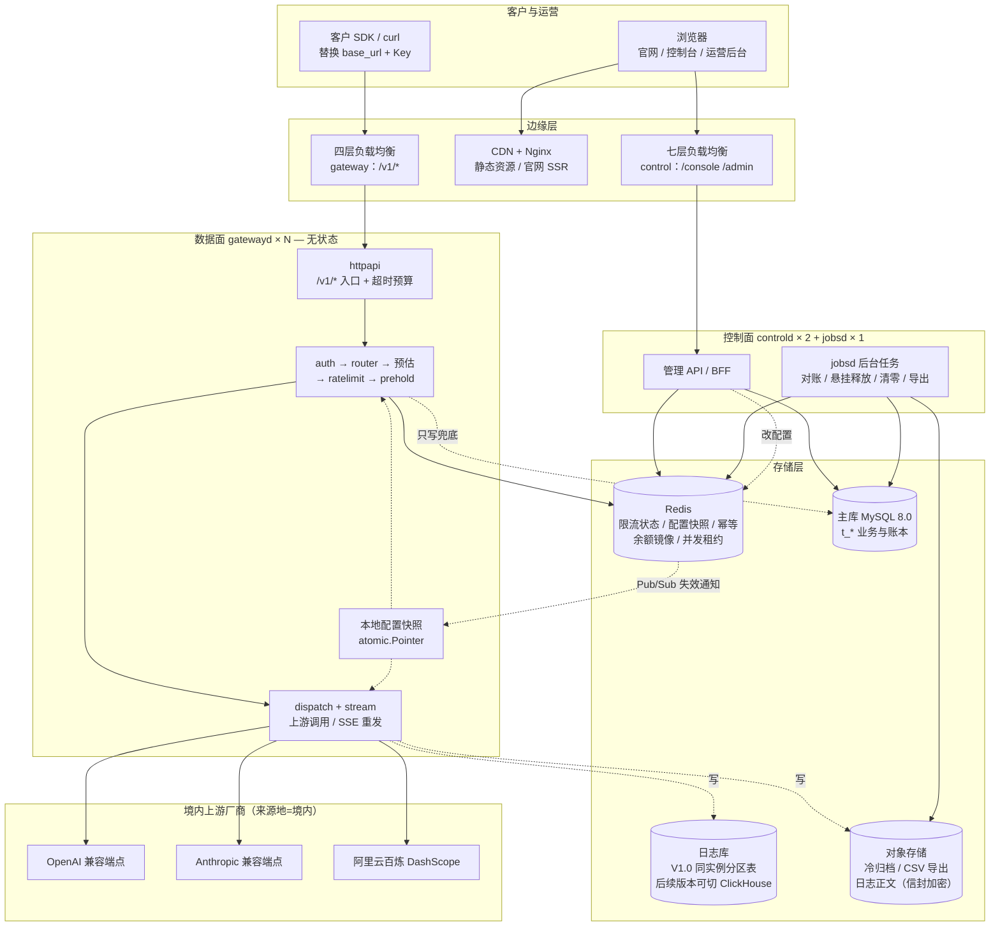
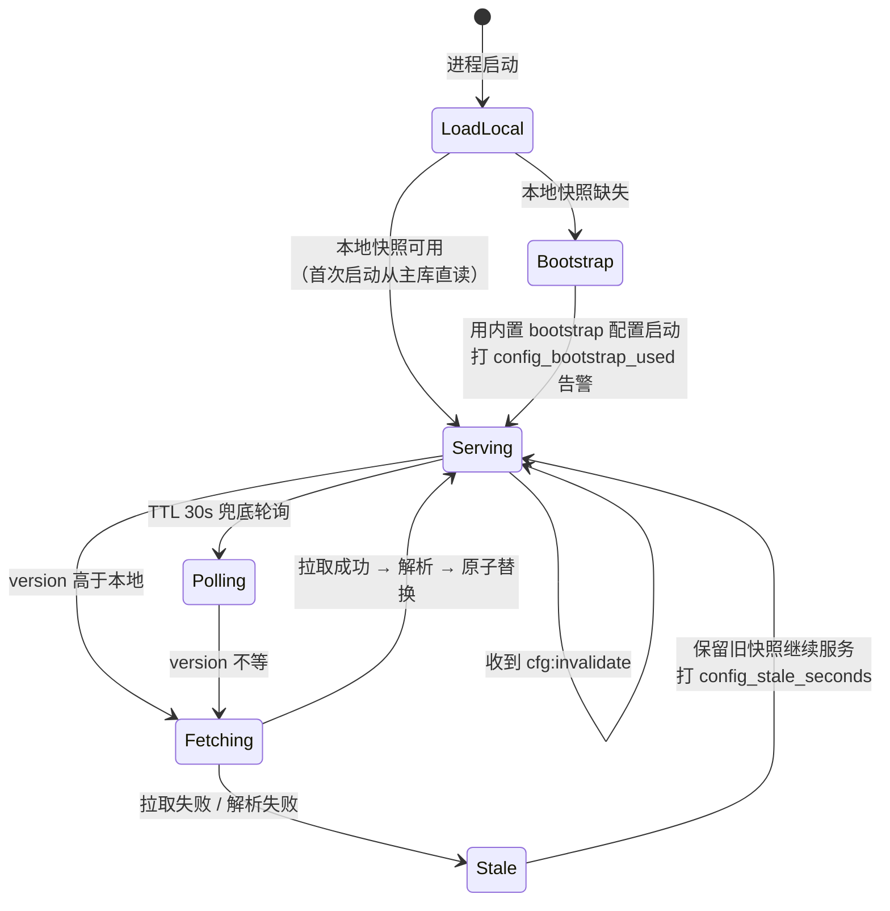
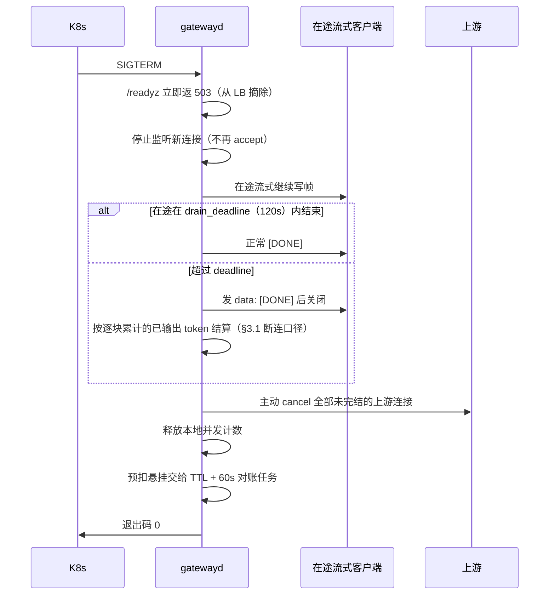
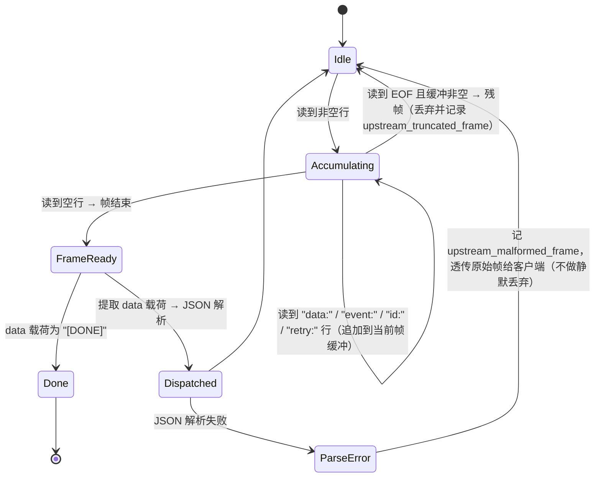
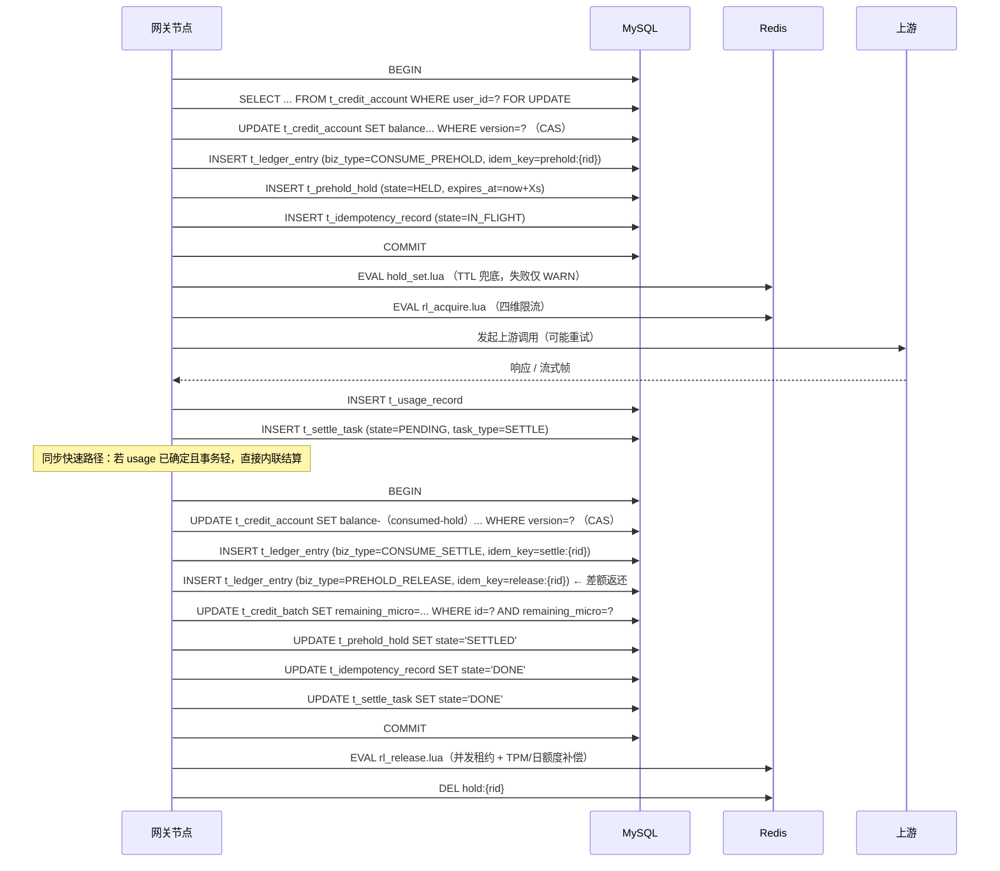
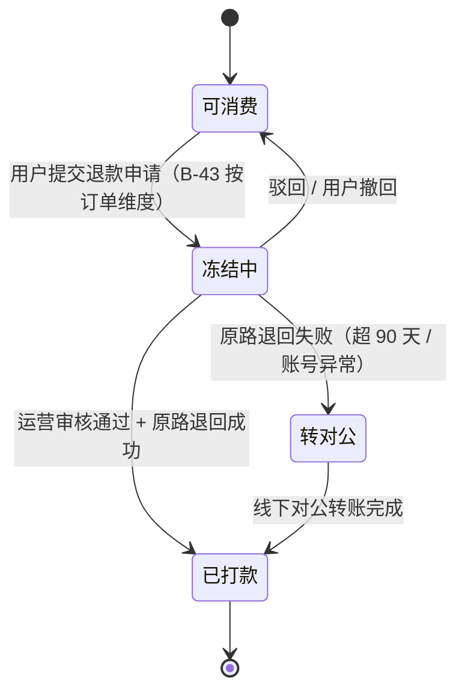

# API 中转站 V1.2 · 技术架构设计文档

| 项目     | 内容                                                                |
| :----- | :---------------------------------------------------------------- |
| 文档版本   | V1.2                                                              |
| 编制日期   | 2026-09-29                                                        |
| 修订日期   | 2026-10-25                                                        |
| 对应需求基线 | 《API 中转站 · 需求文档 V1.2》                                             |
| 技术栈    | Go                                                                |
| 参考对象   | new-api（`github.com/QuantumNous/new-api`）—— **模式参考，非代码复用**，许可约束见下 |

## 结构

| 篇                   | 内容                                                                                                                | 回答什么问题                               |
| :------------------ | :---------------------------------------------------------------------------------------------------------------- | :----------------------------------- |
| **第一篇 · 总体架构与模块边界** | 进程拓扑、模块划分与依赖方向、业务未定项隔离机制、可靠性设计、可观测性、与 new-api 的对照取舍、ADR、与前置 PRD 决策的接口                                             | 系统由哪些进程与模块组成，**业务未定项如何做到只影响配置不影响代码** |
| **第二篇 · 详细设计**      | 全局不变量与命名约定、数据模型（54 张表建表级定义）、Redis 键空间与 Lua 原子边界、网关处理流水线（P01~P31 + 66 条异常路径）、SSE 解析与转发、异步清算与对账、接口契约（8 接口 + 65 错误码） | 具体怎么建表、怎么设计键、每个阶段失败怎么办、返回什么状态码       |

**两篇内部编号各自独立**。篇内交叉引用均在篇内解析；跨篇引用显式标注「见第一篇 §X」或「见第二篇 §X」。

## ⚠️ 许可约束（编码前必读）

new-api 采用 **AGPLv3 + Section 7 附加条款**。其 Section 7 附加条款明确要求：修改版本必须在法律声明、关于页、页脚或其它显著位置保留署名notice `Frontend design and development by New API contributors.`，并保留指向原项目的可见链接 `https://github.com/QuantumNous/new-api`。AGPLv3 §13 另要求：以网络服务形式提供修改版本时，须向使用者提供对应源码。

**结论与约束**：

| 事项                       | 允许   | 说明                                   |
| :----------------------- | :--- | :----------------------------------- |
| 借鉴架构模式（分层方式、模块拆分思路、命名习惯） | ✅ 允许 | 抽象方法不受版权保护                           |
| 复制其任何源代码、Lua 脚本、SQL、配置片段 | ❌ 禁止 | 会触发 AGPL 的传染性开源义务                    |
| 派生作品闭源商用                 | ❌ 禁止 | 除非取得其商务授权（`support@quantumnous.com`） |

本文档中所有标注「模式参考」的段落，均为对公开 README / AGENTS.md 所述**架构思路**的引用，**不含任何代码级复用**。第二篇的表结构、Redis 键名、Lua 逻辑、接口契约均为**本项目自行设计**，与 new-api 无对应关系。

## 术语

| 缩写      | 含义                                                       |
| :------ | :------------------------------------------------------- |
| IR      | 中间表示（Intermediate Representation）——协议转换层两段式的中间数据结构       |
| 微积分     | 积分的最小整数单位，`MICRO_PER_CREDIT = 10000`，即 1 积分 = 10,000 微积分 |
| TDS     | 技术设计规格（Technical Design Spec）——相对 PRD 的技术侧载体             |
| ADR     | 架构决策记录（Architecture Decision Record）                     |
| 悬挂预扣    | 已扣减余额但未产生结算记录的预扣（进程崩溃、上游 hang 后残留）                       |
| 三篇文档的职责 | PRD = 需求与业务规则；技术备忘录 = 未决技术项暂存；本文档 = 技术实现方案               |

---

## 本轮修订（2026-10-22 · TA-1.1）

对应需求文档的六项能力补口。本节是本轮的**变更索引**，逐条给出需求条款与技术落点；正文各节已就地修改，本节不重复设计细节。

| #  | 需求变更                  | 技术落点                                                                                      | 编号影响                                     |
| :- | :---------------------------- | :---------------------------------------------------------------------------------------- | :--------------------------------------- |
| 1  | §3.5 价格分组与倍率：分组挂 Key、不挂价格表    | 新增 `t_price_group` / `t_price_group_scope`；`t_api_key` 增 `group_code`；K13 增 `grp`/`gp` 字段 | 表 45 → **47**                            |
| 2  | §3.1 缓存读写计价（结构支持、默认关闭）        | `t_price_rule` 增 `cache_hit_ratio_bp` / `cache_write_ratio_bp`                            | 列级                                       |
| 3  | §3.1 长上下文阶梯（整单跳价、非累进）         | `t_price_rule` 增 `long_ctx_threshold_tokens` 及两列阶梯价                                       | 列级                                       |
| 4  | §3.4 模型目录态 / 可售态三态            | `t_model.enabled` 替换为 `listing_state`；P07 增判定                                             | 列级 + 索引改名                                |
| 5  | §6.2 渠道「允许的分组」                | `t_channel` 增 `group_scope_mode`；选路后按快照过滤                                                 | 列级                                       |
| 6  | §6.4 F16-5 毛利地板、F16-6 价格唯一真相源 | 后台保存校验；新增一致性校验 SQL 与 CI 断言建议                                                              | 无结构变更                                    |
| 7  | §5.2 密钥有效期                    | **无需变更**：`t_api_key.expire_at` 早已存在；本轮把 E-52 的错误码由 `invalid_api_key` 改为 `key_expired`     | 异常路径 63 → **66**；错误码 58 → **63**（实测核对见下） |

**本轮不做的事**（避免实现期误解）：不引入计费表达式引擎（需求附录 C.2 已否决）、不新增 Redis 键（分组范围随 `cfg:snap:ROUTING` 下发）、不改 P01~P31 阶段编号（分组过滤并入 P12 内部步骤）。

**计数核对的一处既有偏差（本轮发现，未擅自抹平）**：修订前错误码枚举表实测 **59 条**（已排除表头行），而文档头部与 CLAUDE.md 一致声明为 58 条——差 1 条，成因未查明（推测为某次补码只改了表、未改计数）。本轮新增 4 条后为 63 条。

不把 59 直接改成 58 的理由：数字不符本身就是待查项，抹平会让偏差永久固化，且下次再差 1 条时无人能判断是新增还是旧错。建议在 Issue 16 的错误码回归用例中加一条断言——**枚举表实际行数 == 头部声明数**，让这类偏差在 CI 里暴露而不是靠人工核对。

---

## 本轮修订（2026-10-25 · TA-1.2）

对应**需求文档 V1.2**（含 2026-10-22 ~ 10-25 的 8 项 P0 修复与 6 项 P1 补入）。本节是本轮变更索引，逐条给出需求条款与技术落点；正文各节已就地修改，本节不重复设计细节。

| # | 需求条款 | 技术落点 | 编号影响 |
| :- | :--- | :--- | :--- |
| 1 | §3.1 透支上限是**结算侧硬上限**（50 积分 / 500,000 微积分） | 新增 `t_arrears` 表与结算截断流程；`t_user.status` 增 `FROZEN_OVERDRAFT` | 表 47 → 48；迁移 `0014` |
| 2 | §3.2 TPM 计量口径（输入 + 输出合计、`max_tokens` 占位、usage 结算） | §2.1 TPM 占位表；K2 键说明指向该表 | 无结构变更 |
| 3 | §3.1 / §5.6 批次扣减流水与可退基数 | 每批次一条 DEBIT 流水（`t_ledger_entry.batch_id`）；§5.5 可退基数四条 | 无结构变更 |
| 4 | §3.2.1 套餐取高不叠加、跨档升档覆盖、免费档 3 Key | §1.4 套餐规则表；配置键 `quota.free_max_active_keys` | 配置 +1 |
| 5 | §9.11 对账定时任务与差异类型 | §5.4.1 对账任务表（三源比对 / `diff_type` / P0 阈值 / 只读幂等）；`t_upstream_bill` | 表 → 50；迁移 `0016` |
| 6 | §5.9 / §6.6 / §6.7 工单、审核中心、模型主数据 | §1.9 三张表 + 状态机 + SLA | 表 → 53；迁移 `0015` |
| 7 | 附录 E 错误码 65 条 | §6.2 补 `idempotency_key_reused`、`content_policy_violation`；`account_frozen_due_to_overdraft` 由「V1 未开发」改为「必须实现」 | 错误码 63 → 65 |
| 8 | §9.4 单次尝试超时（非流式 50s / 流式首字节 30s）与重试门槛 65s / 45s | §3.1 预算表、P16、`gw.stream_first_byte_ms` / `gw.retry_threshold_ms` | 配置 +4 |
| 9 | §3.4.1 上游 429 不重试、`retry_after` 缺省 30 | §3.3.2 重试判据与 E-06 | 无结构变更 |
| 10 | §3.1 预扣比例 1.2、预估安全系数 11000、语言系数 1.0 | §3.7 配置键定档 | 无结构变更 |
| 11 | §5.7 日志正文 180 天 / 元数据 365 天 | §3.7 新增 `log.meta_retention_days` | 配置 +1 |
| 12 | §9.3 / §9.4 内部 SLO 99.5% 与 P99 指标 | §8.0 新增 | 无结构变更 |
| 13 | §2.1 页面总数 22 | §6.1 页面总表 | 无结构变更 |
| 14 | §3.1 幂等租约与 fence（15s / 5s / fence_token） | §1.6 幂等租约表；键含 `api_key_id`（迁移 `0010` / `0013`） | 配置 +3 |
| 15 | §4.1 F1-7 / §5.4 F8-4 / §6.7 F22-5、F22-6 模型推荐位 | `t_model` 增 `recommend_weight`；对外排序键改为 `(recommend_weight DESC, published_at DESC)`；区块条数键 `site.recommend_limit` | 列级；配置 +1；迁移 `0017` |
| 16 | §6.2 F14-6 / §9.2 逻辑专属（L1） | `t_channel` 增 `dedicated_scope_mode` / `fallback_allowed`；新增 `t_channel_dedicated_user`；选路候选集增专属过滤步 | 表 53 → **54**；迁移 `0017` |
| 17 | D.1 第 15 项税率未签（**财务签署项**） | §1.4 税率口径占位：`pricing.tax_rate_multiplier`（默认 `1.00`）+ 成本侧唯一作用点 + CI 锁默认值；`TODO(Finance)` | 配置 +1 |
| 18 | §6.2 F14-6 边界② 对外文案（**法务签署项**） | §1.4 对外文案约束：`i18n.DedicatedCopyPublic` 单一常量 + `DedicatedForbidden` 禁用词三来源 CI 扫描；`TODO(Legal)` | 无结构变更 |

**本轮不做的事**：不补 46 张表的完整 DDL 回填（§1.2 表清单已给出分层与关键表建表级定义，逐表 DDL 随迁移文件交付）；不新增 Redis 键（`t_arrears` 的抵扣走 DB 事务，不进 K 空间；专属名单随 `cfg:snap:ROUTING` 快照下发，不另设 K 空间键）；不改 P01~P31 阶段编号（欠费判定并入 P27 内部步骤，**专属范围过滤并入 P12 内部步骤**）。

---

## 决策冻结记录（2026-09-29）

以下决策已冻结。编码期间不得单方面变更；如需调整，走 ADR 流程并同步更新本节。

### A. 架构前提（12 条）

| 编号    | 决策                                                                | 来源     |
| :---- | :---------------------------------------------------------------- | :----- |
| AD-01 | 技术栈 **Go**                                                        | 澄清轮 Q1 |
| AD-02 | 账本 **append-only 流水 + 物化余额**，同事务写入，另跑日对账                          | Q4     |
| AD-03 | 限流器**分级降级**：并发维度降为节点内计数，其余 fail-close                             | Q5     |
| AD-04 | **容器化多副本 + 网关无状态**，限流状态全在 Redis                                   | Q6     |
| AD-05 | SSE **解析后重发**（逐帧提取 usage 与首 token 时间，按对外协议重组）                     | Q7     |
| AD-06 | 幂等键 **Redis 快路径 + DB 兜底**，定序「先写 DB 再写 Redis」                      | Q8     |
| AD-07 | 预扣悬挂 **Redis TTL + DB 对账任务**双轨，职责分离                               | Q9     |
| AD-08 | 余额一致性 **同事务 CAS + 日对账**双防线                                        | Q10    |
| AD-09 | 并发降级后 per-Key 上限**预置为「名义值 ÷ 副本数」**                                | Q11    |
| AD-10 | 配置失效 **版本号 + Redis Pub/Sub**，TTL 30 秒兜底                           | Q12    |
| AD-11 | 协议转换**双向两段式**（对外请求 → IR → 上游请求）                                   | Q13    |
| AD-12 | 对外 **2 种协议**（OpenAI / Anthropic 兼容）；百炼作为**上游接入方式**；自定义协议 V1.0 不接线 | Q2     |

### B. 质询决议（5 条）

| 编号    | 决议                                                                 | 落地约束                                                         |
| :---- | :----------------------------------------------------------------- | :----------------------------------------------------------- |
| GR-01 | **生产锁定 MySQL 8.0**；提供 SQLite 单机开发模式（`t_ledger_entry` 的 CAS 走串行化路径） | 唯一不可逆决策。生产侧**不得引入多数据库兼容层**                                   |
| GR-02 | **预扣不以 Redis 为真相源**——Redis 只做拦截判断，`t_ledger_entry` 的预扣行才是账         | Redis 丢键的后果限定为「短暂拦不住超额请求」，**不得解释为「余额算错」**。此定性必须写死在代码注释与运维手册中 |
| GR-03 | **异步结算背压阈值 5,000 条**：积压超过时网关对**新请求**返回 `503`                       | 宁可短暂拒服务，不制造对账缺口                                              |
| GR-04 | **配置版本号落用量记录**：`t_usage_record` 增配置版本列                             | 不做调价差额纠偏；事后按版本号圈定受影响请求范围                                     |
| GR-05 | **不引入批次级扣减明细表**                                                    | **前提条件**：扣减顺序落定为「先扣赠送积分、按到期日升序」。若业务侧改为按比例扣减，本决议作废，明细表必须加回    |

### C. 许可合规确认

遵循「**借鉴架构模式，严格独立原创实现**」。不复制 new-api 的任何代码、Lua 脚本、SQL 或配置片段。全部表结构、Redis 键名、Lua 逻辑、接口契约由本项目自主设计，确保商业闭源合规。

### D. 表名勘误

质询答复中引用的两个表名与本设计稿不符，以右列为准——后续全部文本、工单、代码沿用右列名称。

| 答复中引用             | 设计稿实际表名              | 在设计稿中出现次数 |
| :---------------- | :------------------- | :-------- |
| `t_recharge_flow` | **`t_ledger_entry`** | 21        |
| `t_usage_log`     | **`t_usage_record`** | 23        |

### E. 免决策项

以下两项由研发用真实样本实测标定，**不需要业务或架构决策**，也不构成开工阻断：预扣比例、预估值语言系数。

---

# 第一篇 · 总体架构与模块边界

> 本文只回答拓扑、模块边界、未定项隔离、可靠性、可观测性与选型取舍。
>
> 表结构与字段类型归 backend-architect；本文出现的表名仅用于表达实体关系与依赖方向，不含 DDL。
>
> 凡引用 new-api 做法处均标注「模式参考，非代码复用」。new-api 为 AGPLv3 + Section 7 附加条款（要求保留署名与可见链接），**本项目不复制其任何代码**。

---

## 1. 进程拓扑

三个可独立部署的进程，共用一个 Go module 与一份 `internal/` 代码。

| 进程         | 副本数（V1.0 起配）         | 状态      | 承载路径                                                                                         | 直连存储                   |
| :--------- | :------------------- | :------ | :------------------------------------------------------------------------------------------- | :--------------------- |
| `gatewayd` | 3（12 个月峰值按 §8 推算至 8） | **无状态** | `/v1/chat/completions`、`/v1/messages`、`/v1/images/generations`、`/v1/embeddings`、`/v1/models` | Redis、日志库（只写）、对象存储（只写） |
| `controld` | 2                    | 无状态     | `/console/*`、`/admin/*`、`/api/v1/auth/*`                                                     | 主库（读写）、Redis           |
| `jobsd`    | 1（需选主，见 §4.6）        | 有状态（租约） | 无对外端口                                                                                        | 主库（读写）、Redis、对象存储      |

**`gatewayd` 不持有常规主库连接池，但持有一条连接数受限的主库通道 `gw_write_dsn`（遗留项 1 落地）。**

原表述是「唯一例外是预扣悬挂的 DB 兜底释放，最大 2 连接的**只写**通道」。该表述有两处与实现不符，已修正：

| 原表述           | 实际                                                                                                      |                                             |
| :------------ | :------------------------------------------------------------------------------------------------------ | ------------------------------------------- |
| 「只写通道」        | **读写皆可**。预扣事务本身就要读（`lockAccount` 的 `SELECT ... FOR UPDATE`），不只是写                                        |                                             |
| 「唯一例外是悬挂兜底释放」 | **预扣（P10）必然要用它**。§3.1 的阶段表写的是「P10 预扣（DB + Redis）                                                        | DB 事务 50ms」——预扣在发起上游之前就要判余额、扣预扣，物理上必须同步读写主库 |
| 「最大 2 连接」     | **默认 8 连接**（`GATEWAY_DB_MAX_CONNS`），另有 `ConnMaxLifetime = 5min` 与**单事务 200ms 超时**（`prehold.TxnTimeout`） |                                             |

**连接数的算术**（Little's law：`每副本 QPS × 事务时长`）：

| 阶段              | 峰值 QPS | 副本数 | 每副本并发事务                | 默认 8 连接的余量     |
| :-------------- | :----- | :-- | :--------------------- | :------------- |
| 6 个月（200 QPS）   | 200    | 8   | 25 × 0.05s = **1.25**  | 6 倍            |
| 12 个月（2000 QPS） | 2000   | 8   | 250 × 0.05s = **12.5** | **不足**，需调高或扩副本 |


取 8 而不是 2：2 条对 6 个月目标只剩 60% 余量，一次慢查询就排队；取 25 则在 6 个月阶段开出一堆空闲连接，而主库的 `max_connections` 是共享资源。

**单事务 200ms 超时是这条通道的安全阀**。§1.1 的顾虑是「主库慢查询会直接抬升网关 P99」——有了超时，慢查询最多让本次预扣失败（503），不会让请求无限挂住。取 200ms = §3.1 给 P10 的 50ms 预算的 4 倍：紧贴 50ms 会让一次正常抖动就拒服务，放到秒级则失去保护意义。

**超时后的处置**：返回 503 + 释放连接与租约，**但预扣保持 HELD、不释放资金**。原因是超时后**无法判断事务是否已提交**，而 `ledger.Txn.Settle` 的释放分支（`ConsumedMicro==0` → 全额退回）**不校验是否存在对应的预扣流水**——释放一个未发生的预扣会给用户凭空加钱。悬挂由 §5.2 的 60s 对账兜底。

理由：主库连接池一旦进入网关的请求路径，主库慢查询会直接抬升网关 P99；而网关的可用性 SLA 高于控制面。代价是网关无法读取实时余额，只能依赖 Redis 中的 `bal:{userID}` 镜像。

**该镜像已落地（遗留项 1）**，规格如下：

| 项    | 取值                                 | 理由                                                                       |
| :--- | :--------------------------------- | :----------------------------------------------------------------------- |
| 键名   | `bal:{userID}`（K26）                | 见第二篇 §2.1                                                                |
| 值    | STRING，**微积分整数**                   | 与全库金额口径一致；存积分会让每次读取多一次换算，而换算是舍入点的温床                                      |
| TTL  | **60s**                            | 镜像的价值是"省一次主库往返"，不是长期缓存。TTL 越长，"漏掉一次失效"的偏差窗口越大                            |
| 失效方式 | **`DEL` 而非 `SET` 新值**              | 删除只会让下次读取回源，而**回源永远指向真相**；覆盖需要调用方先知道新值，而"以为自己知道新值"正是偏差来源（并发结算时后写的会盖掉先写的） |
| 失效方  | 控制面（充值、调额）**与网关（预扣、结算、释放后）**       | 结算发生在网关，它必须回写自己的改动，否则它自己刚扣的钱在它自己看来还没扣                                    |
| 缺失时  | 回源主库读一次并回填；再缺失则 **503 fail-close** | L907 已定。**不按 0 处理**——按 0 会误拒有余额用户，按无限会放行没余额用户                            |

**镜像只缓存余额数值，不缓存账户状态**（是否禁用、是否透支冻结）：状态变化必须立即生效，而余额有一分钟容忍度。把两者塞进同一个键会强迫状态也接受一分钟的陈旧。

**它与限流的降级取向相反**：限流的并发维度可以降级放行（资源保护），余额是**资金判定**，必须 fail-close。

### 1.1 拓扑图



### 1.2 存储角色与容量边界

| 存储           | 存什么                                              | V1.0 规模（§8 6 个月目标）                                                                         | 边界处理                                                                                                                                                                                                                                                                                         |
| :----------- | :----------------------------------------------- | :----------------------------------------------------------------------------------------- | :------------------------------------------------------------------------------------------------------------------------------------------------------------------------------------------------------------------------------------------------------------------------------------------- |
| Redis        | 四维限流计数器、并发租约 ZSET、配置快照与版本号、幂等快路径、余额镜像、预扣 TTL 哨兵  | 5,000 日活 × 20 Key = 10 万 Key × 4 维 ≈ 40 万键；峰值内存 < 2 GB                                     | 无持久化要求（可 AOF everysec），**Redis 全丢不影响资金正确性**——资金真相只在 `t_ledger` / `t_balance`                                                                                                                                                                                                                 |
| 主库 MySQL 8.0 | 渠道/路由/定价/套餐/用户/Key/账本/批次/余额/订单/退款/提额申请/审计        | 账本按调用量增长，日 50 万调用 × 每人有扣有退约 3 行 → 150 万行/天                                                 | **修订：账本不分区、不 DROP**——`t_ledger_entry` 的三个唯一键（`uk_le_idem` / `uk_le_entry_no` / `PK(id)`）都不含 `created_at`，分区即意味着丢唯一性保护；而 append-only 下应用账号无 `DELETE` 权限，`DROP PARTITION` 亦不可执行。改为「365 天是**在线查询窗口**、不是保留窗口」：主库全量保留，查询接口硬限 `created_at >= now()-365d`，越界走归档导出。容量与理由见第二篇 §8.3 / §8.5 R-4 |
| 日志库          | `t_usage_record`（请求级）+ `t_upstream_attempt`（尝试级） | 5 GB/天、保留 **180 天**（F-1 裁定，原 90 天）= 900 GB（`all_tables` 最坏口径）/ 250 GB（`meta` 口径） | V1.0 与主库同实例、独立 schema。**V1.0 不分区**——分区要求每个唯一键含分区列，而 `uk_ur_request(request_id)` 必须全局唯一；改为「按 `idx_ur_created` 分批 DELETE + 稳态页复用」，理由与分区数估算见第二篇 §8.5 R-3。**不做跨库 join**——日志查询所需维度（模型名、Key 名）冗余进日志行                                                                                               |
| 对象存储         | 冷归档 Parquet、CSV 导出、完整日志正文                        | 归档 450 GB/年 量级                                                                             | 正文独立信封加密密钥，密钥 ID 存 DB，密钥本体在 KMS。删除正文 = 删对象 + 删密钥，两步幂等                                                                                                                                                                                                                                        |

**日志库分离口径必须先落定（B-77）。** §8 隐含 10 KB/条，而 §5.7 声明默认只存元数据（经验 0.5~~2 KB/条），两者差 5~~20 倍。架构侧的隔离方式是：`t_usage_record` 增加 `volume_basis` 维度列（`meta` / `body` / `all_tables`），由配置键 `log.volume_basis` 决定统计口径；容量告警按 `all_tables` 这一最坏口径配置阈值。业务口径定稿后只改配置，不改分区数与保留策略的代码。

## 3. 业务未定项的隔离机制

### 3.1 三种落点

| 落点                      | 判据                      | 变更代价                       |
| :---------------------- | :---------------------- | :------------------------- |
| **C1 配置表热更新**           | 纯数值或枚举，代码里没有 `if` 分支    | 改一行数据，Pub/Sub 生效，P99 < 30s |
| **C2 接口 + 多实现 + 配置选实现** | 有逻辑分支，但分支可穷举            | 加一个实现文件 + 一条配置值，不改调用方      |
| **C3 常量 + 预留位**         | 已定案，V1.0 只有一个取值，但需预留扩展点 | 需改代码，但接口已稳定                |

### 3.2 逐项落点

| 未定项          | 落点 | 具体机制                                                                                                                                                                           |                      |
| :----------- | :- | :----------------------------------------------------------------------------------------------------------------------------------------------------------------------------- | -------------------- |
| 四档套餐具体数值     | C1 | `t_plan` 全字段可热更新。代码中不出现 60 / 60,000 / 5 等数字                                                                                                                                    |                      |
| 体验版赠送额度      | C1 | `t_plan.bonus_credits` where `plan_code='trial'`；领取规则走 `t_config_item` 的 `plan.trial_*` 键组                                                                                     |                      |
| 上游成本单价导入方式   | C2 | `pricing.cost_source` 选 `manual`                                                                                                                                               | `bill_import`，见 §3.4 |
| 积分扣减顺序       | C2 | `billing.deduct_policy`，见 §3.3                                                                                                                                                 |                      |
| Key 级是否保留日额度 | C2 | `quota.key_daily_mode`，见 §3.5                                                                                                                                                  |                      |
| 负余额透支上限      | C1 | `t_plan.overdraft_limit` + `t_user.overdraft_limit` 覆盖位；缺省走 `billing.overdraft_limit_default`                                                                                  |                      |
| 日志体积口径       | C1 | `log.volume_basis`，见 §1.2；另 `log.body_mode` 控制是否收正文                                                                                                                            |                      |
| 定价层级是否预留代理维度 | C3 | `t_pricing` 保留 `agent_markup` 列且 V1.0 恒为 `1.0000`；`pricing.tier_chain` 配置键预留 `model>protocol>channel>agent` 取值但 V1.0 只接受 `model>channel`。**不新增层级即可支持 V2.0 代理加价**（对齐 B-19 A 方案） |                      |
| 退款粒度         | C2 | `billing.refund_policy`，见 §3.6                                                                                                                                                 |                      |
| 日额度计量口径      | C2 | `quota.daily_meter`，见 §3.5                                                                                                                                                     |                      |

### 3.3 扣减顺序策略（B-03）

```go
// DeductPolicy 决定一笔扣减从账户下的哪些积分批次出账。
// 入参 batches 已按 (expire_at ASC, batch_id ASC) 排序，策略不依赖该顺序但可用它。
type DeductPolicy interface {
    // Name 用于配置键校验与账单脚注（B-73 要求账单写明扣减顺序）。
    Name() string
    // Allocate 返回扣减计划。amount 恒为正；返回条目之和必须等于 amount。
    // 批次余额不足时返回 ErrInsufficientCredits，由调用方转为小额负余额路径。
    Allocate(batches []CreditBatch, amount Credits) ([]DeductEntry, error)
}

type CreditBatch struct {
    BatchID  string
    Kind     BatchKind // recharge | bonus
    Remain   Credits
    ExpireAt time.Time // recharge 批次为零值（长期有效）
}

type DeductEntry struct {
    BatchID string
    Amount  Credits
}
```

| `billing.deduct_policy` | 实现文件                             | 语义                     | 对应 B-03 方案 |
| :---------------------- | :------------------------------- | :--------------------- | :--------- |
| `fifo_expiry`           | `deductpolicy/fifo_expiry.go`    | 先扣赠送、赠送内部按到期日升序，耗尽后扣充值 | A（推荐，默认）   |
| `prorata`               | `deductpolicy/prorata.go`        | 按两类余额比例同步扣，尾差归充值批次     | B          |
| `recharge_first`        | `deductpolicy/recharge_first.go` | 先扣充值、赠送最后扣             | C          |

**未配置或配置值非法时的行为**：回退 `fifo_expiry`，打 `strategy_fallback{kind="deduct_policy", configured="<原值>"}` 计数。**不拒绝请求**——这是硬约束「配置中心抖动不得导致网关拒绝请求」在策略层的落点。


**边界条件**：

- 批次不足且允许负余额 → 在最后一个批次上记超额部分，`t_balance.credits` 写为负；`Allocate` 不返回错误，由 `ledger` 层的事务决定是否接受（CAS 条件含 `credits - amount >= -overdraft_limit`）。
- 批次不足且不允许负余额 → `ErrInsufficientCredits` → 402 `insufficient_credits`。
- 赠送批次 `expire_at < now()` → 该批次不参与 `Allocate`；清零任务与扣减共用同一判断条件，避免「清零任务晚跑 1 秒导致过期批次被扣」。
- 跨日结算：`t_ledger` 与 `t_credit_batch` 的写入恒带 `biz_date`（来自预扣时的 `t_prehold.created_at` 的自然日 UTC+8），不取系统当前日期。

### 3.4 成本单价来源策略（B-48）

```go
// CostProvider 提供上游成本单价，仅用于毛利核算，不参与对外定价。
type CostProvider interface {
    Name() string
    // UnitCost 返回指定模型在指定时刻的单位成本。
    // ok=false 表示未配置——毛利视图必须显示"未配置成本价"，不得按 100% 毛利展示。
    UnitCost(ctx context.Context, modelID string, at time.Time) (Cost, bool)
}
```

| `pricing.cost_source` | 实现                              | 数据来源                                                          | 对应 B-48 方案 |
| :-------------------- | :------------------------------ | :------------------------------------------------------------ | :--------- |
| `manual`              | `pricingadm.ManualCostProvider` | 读 `t_pricing.cost_input_price` / `cost_output_price`，运营表单直接编辑 | A（推荐，默认）   |
| `bill_import`         | `pricingadm.BillCostProvider`   | 读 `t_upstream_bill`（CSV 导入明细），按账单周期生效                         | C          |

**边界**：`manual` 实现下成本价为 NULL 时不返回 `0`，返回 `ok=false`。控制面毛利接口的返回结构 `{revenue, cost, gross_margin}` 中 `cost` 与 `gross_margin` 为 `null` 而非 `0`——前端渲染「未配置成本价」。这是防止「毛利率恒 100% 上线即失真」的具体机制。

### 3.5 限流量测策略（B-01 / B-20 / T-08）

两个正交的未定项：**日额度计量口径**与**Key 级是否保留日额度**。

```go
// DailyQuotaMeter 决定一笔请求按什么数值计入账户日额度（T-08）。
type DailyQuotaMeter interface {
    Name() string
    // Measure 返回本次请求应计入日额度的积分数。预扣阶段调用一次，结算阶段调用一次。
    // 结算阶段的返回值可以为负（多退少补的差额）。
    Measure(ev QuotaEvent) Credits
}

type QuotaEvent struct {
    Phase      QuotaPhase // prehold | settle
    RequestID  string
    Preheld    Credits    // 预扣值
    Settled    Credits    // 结算值；prehold 阶段为零
    BizDate    string     // yyyy-MM-dd，来自预扣时刻，恒为 UTC+8
}

// KeyDailyQuota 决定 per-Key 是否设日额度（B-01 / B-20）。
// 返回 MaxCredits 表示该维度不生效。
type KeyDailyQuota interface {
    Name() string
    Limit(key KeyCfg, account AccountCfg) Credits
    // Validate 用于控制面保存 Key 配置时的校验（B-20 约束①）。
    Validate(key KeyCfg, account AccountCfg, siblings []KeyCfg) error
}
```

| 配置键                    | 取值            | 行为                                                                                                           |
| :--------------------- | :------------ | :----------------------------------------------------------------------------------------------------------- |
| `quota.daily_meter`    | `prehold`（默认） | 预扣阶段记预扣值，结算阶段记 `(结算值 − 预扣值)` 差额                                                                              |
|                        | `settle`      | 预扣阶段记 0，结算阶段记结算值。代价是日内额度检查滞后一个请求                                                                             |
| `quota.key_daily_mode` | `none`（默认）    | `Limit` 恒返 `MaxCredits`；**限流器判定点数 = 3**（RPM / TPM / 并发）                                                      |
|                        | `inherit`     | `Limit` 返回账户日额度（等效于不设），二级取小                                                                                  |
|                        | `strict`      | `Limit` 读 `t_key.daily_quota`；`Validate` 强制各 Key 之和 ≤ 账户日额度，超配时保存返回 422 `key_quota_over_allocated` 并带剩余可分配额度 |
| `quota.reset_scope`    | `account`（默认） | 日额度键为 `rl:dq:{user_id}:{yyyymmdd_cst}`                                                                       |
|                        | `key`         | 键为 `rl:dq:{key_id}:{yyyymmdd_cst}`，重置作业按 Key 维度生成                                                            |

**判定点数由配置推导，不由代码写死**：`ratelimit` 在构造检查链时读 `quota.key_daily_mode`，`none`/`inherit` 下才挂 4 个判定点中的第 4 个。这样 §3.2 约束①的成立与否（B-20 争议点）不产生代码分叉。

**跨日边界处理（具体，不是原则）**：预扣在 23:59:59、结算在 00:00:01 时，差额写入 `ev.BizDate` 指定的**预扣当日**键。若该键已被 `EXPIRE` 清理（键 TTL 48h 不会跨日清理，但 Redis 重启可能丢失），差额记入 `t_quota_carryover` 表并在当日重置作业中合并——**扣减永不因 Redis 丢键而丢失**。

### 3.6 退款粒度策略（B-43）

```go
type RefundPolicy interface {
    Name() string
    // Quotable 计算可退上界（元）。scope 由调用方按策略语义构造。
    Quotable(ctx context.Context, scope RefundScope) (Money, error)
    // Freeze 在申请提交时冻结积分。必须在调用方事务内执行。
    Freeze(ctx context.Context, tx *sql.Tx, refundID string, amt Credits) error
    // Settle 打款成功后扣减冻结。幂等：重复调用返回 ErrAlreadySettled 而非重复扣减。
    Settle(ctx context.Context, tx *sql.Tx, refundID string) error
    // Release 驳回或撤回时解冻。
    Release(ctx context.Context, tx *sql.Tx, refundID string) error
}
```

| `billing.refund_policy` | 语义                             | 对应 B-43 方案 |
| :---------------------- | :----------------------------- | :--------- |
| `by_order`（默认）          | 可退上界 = 该订单未消耗充值积分 × 0.9，按订单冻结  | A          |
| `by_account`            | 可退上界 = 账户全部未消耗充值积分 × 0.9，不区分订单 | B          |
| `clearance_only`        | 仅当余额为 0 或申请注销时可退，退款后账号停用       | C          |

**边界**：`Quotable` 恒以 `deduct_policy` 的**当前配置值**计算，并在返回结构中回传 `deduct_policy_used`。若运营在退款审核中途改了扣减顺序，已冻结的退款单沿用申请时快照的策略名（存 `t_refund.deduct_policy_snapshot`），避免同一退款单在审核前后算出两个金额。


### 3.7 配置键总表

| 配置键                                 | 取值类型                      | 默认值                                                                                                                                                                         | 落点 |
| :---------------------------------- | :------------------------ | :-------------------------------------------------------------------------------------------------------------------------------------------------------------------------- | :- |
| `billing.deduct_policy`             | enum                      | `fifo_expiry`                                                                                                                                                               | C2 |
| `billing.refund_policy`             | enum                      | `by_order`                                                                                                                                                                  | C2 |
| `billing.overdraft_limit_default`   | int（积分）                   | `50`                                                                                                                                                                        | C1 |
| `billing.estimate_language_coef`    | json `{zh,en,code,mixed}` | `{zh:1.0,en:1.0,code:1.0,mixed:1.0}`（已定档：V1.0 一律 1.0，不做语言区分）                                                                                                                                                                 | C1 |
| `billing.prehold_ratio`             | decimal                   | `1.2`（已定档）                                                                                                                                                                 | C1 |
| `billing.prehold_max_ratio`         | decimal                   | `0.5`（§3.1 已定案）                                                                                                                                                             | C1 |
| `billing.settle_deadline_ms`        | int                       | `5000`（非流式）/ `10000`（流式），对齐 B-04 A                                                                                                                                          | C1 |
| `billing.bonus_expire_days`         | int（天）                    | `90`（B-04；自支付成功日起算，到期当日 00:00 UTC+8 清零）                                                                                                                                     | C1 |
| `quota.daily_meter`                 | enum                      | `prehold`                                                                                                                                                                   | C2 |
| `quota.key_daily_mode`              | enum                      | `none`                                                                                                                                                                      | C2 |
| `quota.reset_scope`                 | enum                      | `account`                                                                                                                                                                   | C2 |
| `quota.reset_tz`                    | string                    | `Asia/Shanghai`（§3.2 固定 UTC+8）                                                                                                                                              | C1 |
| `pricing.cost_source`               | enum                      | `manual`                                                                                                                                                                    | C2 |
| `pricing.tier_chain`                | enum                      | `model>channel`                                                                                                                                                             | C3 |
| `pricing.agent_markup`              | enum                      | `off`                                                                                                                                                                       | C3 |
| `pricing.cache_billing_enabled`     | bool                      | `false`（需求 §3.1：结构支持、计费默认关闭；TA-1.1）                                                                                                                                         | C3 |
| `pricing.min_margin_bp`             | int（万分比，**毛利率**）          | `2500`（需求 §7 第 22 项已定档）                                                                                                                                                     | C3 |
| `pricing.plan_min_margin_bp`        | int（万分比，**毛利率**）          | `1000`（需求 §6.4 F16-5 套餐分支）                                                                                                                                                  | C3 |
| `pricing.tax_rate_multiplier`       | decimal                   | `1.00`（**占位**，见第二篇 §1.4 税率口径）                                     | C3 |
| `pricing.max_bonus_ratio_bp`        | int（万分比）                  | `3000`（需求 §3.2 赠送积分占套餐额度上限，25%→30%）                                                                                                                                         | C3 |
| `pricing.group_switch_mode`         | enum                      | `ops_only`（需求 §3.5：禁止用户自助向下切组）                                                                                                                                              | C3 |
| `billing.long_ctx_prehold_guard_bp` | int（万分比）                  | `9000`（TA-1.1：估算输入落在阈值 90% 以上时按阶梯价预扣，见第二篇 §1.4）                                                                                                                             | C1 |
| `log.body_mode`                     | enum                      | `meta_only`                                                                                                                                                                 | C1 |
| `log.volume_basis`                  | enum                      | `meta`                                                                                                                                                                      | C1 |
| `log.retention_days`                | int                       | `180`（B-71 A；**F-1 由 90 改为 180**，对应《网络安全法》第二十一条「不少于六个月」）                                                                                                          | C1 |
| `log.same_instance`                 | bool                      | `true`（V1.0 日志库与主库同实例、独立 schema；置 `true` 时告警提示 IO 竞争风险，后续版本迁出，见 U-03）                                                                                                      | C1 |
| `plan.default_tier`                 | string                    | `free`                                                                                                                                                                      | C1 |
| `plan.trial_days`                   | int                       | `7`（§4.2）                                                                                                                                                                   | C1 |
| `quota.rate_limit_order`            | enum                      | `concurrency>rpm>tpm>daily`（§3.2）                                                                                                                                           | C1 |
| `quota.overdraft_warn_days`         | int                       | `7`（B-05 A）                                                                                                                                                                 | C1 |
| `gw.max_inflight`                   | int                       | `8000`（见 §5.2）                                                                                                                                                              | C1 |
|                                     |                           | **该上限是进程级的**（2026-10-15 标注）：按单个网关实例计数，集群总容量 = 本值 × 副本数。把 8000 当成集群上限会让 3 副本的实际容量变成 24000。§4.3 的三档背压阈值（60% / 90%）同样是**单实例**的占比                                               |    |
| `gw.drain_deadline_ms`              | int                       | `120000`                                                                                                                                                                    | C1 |
| `gw.upstream_timeout_ms`            | int                       | `50000`（**单次尝试**，非流式；已定档）  | C1 |
| `gw.stream_first_byte_ms`           | int                       | `30000`（**单次尝试**，流式首字节；已定档）  | C1 |
| `gw.stream_total_ms`                | int                       | `600000`（流式总时长；已定档）  | C1 |
| `gw.settle_reserve_ms`              | int                       | `15000`（结算预留；已定档）  | C1 |
| `gw.retry_threshold_ms`             | int                       | `65000`（非流式重试门槛）/ `45000`（流式）                                                                                                                                                           | C1 |
| `gw.client_timeout_budget_ms`       | int                       | `120000`                                                                                                                                                                    | C1 |
| `gw.retry_max`                      | int                       | `1`（**F-4**：最大重试 1 次 = 共 2 次尝试；仅对上游 5xx 与超时生效，**上游 429 不重试也不换候选**）。**不进运行时可写白名单**——1→2 会让全平台上游调用量涨约 10%，属随版本发布的开关（同 `pricing.cache_billing_enabled`），见第二篇 §8.5 末表 | C1 |
| `billing.prestimate_safety_bp`     | int（万分比）               | `11000`（2026-10-25 定档：预扣预估 **+10% 安全余量**；**作用于 token 预估环节**，不是金额整体 ×1.1——否则 G-02 的鉴别用例会翻转） | C1 |
| `idem.duplicate_window_seconds`    | int                       | `10`（2026-10-25 定档：同键重复请求去重窗口） | C1 |
| `idem.lease_ttl_seconds`           | int                       | `15`（2026-10-25 定档：幂等租约 TTL） | C1 |
| `idem.lease_renew_seconds`         | int                       | `5`（2026-10-25 定档：租约心跳续约间隔） | C1 |
| `quota.free_max_active_keys`       | int                       | `3`（2026-10-25 定档：`FREE_DEFAULT` 账户活跃 Key 上限，PRD F6-7） | C1 |
| `site.recommend_limit`             | int                       | `8`（2026-10-25 追加：官网「推荐模型」区块展示条数上限，PRD F22-6） | C1 |

全部存于 `t_config_item(cfg_namespace, cfg_key, scope, scope_id, cfg_value, version, enabled, updated_by)`，`cfg_namespace` 取 `ROUTING` / `RATELIMIT` / `PRICING` / `UPSTREAM` / `FEATURE`；运行时值与发布记录分别落 `t_config_runtime` 与 `t_config_publish`（见第二篇 §1.8）。

**上表的键到命名空间的归属**（2026-10-15 定，Issue 17）。原表只给了 `cfg_namespace` 的五个取值而未指名每个键归哪个，以下三组此前无归属，此处补全；其余键按前缀直取同名命名空间（`quota.*` → RATELIMIT）：

| 键组          | 命名空间     | 判断依据                                 |
| :---------- | :------- | :----------------------------------- |
| `billing.*` | PRICING  | 决定怎么扣钱，与 `pricing.*` 变更频次、审阅人、出错后果同类 |
| `pricing.*` | PRICING  | ——                                   |
| `plan.*`    | PRICING  | 决定套餐送多少积分，同属「钱」的配置                   |
| `log.*`     | FEATURE  | 功能与运维开关（收不收正文、留多久），不是路由 / 计费 / 上游参数  |
| `gw.*`      | UPSTREAM | 描述「一次上游往返允许多久、同时允许多少条」，非路由目的地        |

**`quota.overdraft_warn_days` 暂不归入任何命名空间**（2026-10-15 裁决）。它的键前缀指向 RATELIMIT，但语义是「负余额持续多少天强制停用」——属资金侧策略而非限流参数。塞进 `RateLimitSettings` 会让资金参数与限流参数的变更互相牵动；而它的消费方（自动停用任务）尚未排期。**留待资金/限额控制策略统一梳理时一并定**，在那之前它不出现在任何命名空间的键清单里，写入会被拒绝（`config_value_invalid`），而不是被接受却无人读取。§3.7 的 27 个键因此有 26 个已归属（该计数按 2026-10-15 状态；TA-1.1 新增 4 键后为 31 个键、30 个已归属，见下段）。

**TA-1.1 新增 4 个键（2026-10-22）**：`pricing.cache_billing_enabled`、`pricing.min_margin_bp`、`pricing.group_switch_mode`、`billing.long_ctx_prehold_guard_bp`。前三个按上表归入 `PRICING`，第四个按 `billing.*` 规则归入 `PRICING`。**全表因此为 34 个键（2026-10-23 补 `pricing.plan_min_margin_bp` / `pricing.max_bonus_ratio_bp`；补 `gw.retry_max`），其中 33 个已归属**（仍未归属的只剩 `quota.overdraft_warn_days`）。

四个键的消费方与就绪度：

| 键                                   | 消费方            | 默认值能否直接上线                                                                      |
| :---------------------------------- | :------------- | :----------------------------------------------------------------------------- |
| `pricing.cache_billing_enabled`     | P09 取价         | 能。`false` 即等价于 TA-1.0 行为，**结构就绪、行为不变**，上游缓存口径核对后再置 `true`                      |
| `pricing.min_margin_bp`             | 后台保存校验（F16-5）  | 能。`2500` 已定档（毛利率口径，见上方地板校验 SQL）。**但校验逻辑本身仍需实现**：在它落地前，F16-5 按「缺成本价则只告警」的降级路径执行 |
| `pricing.group_switch_mode`         | 控制台 Key 分组切换接口 | 能。`ops_only` 即 V1.0 目标行为                                                       |
| `billing.long_ctx_prehold_guard_bp` | P09 预扣预估       | 能。无阶梯模型不受影响；有阶梯模型按 90% 保守预扣                                                    |

**运行时可写的键（2026-10-19 收口）**：`/admin/config` 只接受有运行时消费方的 12 个键——`billing.deduct_policy`、`billing.prehold_max_ratio`、`gw.upstream_timeout_ms`、`gw.client_timeout_budget_ms`、`gw.max_inflight`、`gw.drain_deadline_ms`、`log.retention_days`、`quota.daily_meter`、`quota.key_daily_mode`、`quota.reset_scope`、`quota.reset_tz`、`quota.rate_limit_order`。其中后四个 `quota.*` 键只接受 V1 已实现的值（`none` / `account` / `Asia/Shanghai` / 默认顺序），其他取值写入返回 400 `config_value_invalid`。其余 15 个键（此前已排除的 4 个 + 消费方未排期的 11 个）一律拒绝写入；`billing.overdraft_limit_default` 的验收移至 Issue 18，等用户注册/建账入口落地后再加回白名单。

**TA-1.1 的 4 个新键一律不进此白名单**（白名单仍为 12 个）。理由：`pricing.cache_billing_enabled` 虽然消费方明确（P09），但其开启前提是「上游缓存口径逐个核对完毕」，属于随版本发布的开关而非运营随手可调；把它放进白名单等于允许在口径未核对时被误开，而误开的后果是**全量请求少收钱**——这类错配不报错、只体现为毛利下滑，事后极难定位。需要灰度时走配置发布（`t_config_publish`）而非运行时写入。

`pricing.*` 与选路快照里的 `PriceRule` **保持分离**：`PriceRule` 是逐模型单价，必须与路由同快照才没有一致性窗口；`pricing.*` 是取价方式的开关，两者不存在必须同时生效的关系。

作用域列（`scope` / `scope_id`）与唯一键的 **Expand-Contract 三步顺序见第二篇 §1.8**。该条 2026-09-24 记的「DDL 中无 `scope` / `scope_id` 列、需在 Issue 02 前落地」已由 Issue 17 收口：迁移 `0004`（加列）+ `0005`（换唯一键）及配套回滚脚本，随 Issue 17 一并交付。

### 3.8 策略注册表与配置下发的耦合点

`internal/config` 暴露注册接口，实现模块反向注册，**方向不可倒转（D6）**：

```go
package config

type StrategyKind string

const (
    KindDeductPolicy StrategyKind = "deduct_policy"
    KindRefundPolicy StrategyKind = "refund_policy"
    KindDailyMeter   StrategyKind = "daily_meter"
    KindKeyDailyQuota StrategyKind = "key_daily_quota"
    KindCostProvider StrategyKind = "cost_provider"
)

// Register 由各实现模块在进程启动时调用（cmd/*/main.go 显式列出，不用 init 隐式副作用）。
func Register(kind StrategyKind, name string, factory Factory)

// Resolve 在配置快照装载时调用。未注册的名字返回 false，**不 panic**。
func Resolve(kind StrategyKind, name string) (any, bool)
```

快照装载流程与它的失败路径：



**逐条失败模式**：

| 失败               | 处理                                                                        | 对客户可观测的影响                         |
| :--------------- | :------------------------------------------------------------------------ | :-------------------------------- |
| Pub/Sub 消息丢失     | 30s 轮询比对 `cfg:ver` 发现并拉取                                                  | 配置生效延迟最坏 30s，无请求失败                |
| Redis 完全不可用      | 本地快照继续服务；限流进入分级降级（§5.1）                                                   | 见 §5.1，与配置无关                      |
| 拉取到的快照 JSON 解析失败 | 丢弃新快照，保留旧快照，打 `config_parse_failed`                                       | 无。连续 5 次失败触发 P1 告警                |
| 快照中某策略名未注册       | 该策略回退到 `default` 实现，其余字段正常生效                                              | 该策略行为回到默认，打 `strategy_fallback`   |
| 快照中套餐表为空         | 用内置 `bootstrapPlan`（R60 / TPM 60,000 / 并发 5 / 日额度 60,000 积分），在控制台显示配置异常横幅 | 新用户按免费档限流，**绝不无限流**（对齐 B-11 方案 A） |
| 快照中某个数值为负或零      | 该字段回退默认值，忽略非法字段而非整体丢弃                                                     | 单字段行为回退，其余字段生效                    |
| 主库不可用            | `controld` 读写失败返回 503；`gatewayd` 不受影响                                     | 运营后台不可用，客户调用不受影响                  |

**硬约束落点**：「配置中心抖动不得导致网关拒绝请求」——上表 7 行中没有任何一行的处理结果是「返 4xx/5xx」。所有失败都收敛到「用旧值」或「用内置默认值」。

---

## 4. 可靠性设计

### 4.1 熔断

粒度 = **渠道**（`t_channel`），因为渠道是故障隔离单元；同一渠道的多条密钥（`t_channel_key`）共享熔断状态。

| 状态       | 进入条件                       | 行为                                                             |
| :------- | :------------------------- | :------------------------------------------------------------- |
| Closed   | 初始                         | 正常参与选路                                                         |
| Open     | 连续 5 次失败（`fail_threshold`） | 从选路结果中摘除                                                       |
| HalfOpen | Open 持续 30s 后自动进入          | **同一时刻只放一个探测**（`up:probe` 的 `SET NX`），其余摘除；累计 3 次探测成功才回 Closed |

**关键区别：熔断不返回 429。** 被熔断的渠道在选路阶段就被摘除，请求自动落到下一优先级渠道。客户看到的是延迟增加（多一次上游尝试）而不是错误。只有**全部渠道均被熔断**时才返回 502，业务码取 `upstream_all_failed`（本节原写作 `upstream_unavailable`，码表 §6.2 中并无此码，已按码表统一）。这与限流的「429 是给客户看的业务信号」语义完全不同（对齐 T-17）。

失败计数口径与 B-68 的渠道健康度口径分开：

- **熔断计数**：按上游尝试次数，只计 5xx、超时、连接失败。**不计** 4xx（客户参数错误不该熔断渠道）。
- **渠道健康度展示**：按上游尝试次数，时间窗「近 1 小时 / 近 24 小时 / 近 30 日」三档，默认近 1 小时（B-68 A 方案）。两者共用 `t_upstream_attempt`，但聚合表达式不同。

**半开探测失败** → 立即回 Open，且退避时长翻倍（30s → 60s → 120s，上限 600s），已累计的探测成功数清零。成功 3 次 → Closed 并清零退避。

**半开的「只放 3 个探测」与 K17 的「只有一个探测」不矛盾**：前者说的是**关闭前累计需要 3 次成功探测**，后者说的是**同一时刻只允许一个探测在飞**。单飞是必需的——多副本各放一个探测，会把刚恢复的渠道用 3 倍试探量再打一次，而半开的意义正是"用最小流量试探"。退避时长与探测成功数分别落在 K16 的 `bo` / `ps` 两个字段上。

**「只计 5xx、超时、连接失败」的落地口径**（Issue 13 实施结论）：

| 上游结果                           | 计熔断   | 可重试    | 说明                                  |
| :----------------------------- | :---- | :----- | :---------------------------------- |
| 超时 / 连接被拒 / 5xx                | 是     | 是      | §4.1 列举的三类                          |
| DNS / TLS                      | 是     | **否**  | 属连接失败；换路由大概率同域/同证书（E-02 / E-03）     |
| **4xx（含 401/403/404/400/422）** | **否** | 否      | 客户参数、凭据或模型名问题，不是渠道故障                |
| **429**                        | **否** | 是（带条件） | 配额问题而非故障，由 K23 冷却承接，不进 `fc`         |
| 非标错误体                          | 否     | 是      | 可重试，但不是渠道故障                         |
| 空 choices / 客户端断连              | 否     | 否      | E-10；断连必须先与"渠道超时"分开，否则一次页面刷新能熔断健康渠道 |

**客户端断连必须与渠道超时分开**：上游调用在客户端断开时返回 `context.Canceled`，若沿用 `upstream_timeout` 归类，一次客户端批量断连（页面刷新、SDK 超时重试）就会被记成"该渠道连续超时"。为此 §6.2 增设 `client_aborted`（HTTP 499）：它是**内部归类码**，连接已断、响应写不出去，用途是不污染渠道健康度。

**未实现的一项（对本文档的偏离）**：上表原有「滑动 30s 内样本 ≥ 20 且失败率 > 50%」这一跳闸条件，V1 **只实现连续失败计数**。原因是键空间里没有能承载 30s 滑动窗口的结构——K15（`m:chan:*`）是按分钟分片的 HASH，其最小粒度是 60s，做不出 30s 窗口；要支持需新增一个每次尝试都写的 ZSET，成本高于收益。持续高失败率的渠道仍会被"连续 5 次"捕获，只是对"失败率 60% 但夹杂零星成功"的渠道不如滑动窗口敏感。

### 4.2 分级降级（D-03 / D-09）

Redis 不可用或响应超时（`connectTimeout=200ms`, `readTimeout=50ms`）时：

| 维度  | 处理                                                      | 客户可见结果                                             | 告警指标                                             |
| :-- | :------------------------------------------------------ | :------------------------------------------------- | :----------------------------------------------- |
| 并发  | 降为节点内计数（`sync.Map[int64]*atomic.Int64`，LRU 上限 20 万 Key） | 无感知，但**多副本口径变松**：实际全局上限 = 名义值                      | `gw_ratelimit_degraded_total{dim="concurrency"}` |
| RPM | fail-close                                              | `503 rate_limiter_unavailable`（**不是 429**，对齐 T-10） | `gw_ratelimit_unavailable_total{dim="rpm"}`      |
| TPM | fail-close                                              | 同上                                                 | `gw_ratelimit_unavailable_total{dim="tpm"}`      |
| 日额度 | fail-close                                              | 同上                                                 | `gw_ratelimit_unavailable_total{dim="daily"}`    |

上表的指标名以 §5.3 为准（本节原先写作 `rate_limiter_degraded{dim}` / `rate_limiter_unavailable{dim}`，缺 `gw_` 前缀与 `_total` 后缀，与 §5.3 及 §2.3 的三种写法互不一致，已统一）。

**为什么 RPM/TPM/日额度是 fail-close 而不是 fail-open**：这三者是资金与配额的前置闸门，fail-open 意味着 Redis 一抖全平台失去额度控制，最坏情况是单账户在降级窗口内打穿日额度。并发维度不涉及资金，降为节点内计数只影响精度不影响正确性，因此选择降级而非拒绝。

**并发降级的副本口径（D-09）**：per-Key 并发上限**预置为「名义值 ÷ 副本数」**。名义值 3 副本时，`t_plan.concurrency` 为 15 的套餐，单副本上限配置为 5。`t_config_item` 的 `gw.replica_count` 变更时，配置快照装载阶段自动重算各档并发上限——**重算发生在 `config` 层，限流器只读结果值**，避免副本数变化时全量套餐值需要人工改一遍。

**降级恢复**：Redis 恢复后需要**热恢复**，不能在恢复瞬间把 3 个副本的本地计数合并。做法是 Redis 可用后先只接 RPM/TPM/日额度（fail-close 解除），并发维度继续本地计数 `drain_window`（默认 150s，即并发租约 TTL），窗口过后再切回 Redis ZSET 租约。否则本地计数与 Redis ZSET 同时存在会导致并发上限被双计。

### 4.3 背压三档（T-24）

网关本地 `gw_inflight` 计数（`atomic.Int64`，含流式与非流式），分母 `gw.max_inflight`。

| 档位   | 触发          | 流式请求                                                           | 非流式请求                    | 健康检查                                   |
| :--- | :---------- | :------------------------------------------------------------- | :----------------------- | :------------------------------------- |
| 正常   | `< 60%`     | 接收                                                             | 接收                       | 200                                    |
| 流式限流 | `60% ~ 90%` | 拒：503 + `Retry-After: 5` + `code=backpressure_stream_rejected` | 接收                       | 200                                    |
| 全量限流 | `> 90%`     | 拒                                                              | 拒：503 + `Retry-After: 2` | 200（liveness 必须保留，否则 k8s 会重启一个正在泄压的实例） |

**为什么先拒流式**：流式请求的在途时长是**可维持峰值时长的量级来源**（B-76 缺口⑤）。非流式平均 2s，流式平均 30s，单条流式连接占用的在途配额是非流式的 15 倍。先拒流式能以最小请求数损失换最大在途释放。

**容量数值**：`gw.max_inflight` 默认 8000，推导如下（**依赖 §8，且 T-22 未补齐前该项为待定**）：6 个月目标峰值 200 QPS × 流式占比 60% × 平均时长 30s + 200 QPS × 40% × 2s ≈ 3600 + 160 = 3760 在途。取 2 倍安全系数并向上取整至 8000。12 个月峰值 2000 QPS 时为 37,600 在途，按 8000/副本需 5 副本，加 2 个冗余 → **8 副本**（即 §1 表中的起配）。

若 T-22 最终确认流式平均时长不是 30s 而是 60s，在途翻倍至 75,200，需 10 副本。**该数值是副本数与连接池大小的唯一输入，是 6 项前置阻塞决策中唯一真正阻塞数据面编码的一项。**

### 4.4 优雅停机



**逐条处理**：

| 场景                       | 处理                                                  | 不做会怎样                            |
| :----------------------- | :-------------------------------------------------- | :------------------------------- |
| 在途流式 < 120s 完成           | 正常发送 `[DONE]`，正常结算                                  | —                                |
| 在途流式 > 120s              | 主动发 `[DONE]` 后关闭连接；按**逐块累计的已输出 token** 结算（§3.1 已定案） | 若按失败 0 计费，客户会通过「在发布窗口发长请求」套取免费额度 |
| 拿不到 usage 且客户端已断连        | 兜底按失败请求 0 积分（§3.1），日志标 `settle_fallback=fail_zero`  | 若按预估结算，客户投诉「失败了还扣钱」              |
| `drain_deadline` 内未释放的预扣 | 不做同步释放，交给 Redis TTL（200s）+ `jobsd` 60s 扫描           | 同步释放会阻塞停机，可能被 k8s SIGKILL，留下永久悬挂 |
| 收到第二次 SIGTERM            | 立即退出，不再等待                                           | k8s 30s 后会 SIGKILL，被动退出会丢失结算     |
| `jobsd` 停机               | 释放选主租约，`t_job_lock` 记录 `released_at`                | 不释放导致下次启动要等租约 TTL 超时             |

### 4.5 幂等与一致性边界（D-06 / D-08）

| 边界             | 机制                                                                                                                                                | 失败路径                                                                                                                       |
| :------------- | :------------------------------------------------------------------------------------------------------------------------------------------------ | :------------------------------------------------------------------------------------------------------------------------- |
| 同请求重复提交（客户端重试） | 入口去重：`Idempotency-Key` 未带时用 `sha256(user_id + key_id + body_hash + 60s 窗口)` 合成键                                                                   | 合成键带来的误合并：同一用户在同一分钟内用同一 Key 发完全相同的请求体会被判重。**这是有意接受的**——V1.0 通过文档说明，如需精确控制请显式携带 `Idempotency-Key`（该头按 PRD 为可选）              |
| 幂等键存储          | 先写 DB `t_idempotency_record`（唯一索引 **`uk_idem_key(scope, api_key_id, idem_key)`**，迁移 `0010` 后生效；迁移前落库键为旧键 `uk_idem(user_id, idem_key)`），后写 Redis `idem:{userID}:{idemKey}` → `request_id`                                               | DB 写成功、Redis 写失败 → 仅降级性能（下次走 DB 查），**不返回错误**（D-06 明确）                                                                      |
| DB 唯一冲突        | 捕获唯一键冲突 → 查 `t_idem` 取 `request_id` → 返回该请求的**原始结果快照**，不重新调用上游                                                                                    | 若原始请求仍在途（`t_idem.request_id` 存在但 `t_usage_record` 无终态）→ 返回 409 `request_in_flight` + `Retry-After: 2`，**不并发发起第二次上游调用**     |
| 余额扣减           | 同事务 CAS：`UPDATE t_balance SET credits = credits - ?, version = version + 1 WHERE user_id = ? AND version = ? AND credits - ? >= -overdraft_limit` | `affected = 0` → 重读 `version` 重试，最多 3 次。3 次均失败 → 502 `balance_contention` 并释放预扣。**不降级为无锁扣减**                               |
| 账本流水与物化余额      | 同事务写入，流水为唯一事实源，余额列是可重建的物化视图                                                                                                                       | 日对账（`jobsd`，每日 01:00）比对 `SUM(t_ledger.amount)` 与 `t_balance.credits`。**不等时不自动改数**，写入 `t_reconcile_diff` 并 P0 告警，由人工决定以哪侧为准 |
| 预扣悬挂（D-07）     | 双层：Redis `prehold:{requestID}` TTL 200s（防客户阻塞）+ `jobsd` 每 60s 扫 `t_prehold WHERE status='held' AND expire_at < now()` → 资金层释放 + 告警                | Redis 层已释放但 DB 未释放 → 下一个 60s 周期释放。DB 层已释放但 Redis 键仍在 → 不影响（Redis 键只防阻塞，不参与资金判定）                                            |
| 支付回调           | `t_order` 状态机 `pending → paid`，回调携带 `trade_no` 唯一索引；重复回调命中唯一冲突 → 返回 200 并跳过                                                                       | 回调缺失（渠道未送达）→ `jobsd` 每 5 分钟对账订单，超过 30 分钟仍 `pending` 的订单调渠道查询接口兜底                                                           |

### 4.6 后台任务选主

`jobsd` 需要单实例执行，但不是「只能有一个进程」，而是「同一任务同一时刻只能有一个执行者」。

```go
// t_job_lock(job_name, owner_id, lease_until, released_at)
// 抢锁：INSERT ... ON DUPLICATE KEY UPDATE owner_id=?, lease_until=? WHERE lease_until < NOW()
// 续约：每 lease/3 续一次
// 释放：正常退出时写 released_at
```

任务清单与失败语义：

| 任务      | 周期       | 失败语义                 | 幂等性                      |
| :------ | :------- | :------------------- | :----------------------- |
| 预扣悬挂释放  | 60s      | 跳过本轮，下轮重试            | 幂等（按 `status='held'` 条件） |
| 订单对账    | 5min     | 已支付订单不受影响            | 幂等                       |
| 日对账     | 每日 01:00 | 告警，不阻塞               | 幂等（只比对）                  |
| 赠送积分清零  | 每日 00:05 | 告警；**清零与扣减共用同一过期判断** | 幂等                       |
| 账户日额度重置 | **不设作业** | —                    | 靠日期嵌入键名实现（见下）            |
| 日志冷归档   | 每日 03:00 | 告警                   | 幂等（按分区名）                 |
| 退款状态轮询  | 10min    | 告警                   | 幂等                       |

**日额度重置不设作业**——键名为 `rl:dq:{user_id}:{yyyymmdd_cst}`，跨日后新键自然生效，键 TTL 48h 自动清理。这消除了「重置作业失败导致全平台额度不重置」这一最严重的单点，代价是 Redis 中同时存在两天以上的键（内存开销可忽略，日活 × 1 个键）。

---

## 5. 可观测性

### 5.1 结构化日志字段

网关每条请求输出 **两行**（请求级 + 尝试级），全部 JSON 单行，含统一 `trace_id`。

**请求级**（`t_usage_record` 对应行）：

| 字段                                                         | 类型             | 来源                                                                     | 备注                            |
| :--------------------------------------------------------- | :------------- | :--------------------------------------------------------------------- | :---------------------------- |
| `ts`                                                       | RFC3339 毫秒     | 网关时钟                                                                   |                               |
| `trace_id`                                                 | string(32 hex) | W3C `traceparent` 或自生成                                                 | 与对外 `X-Request-Id` 同一值        |
| `span_id`                                                  | string(16 hex) | 每阶段一个新 span                                                            |                               |
| `request_id`                                               | string         | `X-Request-Id`                                                         | 对外可查                          |
| `user_id` / `key_id`                                       | string         | 鉴权阶段                                                                   |                               |
| `model_requested`                                          | string         | 客户端 `model` 字段                                                         | 别名，未解析前                       |
| `model_resolved`                                           | string         | 选路后                                                                    | 对外模型名                         |
| `protocol_in` / `protocol_out`                             | enum           | `openai` / `anthropic` / `dashscope`                                   |                               |
| `channel_id`                                               | string         | 最终成功的渠道                                                                | 重试链路的中间渠道在尝试级                 |
| `stream`                                                   | bool           |                                                                        |                               |
| `biz_date`                                                 | `yyyy-MM-dd`   | 预扣时刻 UTC+8                                                             | 结算与聚合的日期键                     |
| `in_tokens` / `out_tokens`                                 | int            | 上游 usage 或本地分词                                                         |                               |
| `usage_source`                                             | enum           | `upstream` / `local`                                                   | 对齐 B-06 A 方案的「两个 token 数」     |
| `platform_in_est` / `platform_out_est`                     | int            | 平台估算                                                                   | 与结算值并列展示                      |
| `credits_preheld` / `credits_settled` / `credits_refunded` | int            | 计费                                                                     | 对齐 B-04 的「预扣 X / 结算 Y / 已返还」  |
| `ttft_ms`                                                  | int, nullable  | 首 token 时间                                                             | B-76 缺口①，聚合口径须排除 NULL         |
| `latency_ms`                                               | int            | 总耗时                                                                    |                               |
| `attempt_count`                                            | int            | 上游尝试次数                                                                 |                               |
| `http_status`                                              | int            | 对外状态码                                                                  | **不得用 tinyint**（402 会溢出，T-25） |
| `err_code`                                                 | string         | `rpm_limit_exceeded` 等                                                 |                               |
| `upstream_code`                                            | string         | 上游原始错误码                                                                | 失败时展示                         |
| `stage`                                                    | string         | `recv`/`auth`/`ratelimit`/`route`/`prehold`/`upstream`/`settle`/`done` | §5.7 链路时间线的数据源                |
| `degrade_flags`                                            | string[]       | `rl_concurrency_local`、`cfg_stale` 等                                   |                               |
| `config_version`                                           | int64          | 本请求使用的配置版本                                                             | 排查「改配置后行为未变」类工单的关键字段          |

**尝试级**字段 = 请求级字段 + `attempt_no`、`channel_id`、`upstream_model`、`started_at`、`outcome`。每次重试单独一行（§5.7 F11-2）。

**脱敏**在写入前完成，掩码规则按 §5.7 表：手机号 `138****8888`、邮箱 `a***@qq.com`、身份证前 6 后 4、银行卡后 4、上游渠道 Key 全掩码、平台 API Key 前 8 位。脱敏函数在 `obs` 包内（`MaskPhone` / `MaskEmail` / `MaskIDCard` / `MaskBankCard` / `MaskUpstreamKey` / `MaskAPIKey`），且**上游 Key 与平台 Key 在进入日志函数前就已替换为掩码值**，不依赖日志函数的正确性。

**两道防线缺一不可**：真正的主力是"根本不把明文交给日志"（`router.Route.String()` 刻意不打印 `UpstreamKey`、`dispatch` 无任何日志调用、控制面只回 `upstream_key_mask`），而 `obs` 的掩码函数是处理**用户可控内容**（User-Agent、上游回显的消息）时的第二道——一个把手机号写进 User-Agent 的客户端，只有第一道拦不住。

**过短的值整串掩掉**，而不是按规则保留前 N 后 M：一个 5 字符的串按"保留前 3 后 4"会把全部内容都露出来。空串保持空串——把"没有这个值"掩成 `****` 会让日志里出现一个看起来像"有值且被掩码"的假象。

**日志正文**：`log.body_mode = meta_only`（默认）时不落正文；`opt_in` 时正文写入 **`t_request_body` 物理分表**，表内只存密文与 `body_key_id`。正文不做脱敏（PRD 明确），但 `body_key_id` 独立于其他数据密钥，删除正文 = 删行 + 删密钥。

**与本节原描述的偏离（Issue 14）**：本节原写「正文写入**对象存储**，DB 只存 `body_object_key` 与 `body_key_id`」。对象存储的协议选型尚未定稿（见环境表），而物理分表不需要任何新依赖就能满足同一条业务承诺：开关关闭时**根本不存在正文行**，而不是「有行但正文列为 NULL」——这让「未开启完整日志的用户，库中不存在其正文」成为一条可以直接用 `SELECT COUNT(*) FROM t_request_body WHERE user_id = ?` 证明的断言。对象存储就位后再迁，届时的改动是把 ciphertext 列换成 object_key 列，表结构与保留期语义不变。

**正文超 1 MB 截断**并在末尾追加 `[truncated]` 标记，同时置 `request_truncated` / `response_truncated`。截断发生在**加密之前**：反过来会截出一个无法解密的密文，而那种损坏只有读的时候才发现。截断前的原始长度记在 `request_bytes` / `response_bytes`，供配额与展示。

### 5.2 Trace ID 贯通

```
客户端 → [LB] → gatewayd
                  │ trace_id = traceparent 头 or 新生成
                  │ X-Request-Id: <trace_id>（对外回传）
                  ├─→ Redis 调用：不做 trace 传播（无跨进程语义）
                  ├─→ 上游 HTTP：请求头带 X-Trace-Id: <trace_id>
                  │   部分上游不认该头 → 由 OutboundCodec.EncodeRequest 的
                  │   headers 白名单决定是否携带，不确定时一律不带
                  └─→ 日志：请求级 + 尝试级两行共用同一 trace_id
```

**上游不参与 trace 时的替代**：在尝试级日志中记录 `upstream_request_id`（从上游响应头提取，如 `x-request-id`、`request-id`），由 `OutboundCodec` 声明该上游的响应头字段名。拿不到时为空，**不阻断请求**。

**控制面调用网关**（如调试台代理调用）复用同一 `trace_id`；控制面自身的 HTTP 请求也生成 `trace_id`，与网关的 trace 通过 `X-Request-Id` 关联，但两者 `trace_id` 不同——控制面的一次操作可能触发多个网关请求。


### 5.3 核心指标清单

| 指标                                  | 类型        | 标签                                                        | 告警阈值                             |
| :---------------------------------- | :-------- | :-------------------------------------------------------- | :------------------------------- |
| `gw_requests_total`                 | counter   | `model, protocol_in, protocol_out, http_status, err_code` | —                                |
| `gw_request_duration_seconds`       | histogram | `model, stream`                                           | P99 > 120s（= 客户端超时预算）            |
| `gw_ttft_seconds`                   | histogram | `model, channel_id`                                       | P99 > 15s                        |
| `gw_upstream_attempts_total`        | counter   | `channel_id, outcome`                                     | —                                |
| `gw_circuit_state`                  | gauge     | `channel_id`（0/1/2）                                       | 任意渠道 = 1 持续 > 60s                |
| `gw_ratelimit_rejected_total`       | counter   | `dim`（`rpm`/`tpm`/`concurrency`/`daily`）                  | —                                |
| `gw_ratelimit_degraded_total`       | counter   | `dim`                                                     | **> 0 即 P1**（D-03 要求降级期打告警）      |
| `gw_ratelimit_unavailable_total`    | counter   | `dim`                                                     | **> 0 即 P0**                     |
| `gw_inflight`                       | gauge     | —                                                         | > 0.9 × `gw.max_inflight` 持续 30s |
| `gw_prehold_orphan_total`           | counter   | `reason`（`ttl_expired`/`db_sweep`）                        | 增速 > 10/min                      |
| `gw_settle_fallback_total`          | counter   | `reason`（`no_usage`/`disconnect`）                         | 占比 > 5%                          |
| `gw_ledger_reconcile_diff`          | gauge     | —                                                         | **≠ 0 即 P0**                     |
| `gw_balance_cas_retry_total`        | counter   | `result`                                                  | 3 次耗尽占比 > 0.1%                   |
| `gw_config_stale_seconds`           | gauge     | `instance`                                                | > 60s                            |
| `gw_config_bootstrap_used`          | counter   | —                                                         | > 0 即 P1                         |
| `gw_strategy_fallback_total`        | counter   | `kind, configured`                                        | > 0 即 P2（说明配置写了未注册的值）            |
| `gw_region_guard_violation_total`   | counter   | `channel_id`                                              | **> 0 即 P0**（境外渠道被误配且进入选路）       |
| `gw_backpressure_rejected_total`    | counter   | `tier`                                                    | —                                |
| `gw_upstream_frame_malformed_total` | counter   | `channel_id`                                              | 占比 > 1%                          |

| `gw_log_written_total` | counter | — | — |
  
| `gw_log_dropped_total` | counter | `reason`（`redis_down` / `max_deliveries` / `bad_payload` / `unknown_version`） | **增速 > 0 即需关注**（日志正在丢） |
  
| `gw_log_backlog` | gauge | — | 持续增长即消费端卡住 |
  
| `gw_config_item_rejected_total` | counter | `namespace, reason` | **> 0 即需排查**（有一条配置写进了库但没生效） |

**项数口径（Issue 15 裁定）**：本表原有 **19 项**，Issue 15 的验收项写"20 项核心指标"——两处不一致。裁定：**以本表为准，并把上表末尾 3 项日志指标一并纳入**（它们在 Issue 14 已实现，而本表自称"指标名的权威来源"，不收进来就违反了这句话）。Issue 17 新增 `gw_config_item_rejected_total`（配置行被拒）。**合计 23 项**，验收项措辞随之回填。

`gw_config_item_rejected_total` 的两个标签都**有界**：`namespace` 取本表五个命名空间之一或常量 `unrecognized`，`reason` 取 `configadm` 的 `ReasonXxx` 常量。键名与配置原值只进日志——它们由运维输入决定，进标签等于把序列数交给配置内容。它的存在意义是：被拒绝的配置行会被静默跳过（该键回落上一层），控制面显示写入成功、发布也不报错，**只有这个指标能说明有东西没进去**。

**本表是指标名的权威来源。** 其余章节若出现同一指标的不同写法（例如 §4.2 的 `rate_limiter_degraded{dim}`、§2.3 的 `gateway_ratelimiter_degraded_total`），一律以本表为准；三处写法已统一为 `gw_ratelimit_degraded_total` / `gw_ratelimit_unavailable_total` / `gw_ratelimit_rejected_total`，标签均为 `dim`。

采集侧统一在 `internal/obs`：热路径只做一次原子加，导出由 `Registry.Run` 按 10 秒窗口聚合（高并发下逐次打点会让限流器自身成为瓶颈，而它位于每个请求的必经路径上）。导出目标是一个 `Sink` 函数，接 Prometheus 时只换 Sink，打点位置不动。**counter 导出的是窗口增量而非累计值**——导出端自己累加，给累计值会让相邻窗口重复计数。

**各指标的实现状态（Issue 15 核对）**：

| 状态                | 指标                                                                                                                                                                                                                                                                                                                                                                                                                                                                                               |
| :---------------- | :----------------------------------------------------------------------------------------------------------------------------------------------------------------------------------------------------------------------------------------------------------------------------------------------------------------------------------------------------------------------------------------------------------------------------------------------------------------------------------------------- |
| 已打点               | `gw_requests_total`、`gw_request_duration_seconds`、`gw_ttft_seconds`、`gw_upstream_attempts_total`、`gw_circuit_state`、`gw_ratelimit_rejected_total`、`gw_ratelimit_degraded_total`、`gw_ratelimit_unavailable_total`、`gw_inflight`、`gw_prehold_orphan_total`、`gw_settle_fallback_total`、`gw_strategy_fallback_total`、`gw_region_guard_violation_total`、`gw_backpressure_rejected_total`、`gw_upstream_frame_malformed_total`、`gw_config_stale_seconds`、`gw_balance_cas_retry_total`，以及 3 项 `gw_log_*` |
| **依赖未建组件，暂不产生序列** | `gw_ledger_reconcile_diff`（日对账作业未建）、`gw_config_bootstrap_used`（bootstrap 配置通道未建）                                                                                                                                                                                                                                                                                                                                                                                                                 |

后两项**刻意不预先创建序列**：一个恒 0 的假序列会让"≠ 0 即 P0 / > 0 即 P1"这两条告警规则永远不触发，而它们守的分别是资金恒等式与配置兜底启动。没有序列时，Prometheus 侧表现为"该指标不存在"，比一条永远安静的假序列安全。

**两处与本节口径的偏离**：

1. `gw_balance_cas_retry_total` 的标签只取 `result="contended"`。本节写的是「3 次耗尽占比 > 0.1%」，隐含"重试"与"耗尽"两个阶段，而**当前实现没有重试循环**——`InTx` 是单次事务，CAS 争用直接抛给调用方。争用**发生**本身就是信号（同一账户的并发写），因此先按这个口径报警，重试循环补上后再拆标签。
2. `gw_inflight` 的统计点在数据面入口/出口（`httpapi`），覆盖流式与非流式；`gw_circuit_state` 只在**本进程记账时**刷新，渠道静默后本进程的 gauge 会停在旧值——跨副本的真实状态以 Redis 的 K16 为准。

### 5.4 健康检查端点

**`gatewayd`**

| 端点                     | 语义                | 依赖探活                                                           | 返回                    |
| :--------------------- | :---------------- | :------------------------------------------------------------- | :-------------------- |
| `GET /healthz`         | liveness          | **不查任何依赖**，只回进程存活                                              | 200 `{"status":"ok"}` |
| `GET /readyz`          | readiness         | 配置快照非空 + 监听端口就绪                                                | 200 / 503             |
| `GET /readyz?strict=1` | 供运维与告警使用          | 上者 + Redis PING（200ms 超时）                                      | 200 / 503             |
| `GET /metrics`         | Prometheus 文本暴露格式 | 无（仅内网监听；配 `GATEWAY_METRICS_TOKEN` 后要求 `Authorization: Bearer`） | 200                   |

**`/metrics` 的监听与暴露（Issue 15 落地）**：

| 项    | 取值                                                                                                                           |
| :--- | :--------------------------------------------------------------------------------------------------------------------------- |
| 端口   | **独立端口** `GATEWAY_METRICS_ADDR`，缺省 `:9090`。**不挂在数据面端口上**——它默认无鉴权，挂在对外入口上等于任何能发请求的客户端都能拉到全量指标（渠道 ID、模型名、错误码分布）                |
| 鉴权   | `GATEWAY_METRICS_TOKEN` 配了才要求 `Authorization: Bearer <token>`（constant-time 比较）；未配则无鉴权，对齐 §6.1 的「无（仅内网监听）」                   |
| 方法   | 仅 GET / HEAD，其余返 405                                                                                                         |
| 语义   | 暴露**累计值**（`Registry.Snapshot()`）。窗口增量那条路留给日志 Sink——给 Prometheus counter 送增量会让 `rate()` 每窗口归零再跳起                              |
| 渲染   | 自实现文本格式，不引 `client_golang`：格式简单到可手写，而后者会带进一整棵依赖树，而依赖的 High/Critical CVE 是阻断交付的                                               |
| 直方图桶 | `0.005 … 300`，**边界按已知告警阈值选**：15s（`gw_ttft_seconds` 的 P99）与 120s（`gw_request_duration_seconds` 的 P99）都落在边界上，因此"超没超阈值"不受分桶误差影响 |
| 抓取频率 | 建议 ≥ 15s。`Snapshot()` 在抓取时取读锁并遍历全部序列（上限 10 000 条），高频抓取会把锁开销放大                                                                |
| 序列护栏 | 单注册表上限 **10 000 条**，触顶**拒绝新序列并计数**（不淘汰旧序列——那会让已存在的指标从输出里消失，Prometheus 会标为陈旧）                                                 |

**`/readyz?strict=1` 的响应体（本节此前只写"200 / 503"，未给结构）**：

```json
200 {"status":"ready","checks":{"redis":"ok","ratelimit":"ok"}}
503 {"status":"not_ready","checks":{"redis":"down: connection refused"}}
```

默认路径（不带 `strict`）的响应体是 `{"status":"ready","checks":{}}`——**不列依赖明细**：它只表达"这个副本该不该接流量"，暴露依赖状态会让编排把它当成健康探针使用。

**默认路径的就绪条件是「配置快照非空」**（§5.4 原文的"配置快照非空 + 监听端口就绪"）。快照为空意味着从来没拉到过配置，路由与模型表都是空的，此时接流量只会全部 503 `no_available_upstream`。

**Redis 挂掉不改变这条判断**：快照是拉取后常驻内存的副本，Redis 断了它仍在——这正是下面"降级仍可用"的机制基础。

**`/readyz` 在 Redis 挂掉时返回 200 而非 503**，理由：Redis 挂了 → RPM/TPM/日额度 fail-close → 全部请求返 503，但这属于**有意的降级语义**而非「实例不健康」。若 `/readyz` 返 503，k8s 会把全部副本摘除，结果是「全量不可用」而不是「快速失败 + 明确错误码」。区分方式由 `?strict=1` 承担：默认路径供编排判断存活，strict 路径供告警判断。

**「降级期间仍能服务一部分流量」这句在现行口径下不成立**（Issue 12 实施结论）：三个维度 fail-close 之后，每个请求都会在 P11 被拒，因此**没有请求能穿过限流闸门**。并发维度的节点内计数只影响**拒绝原因**——本地并发已满时返回 429 `concurrency_limit_exceeded`，否则返回 503 `rate_limiter_unavailable`，两种都是拒绝。

保留 200 的理由不因此改变，但它保的是「不让编排误杀全部副本」，不是「降级期还能扛量」。若将来要真正实现降级期服务（例如 `ratelimit.degrade.mode` 增加一个「RPM/TPM 放行、日额度仍 fail-close」的档位），必须在需求侧先接受「降级窗口内 RPM/TPM 不再受限」这一前提。

**`controld`**：`/healthz`（进程）、`/readyz`（主库 PING + Redis PING，任一失败返 503——控制面直连主库，主库不可用时确实无法服务）。

**`jobsd`**：无 HTTP 端口，改为向 Redis 写 `job:heartbeat:{instance}`，TTL 60s。运维通过 Redis 判断存活。

---

## 6. 与 new-api 的对照取舍

### 6.1 采用（均为模式参考，非代码复用）

| new-api 的做法                                               | 我们的落点                                                            | 为什么采用                                         |
| :-------------------------------------------------------- | :--------------------------------------------------------------- | :-------------------------------------------- |
| `relaykit/` 独立可构建 module，只放协议 DTO 与转换，传输/鉴权/DB/计费留在 host  | `pkg/relaying` 独立 module，D1 规则 + `GOWORK=off go build ./...` 验证  | 协议转换是唯一有 M×N 组合爆炸的模块，隔离后单测无需容器与网络             |
| 渠道优先级、权重、重试、多渠道 Key、渠道亲和                                  | `t_route(priority, weight)` + `t_channel_key` + `dispatch` 的重试预算 | 直接对应 §3.4 的 Route 配置对象与 C3 智能路由               |
| `streamSupportedChannels` 白名单                             | `t_channel.capabilities` 位掩码 + 选路过滤（§2.4）                        | 上游能力差异是事实，声明式比运行时 try-catch 便宜                |
| 所有 JSON 操作走 `common/json.go` 包装                           | `internal/platform/jsonx` + CI 规则 D4                             | 上游 JSON 不合规是常态，集中打补丁与收集失败指标                   |
| `lockForUpdate(tx)` 助手（MySQL/PG 发 `FOR UPDATE`，SQLite 跳过） | 保留 `FOR UPDATE` 助手，**但不保留方言跳过逻辑**                                | 我们只支持 MySQL 8.0（见 6.2），方言分支是纯粹的负担             |
| 日志库可分离（`LOG_SQL_DSN`）                                     | `logstore` 接口 + 两种实现                                             | 分离的价值在后续版本切换 ClickHouse 时才兑现，但接口必须从 V1.0 就位 |

### 6.2 明确不采用

| 不采用                                                  | 理由                                                                                                                                                                     | 代价                                                                      | 可逆性                                                                              |
| :--------------------------------------------------- | :--------------------------------------------------------------------------------------------------------------------------------------------------------------------- | :---------------------------------------------------------------------- | :------------------------------------------------------------------------------- |
| **单进程单体**（new-api 的控制面与数据面在一个进程）                     | 控制面的用量聚合、CSV 导出、账单计算是重查询，与网关共享 GC 与 CPU 后，一次导出即可抬升网关 P99。且控制面需要直连主库长连接池，数据面不应持有                                                                                        | 多一套部署编排与配置下发链路；跨进程的配置生效从「内存直读」变为「Pub/Sub + 30s 兜底」                      | **高**。两者共用同一份 `internal/`，合并回单体只需把 `cmd/gatewayd` 与 `cmd/controld` 的 `main` 合成一个 |
| **主库三库同支持**（SQLite / MySQL ≥5.7.8 / PostgreSQL ≥9.6） | 我们的账本正确性依赖 `INSERT ... ON DUPLICATE KEY UPDATE`、`SELECT ... FOR UPDATE`、分区表、`datetime(3)`、生成列。SQLite 无 `FOR UPDATE`、无原生分区；三库方言分支意味着**账本 CAS 逻辑要写三份**，而账本并发正确性是最不能分叉的部分 | 本地开发需跑 MySQL 容器（用 docker-compose 或 testcontainers）；单机演示部署门槛比 SQLite 方案高 | **低，本项目接受这笔不可逆决策。** 一旦写死 MySQL 语法，迁移 PG 要重写全部 SQL 与部分索引定义。见 ADR-003              |
| **ClickHouse 作为日志库（V1.0 不引入）**                       | 5 GB/天、保留 90 天 = 450 GB，MySQL 按天分区足够；引入 ClickHouse 增加一个运维单元与一份数据同步的一致性负担，且日志查询本身不是网关路径                                                                                 | 日志查询在 12 个月（50 GB/天）时必须迁移，届时需一次性回灌 90 天历史                               | **中**。`logstore` 接口从 V1.0 就位，切换实现不改调用方。见 ADR-006                                 |
| **多语言日志（new-api 支持 6 语言）**                           | 对外只有中文，`message` 与 `hint` 的中文文案由 PRD §3.3 定义，不做 i18n 抽象                                                                                                                | 未来出海需重构文案层                                                              | 中                                                                                |
| **模型映射的运行时字符串匹配链**                                   | new-api 的 model mappings 是配置里的字符串对；我们用 `t_route` 显式关联 `model_id ↔ upstream_model`，并做 `(channel_id, model_id)` 唯一约束                                                     | 新增一条映射需插一行而非改一个字符串，配置步骤略多                                               | 高                                                                                |
| **AGPLv3 代码复用**                                      | **法律约束，非技术取舍。** new-api 为 AGPLv3 + Section 7 附加条款，要求保留署名与可见链接                                                                                                          | 无。架构模式不受版权保护，代码受                                                        | 不适用                                                                              |

### 6.3 我们的取舍中新增的风险

| 风险                                     | 触发条件                          | 缓解                                                                                                                                                                                          |
| :------------------------------------- | :---------------------------- | :------------------------------------------------------------------------------------------------------------------------------------------------------------------------------------------ |
| 控制面与数据面的配置一致性窗口                        | Pub/Sub 丢消息 + 30s 轮询未到        | 快照携带 `config_version`，日志落盘该版本号；排查类工单可用它定位「请求发生在哪一版配置下」                                                                                                                                      |
| `gatewayd` 不读实时余额，只读 `bal:{userID}` 镜像 | 镜像失效（Redis 抖动、任一失效方未及时 `DEL`） | 镜像由**控制面（充值、调额）与网关（预扣、结算、释放后）各自同步 `DEL`**——结算发生在网关，它必须作废自己刚改动的镜像，否则它自己看来钱还没扣。镜像缺失时经 `gw_write_dsn` 回源主库读一次并回填（该通道读写皆可，见 §1）；再缺失则**拒绝该请求**（503），不按 0 余额处理（按 0 会误拒有余额用户，按无限会放行无余额用户，两者都比拒绝更差） |
| MySQL 单库承载主库与日志库                       | 日志写入量拖慢主库                     | V1.0 起即使用**独立 schema + 独立连接池 + 独立账号**，日志写入不参与主库事务；配置 `log.same_instance=true` 时告警提示该风险，后续版本迁出                                                                                              |
| `jobsd` 单副本                            | 副本宕机时选主租约到期前任务停摆              | 租约 TTL 90s，续约周期 30s；停摆窗口内预扣悬挂由 Redis TTL 兜底（客户端不阻塞），资金释放延迟最坏 90s                                                                                                                            |

---

## 7. 架构决策记录（ADR）

### ADR-001：控制面与数据面拆分为独立进程

**状态**：已接受

**背景**：V1.0 同时包含网关（`/v1/*`，长连接、60% 流式）与运营后台（重查询、导出、账单）。若同进程，控制面的用量聚合与 CSV 导出会与网关共享 GC 与 CPU。

**决策**：`gatewayd`（无状态、不持主库连接池）与 `controld`（有状态会话、直连主库）分进程部署，`jobsd` 独立承载定时任务并选主。


**备选方案**：

- 单进程单体：部署最简单，网关与控制面共享资源，一次导出即抬升网关 P99。拒绝。
- 每个模块一个微服务：控制面内部（渠道管理、定价、审核、财务）耦合度高、事务边界重叠，拆成多个服务会把本地事务变成分布式事务。拒绝。

**影响**：多一套编排与配置下发链路（Pub/Sub + 30s 兜底），换取网关 P99 不受后台查询影响。合并回单体的路径保留（共用 `internal/`）。

### ADR-002：协议转换层独立为可独立构建的 Go module

**状态**：已接受

**背景**：对外 2 种协议 × 上游 3 种协议，朴素的转换实现是 6 个双向转换器；每新增一种对外协议需改 3 处。

**决策**：`pkg/relaying` 自带 `go.mod`，只含 IR、编解码、usage 提取与 SSE 帧解析，零 I/O、零 `internal/*` 依赖（D1 规则 + CI 强制）。双向两段式：`对外 → IR → 上游`，实现数由 M×N 降为 M+N。

**备选方案**：

- 内联在 `internal/gw`：省一个 module，但单测需拉起 Redis/DB，且无法用 `GOWORK=off go build` 约束依赖边界。拒绝。
- 使用现有开源转换库：上游协议的非标行为（多余帧、缺失 usage、`[DONE]` 位置不固定）需逐家打补丁，外部库的补丁节奏不可控。拒绝。

**影响**：新增一种对外协议 = 加一个 `InboundCodec` + 一组 golden 样本；新增一种上游 = 加一个 `OutboundCodec` + 能力声明位。代价是 IR 需要覆盖三家协议语义的并集，IR 字段会多于任一单协议的字段数。

### ADR-003：主库只支持 MySQL 8.0（不可逆）

**状态**：已接受

**背景**：new-api 同时支持 SQLite / MySQL ≥5.7.8 / PostgreSQL ≥9.6（模式参考）。该方案的收益是单机免依赖演示；代价是方言分支渗透进每一处 SQL，且 SQLite 不支持 `FOR UPDATE`（new-api 用 `lockForUpdate` 助手跳过）与原生分区。

**决策**：主库只支持 MySQL 8.0。理由：本项目账本的并发正确性依赖 `SELECT ... FOR UPDATE` 与唯一索引冲突检测，三库方言分支意味着账本 CAS 逻辑写三份，而这是最不能分叉的部分；分区表用于账本与日志的冷热分离，SQLite 无原生分区。

**备选方案**：

- 三库同支持：本地开发免容器，但账本正确性无法用单套测试覆盖三个方言。拒绝。
- 只支持 PostgreSQL：技术上可行且分区与生成列更强，但团队既有运维栈以 MySQL 为主，且上游成本更低。记录为次优但未采用。

**影响**：本地开发需 docker-compose 起 MySQL；单机部署门槛高于 SQLite 方案。**这是本项目唯一的明确不可逆决策**——迁移 PostgreSQL 需重写全部 SQL 与部分索引定义。

### ADR-004：限流用固定窗口计数 + 并发用 ZSET 租约

**状态**：已接受

**背景**：RPM/TPM 需跨副本一致，并发需防计数泄漏（T-09）。滑动窗口日志精度高但内存与命令数随窗口内请求数线性增长。

**决策**：RPM/TPM 用固定窗口 `INCR` + `EXPIRE`（Lua 单脚本原子）；并发用 ZSET 租约（`ZADD` 当前毫秒 + `ZREMRANGEBYSCORE` 清过期 + `ZCARD`），租约 TTL = 网关总超时预算 + 缓冲（150s），进程崩溃不泄漏。窗口边界取值统一用 Redis `TIME`，不用各副本本地时钟。

**备选方案**：

- 滑动窗口 ZSET（RPM/TPM 也用）：精度高，但 2000 QPS 下每分钟 12 万条 ZSET 成员，内存与命令开销超过收益。拒绝。
- 令牌桶：允许突发，与 PRD「每分钟请求数上限」的语义不匹配。拒绝。

**影响**：每分钟边界前后 1 秒可能出现 2× 名义速率。该瞬时速率对上游是软性压力，由渠道熔断与权重承接。切换到滑动窗口只改 Lua 脚本，可逆性高。

### ADR-005：业务未定项一律走策略注册表 + 配置热更新

**状态**：已接受

**背景**：截至本版前序有 77 条业务待决策，其中约 10 条打到架构层（扣减顺序、退款粒度、成本来源、Key 日额度、日额度口径、透支上限、日志口径、定价层级预留、套餐数值、体验额度）。开发不能等业务全部定完才开工。

**决策**：每个未定项归入三种落点之一（C1 配置热更新 / C2 接口 + 多实现 / C3 常量 + 预留位，见 §3.1），**且每个未定项必须有一个代码级的默认实现**，使「业务未答复」不成为编码阻塞。默认值全部在 §3.7 配置键表中给出。

**备选方案**：

- 等待业务冻结再开工：阻断交付，且 §4 明示 6 项前置决策中只有 T-22 真正阻塞数据面编码。拒绝。
- 用编译期常量 + 分支开关：每改一次业务口径要改代码、要走发布。拒绝。

**影响**：新增一档套餐只改 `t_plan` 一行；新增一种扣减顺序只加一个实现文件 + 改一条配置。代价是策略名拼写错误会静默回退默认值——用 `gw_strategy_fallback_total` 指标（配置写了未注册的值即告警）覆盖该风险。

### ADR-006：V1.0 不引入 ClickHouse，用 `logstore` 接口隔离

**状态**：已接受

**背景**：§8 报 5 GB/天（6 个月）→ 50 GB/天（12 个月），保留 90 天。MySQL 分区表在 450 GB 量级可承载，18 TB 量级不可。

**决策**：V1.0 实现 `MySQLPartitionLogStore`，按天分区、热区 90 天、冷区归档 Parquet 至对象存储后 `DROP PARTITION`。`logstore` 接口从 V1.0 就位，后续版本增加 `ClickHouseLogStore`。

**备选方案**：V1.0 直接上 ClickHouse —— 多一个运维单元与一份数据同步的一致性负担，而日志查询不在网关请求路径上，延迟要求宽松。拒绝。

**影响**：12 个月时需一次性回灌 90 天历史到 ClickHouse。切换不改调用方代码。

### ADR-007：日额度重置不使用定时作业

**状态**：已接受

**背景**：日额度需每日 00:00（UTC+8）重置。定时作业失败会导致全平台额度不重置，是单点故障。

**决策**：键名嵌入日期 `rl:dq:{user_id}:{yyyymmdd_cst}`，跨日新键自然生效，键 TTL 48h 自动清理。**不设重置作业。** 差额修正（跨日结算）按预扣时刻的 `biz_date` 写入对应日键，键已丢失时落 `t_quota_carryover` 由当日作业合并。

**备选方案**：定时作业批量重置 —— 作业失败即全平台额度失效，且批量重置在 00:00 产生惊群。拒绝。

**影响**：Redis 同时存在两天以上的额度键，内存开销可忽略。跨日结算的差额修正逻辑比定时作业复杂，但消除了最严重的单点。

---

## 8. 与前置 PRD 决策的接口（技术备忘录 §4）

技术备忘录列出 6 项前置阻塞决策。实际评估结果：**只有 1 项真正阻塞编码**。

| 前置决策         | 清单编号        | 阻塞的模块                                | 未决时的代码级默认                                             | 是否阻塞编码                                 |
| :----------- | :---------- | :----------------------------------- | :---------------------------------------------------- | :------------------------------------- |
| 积分扣减顺序       | B-03        | `billing/deductpolicy`               | `fifo_expiry`（先扣赠送、按到期日升序）                            | 否。接口已定，实现可在业务答复后加一个文件                  |
| 赠送积分有效期与起算点  | B-04        | `t_credit_batch.expire_at` 生成规则、清零任务 | 自支付成功日起 90 天，到期当日 00:00 UTC+8 清零                      | 否。走 `billing.bonus_expire_days` 配置     |
| 套餐有效期与重复购买规则 | B-12        | `quota` 的规格解析                        | 永久有效、同档拒绝重复购买、跨档高覆盖低                                  | 否。`t_plan.validity_days` 为 `NULL` 表示永久 |
| Key 级日额度保留与否 | B-01        | `ratelimit` 判定点数                     | `quota.key_daily_mode = none`，判定点 = 3                 | 否。判定点由配置推导（§3.5）                       |
| 负余额透支上限      | B-17        | `t_balance` 的 CAS 边界                 | `billing.overdraft_limit_default = 50`                | 否。配置值                                  |
| §8 容量输入补齐    | T-22 / T-39 | `gw.max_inflight`、副本数、上游连接池大小        | 流式均值 30s / P99 60s（**标注为设计假设**），`max_inflight = 8000` | **是。** 这是唯一的真阻塞项                       |

**结论**：除 T-22 外，其余 5 项前置决策在编码阶段不构成阻塞——每项都有明确的代码级默认实现与一个配置开关。T-22 需在数据面容量相关的编码开始前冻结，因为它同时决定 `gw.max_inflight`、`gw.upstream_timeout_ms`、副本数与上游连接池上限，这四个值无法用一个通用默认值覆盖（本文件已给出假设值，但这些值写入容量验收基线前必须由业务确认）。

---

## 9. 本文档未覆盖的边界

| 项                          | 归属                        |
| :------------------------- | :------------------------ |
| 表结构、字段类型、索引、分区键定义          | backend-architect         |
| 前端工程结构、组件库、状态管理            | frontend-developer        |
| 容器编排、CI/CD 流水线、多环境配置模板     | devops-automator          |
| 依赖 CVE 审计、密钥轮换、信封加密的密钥管理实现 | appsec-engineer           |
| 告警阈值到告警通道的映射、值班与升级路径       | infrastructure-maintainer |

---

# 第二篇 · 详细设计（数据模型 / Redis / 网关流水线 / 清算 / 接口契约）

> 本文为 TDS 输入草案，覆盖《技术备忘录》D-01~~D-11 与 T-01~~T-37 分流条目的技术落地形态，对齐《需求文档》§3 全局规则与 §8 容量假设。凡标记「待定」的条目为技术选型建议，未冻结。

---

## §0 全局不变量与命名约定

| 项             | 取值                                                                  | 约束来源                                                                                          |
| :------------ | :------------------------------------------------------------------ | :-------------------------------------------------------------------------------------------- |
| 主库            | MySQL 8.0（唯一主库，utf8mb4 / utf8mb4_0900_as_cs）                        | 待定：`utf8mb4_0900_as_cs` 用于 T-33 模型名大小写敏感；若选 PostgreSQL 需将全部 `unsigned` 改写为 `CHECK (col >= 0)` |
| 日志库           | 可分离 DSN（`LOG_SQL_DSN`），V1.0 同实例不同 schema，后续版本迁 ClickHouse          | 模式参考 new-api 的 `LOG_SQL_DSN`，非代码复用                                                            |
| 时间列           | 全表 `datetime(3)`，存 UTC，禁 `timestamp`                                | T-27。`timestamp` 在 MySQL 上有 2038 上限且受 `time_zone` 隐式转换，审计列不可回溯                                |
| 精度常量          | `MICRO_PER_CREDIT = 10000`；1 积分 = 10^4 微积分；1 元 = 100 积分 = 10^6 微积分  | T-01                                                                                          |
| 金额列           | 一律 `bigint`（微积分），列名后缀 `_micro`。全库无 `decimal` 金额列                    | 见 §1.1                                                                                        |
| 单价列           | `int unsigned`，单位「微积分 / 千 token」，列名后缀 `_micro_per_k`                | 1 微积分/千token = 0.0001 积分/千token，上限 4.29e9 微积分/千token ≈ 429,496 积分/千token，超出任何真实定价             |
| `http_status` | `smallint unsigned`（0~65535）                                        | T-25。`tinyint` 上限 127（signed）/255（unsigned），装不下 402 之外也不可能装下 5xx+ 组合                          |
| 账本            | append-only 流水 + 物化余额列，同事务写入，每笔写 CAS                                | D-02 / T-02 / T-03                                                                            |
| 索引命名          | 唯一 `uk_<表短名>_<列>`；普通 `idx_<表短名>_<列>`；外键 `fk_<表短名>_<父表短名>`           | ——                                                                                            |
| 软删            | 参与唯一索引的列（email / phone / key_hash / model_name）采用「哨兵改写」而非 `NULL` 置空 | T-29。删除时将该列改写为 `#del#{id}#{unix_ms}`，唯一索引继续有效，历史行可按 `deleted_at IS NOT NULL` 过滤               |
| 字符集           | `utf8mb4` / `utf8mb4_0900_as_cs`（大小写敏感）                             | T-33。模型名、别名、Key 名均大小写敏感，`qwen-Max` 与 `qwen-max` 是两个不同标识                                       |
| JSON 列        | 统一经 `internal/jsonx` 包装访问，业务代码禁止 `import encoding/json`             | 模式参考 new-api `common/json.go`，非代码复用                                                           |
| 行锁            | 事务内取余额用 `SELECT ... FOR UPDATE`（MySQL/PG）；SQLite 跳过                 | 模式参考 new-api `lockForUpdate`。V1.0 主库为 MySQL，该助手恒发 `FOR UPDATE`                                |

### 0.1 积分精度：整数微积分 vs decimal

**结论：整数微积分，`bigint`，`MICRO_PER_CREDIT = 10000`。**

| 判据             | 整数微积分                                                                                                              | `decimal(18,6)`                              |
| :------------- | :----------------------------------------------------------------------------------------------------------------- | :------------------------------------------- |
| Redis Lua 原子运算 | 可直接运算。Redis 5.0.9 内嵌 Lua 5.1，`number` 为 IEEE-754 double，整数安全区 ±2^53 ≈ 9.0e15；单账户余额上限 10^11 微积分（10 万元），远在安全区内       | 不可。Lua 无 decimal，须字符串拼接或转 double，日额度累计判定会丢精度 |
| CAS 比较         | `WHERE balance_micro >= ?` 整数精确比较，无 `ROUND` 语义歧义                                                                   | 依赖列定义精度，跨列 `ROUND` 规则易漂移                     |
| 跨语言一致性         | Go `int64` / Lua `number` / MySQL `bigint` 三处语义一致                                                                  | Go 需 `shopspring/decimal`，与 Lua 侧无法对齐        |
| 求和可逆           | `SUM(bigint)` 精确，日对账可做 `SUM(ledger) == balance` 的严格等值断言                                                            | `decimal` 求和亦精确，但汇率式换算（积分↔元）需指定 scale        |
| 换算出小数          | 1 微积分 = 0.0001 积分 = 0.000001 元；报价页展示时除以 10^4 保留 2 位（B-51）                                                          | 原生小数，展示侧无换算                                  |
| 舍入点            | **唯一舍入点**：`cost_micro = (tokens_in * p_in + tokens_out * p_out + 999) / 1000`，整除向上取整（对平台有利，误差 ≤ 1 微积分 = 0.0001 积分） | 同上但需显式指定 `ROUND_HALF_UP` 与 scale             |

单价以「微积分/千 token」存储后，**只有在最终按 token 总量计算时才做一次向上取整**，不做 per-token 舍入，因此不存在舍入误差累积。`0.15 积分/千 token` 存为 `1500`，1000 token 结算 `1500` 微积分，1001 token 结算 `(1001*1500 + 999)/1000 = 1502` 微积分。

**禁止**：任何列使用 `float` / `double` 承载金额。`t_metric_*` 中的比率列例外（`success_rate decimal(7,4)`），因为它是展示值而非可参与资金运算的值。

### 0.2 框架选择（待定）

| 候选                                                  | 理由                                                                                            | 保留意见                                                                |
| :-------------------------------------------------- | :-------------------------------------------------------------------------------------------- | :------------------------------------------------------------------ |
| **Gin（建议主选）**                                       | 中间件链天然贴合流水线阶段划分；社区成熟；接入层可直接复用其 `c.Stream()` 做 SSE 逐帧 flush；与 new-api 同栈便于对照调试                 | 引入第三方依赖；`c.Stream()` 内部 bufio 缓冲需要显式 `Flush()`，否则 SSE 首帧延迟到 4KB 才发出 |
| **标准库 `net/http` + `http.ServeMux`（Go 1.22+ 增强路由）** | 零第三方依赖；SSE 直通用 `http.Flusher` 完全可控；`http.NewResponseController` 可设 per-request write deadline | 中间件、参数绑定、错误聚合需自建，约 1.5 人周工作量                                        |

**建议**：接入层（HTTP 解析、SSE flush、超时控制）用标准库 `net/http` + `http.ServeMux`，业务层用 Gin 的 `Context` 抽象会带来不必要的耦合；若团队已有 Gin 积累则统一 Gin。**该项待定，不阻塞数据模型与流水线阶段划分**。

---

## §1 数据模型

### 1.1 实体关系（Mermaid ER）

```mermaid
erDiagram
  t_user ||--o{ t_api_key : "1:N"
  t_user ||--|| t_credit_account : "1:1"
  t_user ||--o{ t_credit_batch : "1:N"
  t_user ||--o{ t_recharge_order : "1:N"
  t_user ||--o{ t_ledger_entry : "1:N"
  t_user ||--o{ t_usage_record : "1:N"
  t_user ||--o{ t_quota_apply : "1:N"
  t_user ||--o{ t_rate_limit_policy : "1:N"
  t_user ||--o{ t_user_daily_quota : "1:N"
  t_user ||--o{ t_device_fingerprint : "1:N"
  t_user ||--o{ t_announcement_read : "1:N"
  t_user ||--o{ t_notification : "1:N"
  t_user ||--o{ t_verify_record : "1:N"

  t_api_key ||--o{ t_usage_record : "1:N"
  t_api_key ||--o{ t_rate_limit_policy : "1:N"
  t_api_key ||--o{ t_api_key_model : "1:N"
  t_api_key ||--o{ t_api_key_ip_rule : "1:N"
  t_api_key ||--o{ t_api_key_audit : "1:N"

  t_protocol ||--o{ t_channel : "1:N"
  t_channel ||--o{ t_route : "1:N"
  t_channel ||--o{ t_upstream_attempt : "1:N"
  t_channel ||--o{ t_model : "1:N(primary)"
  t_channel ||--o{ t_price_rule : "1:N(scope=CHANNEL)"

  t_model ||--o{ t_route : "1:N"
  t_model ||--o{ t_model_alias : "1:N"
  t_model ||--o{ t_price_rule : "1:N(scope=MODEL)"
  t_model ||--o{ t_api_key_model : "1:N"
  t_model ||--o{ t_model_capability : "1:N"

  t_route ||--o{ t_upstream_attempt : "1:N"

  t_price_group ||--o{ t_api_key : "1:N(group_code)"
  t_price_group ||--o{ t_price_group_scope : "1:N"
  t_model ||--o{ t_price_group_scope : "1:N(scope=MODEL)"
  t_channel ||--o{ t_price_group_scope : "1:N(scope=CHANNEL)"
  t_channel ||--o{ t_channel_dedicated_user : "1:N(F14-6 专属名单)"

  t_usage_record ||--o{ t_upstream_attempt : "1:N"
  t_usage_record ||--o{ t_ledger_entry : "0:N"
  t_usage_record ||--|| t_prehold_hold : "1:1"
  t_usage_record ||--o| t_settle_task : "1:0..1"

  t_credit_batch ||--o{ t_ledger_entry : "1:N"
  t_ledger_entry ||--o{ t_refund_order : "0:N"

  t_recharge_order ||--o{ t_refund_order : "1:N"
  t_recharge_order ||--o{ t_invoice_apply : "1:N"
  t_redeem_batch ||--o{ t_redeem_code : "1:N"
  t_redeem_code ||--o{ t_ledger_entry : "1:N"

  t_risk_rule ||--o{ t_risk_hit_log : "1:N"
  t_user ||--o{ t_risk_hit_log : "1:N"

  t_plan ||--o{ t_rate_limit_policy : "1:N(scope=USER)"
  t_plan ||--o{ t_recharge_order : "1:N"
```



### 1.2 表清单与分层

| 分层 | 表                                                                                                                                                                                            | 说明                                                       |
| :- | :------------------------------------------------------------------------------------------------------------------------------------------------------------------------------------------- | :------------------------------------------------------- |
| 账号 | `t_user`、`t_verify_record`、`t_device_fingerprint`、`t_verification_code`                                                                                                                      | 账号、实名、设备指纹、验证码                                           |
| 凭据 | `t_api_key`、`t_api_key_model`、`t_api_key_ip_rule`、`t_api_key_audit`                                                                                                                          | Key 及其授权范围（T-18 四类凭据：用户密码 / 平台 Key / 上游 Key / 支付密钥）      |
| 配置 | `t_protocol`、`t_channel`、`t_model`、`t_model_alias`、`t_model_capability`、`t_route`、`t_price_rule`、`t_price_group`、`t_price_group_scope`、`t_plan`、`t_config_item`、`t_config_runtime`           | 全量配置驱动，新增上游 = 新增行（§3.4）；分组倍率与范围见 `t_price_group`（TA-1.1） |
| 资金 | `t_credit_account`、`t_credit_batch`、`t_ledger_entry`、`t_prehold_hold`、`t_settle_task`、`t_recharge_order`、`t_refund_order`、`t_redeem_batch`、`t_redeem_code`、`t_invoice_apply`、`t_quota_apply` | 账本 append-only + 物化余额（D-02）；`t_arrears` 欠费登记                              |
| 计量 | `t_usage_record`、`t_upstream_attempt`、`t_idempotency_record`                                                                                                                                 | 请求级 / 尝试级两级日志（T-21）                                      |
| 限流 | `t_rate_limit_policy`、`t_user_daily_quota`                                                                                                                                                   | 策略配置 + 日额度落库快照（Redis 为运行态，DB 为权威态）                       |
| 指标 | `t_metric_minute`、`t_metric_daily`、`t_metric_model_daily`、`t_metric_channel_health`                                                                                                          | 三层聚合（T-35）                                               |
| 运营 | `t_admin_audit_log`、`t_risk_rule`、`t_risk_hit_log`、`t_announcement`、`t_announcement_read`、`t_notification`                                                                                   | 审计只追加（T-30）；公告位掩码（T-31）；工单与审核队列（`t_ticket` / `t_ticket_reply` / `t_review_task`）；逻辑专属名单（`t_channel_dedicated_user`）                                  |


### 1.3 账号与凭据

#### t_user

```sql
CREATE TABLE t_user (
  id                    bigint unsigned NOT NULL AUTO_INCREMENT,
  user_no               char(12)        NOT NULL COMMENT '对外展示号 U+yyyymmdd+4位序号',
  email                 varchar(254)    DEFAULT NULL COMMENT 'RFC5321 上限 254',
  phone                 varchar(20)     DEFAULT NULL COMMENT 'E.164 去 + 号，如 8613800138000',
  password_hash         varchar(120)    NOT NULL COMMENT 'bcrypt cost=12 输出 60 字符，留 120 兼容 argon2id',
  password_algo         varchar(16)     NOT NULL DEFAULT 'bcrypt' COMMENT 'bcrypt / argon2id；算法升级时按行判定',
  password_updated_at   datetime(3)     NOT NULL,
  nickname              varchar(64)     NOT NULL DEFAULT '',
  role                  varchar(16)     NOT NULL DEFAULT 'PERSONAL' COMMENT 'PERSONAL / OPS / FINANCE / SUPER_ADMIN（B-21 财务运营分离）',
  status                varchar(16)     NOT NULL DEFAULT 'NORMAL' COMMENT 'NORMAL / DISABLED / **FROZEN_OVERDRAFT**（B-31 统一账号状态；FROZEN_OVERDRAFT = 结算超透支上限，2026-10-25 定档，见 §1.5 t_arrears）',
  disable_source        varchar(16)     DEFAULT NULL COMMENT 'RISK_AUTO / OPS_MANUAL；仅 status=DISABLED 时有值',
  disable_reason        varchar(255)    DEFAULT NULL,
  disabled_at           datetime(3)     DEFAULT NULL,
  disabled_by           bigint unsigned DEFAULT NULL COMMENT '运营手动禁用时的操作人；RISK_AUTO 为 NULL',
  risk_score            smallint        NOT NULL DEFAULT 0 COMMENT '0~100，风控累计分',
  plan_id               bigint unsigned DEFAULT NULL COMMENT '当前生效套餐；NULL = 免费默认档',
  plan_purchased_at     datetime(3)     DEFAULT NULL,
  verify_status         varchar(16)     NOT NULL DEFAULT 'UNVERIFIED' COMMENT 'UNVERIFIED / PENDING / VERIFIED / FAILED',
  verified_at           datetime(3)     DEFAULT NULL,
  trial_claimed_at      datetime(3)     DEFAULT NULL COMMENT '体验积分领取时点（B-29 主动领取）',
  trial_expire_at       datetime(3)     DEFAULT NULL COMMENT '注册起 7 天，到期回落免费默认档',
  full_log_enabled      tinyint(1)      NOT NULL DEFAULT 0 COMMENT '完整日志开关（B-67 per-User 一级）',
  overdraft_limit_micro bigint          NOT NULL DEFAULT 500000 COMMENT '透支上限，默认 50 积分（B-05 A 档）',
  frozen_until          datetime(3)     DEFAULT NULL COMMENT '注销冷静期冻结截止（B-27）',
 注销_apply_at         datetime(3)     DEFAULT NULL,
  agreement_version     varchar(16)     NOT NULL DEFAULT '' COMMENT '最后勾选的用户协议版本（B-61）',
  agreed_at             datetime(3)     DEFAULT NULL,
  team_type             varchar(16)     NOT NULL DEFAULT 'PERSONAL' COMMENT '预留，V1.0 恒 PERSONAL（B-16）',
  org_name              varchar(128)    DEFAULT NULL COMMENT '预留，V1.0 不展示（B-16）',
  created_at            datetime(3)     NOT NULL,
  updated_at            datetime(3)     NOT NULL,
  deleted_at            datetime(3)     DEFAULT NULL,
  PRIMARY KEY (id),
  UNIQUE KEY uk_user_no      (user_no),
  UNIQUE KEY uk_user_email   (email),
  UNIQUE KEY uk_user_phone   (phone),
  UNIQUE KEY uk_user_idno    (verified_id_no_hmac),
  KEY idx_user_status_created (status, created_at),
  KEY idx_user_plan          (plan_id),
  KEY idx_user_trial_expire  (trial_expire_at)
) ENGINE=InnoDB DEFAULT CHARSET=utf8mb4 COLLATE=utf8mb4_0900_as_cs;
```

`verified_id_no_hmac char(64)` 与 `verified_name_enc varbinary(512)` 两列在同一张表内补齐：

```sql
ALTER TABLE t_user
  ADD COLUMN verified_id_no_hmac char(64)   DEFAULT NULL COMMENT 'HMAC-SHA256(身份证号, ID_HMAC_KEY)；用于唯一性与防重，不可逆',
  ADD COLUMN verified_name_enc   varbinary(512) DEFAULT NULL COMMENT '信封加密后的姓名，KMS 数据密钥加密',
  ADD COLUMN verify_provider     varchar(32) DEFAULT NULL COMMENT '二要素核身渠道标识',
  ADD UNIQUE KEY uk_user_idno (verified_id_no_hmac);
```

**实名信息分列存储的理由**：身份证号本身是弱熵空间（约 10^17 但可枚举前缀），单纯哈希可被字典攻击；用带服务端密钥的 HMAC 才能既支撑 `uk_user_idno` 唯一性判定又不可逆。姓名不做 HMAC（熵过低，HMAC 等于明文），改用信封加密。

#### t_verify_record

```sql
CREATE TABLE t_verify_record (
  id             bigint unsigned NOT NULL AUTO_INCREMENT,
  user_id        bigint unsigned NOT NULL,
  provider       varchar(32)     NOT NULL COMMENT '核身渠道标识',
  provider_txn   varchar(64)     DEFAULT NULL COMMENT '上游核身流水号，对账用',
  id_no_hmac     char(64)        NOT NULL,
  result         varchar(16)     NOT NULL COMMENT 'MATCH / MISMATCH / LOCKED / SYSTEM_ERROR',
  fail_reason    varchar(128)    DEFAULT NULL,
  client_ip      varbinary(16)   DEFAULT NULL COMMENT 'INET6_ATON 后的二进制，varchar 存 IP 无法做网段计算',
  created_at     datetime(3)     NOT NULL,
  PRIMARY KEY (id),
  KEY idx_vr_user_created (user_id, created_at),
  KEY idx_vr_provider_txn (provider_txn)
) ENGINE=InnoDB DEFAULT CHARSET=utf8mb4;
```

**频控索引依据**：B-28 要求「单日 5 次失败锁 24 小时」，判定 SQL 为 `SELECT COUNT(*) FROM t_verify_record WHERE user_id=? AND result<>'MATCH' AND created_at >= ?`，走 `idx_vr_user_created`，无回表。

#### t_device_fingerprint

```sql
CREATE TABLE t_device_fingerprint (
  id              bigint unsigned NOT NULL AUTO_INCREMENT,
  fp_hash         char(64)        NOT NULL COMMENT 'HMAC-SHA256(设备指纹原始串, FP_HMAC_KEY)',
  user_id         bigint unsigned NOT NULL,
  first_seen_at   datetime(3)     NOT NULL,
  last_seen_at    datetime(3)     NOT NULL,
  seen_count      int unsigned    NOT NULL DEFAULT 1,
  trial_granted   tinyint(1)      NOT NULL DEFAULT 0 COMMENT '该指纹下是否已发放过体验积分',
  granted_user_id bigint unsigned DEFAULT NULL COMMENT '首个领取体验积分的账号',
  created_at      datetime(3)     NOT NULL,
  PRIMARY KEY (id),
  UNIQUE KEY uk_fp_user (fp_hash, user_id),
  KEY idx_fp_granted (fp_hash, trial_granted)
) ENGINE=InnoDB DEFAULT CHARSET=utf8mb4;
```

**「同设备」判定依据（T-36 / B-30 / B-60）**：不使用 IP（会误伤同办公室与家庭共用网络，B-60 已列明），也不使用裸 Cookie（可清）。判定取 `fp_hash`，其原始串 = `User-Agent + Accept-Language + screen.width x screen.height + timezone + WebGL renderer 指纹`，服务端加 HMAC 后落库。判定 SQL（领取体验积分时）：

```sql
SELECT COUNT(DISTINCT user_id) FROM t_device_fingerprint
WHERE fp_hash = ? AND trial_granted = 1;
-- 结果 >= 2 时拒绝，错误码 trial_device_limit_reached
```

阈值 2 来自 B-30 A 档「同指纹下最多 2 个账号可领」。

#### t_verification_code

```sql
CREATE TABLE t_verification_code (
  id            bigint unsigned NOT NULL AUTO_INCREMENT,
  target        varchar(254)    NOT NULL COMMENT '邮箱或手机号，明文存以便频控与重发',
  scene         varchar(24)     NOT NULL COMMENT 'REGISTER / LOGIN / RESET_PWD / REBIND_OLD / REBIND_NEW / INVOICE',
  code_hash     char(64)        NOT NULL COMMENT 'SHA256(code + scene + target + CODE_PEPPER)',
  code_algo     varchar(16)     NOT NULL DEFAULT 'sha256' COMMENT 'T-32 算法版本列，便于后续换 argon2',
  attempt_count tinyint unsigned NOT NULL DEFAULT 0 COMMENT '校验失败次数，>= 5 作废',
  consumed_at   datetime(3)     DEFAULT NULL,
  expires_at    datetime(3)     NOT NULL COMMENT '签发 + 10 分钟',
  send_ip       varbinary(16)   DEFAULT NULL,
  created_at    datetime(3)     NOT NULL,
  PRIMARY KEY (id),
  KEY idx_vc_target_scene (target, scene, created_at) COMMENT '频控：60 秒内同 target+scene 只发一条',
  KEY idx_vc_expire (expires_at)
) ENGINE=InnoDB DEFAULT CHARSET=utf8mb4;
```

**验证码不存明文**：日志、DB 泄漏均不可还原。校验走 `code_hash` 等值比较。**频控索引 `idx_vc_target_scene`** 支撑 `SELECT COUNT(*) FROM t_verification_code WHERE target=? AND scene=? AND created_at > now()-INTERVAL 60 SECOND`，命中即返回 `code_send_too_frequent`。

#### t_api_key

```sql
CREATE TABLE t_api_key (
  id                bigint unsigned NOT NULL AUTO_INCREMENT,
  user_id           bigint unsigned NOT NULL,
  key_name          varchar(64)     NOT NULL,
  key_prefix        char(8)         NOT NULL COMMENT '明文前 8 位，列表展示用',
  key_hash          char(64)        NOT NULL COMMENT 'SHA256(完整 key)，鉴权等值查找',
  key_hash_version  smallint        NOT NULL DEFAULT 1 COMMENT 'T-32 哈希算法版本',
  key_last4         char(4)         NOT NULL COMMENT '掩码展示尾部 4 位',
  status            varchar(16)     NOT NULL DEFAULT 'ENABLED' COMMENT 'ENABLED / DISABLED',
  model_scope_mode  varchar(16)     NOT NULL DEFAULT 'SELECTED' COMMENT 'SELECTED（显式勾选，B-35 必选）/ ALL',
  group_code        varchar(24)     NOT NULL DEFAULT 'standard' COMMENT '价格分组（需求 §3.5）；指向 t_price_group.code。存 code 而非 id：网关鉴权快照直接带 code 与倍率，P09 取价不需回表；改分组只改一行',
  ip_whitelist_mode varchar(16)     NOT NULL DEFAULT 'OFF' COMMENT 'OFF（留空=不限制，B-35）/ ON',
  expire_at         datetime(3)     DEFAULT NULL COMMENT 'NULL = 永久',
  last_used_at      datetime(3)     DEFAULT NULL,
  rotated_from_id   bigint unsigned DEFAULT NULL COMMENT 'B-40 重新生成时指向旧 Key',
  revoked_at        datetime(3)     DEFAULT NULL COMMENT '重新生成后旧 Key 的失效时点',
  deleted_at        datetime(3)     DEFAULT NULL,
  created_at        datetime(3)     NOT NULL,
  updated_at        datetime(3)     NOT NULL,
  PRIMARY KEY (id),
  UNIQUE KEY uk_key_hash (key_hash),
  KEY idx_key_user_status  (user_id, status),
  KEY idx_key_user_deleted (user_id, deleted_at),
  KEY idx_key_group        (group_code, status) COMMENT '后台按分组统计与批量调组',
  KEY idx_key_rotated      (rotated_from_id)
) ENGINE=InnoDB DEFAULT CHARSET=utf8mb4;
```

**Key 明文格式**：`sk-` + 48 字符 Crockford Base32（20 字节熵 = 160 bit）。**完整 Key 仅在创建/重新生成响应中出现一次**，DB 只存 `SHA256`。鉴权不用 bcrypt——bcrypt 单次约 100ms，网关 P99 预算 200ms 无法承受；Key 为 160 bit 随机串，无字典攻击面，哈希足够。此点与用户密码（bcrypt cost=12）策略不同，是刻意区分，理由是熵源强度不同。

**软删哨兵（T-29 / B-39）**：删除时执行

```sql
UPDATE t_api_key SET deleted_at=NOW(3),
  key_hash = CONCAT('#del#', id, '#', UNIX_TIMESTAMP(NOW(3))),
  key_name = CONCAT(key_name, ' (已删除)')
WHERE id=? AND user_id=? AND deleted_at IS NULL;
```

`key_hash` 改写后原 Key 立即无法鉴权（鉴权查不到行），但 `t_usage_record.api_key_id` 外键仍指向该行，历史日志与账单的「含已删除 Key」筛选（B-39）可正常工作。

**`group_code` 的三条约束（需求 §3.5 落地）**：

1. **它是价格维度，不是权限维度。** 分组改变的是 `实际单价 = 标准单价 × 倍率`，不改变限流额度、不改变模型授权范围——模型授权仍由 `model_scope_mode` + `t_api_key_model` 独立决定。混在一起会让「调价」与「调权限」变成同一个操作，审计时分不清是谁改了哪件事。
2. **写到 `t_api_key` 而不是 `t_price_rule`。** 若分组做进价格表，`t_price_rule` 的行数会变成「模型数 × 分组数」，且每个模型每次调价都要写 N 行，N 个写入点必然出现部分成功——这是需求 F16-6 明令禁止的形态。分组倍率是**一个数**，存在 `t_price_group` 一行里。
3. **引用的完整性由控制面保证，不由外键保证。** 网关侧鉴权快照带的是 `group_code` 与当时的 `ratio_bp`（K13 的 `grp` / `gp`），因此分组倍率变更必须**写穿**该 Key 的快照；删除分组前须校验无 Key 引用，返回 `conflict_error`（与 `channel_in_use` 同处理）。不建外键的理由：`t_api_key` 是热表，外键会在 Key 创建/删除路径上引入对 `t_price_group` 的锁竞争。

**`expire_at` 已存在，本轮不改**：需求 §5.2 要求 Key 有效期，`t_api_key.expire_at`（`NULL = 永久`）在 TA-1.0 就已具备，缺的只是到期语义的错误码——原 `invalid_api_key` 的 hint 引导用户「核对或重新生成」，对「已过期」这个可自解场景是错误指引。本轮补 `key_expired`（见第二篇 §6.2）。

#### t_api_key_model / t_api_key_ip_rule / t_api_key_audit

```sql
CREATE TABLE t_api_key_model (
  id          bigint unsigned NOT NULL AUTO_INCREMENT,
  api_key_id  bigint unsigned NOT NULL,
  model_id    bigint unsigned NOT NULL,
  created_at  datetime(3)     NOT NULL,
  PRIMARY KEY (id),
  UNIQUE KEY uk_akm (api_key_id, model_id),
  KEY idx_akm_model (model_id)
) ENGINE=InnoDB DEFAULT CHARSET=utf8mb4;

CREATE TABLE t_api_key_ip_rule (
  id          bigint unsigned NOT NULL AUTO_INCREMENT,
  api_key_id  bigint unsigned NOT NULL,
  cidr        varchar(43)     NOT NULL COMMENT '单 IP 或 CIDR；v4 最长 15+3，v6 最长 39+4',
  ip_family   tinyint unsigned NOT NULL COMMENT '4 / 6',
  note        varchar(64)     DEFAULT NULL,
  created_at  datetime(3)     NOT NULL,
  PRIMARY KEY (id),
  UNIQUE KEY uk_akip (api_key_id, cidr),
  KEY idx_akip_key (api_key_id)
) ENGINE=InnoDB DEFAULT CHARSET=utf8mb4;

CREATE TABLE t_api_key_audit (
  id          bigint unsigned NOT NULL AUTO_INCREMENT,
  api_key_id  bigint unsigned NOT NULL,
  action      varchar(24)     NOT NULL COMMENT 'CREATE / ROTATE / DISABLE / ENABLE / DELETE / MODEL_SCOPE_CHANGE / IP_RULE_CHANGE',
  before_json json            DEFAULT NULL COMMENT '变更前（T-18 脱敏后）',
  after_json  json            DEFAULT NULL,
  operator_id bigint unsigned NOT NULL,
  operator_ip varbinary(16)   DEFAULT NULL,
  created_at  datetime(3)     NOT NULL,
  PRIMARY KEY (id),
  KEY idx_aka_key_created (api_key_id, created_at)
) ENGINE=InnoDB DEFAULT CHARSET=utf8mb4;
```

`t_api_key_audit` 只追加，无 `UPDATE` / `DELETE` 语句，权限上撤回应用账号的这两项授权。


### 1.4 配置驱动层

#### t_protocol

```sql
CREATE TABLE t_protocol (
  id              bigint unsigned NOT NULL AUTO_INCREMENT,
  code            varchar(32)     NOT NULL COMMENT 'BAILIAN / OPENAI_COMPAT / ANTHROPIC_COMPAT / CUSTOM',
  name            varchar(64)     NOT NULL,
  direction       varchar(16)     NOT NULL DEFAULT 'BOTH' COMMENT 'INBOUND（对外暴露）/ OUTBOUND（上游接入）/ BOTH',
  adapter_version varchar(16)     NOT NULL DEFAULT 'v1' COMMENT 'T-15 适配器契约版本，用于契约测试矩阵',
  stream_usage_mode varchar(24)   NOT NULL DEFAULT 'UNKNOWN' COMMENT 'NATIVE / STREAM_OPTIONS / ESTIMATE / UNKNOWN——见 §3.4',
  body_parser     varchar(24)     NOT NULL DEFAULT 'IR_JSON' COMMENT 'IR_JSON（两段式转换，D-11）',
  enabled         tinyint(1)      NOT NULL DEFAULT 1,
  created_at      datetime(3)     NOT NULL,
  updated_at      datetime(3)     NOT NULL,
  PRIMARY KEY (id),
  UNIQUE KEY uk_proto_code (code)
) ENGINE=InnoDB DEFAULT CHARSET=utf8mb4;
```

V1.0 初始 4 行：`BAILIAN`、`OPENAI_COMPAT`、`ANTHROPIC_COMPAT`、`CUSTOM`（`enabled=0`，V1.0 不接线，协议类型枚举保留但无 `t_channel` 引用）。

#### t_channel

```sql
CREATE TABLE t_channel (
  id                  bigint unsigned NOT NULL AUTO_INCREMENT,
  name                varchar(64)     NOT NULL,
  protocol_id         bigint unsigned NOT NULL,
  region              varchar(16)     NOT NULL COMMENT 'DOMESTIC / OVERSEAS；V1.0 强制 DOMESTIC（§3.4）',
  base_url            varchar(512)    NOT NULL COMMENT 'https 强制；http 仅私网地址放行',
  upstream_key_enc    varbinary(1024) NOT NULL COMMENT '信封加密：DEK 加密值 + DEK 密文（KMS）',
  upstream_key_mask   varchar(32)     NOT NULL COMMENT '全掩码值，如 sk-****abcd；B-14 / §5.7 要求全部掩码',
  key_rotation_at     datetime(3)     DEFAULT NULL,
  supported_models    json            DEFAULT NULL COMMENT '冗余快照，仅供后台展示；路由事实来源为 t_route（T-34）',
  group_scope_mode    varchar(16)     NOT NULL DEFAULT 'ALL' COMMENT 'ALL（全部分组可见）/ SELECTED（以 t_price_group_scope.scope_type=CHANNEL 为准）；需求 §6.2「允许的分组」',
  weight              int unsigned    NOT NULL DEFAULT 100 COMMENT '同模型多路由时的权重分母',
  priority            smallint        NOT NULL DEFAULT 100 COMMENT 'T-34：权重列整数型，数值越小优先级越高，同优先级内按权重随机',
  timeout_connect_ms  int unsigned    NOT NULL DEFAULT 3000,
  timeout_first_byte_ms int unsigned  NOT NULL DEFAULT 60000 COMMENT 'B-76 默认 60s',
  timeout_total_ms    int unsigned    NOT NULL DEFAULT 120000 COMMENT 'B-76 默认 120s',
  retry_max           tinyint unsigned NOT NULL DEFAULT 2 COMMENT 'T-16 渠道级重试次数，0~2',
  stream_supported    tinyint(1)      NOT NULL DEFAULT 1,
  stream_usage_mode   varchar(24)     NOT NULL DEFAULT 'UNKNOWN' COMMENT '渠道级覆盖协议级；见 §3.4',
  upstream_model_name_map json        DEFAULT NULL,
  health_state        varchar(16)     NOT NULL DEFAULT 'CLOSED' COMMENT 'CLOSED / OPEN / HALF_OPEN（熔断态，运行态主源在 Redis）',
  enabled             tinyint(1)      NOT NULL DEFAULT 1,
  created_by          bigint unsigned NOT NULL,
  updated_by          bigint unsigned DEFAULT NULL,
  created_at          datetime(3)     NOT NULL,
  updated_at          datetime(3)     NOT NULL,
  deleted_at          datetime(3)     DEFAULT NULL,
  PRIMARY KEY (id),
  UNIQUE KEY uk_channel_name (name),
  KEY idx_channel_proto_enabled (protocol_id, enabled),
  KEY idx_channel_region_enabled (region, enabled) COMMENT 'T-13 三层校验之二：选路 SQL 强制 region=DOMESTIC'
) ENGINE=InnoDB DEFAULT CHARSET=utf8mb4;
```

**T-13 境外误配三层校验**：

| 层         | 位置         | 行为                                                                                                                                     |
| :-------- | :--------- | :------------------------------------------------------------------------------------------------------------------------------------- |
| L1 写校验    | 后台保存渠道/模型时 | 渠道 `region` 与所选模型 `region` 不一致 → 拒绝保存，返回字段级错误 `region_mismatch`（B-17 A 档「不一致就不许存」）；不提供「标记不可用」中间态                                       |
| L2 SQL 过滤 | 选路查询       | 恒带 `WHERE c.region='DOMESTIC' AND m.region='DOMESTIC'`，走 `idx_channel_region_enabled`；`OVERRSEAS` 行对选路不可见                              |
| L3 选路断言   | 路由结果返回前    | 断言 `channel.region == DOMESTIC && model.region == DOMESTIC`，不成立则丢弃该候选并打 `ERROR` 日志 + `channel_region_assert_failed` 告警。此为纵深防御，前两层失效时兜底 |

#### t_channel_dedicated_user（F14-6 逻辑专属，2026-10-25 追加）

`t_channel` 增两列；名单独立成表（渠道 : 用户 = 1 : N），**不用 JSON 列承载需要反向检索的关系**。

```sql
ALTER TABLE t_channel
  ADD COLUMN dedicated_scope_mode varchar(16) NOT NULL DEFAULT 'ALL'
    COMMENT 'ALL / SELECTED；F14-6 逻辑专属，SELECTED 时仅名单内用户可见该渠道',
  ADD COLUMN fallback_allowed tinyint(1) NOT NULL DEFAULT 0
    COMMENT 'F14-6 边界④：专属渠道全不可用时是否允许回落共享池；默认 0（不回落）';

CREATE TABLE t_channel_dedicated_user (
  id          bigint unsigned NOT NULL AUTO_INCREMENT,
  channel_id  bigint unsigned NOT NULL,
  user_id     bigint unsigned NOT NULL,
  created_by  bigint unsigned NOT NULL COMMENT '运营操作人；变动须二次确认并留痕',
  created_at  datetime(3)     NOT NULL,
  PRIMARY KEY (id),
  UNIQUE KEY uk_cdu_channel_user (channel_id, user_id),
  KEY idx_cdu_user (user_id) COMMENT '选路时按 user_id 反查可用渠道'
) ENGINE=InnoDB DEFAULT CHARSET=utf8mb4;
```

**选路侧**（并入 P12 内部步骤，**不改 P01~P31 阶段编号**）：候选集构造顺序为 `region → enabled → 熔断态 → 模型支持 → 分组范围 → **专属范围** → 权重`。专属过滤两条：

1. `dedicated_scope_mode = 'SELECTED'` 的渠道，**仅当 `user_id` 命中名单时**进入候选；名单外用户的候选集不含它，反向不受影响；
2. 若某用户的**全部专属候选均不可用**，只有该落选渠道 `fallback_allowed = 1` 时才把共享池纳入候选，且**每次回落写 `t_usage_record.fallback_from_dedicated = 1`** 供月度对账举证；`fallback_allowed = 0` 时按 §3.4.1 既有降级路径返回对外错误，**绝不静默回落**。

> **这不是资源隔离。** 该用户仍运行在共享的 gatewayd 进程与 Redis 上，**限流额度、并发维度、SLO 统计口径一律不变**（PRD §9.2 四条边界）。需要真正隔离走独立实例，属 V2.0 事项。


**对外文案约束（技术侧卡死，2026-10-25 追加）**

需求 §6.2 F14-6 边界②与 §9.2 合约客户行把话说得很死：**合同与官网文案只能写到「优先使用指定渠道」这一层**，「独享 / 保证可用性 / 更低延迟」一类表述一律禁止。这句话若只留在需求文档里，实际执行时会被官网文案、控制台提示、销售话术、合同模板四处各解释一遍——每解释一次就是一次口径漂移，而这类措辞是**对客承诺**，出问题按《广告法》与合同条款追责的是平台。因此技术侧把它做成**编译期可断言**的形式。

三条约定：

1. **对外可见文案集中定义**，一处兜住：全部落在 `internal/i18n/dedicated.go` 的常量块里（含官网、控制台提示、邮件与站内信模板）；不得在多个模板里各写一遍同义句。
2. **唯一允许的表述**是 `DedicatedCopyPublic` 及其等义版本；新增任何措辞须先过需求 §6.2 F14-6 边界②，再落到常量里。
3. **禁用词扫描进 CI**，扫描对象是**三个来源**：Go 文案常量、i18n 文件、合同模板。**第四个来源（销售话术包）若后续上线，须同步加入扫描源**——漏扫的那一处往往正是出事的那一处。

```go
// internal/i18n/dedicated.go

// TODO(Legal): 四条边界约束已在技术侧卡死，等待法务背书最终合同模板。
//   - 本文件是「专属渠道」对外可见文案的唯一来源，不得在别处拼接同类表述；
//   - DedicatedForbidden 是需求 §6.2 F14-6 边界②的可执行形式，命中任一词即构建失败；
//   - 法务出具模板后如需放宽措辞，必须同时更新本词表与 dedicated_test.go 的扫描源，
//     禁止只在模板里放宽而不同步词表（那样 CI 全绿、实际口径已经漂移）；
//   - 内部标识符（dedicated_scope_mode / t_channel_dedicated_user /
//     fallback_from_dedicated）是内部名，不受本词表约束；本表只约束对外可见文本。
package i18n

// DedicatedCopyPublic 唯一允许对外使用的表述。
const DedicatedCopyPublic = "优先使用指定渠道"

// DedicatedForbidden 对外文案禁用词表。命中即 CI 失败。
var DedicatedForbidden = []string{
    // 资源独占类
    "独享", "独占", "专用集群", "专用资源", "独立实例", "独立部署", "私有化部署", "独占带宽",
    // 可用性承诺类
    "保证可用性", "可用性承诺", "更高可用", "SLA 承诺", "资源保障", "决不中断", "永不中断", "零中断",
    // 性能承诺类
    "更低延迟", "更低时延", "最低延迟", "延迟保证", "更快的响应",
}
```

```go
// internal/i18n/dedicated_test.go

// TODO(Legal): 同 dedicated.go——等待法务背书最终合同模板后，与本文件一并复核。
func TestDedicatedPublicCopyHasNoForbiddenTerms(t *testing.T) {
    sources := map[string]string{
        "consts": DedicatedCopyPublic,
        "i18n":   readFile(t, "locales/zh-CN/dedicated.yaml"),
        "tpl":    readFile(t, "templates/contract/dedicated.md"),
    }
    for name, body := range sources {
        if strings.TrimSpace(body) == "" {
            // 扫描到空气等于没扫：这是比漏词更危险的情况，必须 Fatal 而不是跳过
            t.Fatalf("%s: 来源为空，疑似路径变更导致扫描失效", name)
        }
        for _, w := range DedicatedForbidden {
            if strings.Contains(body, w) {
                t.Errorf("%s 出现对外禁用词 %q；仅允许 %q", name, w, DedicatedCopyPublic)
            }
        }
    }
}
```

**为什么 `body == ""` 要 Fatal 而不是 Skip**：模板文件一旦改名或换目录，扫描就会对着空气通过——绿油油的 CI 背后是已经失效的约束。同理，新增对外文案渠道（例如短链营销页、短信模板）时必须同步加进 `sources`，否则那条渠道就是自由的。
#### t_model / t_model_alias / t_model_capability

```sql
CREATE TABLE t_model (
  id                  bigint unsigned NOT NULL AUTO_INCREMENT,
  model_name          varchar(128)    NOT NULL COMMENT '对外模型名，客户端唯一可见标识',
  display_name        varchar(128)    NOT NULL,
  region              varchar(16)     NOT NULL COMMENT 'DOMESTIC / OVERSEAS；V1.0 强制 DOMESTIC',
  model_type          varchar(16)     NOT NULL COMMENT 'TEXT / IMAGE / EMBEDDING（B-07 向量归 EMBEDDING）',
  protocol_id         bigint unsigned NOT NULL COMMENT '默认协议，路由未显式指定时的回落值',
  primary_channel_id  bigint unsigned DEFAULT NULL,
  context_length      int unsigned    NOT NULL DEFAULT 0,
  capability_mask     smallint unsigned NOT NULL DEFAULT 0 COMMENT 'T-31 位掩码：bit0 STREAM / bit1 TOOL_CALL / bit2 VISION / bit3 JSON_MODE',
  default_price_rule_id bigint unsigned DEFAULT NULL COMMENT '唯一价格写源为 t_price_rule，本列仅为快捷指针',
  listing_state       varchar(16)     NOT NULL DEFAULT 'LISTED' COMMENT 'LISTED（对外可见可路由）/ CATALOG_ONLY（仅目录：价格与别名已配，对外不可见、路由拒绝）/ DELISTED（已下架：对外完全不可见）。需求 §3.4 三态',
  recommend_weight   int unsigned    NOT NULL DEFAULT 0 COMMENT 'F22-5 推荐权重，值越大越靠前；仅 `已上架` 且已配价的模型可设，模型转为 CATALOG_ONLY / DELISTED 时由后台保存逻辑置 0',
  published_at        datetime(3)     DEFAULT NULL COMMENT '首次上架时间；与 recommend_weight 构成对外排序键 (recommend_weight DESC, published_at DESC)；CATALOG_ONLY 期间不清空',
  delisted_at         datetime(3)     DEFAULT NULL COMMENT '置为 DELISTED 的时点；仅运营可见',
  created_at          datetime(3)     NOT NULL,
  updated_at          datetime(3)     NOT NULL,
  deleted_at          datetime(3)     DEFAULT NULL,
  PRIMARY KEY (id),
  UNIQUE KEY uk_model_name (model_name) COMMENT 'utf8mb4_0900_as_cs，qwen-Max != qwen-max（T-33）',
  KEY idx_model_type_state (model_type, listing_state),
  KEY idx_model_region_state (region, listing_state)
) ENGINE=InnoDB DEFAULT CHARSET=utf8mb4 COLLATE=utf8mb4_0900_as_cs;

CREATE TABLE t_model_alias (
  id          bigint unsigned NOT NULL AUTO_INCREMENT,
  alias_name  varchar(128)    NOT NULL COMMENT '客户端可传入的别名，如 deepseek-chat',
  model_id    bigint unsigned NOT NULL,
  source      varchar(16)     NOT NULL DEFAULT 'OPS' COMMENT 'OPS（运营配置）/ AUTO（上游官方名自动收集）',
  enabled     tinyint(1)      NOT NULL DEFAULT 1,
  created_at  datetime(3)     NOT NULL,
  PRIMARY KEY (id),
  UNIQUE KEY uk_alias_name (alias_name),
  KEY idx_alias_model (model_id)
) ENGINE=InnoDB DEFAULT CHARSET=utf8mb4 COLLATE=utf8mb4_0900_as_cs;

CREATE TABLE t_model_capability (
  id          bigint unsigned NOT NULL AUTO_INCREMENT,
  model_id    bigint unsigned NOT NULL,
  cap_code    varchar(24)     NOT NULL COMMENT 'STREAM / TOOL_CALL / VISION / JSON_MODE',
  supported   tinyint(1)      NOT NULL COMMENT 'B-53：未配置行显示「—」，配置 supported=0 显示「不支持」，两者语义不同',
  note        varchar(128)    DEFAULT NULL,
  updated_at  datetime(3)     NOT NULL,
  PRIMARY KEY (id),
  UNIQUE KEY uk_mc (model_id, cap_code)
) ENGINE=InnoDB DEFAULT CHARSET=utf8mb4;
```

**`listing_state` 取代了 TA-1.0 的 `enabled`（TA-1.1）。** 原设计只有 `enabled` 二值，无法表达「价格已配好但暂不对外」这一最常见的运营状态。改为一列三态而非「`enabled` + 新列」，是因为两列并存必然出现 `enabled=1 且 listing_state=CATALOG_ONLY` 这类互相矛盾的组合，而两个写入点就有两次写错的机会（与需求 F16-6 同一条理由）。

| 状态             | 对外页面（首页 / 模型广场 / 文档） | `/v1/models` | 别再名解析                        | 路由     | 价格行        |
| :------------- | :------------------- | :----------- | :--------------------------- | :----- | :--------- |
| `LISTED`       | 可见                   | 返回           | 允许                           | 允许     | 必须存在       |
| `CATALOG_ONLY` | **不可见**              | **不返回**      | 允许（返回 `model_not_available`） | **拒绝** | **必须保留**   |
| `DELISTED`     | 不可见                  | 不返回          | 返回 `model_not_found`         | 拒绝     | 保留（历史账单需要） |

`CATALOG_ONLY` 与 `DELISTED` 的差别只在**别再名的解析结果**：前者告诉用户「这个模型暂时停了」，后者当作不存在。上游临时停供用前者（用户知道等一等），模型彻底不卖用后者（避免给出"以后会恢复"的错误预期）。

**关键约束：任何状态下都不得删除价格行与 `t_route` 绑定。** 删除会让 `t_usage_record.price_rule_id` 悬空、使历史账单无法复核，也会让 `t_route` 的渠道引用校验（`channel_in_use`）失效。缺货的正确动作是 `listing_state=CATALOG_ONLY`，不是删数据。

**`t_model` 不含价格列**，与 §3.4 表格描述（「模型 Model 关键字段：……输入单价、输出单价」）存在分歧。**设计决定：价格唯一写源为 `t_price_rule`**，理由：§6.4 F16-1 要求「价格修改必须留痕且不对历史账单回溯生效」，价格必须具备版本与生效时点，单列无法承载；且 `t_recharge_order` / `t_usage_record` 需按 `price_rule_id` 快照结算价。`t_model` 保留 `default_price_rule_id` 指针，后台定价页读写 `t_price_rule`。此分歧需在 TDS 评审时与需求方确认。

`capability_mask` 与 `t_model_capability` 双写的原因：`capability_mask` 供选路时一次判定（避免 JOIN），`t_model_capability` 供后台逐项展示与 `note` 承载。两者在同一事务内更新，以 `t_model_capability` 为准，`capability_mask` 为派生列。

#### t_route

```sql
CREATE TABLE t_route (
  id                  bigint unsigned NOT NULL AUTO_INCREMENT,
  model_id            bigint unsigned NOT NULL,
  channel_id          bigint unsigned NOT NULL,
  protocol_id         bigint unsigned NOT NULL COMMENT '可覆盖渠道默认协议（同渠道多协议接入）',
  upstream_model_name varchar(128)    NOT NULL COMMENT '真实上游模型名，对客户端不可见',
  region              varchar(16)     NOT NULL COMMENT '冗余自 channel.region，选路时免 JOIN（T-34）',
  weight              int unsigned    NOT NULL DEFAULT 100 COMMENT '0 = 不参与分流（灰度挂起）',
  priority            smallint        NOT NULL DEFAULT 100,
  stream_supported    tinyint(1)      NOT NULL DEFAULT 1 COMMENT 'false 时流式请求跳过该路由',
  max_tokens_ceiling  int unsigned    NOT NULL DEFAULT 0 COMMENT '0 = 不限；上游模型硬上限，超出返回 max_tokens_exceeded',
  enabled             tinyint(1)      NOT NULL DEFAULT 1,
  probe_at            datetime(3)     DEFAULT NULL COMMENT '最近一次连通性探测',
  probe_result        varchar(16)     DEFAULT NULL COMMENT 'OK / AUTH_FAIL / TIMEOUT / HTTP_5XX / DNS_FAIL',
  created_at          datetime(3)     NOT NULL,
  updated_at          datetime(3)     NOT NULL,
  PRIMARY KEY (id),
  UNIQUE KEY uk_route (model_id, channel_id, protocol_id, upstream_model_name),
  KEY idx_route_model_enabled (model_id, enabled, region, priority) COMMENT '选路主索引：model_id + enabled + region + priority',
  KEY idx_route_channel (channel_id) COMMENT '渠道删除前置校验：存在引用则拒绝',
  CONSTRAINT fk_route_channel FOREIGN KEY (channel_id) REFERENCES t_channel(id)
) ENGINE=InnoDB DEFAULT CHARSET=utf8mb4;
```

**`t_route` 是渠道-模型关系的事实来源（T-34）**。`t_channel.supported_models` JSON 仅为后台展示快照，任何选路逻辑禁止读取该列。渠道删除前置校验走 `idx_route_channel`：存在任一 `t_route` 引用即拒绝（§6.2「已被模型引用的渠道不允许直接删除」）。

选路 SQL（热路径，命中 `idx_route_model_enabled`，回表仅取必要列）：

```sql
SELECT r.id, r.channel_id, r.protocol_id, r.upstream_model_name, r.weight,
       r.stream_supported, r.max_tokens_ceiling,
       c.base_url, c.upstream_key_enc, c.timeout_connect_ms, c.timeout_first_byte_ms,
       c.timeout_total_ms, c.retry_max, c.stream_usage_mode
FROM t_route r JOIN t_channel c ON c.id = r.channel_id
WHERE r.model_id = ? AND r.enabled = 1 AND c.enabled = 1
  AND r.region = 'DOMESTIC' AND c.region = 'DOMESTIC'
  AND r.weight > 0
  AND (? = 0 OR r.stream_supported = 1)          -- ? = 是否流式请求
ORDER BY r.priority ASC, r.id ASC;
```

权重随机在应用层完成（`rand.Intn(sumWeight)` 落桶），不写 SQL，避免 `ORDER BY RAND()` 的全表排序。候选集上限 32 条（`LIMIT 32` 兜底），超出的路由按 `priority` 截断。

**分组可见性过滤（TA-1.1，P12 内部第 3 步，不新增阶段编号）**：上面这条 SQL **刻意不含分组条件**。原因有两条：

1. **热路径**：分组过滤需要 `EXISTS` 子查询或与 `t_price_group_scope` JOIN，会给选路主索引带进一张配置表，把「一次索引扫描回表」变成「两次关联」。
2. **候选集本来就小**：上限 32 条且已按 `priority` 截断，在 Go 里用内存快照过滤（`map[groupCode]map[channelID]struct{}`）的代价低于任何 SQL 改写。

```go
// P12 内部，SQL 之后、权重随机之前
cands = filterByGroupSnapshot(cands, auth.GroupCode)  // 快照来自 cfg:snap:ROUTING
if len(cands) == 0 {
    return apierr.New(errCodeNoUpstreamForGroup)      // 503，hint 指向「该分组当前无可用渠道」
}
```

**`len(cands)==0` 必须与「无可用上游」分开成两个错误码。** 前者是配置问题（该分组没绑任何健康渠道），hint 应指向「联系运营调整分组」，后者是容量/故障问题，hint 应指向「稍后重试」。合并会让用户对同一个 503 做完全错误的处置。

模型状态在 P07 已拦截（`CATALOG_ONLY` → `model_not_available`），此处不再对 `t_model.listing_state` 加条件——避免同一判定散落两处、日后改一处忘另一处。

#### t_price_rule

```sql
CREATE TABLE t_price_rule (
  id                    bigint unsigned NOT NULL AUTO_INCREMENT,
  scope_level           varchar(16)     NOT NULL COMMENT 'MODEL / PROTOCOL / CHANNEL（B-19：PROTOCOL 层 V1.0 恒为空）',
  scope_id              bigint unsigned NOT NULL COMMENT '按 scope_level 指向 t_model.id / t_protocol.id / t_channel.id',
  model_type            varchar(16)     NOT NULL COMMENT 'TEXT / IMAGE / EMBEDDING，决定计价公式（B-07）',
  in_price_micro_per_k  int unsigned    NOT NULL DEFAULT 0 COMMENT '输入单价，微积分/千token；IMAGE 类型恒 0',
  out_price_micro_per_k int unsigned    NOT NULL DEFAULT 0 COMMENT '输出单价；IMAGE / EMBEDDING 类型恒 0（B-07 向量无输出价）',
  per_call_price_micro  bigint unsigned NOT NULL DEFAULT 0 COMMENT 'IMAGE 按张单价，微积分/张',
  cache_hit_ratio_bp    smallint unsigned DEFAULT NULL COMMENT '缓存命中 token 计价倍率，万分比（1000 = 输入价的 0.1）。NULL = 该模型不计缓存折扣。生效前提：pricing.cache_billing_enabled=true',
  cache_write_ratio_bp  smallint unsigned DEFAULT NULL COMMENT '缓存写入 token 计价倍率，万分比（12500 = 输入价的 1.25）。NULL = 上游不收缓存写入费',
  long_ctx_threshold_tokens int unsigned DEFAULT NULL COMMENT '长上下文阶梯阈值（输入 token 数）。NULL = 无阶梯。超阈值按整单跳价，不分段累进（需求 §3.1）',
  long_ctx_in_price_micro_per_k  int unsigned DEFAULT NULL COMMENT '超阈值档输入单价；NULL 时回落 in_price_micro_per_k（视同无阶梯）',
  long_ctx_out_price_micro_per_k int unsigned DEFAULT NULL COMMENT '超阈值档输出单价；NULL 时回落 out_price_micro_per_k',
  cost_in_micro_per_k   int unsigned    DEFAULT NULL COMMENT '上游成本价，仅运营可见（B-48）；NULL = 未配置成本价',
  cost_out_micro_per_k  int unsigned    DEFAULT NULL,
  cost_per_call_micro   bigint unsigned DEFAULT NULL,
  currency_cost         varchar(8)      NOT NULL DEFAULT 'CNY',
  markup_factor         decimal(8,4)    NOT NULL DEFAULT 1.0000 COMMENT 'B-19 A 档：代理加价维度预留于渠道级，V1.0 恒 1.0000 且后台无入口',
  version               int unsigned    NOT NULL DEFAULT 1 COMMENT '价格版本号，每次变更 +1（T-14）',
  effective_from        datetime(3)     NOT NULL COMMENT '生效时点；B-66 涨价公示期 >= 7 自然日后方可设置',
  effective_to          datetime(3)     DEFAULT NULL COMMENT 'NULL = 长期有效；被新版本顶替时回填',
  enabled               tinyint(1)      NOT NULL DEFAULT 1,
  created_by            bigint unsigned NOT NULL,
  created_at            datetime(3)     NOT NULL,
  PRIMARY KEY (id),
  KEY idx_price_scope_effective (scope_level, scope_id, enabled, effective_from) COMMENT '定价解析主索引',
  KEY idx_price_effective_from (effective_from) COMMENT 'B-66 公示期校验：生效时点 >= now()+7d'
) ENGINE=InnoDB DEFAULT CHARSET=utf8mb4;
```

定价解析顺序（§3.4「模型 > 协议 > 渠道」，模型级优先）：

1. 查 `scope_level='MODEL' AND scope_id=:model_id` 的当前生效行（`enabled=1 AND effective_from<=now AND (effective_to IS NULL OR effective_to>now)`，取 `version` 最大者）；
2. 命中即用；
3. 未命中查 `scope_level='PROTOCOL'`——V1.0 无数据，必然未命中；
4. 未命中查 `scope_level='CHANNEL' AND scope_id=:channel_id`；
5. 三级均未命中 → 返回 `price_not_configured` 并**在预扣阶段即拦截该请求**（HTTP 500，非用户可重试类），同时打 `ERROR` 告警。不允许「单价为 0 放行」——那等于白送。

价格变更历史不回溯：`t_usage_record.price_rule_id` 快照结算时使用的规则行 ID，历史账单 JOIN 该 ID 取值，不受后续版本影响。

**阶梯与缓存的取价顺序（TA-1.1 新增）**——P09 一次解析完成，禁止在结算阶段二次查表：

1. 按上述 5 步取到 `price_rule` 行；
2. **阶梯判定**：`long_ctx_threshold_tokens` 非空且 `输入 token > 阈值` → 用 `long_ctx_*` 两列替换 `in/out_price`（**整单替换**，不对前半段 token 保留基础价——分段累进会让"刚过阈值"的账单金额跳变且难以向用户解释）；
3. **缓存拆分**：仅当 `pricing.cache_billing_enabled=true` 且上游 usage 给出缓存明细时，把输入 token 拆为「未命中 / 命中 / 写入」三段，后两段分别乘 `cache_hit_ratio_bp` / `cache_write_ratio_bp`。上游不给明细时整段按未命中计价——**不得用估算命中率编造折扣**；
4. **分组倍率**：`价格 × ratio_bp ÷ 10000`，`ratio_bp` 取自 K13 快照的 `gp` 字段（不查 `t_price_group`）；
5. **唯一舍入点**：
   ```sql
   cost_micro = (tokens_in_eff * p_in + tokens_out * p_out + 999) DIV 1000
   ```
   其中 `p_in` / `p_out` 为「微积分/千 token」，`tokens_in_eff` 为按缓存拆分加权后的等效输入 token。**全链路只此一处整除，且必须向上取整**（`+999 DIV 1000`）；不得在缓存分段或阶梯分段各自舍入后相加，否则误差随分段数累积。

**预扣与阶梯不一致的处理（必须实现，否则会出现大幅超预扣）**：预扣用的是估算 token，结算用的是真实 token，两者可能跨过阈值——估 271K 实 273K 时，整单价格翻倍而预扣只按基础价冻结，结算差额会直接形成超额负余额。规则：

> 预扣时若 `est_tokens` 落在阈值的 **90% ~ 100%** 区间，**按阶梯价预扣**（宁可多冻结、结算退还），而不是按基础价。90% 以下按基础价预扣。该比例登记为 `billing.long_ctx_prehold_guard_bp`（默认 `9000`），属于保守取值，可配置。

**毛利地板校验（需求 F16-5 落地）**：后台保存分组倍率或模型单价时执行，返回非空即拒绝保存并把差额与模型清单回给运营。比较全程用 bigint 整数，避免整除截断：

`min_margin_bp` 的语义是**毛利率**（`(收入 − 成本) / 收入`），不是成本加成率。两者的整数式差一个量级：成本 20,000 时，毛利率 25% 的地板是 26,667，加成率 25% 的地板是 25,000（等价毛利仅 20%）。混用的方向是「少拒」而非「多拒」——放过本应拒绝的低价，属资损方向。

```sql
-- 条件：收入 × (10000 − min_margin_bp) ≥ 成本 × 10000 × 10000
--   收入 = in_price × ratio_bp / 10000（ratio_bp 为分组倍率，10000 = 1.0）
-- :floor_bp = 10000 − :min_margin_bp，由应用层算好传入（理由见下方第 2 条）
-- 下面查出「不满足」的行
SELECT m.id, m.model_name,
       p.in_price_micro_per_k,
       p.cost_in_micro_per_k,
       (p.in_price_micro_per_k * :ratio_bp * :floor_bp) AS revenue_1e8,
       (p.cost_in_micro_per_k * 100000000)              AS cost_1e8
FROM t_price_rule p JOIN t_model m ON m.id = p.scope_id AND p.scope_level = 'MODEL'
WHERE p.enabled = 1
  AND p.cost_in_micro_per_k IS NOT NULL
  AND p.in_price_micro_per_k * :ratio_bp * :floor_bp < p.cost_in_micro_per_k * 100000000;
```

三处要点（2026-10-23 修订）：

1. **零截断**：整式只有乘法与比较，没有整除，因此不存在「向上/向下取整」的分歧——这是唯一能让边界值结论唯一的写法。
2. **`:floor_bp` 由应用层算好传入**，SQL 里不写 `10000 - :min_margin_bp`：`min_margin_bp = 10000` 时 `10000 - 10000 = 0`，判定式退化为 `0 < cost × 10^8` 恒真/恒假。应用层校验 `0 < floor_bp ≤ 10000` 后传入，SQL 里只出现参数。
3. **溢出**：最坏 `in_price = 10^9`、`ratio_bp = 10^4`、`floor_bp = 7.5×10^3` → `7.5×10^16 < 9.22×10^18`（BIGINT 上限），安全余量约 120 倍，不需要 DECIMAL。

`cost_in_micro_per_k IS NULL` 的行不参与校验（无成本价则无从判断），但**必须返回"有 N 个模型缺成本价、未纳入地板校验"的警告**，不得静默跳过——静默跳过等于把校验变成摆设。


**税率口径占位（D-15 未签，2026-10-25 追加）**

需求 D.1 第 15 项裁定为「平台主体开『信息技术服务』发票，税率随合同、价税分离」，但**税率数值未签**；§6.4 的上游成本单价口径明确为「上游折后净价、**不含税**、CNY」。两句话拼接处缺一个数，这个数必须落到一个**可替换的单点**，而不是散进若干条校验表达式——否则财务文件到位那天要把所有 SQL 与 Go 代码翻一遍。

| 项 | 约定 |
| :--- | :--- |
| 键名 | `pricing.tax_rate_multiplier` |
| 类型 | decimal（配置存储）→ **读入后即转万分比整数**，后续全程整数运算 |
| 默认值 | `1.00`（**中性值**） |
| 环境变量覆盖 | `PRICING_TAX_RATE_MULTIPLIER`；优先级：环境变量 > 配置项 > 默认 `1.00`；**仅允许在测试环境覆盖** |
| 作用点 | **唯一**：把不含税账面成本单价换算为进毛利校验的税务口径成本单价 |
| 作用对象 | `cost_in_micro_per_k` / `cost_out_micro_per_k` → `cost_in_eff` / `cost_out_eff` |
| 换算式 | `tax_mult_bp = ceil(tax_rate_multiplier × 10000)`（只取整一次）；`cost_eff = ceil(cost_micro × tax_mult_bp ÷ 10000)` |
| 禁止用法 | ① 不得乘到对外售价上；② 不得在同一校验里作用两次；③ **不得用于记账金额**，只用于门槛校验；④ 不得在 SQL 内部做浮点换算 |

**为什么默认是 `1.00`**：`multiplier > 1` 会让地板抬高、拒绝更多配置，是**收紧**方向。取 `1.00` 等价「账面口径 = 税务口径」，是最不易误伤的取值——代价是**当前通过校验的价格，在财务给出税率后可能被追认不达标**。这正是占位存在的意义，不是缺陷。

```go
// internal/pricing/margin.go

// TaxRateMultiplierBp 把配置里的十进制税率系数转成参与整数运算的万分比。
//
// TODO(Finance): 等待财务提供正式税后/含税口径文件后调整公式。
//   - 默认 1.00 是中性占位，**不等价于「已确认不含税」**；
//   - 财务文件到位后，只需改配置 pricing.tax_rate_multiplier 与本节换算式，
//     严禁把税率逐条写进各校验 SQL；
//   - 调整后必须重跑全量毛利校验并导出新被拒清单交运营（见下方连带动作）。
func TaxRateMultiplierBp(cfg config.Pricing) int64 {
    raw := strings.TrimSpace(os.Getenv("PRICING_TAX_RATE_MULTIPLIER"))
    if raw == "" { raw = cfg.TaxRateMultiplier }   // 配置项，默认 "1.00"
    dec, err := decimal.NewFromString(raw)
    if err != nil || !dec.IsPositive() {
        dec = decimal.NewFromInt(1)                // 解析失败回落中性值，禁止回落 0
    }
    // 一次性转万分比并向上取整：后续比较全程 BIGINT
    return dec.Mul(decimal.NewFromInt(10000)).Ceil().IntPart()
}

// EffectiveCostMicroPerK 税率在系统里的唯一作用点。
func EffectiveCostMicroPerK(costMicroPerK, taxMultBp int64) int64 {
    return (costMicroPerK*taxMultBp + 9999) / 10000   // 与 cost_micro 同向向上取整
}
```

SQL 侧相应改为成本取换算值（`:cost_expr` 由应用层算好传入，理由同 `:floor_bp`——SQL 内不出现浮点与二次取整）：

```sql
-- :cost_expr = ceil(cost_in_micro_per_k * :tax_mult_bp / 10000)
SELECT m.id, m.model_name,
       (p.in_price_micro_per_k * :ratio_bp * :floor_bp) AS revenue_1e8,
       (:cost_expr      * 100000000)                    AS cost_1e8
FROM t_price_rule p JOIN t_model m ON m.id = p.scope_id AND p.scope_level = 'MODEL'
WHERE p.enabled = 1
  AND p.cost_in_micro_per_k IS NOT NULL
  AND p.in_price_micro_per_k * :ratio_bp * :floor_bp < :cost_expr * 100000000;
```

**两条 CI 卡死**（防止占位被当成「默认正确」悄悄用掉）：

1. `TestPricingTaxMultiplierDefault`：断言当前生效值 **== `1.00`**；非 1.00 时**构建失败**并提示「需附财务签署文件编号」。这样「谁在什么环境下改了税率」在 CI 里暴露，而不是留在生产配置里无人知晓。
2. `TestRejectedRowsMonotonicOnTaxMultiplier`：`tax_mult_bp ≥ 10000` 时同一批入参的被拒行数必须**单调不减**。这条锁的是方向——税率系数只能让校验更严，不能被用来放行本应拒绝的低价（那是资损方向）。

**税率到位后的连带动作（三步，缺一不可）**：① 改配置并同步更新 D.1 第 10 项注脚——「25% 是**不含税**口径」这句话要跟着改口径一起改；② 全量重跑校验，导出新被拒模型清单交运营限期处理（参考执行期间的缺成本价降级路径）；③ **复核退款是否受影响**：§5.6 的「退 90%」按实收发票金额退还是按不含税金额退，是另一个待财务裁定的数，不得默认沿用。
**价格唯一真相源（需求 F16-6 落地）**：`t_model` 不含价格列这一约束需要有**可执行的断言**，而不仅是文档约定。建议纳入 CI 与后台自检：

```sql
-- 断言 1：t_model 不得出现任何价格/成本列。期望结果 0
SELECT COUNT(*) FROM information_schema.COLUMNS
WHERE TABLE_SCHEMA = DATABASE() AND TABLE_NAME = 't_model'
  AND COLUMN_NAME REGEXP '(^|_)(price|cost)(_|$)';

-- 断言 2：default_price_rule_id 必须指向存在且启用的 MODEL 级行。期望结果为空集
SELECT m.id, m.model_name FROM t_model m
LEFT JOIN t_price_rule p
  ON p.id = m.default_price_rule_id AND p.scope_level = 'MODEL' AND p.enabled = 1
WHERE m.default_price_rule_id IS NOT NULL AND p.id IS NULL;
```

断言 2 是断言 1 的补充：允许指针存在，就不允许指针悬空。只做断言 1 会漏掉「指针存在但指向已停用行」这种更常见的错配。

#### t_price_group / t_price_group_scope

```sql
CREATE TABLE t_price_group (
  id                  bigint unsigned NOT NULL AUTO_INCREMENT,
  code                varchar(24)     NOT NULL COMMENT 'standard / contract / internal；对外接口与 K13 快照均用 code，不用 id',
  name                varchar(64)     NOT NULL,
  ratio_bp            smallint unsigned NOT NULL DEFAULT 10000 COMMENT '价格倍率，万分比：10000=1.0，8500=0.85，0=免费。约束 0<=x<=10000（需求 §3.5 不设 >1）',
  model_scope_mode    varchar(16)     NOT NULL DEFAULT 'ALL' COMMENT 'ALL / SELECTED（SELECTED 时以 t_price_group_scope.scope_type=MODEL 为准）',
  channel_scope_mode  varchar(16)     NOT NULL DEFAULT 'ALL' COMMENT 'ALL / SELECTED；风险隔离执行点：受限分组只走非主力渠道',
  self_service        tinyint(1)      NOT NULL DEFAULT 0 COMMENT '是否允许用户自助切到本分组；V1.0 全 0（需求 §3.5 禁止向下自助切换）',
  min_margin_bp       smallint unsigned DEFAULT NULL COMMENT '本分组覆盖全局毛利地板；NULL 时取 pricing.min_margin_bp',
  remark              varchar(255)    NOT NULL DEFAULT '',
  enabled             tinyint(1)      NOT NULL DEFAULT 1,
  created_by          bigint unsigned NOT NULL,
  created_at          datetime(3)     NOT NULL,
  updated_at          datetime(3)     NOT NULL,
  PRIMARY KEY (id),
  UNIQUE KEY uk_pg_code (code)
) ENGINE=InnoDB DEFAULT CHARSET=utf8mb4;

CREATE TABLE t_price_group_scope (
  id          bigint unsigned NOT NULL AUTO_INCREMENT,
  group_id    bigint unsigned NOT NULL,
  scope_type  varchar(16)     NOT NULL COMMENT 'MODEL / CHANNEL',
  scope_id    bigint unsigned NOT NULL COMMENT '指向 t_model.id 或 t_channel.id',
  created_at  datetime(3)     NOT NULL,
  PRIMARY KEY (id),
  UNIQUE KEY uk_pgs (group_id, scope_type, scope_id),
  KEY idx_pgs_scope (scope_type, scope_id) COMMENT '反向查询：某渠道被哪些分组可见'
) ENGINE=InnoDB DEFAULT CHARSET=utf8mb4;
```

V1.0 初始 3 行：`standard`（`ratio_bp=10000`，全 `ALL`）、`contract`（`8500`，全 `ALL`）、`internal`（`0`，全 `ALL`）。

| 设计点                       | 取值                                                             | 理由                                                                                                                               |
| :------------------------ | :------------------------------------------------------------- | :------------------------------------------------------------------------------------------------------------------------------- |
| 倍率上界                      | `<= 10000`，由 `CHECK` 之外的**应用层校验**保证                            | 加价场景走单独价格表。允许 >1 会让同一列既可表示折扣又可表示加价，运营无法从数值判断方向（需求 §3.5）                                                                          |
| 倍率存整数万分比                  | `smallint unsigned`                                            | 与 `cost_micro` 的整数口径一致；`decimal` 在 Lua 与整数运算混用时会引入隐式转换误差                                                                         |
| 不建外键                      | `t_api_key.group_code` / `t_price_group_scope.group_id` 均不加 FK | `t_api_key` 是鉴权热表，FK 会在 Key 创建/删除路径引入对配置表的锁竞争。完整性由控制面在删除分组前校验（存在引用 → `conflict_error`）                                           |
| 不新增 Redis 键               | 分组定义与范围随 `cfg:snap:ROUTING` 下发                                 | 新增键要新增失效通道，而分组变更频率与路由配置同量级，合在同一个快照里没有一致性窗口问题                                                                                     |
| `internal` 的 `ratio_bp=0` | 必须与账号白名单配合                                                     | 倍率为 0 意味着免费。若有人误把普通用户塞进 `internal`，损失无上限。控制面保存 Key 分组时校验：`ratio_bp=0` 的分组仅允许绑定 `t_user.is_ops=1` 的账号，否则拒绝（无 `is_ops` 列时以管理员角色判定） |

**分组的三个传播点（改一处必须同时改三处，遗漏即不一致）**：

1. `t_api_key.group_code` 变更 → 写穿该 Key 的 K13 快照（`grp` + `gp`）；同一分组下可能存在上万 Key，批量写穿须走后台任务，期间新旧倍率并存，**以请求到达时快照中的 `gp` 为准**，不做实时切换。
2. `t_price_group.ratio_bp` 变更 → 写穿**所有**引用该分组的 Key 快照；不回溯历史账单（`t_usage_record.price_ratio_bp` 已快照结算时倍率）。
3. `t_price_group_scope` 变更 → 随 `cfg:snap:ROUTING` 重新下发；网关侧按「分组 → 可见渠道集合」过滤候选，**过滤在 P12 内部完成，不写进选路 SQL**（候选集上限 32 条，应用层过滤更快且不污染热路径索引）。

#### t_plan / t_rate_limit_policy

```sql
CREATE TABLE t_plan (
  id                    bigint unsigned NOT NULL AUTO_INCREMENT,
  code                  varchar(24)     NOT NULL COMMENT 'TRIAL / FREE / STANDARD / PRO / ENTERPRISE',
  name                  varchar(64)     NOT NULL,
  price_fen             int unsigned    NOT NULL DEFAULT 0 COMMENT '售价，单位分；一次性购买',
  grant_recharge_micro  bigint unsigned NOT NULL DEFAULT 0 COMMENT 'B-12 A 档：支付 X 元得 Y 充值积分（Y>=X 保底），单位微积分',
  grant_bonus_micro     bigint unsigned NOT NULL DEFAULT 0 COMMENT '赠送积分，不可退，90 天有效（B-02）',
  bonus_valid_days      smallint unsigned NOT NULL DEFAULT 90,
  rpm                   int unsigned    NOT NULL DEFAULT 60,
  tpm                   int unsigned    NOT NULL DEFAULT 60000,
  concurrency           smallint unsigned NOT NULL DEFAULT 5 COMMENT '名义并发上限，实际 per-Key 预置值 = 本值 / 副本数（D-09）',
  daily_quota_micro     bigint unsigned NOT NULL DEFAULT 0 COMMENT '账户日额度，微积分；0 = 继承上一档',
  model_scope_mode      varchar(16)     NOT NULL DEFAULT 'ALL' COMMENT 'B-13 A 档：V1.0 全部套餐恒 ALL',
  invoice_supported     tinyint(1)      NOT NULL DEFAULT 0,
  sla_text              varchar(255)    NOT NULL DEFAULT '' COMMENT 'B-18 A 档：7x24 工单受理，不承诺可用性百分比',
  permanent             tinyint(1)      NOT NULL DEFAULT 1 COMMENT 'B-11 A 档：限流规格一次性购买永久有效',
  stackable             tinyint(1)      NOT NULL DEFAULT 0 COMMENT '同档不可重复购买；跨档高覆盖低',
  sort_order            smallint        NOT NULL DEFAULT 0,
  enabled               tinyint(1)      NOT NULL DEFAULT 1,
  created_at            datetime(3)     NOT NULL,
  updated_at            datetime(3)     NOT NULL,
  PRIMARY KEY (id),
  UNIQUE KEY uk_plan_code (code)
) ENGINE=InnoDB DEFAULT CHARSET=utf8mb4;

CREATE TABLE t_rate_limit_policy (
  id                bigint unsigned NOT NULL AUTO_INCREMENT,
  scope_type        varchar(8)      NOT NULL COMMENT 'USER / KEY（B-20 A 档：Key 级无日额度，故 scope_type=KEY 时 daily_quota_micro 恒 0）',
  scope_id          bigint unsigned NOT NULL COMMENT 't_user.id 或 t_api_key.id',
  source            varchar(16)     NOT NULL COMMENT 'PLAN / TRIAL / QUOTA_APPLY / OPS_OVERRIDE / FREE_DEFAULT',
  rpm               int unsigned    NOT NULL,
  tpm               int unsigned    NOT NULL,
  concurrency_quota smallint unsigned NOT NULL COMMENT '名义并发上限；节点实际用值 = 本列 DIV node_count',
  daily_quota_micro bigint unsigned NOT NULL DEFAULT 0,
  effective_from    datetime(3)     NOT NULL,
  effective_to      datetime(3)     DEFAULT NULL COMMENT 'B-24 A 档：提额有效期默认 30 天，到期自动回落',
  fallback_policy_id bigint unsigned DEFAULT NULL COMMENT '到期后回落的策略行 ID；免费默认档时指向自身',
  created_at        datetime(3)     NOT NULL,
  updated_at        datetime(3)     NOT NULL,
  PRIMARY KEY (id),
  UNIQUE KEY uk_rlp_scope_active (scope_type, scope_id, effective_from),
  KEY idx_rlp_lookup (scope_type, scope_id, effective_from, effective_to) COMMENT '限流策略解析：取 effective_from<=now AND (effective_to IS NULL OR >now) 的最新行'
) ENGINE=InnoDB DEFAULT CHARSET=utf8mb4;
```

**B-20 A 档落地**：Key 级仅 `rpm` / `tpm` / `concurrency_quota`，`daily_quota_micro` 恒 0；§3.2 约束①（「Key 日额度只能收紧不能放宽」）整句从实现中删除。账户日额度唯一作用于 `scope_type='USER'`，任一 Key 触顶即全账户返 429。

**B-11 A 档落地**：未购套餐用户由 `source='FREE_DEFAULT'` 行兜底（**RPM 6 / TPM 13,000 / 并发 3 / 日额度 1,000 积分**，取值见需求文档 §3.2.1），不存在「无限流」用户。该行按用户惰性生成（`scope_type='USER'`、`scope_id=t_user.id`），**不是全局一行、也不是种子数据**；体验版到期后回落于此。

#### t_user_daily_quota

```sql
CREATE TABLE t_user_daily_quota (
  id                bigint unsigned NOT NULL AUTO_INCREMENT,
  user_id           bigint unsigned NOT NULL,
  stat_date         date            NOT NULL COMMENT '自然日，UTC+8 口径（§3.2 重置维度）',
  limit_micro       bigint unsigned NOT NULL COMMENT '当日起始额度快照，用于对账时还原分母',
  used_recharge_micro bigint        NOT NULL DEFAULT 0 COMMENT '当日消耗的充值积分部分（B-73 消耗构成）。可为负：结算差额回补',
  used_bonus_micro  bigint          NOT NULL DEFAULT 0 COMMENT '当日消耗的赠送积分部分',
  used_total_micro  bigint          NOT NULL DEFAULT 0 COMMENT 'used_recharge + used_bonus，等于 Redis 计数器的持久化镜像；可为负',
  request_count     int unsigned    NOT NULL DEFAULT 0,
  blocked_count     int unsigned    NOT NULL DEFAULT 0 COMMENT '当日被 429 拦截次数（B-23 C 档可见计数）',
  reset_at          datetime(3)     NOT NULL COMMENT '次日 00:00:00.000 (UTC+8)',
  created_at        datetime(3)     NOT NULL,
  updated_at        datetime(3)     NOT NULL,
  PRIMARY KEY (id),
  UNIQUE KEY uk_udq (user_id, stat_date),
  KEY idx_udq_date (stat_date) COMMENT '运营概览按日聚合'
) ENGINE=InnoDB DEFAULT CHARSET=utf8mb4;
```

`used_*_micro` 允许为负的原因：B-08 / T-08 的「日额度按预扣值累计、结算差额修正」——预扣 40 积分实结 5 积分时，日额度计数器需回补 35 积分。若用 `unsigned` 会在并发下抛 `Out of range value`。


**套餐购买与升档规则（PRD 2026-10-25 定档，控制面必须按此实现）**：

| 项 | 规则 |
| :-- | :-- |
| 订阅制 | **V1.0 不做**订阅制，不做到期自动续费，也不做到期降档 |
| 积分 | 重复购买 / 跨档购买，积分**按批次累加，不清空原有额度** |
| 限流规格 | RPM / TPM / 并发 / 账户日额度四项，取该用户当前**所有有效套餐中的最高值**，**不做数字相加** |
| 跨档购买 | 视为**升档覆盖**：档位序 体验版 < 标准版 < 专业版 < 企业版；升档后旧档规格立即失效，新档有效期自**本次支付成功时刻**起算 |
| 赠送积分 | 不因升档而延长到期日，也不因升档清零 |
| 免费档 Key 上限 | `FREE_DEFAULT` 活跃 Key（未停用且未过期）**最多 3 个**（`quota.free_max_active_keys = 3`），超限创建被拒并提示升级；付费三档不设固定数量上限 |

> 免费档 Key 上限与「免费档无账户日额度」是配套的：没有日额度兜底时，Key 数量是唯一的横向扩张口子，必须堵住。

### 1.5 资金账本

#### t_credit_account（物化余额）

```sql
CREATE TABLE t_credit_account (
  id                    bigint unsigned NOT NULL AUTO_INCREMENT,
  user_id               bigint unsigned NOT NULL,
  balance_recharge_micro bigint       NOT NULL DEFAULT 0 COMMENT '充值积分余额（可退，B-01 A 档先扣赠送）',
  balance_bonus_micro   bigint        NOT NULL DEFAULT 0 COMMENT '赠送积分余额（不可退，90 天到期清零）',
  balance_micro         bigint        NOT NULL DEFAULT 0 COMMENT '两账之和，冗余列；恒等于上一列之和，日对账校验此断言',
  frozen_refund_micro   bigint        NOT NULL DEFAULT 0 COMMENT '退款冻结（B-43）：冻结期不可消费、不可再退',
  total_recharge_micro  bigint        NOT NULL DEFAULT 0 COMMENT '累计充值积分（历史累加，只增不减）',
  total_bonus_micro     bigint        NOT NULL DEFAULT 0 COMMENT '累计赠送积分（只增不减）',
  total_consumed_micro  bigint        NOT NULL DEFAULT 0 COMMENT '累计消耗（只增）',
  overdraft_limit_micro bigint        NOT NULL DEFAULT 500000 COMMENT '透支上限，冗余自 t_user；余额下限 = -本值',
  version               bigint unsigned NOT NULL DEFAULT 0 COMMENT '乐观锁版本号，与 CAS 同事务自增',
  last_ledger_id        bigint unsigned DEFAULT NULL COMMENT '最后一条流水 ID，日对账断点续算用',
  last_settled_at       datetime(3)   DEFAULT NULL,
  created_at            datetime(3)   NOT NULL,
  updated_at            datetime(3)   NOT NULL,
  PRIMARY KEY (id),
  UNIQUE KEY uk_ca_user (user_id),
  KEY idx_ca_last_ledger (last_ledger_id)
) ENGINE=InnoDB DEFAULT CHARSET=utf8mb4;
```

**可用余额定义**：`available_micro = balance_recharge_micro + balance_bonus_micro - frozen_refund_micro`。

**CAS 写入语句（D-02 / D-08）**：

```sql
UPDATE t_credit_account
SET balance_bonus_micro    = balance_bonus_micro    - ?,
    balance_recharge_micro = balance_recharge_micro - ?,
    balance_micro          = balance_micro          - ?,
    total_consumed_micro   = total_consumed_micro   + ?,
    version                = version + 1,
    last_ledger_id         = ?,
    updated_at             = NOW(3)
WHERE user_id = ?
  AND version = ?                                        -- 乐观锁
  AND balance_bonus_micro + balance_recharge_micro - frozen_refund_micro - ? >= -overdraft_limit_micro;  -- 余额下界
```

判定顺序为「先扣 `balance_bonus_micro`，不足部分扣 `balance_recharge_micro`」，对应 B-01 A 档。`affected_rows = 0` 时进入重试分支（最多 3 次，退避 5 / 15 / 40 ms），仍失败则整笔结算转入 `t_settle_task` 死信队列，返回预扣值不调整（保守侧，资金不超扣）。

**两账同扣在同一 `UPDATE` 内完成**，不做两条语句——避免「扣了赠送、扣充值失败」的中间态。此即 D-02「同事务写入」的资金侧实现。

#### t_credit_batch（批次）

```sql
CREATE TABLE t_credit_batch (
  id                  bigint unsigned NOT NULL AUTO_INCREMENT,
  user_id             bigint unsigned NOT NULL,
  batch_no            char(20)        NOT NULL COMMENT '批次号 yyyymmdd+6位序号，如 20260924000001',
  batch_type          varchar(16)     NOT NULL COMMENT 'BONUS / RECHARGE / REDEEM / COMPENSATION / PLAN_GRANT',
  source_id           bigint unsigned DEFAULT NULL COMMENT '来源单据 ID（充值单 / 兑换码 / 套餐单 / 调额审计 ID）',
  face_value_micro    bigint          NOT NULL COMMENT '面额',
  remaining_micro     bigint          NOT NULL COMMENT '剩余；=0 时本批次不再参与扣减',
  consumed_micro      bigint          NOT NULL DEFAULT 0,
  refundable          tinyint(1)      NOT NULL COMMENT 'B-02 / B-12：BONUS 系恒 0（不可退），RECHARGE 系恒 1',
  effective_at        datetime(3)     NOT NULL,
  expire_at           datetime(3)     DEFAULT NULL COMMENT 'BONUS 系 = effective_at + 90 天；RECHARGE 系 NULL（长期有效）',
  cleared_at          datetime(3)     DEFAULT NULL COMMENT '到期清零执行时点',
  create_ledger_id    bigint unsigned DEFAULT NULL COMMENT '入账流水 ID',
  created_at          datetime(3)     NOT NULL,
  updated_at          datetime(3)     NOT NULL,
  PRIMARY KEY (id),
  UNIQUE KEY uk_cb_no (batch_no),
  KEY idx_cb_deduct (user_id, batch_type, expire_at, id) COMMENT '扣减顺序：批次有效 + 按 expire_at ASC NULLS LAST + id ASC',
  KEY idx_cb_expire_scan (batch_type, expire_at, remaining_micro) COMMENT '清零任务扫描：BONUS 且 expire_at<now 且 remaining>0'
) ENGINE=InnoDB DEFAULT CHARSET=utf8mb4;
```

**扣减顺序实现（B-01 A 档「先扣赠送、赠送内部按到期日升序」）**：

```sql
SELECT id, remaining_micro FROM t_credit_batch
WHERE user_id = ? AND batch_type = 'BONUS' AND remaining_micro > 0
  AND (expire_at IS NULL OR expire_at > NOW(3))
ORDER BY (expire_at IS NULL) ASC, expire_at ASC, id ASC
FOR UPDATE;                                        -- 行锁，防并发双重扣减同一批次
```

同事务内逐条递减 `remaining_micro`，用 `WHERE id=? AND remaining_micro>=? AND remaining_micro=?` 的形式做 CAS 防超扣。赠送批次耗尽后，同构查询按 `batch_type='RECHARGE'` 再做一轮。**不引入批次级扣减明细表**（原 T-03 提及）：批次 `remaining_micro` 与 `t_ledger_entry` 已能还原全部扣减轨迹，再加一层明细表属冗余，且会放大写放大。**该项与 T-03 的原始表述有出入，需在 TDS 评审确认。**

#### t_ledger_entry（append-only 流水）

```sql
CREATE TABLE t_ledger_entry (
  id                bigint unsigned NOT NULL AUTO_INCREMENT,
  user_id           bigint unsigned NOT NULL,
  entry_no          char(26)        NOT NULL COMMENT '流水号：ULID 26 字符，单调且带时间前缀',
  account_type      varchar(16)     NOT NULL COMMENT 'RECHARGE / BONUS / MIXED（一次结算同时动两账）',
  direction         varchar(8)      NOT NULL COMMENT 'CREDIT（增）/ DEBIT（减）',
  biz_type          varchar(24)     NOT NULL COMMENT 'RECHARGE / PLAN_GRANT / REDEEM / CONSUME_PREHOLD / CONSUME_SETTLE / PREHOLD_RELEASE / REFUND / COMPENSATION / BATCH_EXPIRE / OVERDRAFT_OFFSET / ADJUST',
  amount_bonus_micro bigint         NOT NULL DEFAULT 0 COMMENT '本笔对赠送账的变动，带符号',
  amount_recharge_micro bigint      NOT NULL DEFAULT 0 COMMENT '本笔对充值账的变动，带符号',
  amount_total_micro bigint         NOT NULL COMMENT '= 前两列之和，冗余用于求和校验',
  balance_before_micro bigint       NOT NULL,
  balance_after_micro  bigint       NOT NULL COMMENT '= balance_before + amount_total，日对账第一断言',
  batch_id          bigint unsigned DEFAULT NULL COMMENT '关联批次',
  request_id        char(36)        DEFAULT NULL COMMENT '关联 t_usage_record.request_id',
  recharge_order_id bigint unsigned DEFAULT NULL,
  refund_order_id   bigint unsigned DEFAULT NULL,
  idem_key          varchar(80)     NOT NULL COMMENT '幂等键：biz_type + 业务主键，唯一索引防重复入账',
  operator_id       bigint unsigned DEFAULT NULL COMMENT '人工调账时的操作人；系统流水为 NULL',
  reason            varchar(255)    DEFAULT NULL COMMENT '人工调账必填',
  created_at        datetime(3)     NOT NULL,
  PRIMARY KEY (id),
  UNIQUE KEY uk_le_idem (idem_key),
  UNIQUE KEY uk_le_entry_no (entry_no),
  KEY idx_le_user_created (user_id, created_at) COMMENT '日对账按用户求和 + 账单明细',
  KEY idx_le_user_biz (user_id, biz_type, created_at),
  KEY idx_le_request (request_id),
  KEY idx_le_batch (batch_id),
  KEY idx_le_biz_created (biz_type, created_at) COMMENT '运营对账按业务类型汇总'
) ENGINE=InnoDB DEFAULT CHARSET=utf8mb4;
```

**append-only 强制手段**（T-30 同源约束）：

1. 应用账号对该表**只授予 `SELECT, INSERT`**，回收 `UPDATE, DELETE`；
2. 无 `updated_at` 列，无 `deleted_at` 列，从 schema 层杜绝改写意图；
3. 冲正不通过改旧行实现，一律追加 `biz_type='ADJUST'` 的反向流水，`reason` 必填。

`idem_key` 格式示例：结算 `settle:{request_id}`；预扣 `prehold:{request_id}`；预扣释放 `release:{request_id}`；充值到账 `recharge:{recharge_order_id}`；退款 `refund:{refund_order_id}`；批次清零 `expire:{batch_id}`。**唯一索引是资金层的最后一道幂等防线**——即使 Redis 幂等键丢失、任务重复投递，重复入账也会被 `uk_le_idem` 拒绝（`SQLIntegrityConstraintViolationException` → 视为成功并跳过）。

#### t_arrears（欠费登记，2026-10-25 新增）

**存在理由**：PRD §3.1 定档「单请求实际扣减上限 = 当前可用余额 + 透支上限（50 积分 / 500,000 微积分），超出部分不入余额」。超出部分必须有落点，否则账本与 `t_usage_record` 对不上——`t_ledger_entry` 只能记到上限为止，缺口需要一个显式载体。

```sql
CREATE TABLE t_arrears (
  id                bigint unsigned NOT NULL AUTO_INCREMENT,
  user_id           bigint unsigned NOT NULL,
  request_id        char(36)        NOT NULL COMMENT '触发欠费的请求',
  arrears_no        char(26)        NOT NULL COMMENT 'ULID，对外可引用',
  due_micro         bigint          NOT NULL COMMENT '欠费额（正数）',
  repaid_micro      bigint          NOT NULL DEFAULT 0 COMMENT '已抵扣额',
  state             varchar(16)     NOT NULL DEFAULT 'OPEN' COMMENT 'OPEN / PARTIAL / REPAID / WRITTEN_OFF',
  overdraft_limit_micro bigint      NOT NULL COMMENT '发生时的透支上限快照',
  freeze_flag       tinyint(1)      NOT NULL DEFAULT 1 COMMENT '是否触发 FROZEN_OVERDRAFT（V1.0 恒 1）',
  created_at        datetime(3)     NOT NULL,
  updated_at        datetime(3)     NOT NULL,
  PRIMARY KEY (id),
  UNIQUE KEY uk_arr_request (request_id),
  UNIQUE KEY uk_arr_no (arrears_no),
  KEY idx_arr_user_state (user_id, state)
) ENGINE=InnoDB DEFAULT CHARSET=utf8mb4 COMMENT='欠费登记；迁移 0014';
```

**结算侧硬截断流程（P27 结算阶段，必须与 P10 预扣区分）**：

```
1. 按真实 usage 算出 cost_micro
2. cap = 可用余额 + overdraft_limit_micro      ← 结算侧硬上限
3. 若 cost_micro <= cap：正常扣减，无欠费
4. 若 cost_micro >  cap：
   a. 账本只扣到 cap（可形成负余额，下限 = -overdraft_limit_micro）
   b. 差额 = cost_micro - cap → INSERT t_arrears（state=OPEN）
   c. UPDATE t_user SET status='FROZEN_OVERDRAFT'
   d. 返回 200 + 响应体（本次请求已成功，不因欠费回滚已生成内容）
   e. 后续请求在 P05 鉴权阶段被冻结状态拦截 → 402 insufficient_credits
```

**三条硬约束**：

1. **透支上限是结算侧上限，不是下次请求的准入阈值**——P10 预扣仍用「可用余额」判准入，不得把 50 积分当成可再次透支的额度；
2. **欠费不写负余额流水以外的东西**：`t_ledger_entry` 只记真实扣减，`t_arrears` 只记缺口，两者相加 = 真实成本，日对账按此闭合；
3. **抵扣顺序**：用户充值后自动抵扣欠费（`RECHARGE` 到账时先冲 `t_arrears.state=OPEN` 的行，写 `repaid_micro`，全部还清后解冻账号），冲抵流水 `biz_type='OVERDRAFT_OFFSET'` 并引用 `arrears_no`。

#### t_prehold_hold

```sql
CREATE TABLE t_prehold_hold (
  id                bigint unsigned NOT NULL AUTO_INCREMENT,
  request_id        char(36)        NOT NULL,
  user_id           bigint unsigned NOT NULL,
  api_key_id        bigint unsigned NOT NULL,
  hold_micro        bigint          NOT NULL COMMENT '预扣额；B-03 A 档 = MIN(预估值, 可用余额*50%)',
  estimated_micro   bigint          NOT NULL COMMENT '预估值（未受 50% 上限约束的原始估算）',
  model_id          bigint unsigned NOT NULL,
  route_id          bigint unsigned DEFAULT NULL COMMENT '已选出但可能尚未发起调用的路由',
  state             varchar(16)     NOT NULL DEFAULT 'HELD' COMMENT 'HELD / SETTLED / RELEASED / SUSPENDED（悬挂）',
  expires_at        datetime(3)     NOT NULL COMMENT 'B-04：非流式 +125s，流式 +600s；对账任务扫描条件。取值必须覆盖请求合法生命周期，见 §5.2',
  settled_at        datetime(3)     DEFAULT NULL,
  released_at       datetime(3)     DEFAULT NULL,
  release_reason    varchar(32)     DEFAULT NULL COMMENT 'UPSTREAM_FAIL / CLIENT_ABORT / TIMEOUT / CRASH_RECOVER / IDEM_REPLAY',
  node_id           varchar(64)     NOT NULL COMMENT '发起预扣的网关节点 ID，崩溃恢复时定位归属',
  created_at        datetime(3)     NOT NULL,
  PRIMARY KEY (id),
  UNIQUE KEY uk_ph_request (request_id),
  KEY idx_ph_suspend_scan (state, expires_at) COMMENT 'D-07 对账任务：60s 扫描 state=HELD AND expires_at<now',
  KEY idx_ph_user_state (user_id, state)
) ENGINE=InnoDB DEFAULT CHARSET=utf8mb4;
```

#### t_settle_task（异步结算任务）

```sql
CREATE TABLE t_settle_task (
  id                bigint unsigned NOT NULL AUTO_INCREMENT,
  request_id        char(36)        NOT NULL,
  user_id           bigint unsigned NOT NULL,
  task_type         varchar(24)     NOT NULL COMMENT 'SETTLE / RELEASE / EXPIRE_BATCH / RECONCILE_DAY',
  payload           json            NOT NULL COMMENT '结算入参：tokens_in/tokens_out/images/price_rule_id/usage_source',
  state             varchar(16)     NOT NULL DEFAULT 'PENDING' COMMENT 'PENDING / RUNNING / DONE / DEAD',
  attempt_count     tinyint unsigned NOT NULL DEFAULT 0 COMMENT 'T-07 死信重试：退避 1s/5s/25s/125s/625s，>5 次转 DEAD',
  next_retry_at     datetime(3)     NOT NULL,
  locked_by         varchar(64)     DEFAULT NULL COMMENT '持有任务的节点 ID',
  locked_at         datetime(3)     DEFAULT NULL,
  last_error        varchar(512)    DEFAULT NULL,
  created_at        datetime(3)     NOT NULL,
  updated_at        datetime(3)     NOT NULL,
  PRIMARY KEY (id),
  UNIQUE KEY uk_st_request_type (request_id, task_type),
  KEY idx_st_dispatch (state, next_retry_at) COMMENT '派发：state IN (PENDING,RUNNING) AND next_retry_at<=now，LIMIT 200',
  KEY idx_st_user (user_id, created_at)
) ENGINE=InnoDB DEFAULT CHARSET=utf8mb4;
```

派发使用 `SELECT ... WHERE state='PENDING' AND next_retry_at<=NOW(3) ORDER BY id LIMIT 200 FOR UPDATE SKIP LOCKED`，多副本下天然互斥（MySQL 8.0 支持 `SKIP LOCKED`）。`uk_st_request_type` 保证同一请求的同类任务只有一条。

#### t_idempotency_record

```sql
CREATE TABLE t_idempotency_record (
  id                bigint unsigned NOT NULL AUTO_INCREMENT,
  scope             varchar(24)     NOT NULL COMMENT 'CLIENT_REQUEST（客户端 Idempotency-Key）/ INBOUND_DEDUP（未带键时的去重，T-05）',
  idem_key          varchar(128)    NOT NULL COMMENT 'CLIENT_REQUEST 用客户端原值；INBOUND_DEDUP 用 sha256(user_id|api_key_id|model|body_hash|floor(now/10s))',
  user_id           bigint unsigned NOT NULL,
  api_key_id        bigint unsigned NOT NULL,
  request_id        char(36)        NOT NULL COMMENT '首次请求的 request_id',
  state             varchar(16)     NOT NULL COMMENT 'IN_FLIGHT / DONE / FAILED',
  response_status   smallint unsigned DEFAULT NULL,
  response_headers  json            DEFAULT NULL COMMENT 'T-07：重放时需回放 X-Request-Id / X-Credits-Consumed 等',
  response_body_ref varchar(255)    DEFAULT NULL COMMENT '非流式响应体存储引用（>64KB 落对象存储）',
  response_body     mediumtext      DEFAULT NULL COMMENT '非流式且 <=64KB 时直存；流式恒为 NULL（不可重放）',
  settled_micro     bigint          DEFAULT NULL COMMENT '已结算积分，重放时回放 X-Credits-Consumed',
  created_at        datetime(3)     NOT NULL,
  expires_at        datetime(3)     NOT NULL COMMENT 'created_at + 24h（§3.1 去重窗口）',
  PRIMARY KEY (id),
  UNIQUE KEY uk_idem (scope, idem_key),
  KEY idx_idem_expire (expires_at) COMMENT '清理任务：DELETE WHERE expires_at<now LIMIT 5000',
  KEY idx_idem_user_created (user_id, created_at)
) ENGINE=InnoDB DEFAULT CHARSET=utf8mb4;
```

#### t_recharge_order / t_redeem_batch / t_redeem_code

```sql
CREATE TABLE t_recharge_order (
  id                bigint unsigned NOT NULL AUTO_INCREMENT,
  order_no          char(28)        NOT NULL COMMENT 'yyyymmddHHmmss + 14 位随机',
  user_id           bigint unsigned NOT NULL,
  order_type        varchar(16)     NOT NULL COMMENT 'CUSTOM（自定义充值）/ PLAN（套餐购买）',
  plan_id           bigint unsigned DEFAULT NULL COMMENT 'order_type=PLAN 时必填',
  pay_amount_fen    int unsigned    NOT NULL COMMENT '实付金额，单位分；B-09：CUSTOM 上限 5,000,000 分',
  recharge_micro    bigint unsigned NOT NULL DEFAULT 0 COMMENT '本单产生的充值积分（可退）',
  bonus_micro       bigint unsigned NOT NULL DEFAULT 0 COMMENT '本单产生的赠送积分（不可退，90 天有效）',
  pay_channel       varchar(16)     NOT NULL COMMENT 'WECHAT / ALIPAY / OFFLINE（B-46 A 档：V1.0 仅 WECHAT / ALIPAY）',
  pay_txn_id        varchar(64)     DEFAULT NULL COMMENT '支付平台流水号，回调幂等键',
  state             varchar(16)     NOT NULL DEFAULT 'PENDING' COMMENT 'PENDING / PAID / CLOSED / REFUNDING / REFUNDED / PARTIAL_REFUNDED',
  paid_at           datetime(3)     DEFAULT NULL,
  refundable_micro  bigint          NOT NULL DEFAULT 0 COMMENT '当前可退充值积分上限，随消耗递减；B-43 按订单维度退款',
  invoiced_fen      int unsigned    NOT NULL DEFAULT 0 COMMENT '该订单已开票金额（分）；B-45 A 档：可开额度 = 实付 - 已开',
  expire_at         datetime(3)     NOT NULL COMMENT '下单 + 30 分钟未支付自动 CLOSED',
  created_at        datetime(3)     NOT NULL,
  updated_at        datetime(3)     NOT NULL,
  PRIMARY KEY (id),
  UNIQUE KEY uk_ro_order_no (order_no),
  UNIQUE KEY uk_ro_pay_txn (pay_channel, pay_txn_id) COMMENT '支付回调幂等（F10-2）',
  KEY idx_ro_user_state (user_id, state, created_at),
  KEY idx_ro_expire (state, expire_at) COMMENT '关单任务：state=PENDING AND expire_at<now'
) ENGINE=InnoDB DEFAULT CHARSET=utf8mb4;

CREATE TABLE t_redeem_batch (
  id              bigint unsigned NOT NULL AUTO_INCREMENT,
  batch_name      varchar(64)     NOT NULL,
  face_value_fen  smallint unsigned NOT NULL COMMENT '面额档位（分）：1000/5000/10000/50000（B-44 A 档）',
  quantity        int unsigned    NOT NULL,
  generated_count int unsigned    NOT NULL DEFAULT 0,
  redeemed_count  int unsigned    NOT NULL DEFAULT 0,
  valid_from      datetime(3)     NOT NULL,
  valid_to        datetime(3)     NOT NULL,
  credit_target   varchar(16)     NOT NULL DEFAULT 'BONUS' COMMENT 'B-44 A 档：兑换积分固定计入赠送积分，不可退',
  created_by      bigint unsigned NOT NULL,
  created_at      datetime(3)     NOT NULL,
  PRIMARY KEY (id),
  KEY idx_rb_valid (valid_to)
) ENGINE=InnoDB DEFAULT CHARSET=utf8mb4;

CREATE TABLE t_redeem_code (
  id              bigint unsigned NOT NULL AUTO_INCREMENT,
  batch_id        bigint unsigned NOT NULL,
  code_hash       char(64)        NOT NULL COMMENT 'SHA256(码明文)；明文仅生成时导出，库内不可还原',
  code_prefix     char(6)         NOT NULL COMMENT '掩码展示',
  status          varchar(16)     NOT NULL DEFAULT 'UNUSED' COMMENT 'UNUSED / USED / EXPIRED / VOID',
  redeemed_by     bigint unsigned DEFAULT NULL,
  redeemed_at     datetime(3)     DEFAULT NULL,
  ledger_id       bigint unsigned DEFAULT NULL COMMENT '入账流水 ID，兑换幂等的最终防线',
  valid_to        datetime(3)     NOT NULL COMMENT '冗余自批次，兑换校验免 JOIN',
  created_at      datetime(3)     NOT NULL,
  PRIMARY KEY (id),
  UNIQUE KEY uk_rc_hash (code_hash),
  KEY idx_rc_batch_status (batch_id, status) COMMENT '批次统计：生成量/已兑/未兑/已过期',
  KEY idx_rc_user (redeemed_by)
) ENGINE=InnoDB DEFAULT CHARSET=utf8mb4;
```

**兑换并发控制**：兑换走 `UPDATE t_redeem_code SET status='USED', redeemed_by=?, redeemed_at=NOW(3) WHERE code_hash=? AND status='UNUSED' AND valid_to>NOW(3)`，`affected_rows=1` 才继续入账。此语句本身就是 CAS，**不依赖 Redis**——兑换码是低频操作，无需为它引入缓存层的一致性负担。

#### t_refund_order / t_invoice_apply / t_quota_apply

```sql
CREATE TABLE t_refund_order (
  id                bigint unsigned NOT NULL AUTO_INCREMENT,
  refund_no         char(28)        NOT NULL,
  user_id           bigint unsigned NOT NULL,
  recharge_order_id bigint unsigned NOT NULL COMMENT 'B-43 A 档：按订单维度发起退款',
  apply_micro       bigint          NOT NULL COMMENT '申请退还的充值积分额（冻结前口径）',
  refund_micro      bigint          NOT NULL COMMENT '实际退款积分 = apply_micro（用户侧承担 10% 手续费，故 refund_micro = apply_micro * 0.9）',
  refund_fen        int unsigned    NOT NULL COMMENT '实际退回人民币（分）= refund_micro / 10000 * 100 / 100 ... 见下方公式',
  fee_fen           int unsigned    NOT NULL COMMENT '手续费（分）',
  state             varchar(16)     NOT NULL DEFAULT 'APPLIED' COMMENT 'APPLIED / APPROVED / REJECTED / PAYING / PAID / FAILED',
  reject_reason     varchar(255)    DEFAULT NULL COMMENT '驳回必填',
  pay_txn_id        varchar(64)     DEFAULT NULL COMMENT '原路退回流水号',
  fail_reason       varchar(255)    DEFAULT NULL COMMENT '原路退回失败原因（超 90 天 / 账号异常）→ 转对公',
  auditor_id        bigint unsigned DEFAULT NULL,
  audited_at        datetime(3)     DEFAULT NULL,
  paid_at           datetime(3)     DEFAULT NULL,
  created_at        datetime(3)     NOT NULL,
  updated_at        datetime(3)     NOT NULL,
  PRIMARY KEY (id),
  UNIQUE KEY uk_rf_no (refund_no),
  KEY idx_rf_user_state (user_id, state, created_at),
  KEY idx_rf_order (recharge_order_id)
) ENGINE=InnoDB DEFAULT CHARSET=utf8mb4;

CREATE TABLE t_invoice_apply (
  id              bigint unsigned NOT NULL AUTO_INCREMENT,
  apply_no        char(28)        NOT NULL,
  user_id         bigint unsigned NOT NULL,
  recharge_order_id bigint unsigned NOT NULL COMMENT 'B-45 A 档：按订单申请',
  invoice_type    varchar(16)     NOT NULL DEFAULT 'VAT_NORMAL_E' COMMENT 'V1.0 仅 VAT_NORMAL_E（电子普票），专票走线下',
  title_type      varchar(16)     NOT NULL COMMENT 'PERSONAL / COMPANY',
  title           varchar(128)    NOT NULL,
  tax_no          varchar(32)     DEFAULT NULL COMMENT 'title_type=COMPANY 时必填',
  company_addr    varchar(255)    DEFAULT NULL,
  company_bank    varchar(255)    DEFAULT NULL,
  receive_email   varchar(254)    NOT NULL,
  amount_fen      int unsigned    NOT NULL COMMENT '开票金额（分）= 订单实付 - 已开票金额',
  state           varchar(16)     NOT NULL DEFAULT 'APPLIED' COMMENT 'APPLIED / APPROVED / ISSUED / REJECTED / VOIDED',
  reject_reason   varchar(255)    DEFAULT NULL,
  invoice_url     varchar(512)    DEFAULT NULL COMMENT '电子发票 PDF 地址',
  issued_at       datetime(3)     DEFAULT NULL,
  auditor_id      bigint unsigned DEFAULT NULL,
  created_at      datetime(3)     NOT NULL,
  updated_at      datetime(3)     NOT NULL,
  PRIMARY KEY (id),
  UNIQUE KEY uk_ia_no (apply_no),
  KEY idx_ia_user_state (user_id, state, created_at),
  KEY idx_ia_order (recharge_order_id)
) ENGINE=InnoDB DEFAULT CHARSET=utf8mb4;

CREATE TABLE t_quota_apply (
  id                bigint unsigned NOT NULL AUTO_INCREMENT,
  apply_no          char(28)        NOT NULL,
  user_id           bigint unsigned NOT NULL,
  current_quota_micro bigint       NOT NULL COMMENT '提交时的账户日额度快照',
  used_at_apply_micro bigint       NOT NULL COMMENT '提交时的当日已用，用于运营判断紧迫度',
  target_quota_micro  bigint       NOT NULL COMMENT 'B-24 A 档：可选 1.5x / 2x / 自定义（上限 = 当前套餐日额度 * 5）',
  apply_reason      varchar(500)    NOT NULL,
  state             varchar(16)     NOT NULL DEFAULT 'PENDING' COMMENT 'PENDING / APPROVED / REJECTED / EXPIRED',
  approved_quota_micro bigint      DEFAULT NULL,
  effective_from    datetime(3)     DEFAULT NULL COMMENT 'B-24：批准后次日 00:00（UTC+8）生效',
  effective_to      datetime(3)     DEFAULT NULL COMMENT '默认 30 天，到期自动回落 fallback_policy_id',
  reject_reason     varchar(255)    DEFAULT NULL,
  auditor_id        bigint unsigned DEFAULT NULL,
  audited_at        datetime(3)     DEFAULT NULL,
  created_at        datetime(3)     NOT NULL,
  updated_at        datetime(3)     NOT NULL,
  PRIMARY KEY (id),
  UNIQUE KEY uk_qa_no (apply_no),
  KEY idx_qa_state_created (state, created_at) COMMENT 'B-42 /admin/quota 审核队列：state=PENDING 按提交时间排序',
  KEY idx_qa_user (user_id, created_at)
) ENGINE=InnoDB DEFAULT CHARSET=utf8mb4;
```

退款金额公式（B-43 / B-59）：`refund_fen = floor(refund_micro * 100 / 10000 * 0.9)`，即「未消耗充值积分 → 元（÷100 积分/元）→ ×90%」。积分与分的换算是 `1 积分 = 100 分`（1 元 = 100 积分 = 10000 分），故 `refund_fen = (apply_micro / 10000) * 100 * 0.9 = apply_micro * 9 / 1000`，向下取整到分。`fee_fen = floor(apply_micro * 100 / 10000) - refund_fen`。


### 1.6 计量与幂等

#### t_usage_record（请求级）

```sql
CREATE TABLE t_usage_record (
  id                bigint unsigned NOT NULL AUTO_INCREMENT,
  request_id        char(36)        NOT NULL COMMENT 'ULID/UUIDv7，全局唯一，对外 X-Request-Id',
  user_id           bigint unsigned NOT NULL,
  api_key_id        bigint unsigned NOT NULL COMMENT 'Key 软删后仍指向原行（B-39 含已删除筛选）',
  api_key_name_snap varchar(64)     NOT NULL COMMENT 'Key 名快照——删除后改写 key_name 也不影响历史展示',
  model_id          bigint unsigned DEFAULT NULL,
  model_name_snap   varchar(128)    NOT NULL COMMENT '对外模型名快照',
  request_model_req varchar(128)    NOT NULL COMMENT '客户端实际传入的 model 字段（可能与 model_name_snap 不同，别名场景）',
  inbound_protocol  varchar(24)     NOT NULL COMMENT 'OPENAI_COMPAT / ANTHROPIC_COMPAT',
  channel_id        bigint unsigned DEFAULT NULL COMMENT '最终成功的渠道；全失败为 NULL',
  channel_name_snap varchar(64)     DEFAULT NULL,
  outbound_protocol varchar(24)     DEFAULT NULL,
  route_id          bigint unsigned DEFAULT NULL,
  price_rule_id     bigint unsigned DEFAULT NULL COMMENT '结算价快照（T-14）',
  group_code_snap   varchar(24)     NOT NULL DEFAULT 'standard' COMMENT '结算时 Key 所属分组快照（TA-1.1）；之后改分组不影响本行',
  price_ratio_bp    smallint unsigned NOT NULL DEFAULT 10000 COMMENT '结算时实际生效的分组倍率，万分比。必须快照：否则日后看账单无法还原"当时为什么是这个价"',
  billing_tier      varchar(16)     NOT NULL DEFAULT 'BASE' COMMENT 'BASE / LONG_CTX。阶梯判定结果快照，用于复核超阈值订单的单价跳变',
  cache_hit_tokens  int unsigned    NOT NULL DEFAULT 0 COMMENT '缓存命中输入 token（上游 usage 给出时）；pricing.cache_billing_enabled=false 时恒 0',
  cache_write_tokens int unsigned   NOT NULL DEFAULT 0 COMMENT '缓存写入 token；同上',
  is_stream         tinyint(1)      NOT NULL DEFAULT 0,
  http_status       smallint unsigned NOT NULL COMMENT 'T-25：可存 402 / 429 / 5xx',
  biz_code          varchar(32)     NOT NULL DEFAULT '' COMMENT '业务错误码枚举值；成功为空串',
  result            varchar(16)     NOT NULL COMMENT 'SUCCESS / PARTIAL / FAILED（B-08 图像部分成功）',
  fail_stage        varchar(24)     DEFAULT NULL COMMENT 'REQUEST / AUTH / RATE_LIMIT / ROUTE / UPSTREAM / CONVERT / SETTLE / CLIENT_ABORT',
  fail_owner        varchar(16)     DEFAULT NULL COMMENT 'CLIENT / PLATFORM / UPSTREAM（T-35 失败归因分层）',
  tokens_in         int unsigned    NOT NULL DEFAULT 0 COMMENT '结算口径：上游返回的 usage',
  tokens_out        int unsigned    NOT NULL DEFAULT 0 COMMENT '结算口径',
  tokens_in_est     int unsigned    NOT NULL DEFAULT 0 COMMENT 'B-06 A 档：平台本地估算值，与结算值并列展示',
  tokens_out_est    int unsigned    NOT NULL DEFAULT 0,
  usage_source      varchar(16)     NOT NULL DEFAULT 'NONE' COMMENT 'UPSTREAM_API / UPSTREAM_STREAM / LOCAL_ESTIMATE / NONE',
  image_count       tinyint unsigned NOT NULL DEFAULT 0 COMMENT '图像实际返回张数（B-08 按实际张数计费）',
  prehold_micro     bigint          NOT NULL DEFAULT 0,
  consumed_micro    bigint          NOT NULL DEFAULT 0 COMMENT '失败恒 0（§3.1）',
  consumed_recharge_micro bigint    NOT NULL DEFAULT 0 COMMENT 'B-73 消耗构成',
  consumed_bonus_micro    bigint    NOT NULL DEFAULT 0,
  refunded_micro    bigint          NOT NULL DEFAULT 0 COMMENT '已返还额 = prehold - consumed（可为负，负余额场景）',
  upstream_attempts tinyint unsigned NOT NULL DEFAULT 0 COMMENT '重试次数 + 1',
  ttft_ms           int unsigned    DEFAULT NULL COMMENT 'T-26：非流式为 NULL，聚合时排除 NULL 分母',
  total_ms          int unsigned    NOT NULL,
  upstream_ms       int unsigned    NOT NULL DEFAULT 0 COMMENT '上游耗时合计（含全部尝试）',
  ttft_bucket       smallint        NOT NULL DEFAULT -1 COMMENT 'T-26 生成列：ttft_ms DIV 100；-1 表示无值，供生成列索引',
  client_ip         varbinary(16)   DEFAULT NULL,
  user_agent        varchar(255)    DEFAULT NULL,
  client_aborted    tinyint(1)      NOT NULL DEFAULT 0 COMMENT '流式过程中客户端断连',
  full_log_saved    tinyint(1)      NOT NULL DEFAULT 0 COMMENT 'B-67 该请求是否落正文',
  created_at        datetime(3)     NOT NULL COMMENT '自然日分区/归档依据',
  PRIMARY KEY (id),
  UNIQUE KEY uk_ur_request (request_id),
  KEY idx_ur_user_created (user_id, created_at) COMMENT '用户日志列表主索引',
  KEY idx_ur_key_created (api_key_id, created_at) COMMENT 'B-39 按 Key 筛选（含已删除）',
  KEY idx_ur_model_created (model_id, created_at) COMMENT '模型用量聚合',
  KEY idx_ur_channel_created (channel_id, created_at) COMMENT '渠道用量聚合',
  KEY idx_ur_result_created (result, created_at) COMMENT '成功率对内/对外口径聚合（T-35）',
  KEY idx_ur_ttft_bucket (ttft_bucket) COMMENT 'T-26 生成列索引，支撑 TTFT 分位聚合',
  KEY idx_ur_created (created_at) COMMENT '保留期清理任务（B-71 明细 90 天）'
) ENGINE=InnoDB DEFAULT CHARSET=utf8mb4;
```

**TA-1.1 的 token 口径（必须与计费一致）**：`tokens_in` 恒为**输入总量**（含缓存命中与缓存写入），`cache_hit_tokens` / `cache_write_tokens` 是其中的**拆分子集**，不是额外增量。因此恒有 `cache_hit_tokens + cache_write_tokens <= tokens_in`，未命中部分 = `tokens_in - hit - write`。

若三者之和大于 `tokens_in`，说明上游 usage 解析有误：P25 打 `WARN` 并**按未命中（全价）计价**，不擅自给出折扣。多收可通过后续调账退还，少收是直接资损且无法追溯——两者不对称，故取保守方向。此判定同时是「缓存计费是否可信」的探针：该 `WARN` 频繁出现即说明该上游的缓存字段不可用，应把 `cache_hit_ratio_bp` 置 `NULL` 而不是继续按错误数据打折。

`ttft_bucket` 是 MySQL 生成列，定义为

```sql
ALTER TABLE t_usage_record
  ADD COLUMN ttft_bucket smallint AS (IF(ttft_ms IS NULL, -1, ttft_ms DIV 100)) STORED,
  ADD KEY idx_ur_ttft_bucket (ttft_bucket);
```

分桶使 P99 统计可用 `SELECT ttft_bucket FROM ... GROUP BY ttft_bucket` 走索引扫描，避免全表排序。`-1` 桶代表非流式/无值，聚合 P99 时显式排除。

\*\*\*\*失败阶段与归因（T-35）的落地口径\*\*：

| 取值                    | 含义                                                                                       | 归因 `fail_owner` |
| :-------------------- | :--------------------------------------------------------------------------------------- | :-------------- |
| `REQUEST`             | P04 请求体不合法。**本值是 Issue 14 新增**——原枚举里没有"请求本身不合法"这一档，缺了它畸形请求的失败会被归到 PLATFORM，等于把用户的错算在自己头上 | CLIENT          |
| `AUTH` / `RATE_LIMIT` | 鉴权与限流阶段的拒绝                                                                               | CLIENT          |
| `ROUTE`               | P12/P13 无可用上游                                                                            | PLATFORM        |
| `UPSTREAM`            | 上游全部失败（含上游 4xx——参数问题最终由上游判定）                                                             | UPSTREAM        |
| `CONVERT` / `SETTLE`  | 协议转换、结算                                                                                  | PLATFORM        |
| `CLIENT_ABORT`        | 调用方断连（§4.4 的正常结算路径，不是失败）                                                                 | CLIENT          |

`fail_stage` 由 trace 的**最后完成阶段**推导，而不是在每个 return 点手写：两条流水线路径各有十来个失败出口，逐处赋值必然漏掉某一条，而漏掉的那条会记成"无阶段的失败"——按 fail_stage 分组做失败归因时它就是一行无法解释的空值。

**注意 `obs.Trace.FailStage()` 在现有调用形态下恒为空串**：它只认经由 `StageErr` 记录过的阶段，而全仓的阶段都写成 `defer tr.Stage(name)()`（只记时长、不带 error）。需要"最后完成阶段"时应改用 `Trace.LastStage()`。要么把每个阶段改成出错时调 `StageErr`（改动覆盖整条流水线），要么废弃 `FailStage`——本项待定。

成功率的两个口径（B-50 / T-35）\*\*：

| 口径 | 公式                                                                      | 使用位置                    | 分母排除项                                                                     |
| :- | :---------------------------------------------------------------------- | :---------------------- | :------------------------------------------------------------------------ |
| 对内 | `result='SUCCESS'` 计数 ÷ (`result IN ('SUCCESS','FAILED','PARTIAL')` 计数) | §5.1 概览、§6.1 运营概览       | 排除 `biz_code` 属于 429 / 402 类的记录（`fail_stage IN ('RATE_LIMIT','BILLING')`） |
| 对外 | `result='SUCCESS'` 计数 ÷ 全部到达网关的记录计数                                     | §4.1 首页 Hero、§4.1 调价公告位 | 不排除（含 429 / 402）                                                          |

两个口径在 SQL 层用同一索引 `idx_ur_result_created` 配合 `fail_stage` 过滤实现，避免维护两套聚合管线。

**本 DDL 与实现的列漂移（Issue 14 核对）**：`t_usage_record` 还有三列在建表语句里没有、而代码与迁移里存在，需回填本 DDL：

| 列                | 来源                  | 说明                                                   |
| :--------------- | :------------------ | :--------------------------------------------------- |
| `config_version` | 迁移 `0002`（GR-04 决定） | 服务该请求时生效的 `cfg:ver`；0 = 本列新增前的历史请求                   |
| `full_log_saved` | `0001` 建表语句         | B-67：该请求是否落正文                                        |
| `volume_basis`   | `0001` 建表语句         | 日志体积口径（`meta` / `body` / `all_tables`），见 Schema 缺陷裁定 |

**日志的写入路径（Issue 14 落地）**：网关在请求退出路径上把一条 `Entry`（1 个请求级记录 + 0~3 个尝试级记录 + 可选正文 + **trace_id**）`XADD` 到 `log:stream`（K24），**不碰主库**（第一篇 §1）；`jobsd` 以消费者组消费，按「100 条或 500ms」攒批，在**一个事务**里写 1+N 行。因此 P28/P29 的"异步批量 3s"应理解为**批量的语义**，实际延迟上限由 500ms 的攒批窗口决定。

一次请求一条消息、而不是一条记录一条消息：分两次入队会产生「请求行已落、尝试行还在路上」的可观测中间态，而日志详情页的链路时间线正是按 `request_id` 关联两者的。落库失败**不确认**消息，由 `XPENDING` + `XCLAIM` 重投；写入端靠唯一键幂等，因此"至少一次投递"收敛为"恰好一次落库"。

**trace_id 只在队列消息里、不落库**：`t_usage_record` 没有这一列，日志详情页的链路时间线按 `request_id` 关联（§5.1）。放进消息的理由是「Trace ID 贯穿异步清算」——`jobsd` 落库时把它写进自己的结构化日志，于是"这条落库日志对应网关侧的哪次请求"在跨进程日志里能对上。§5.2 说「Redis 调用不做 trace 传播」指的是不在 Redis 协议层传播（那没有语义），不是禁止把标识写进消息体。

**丢日志不丢资金**：入队失败只计数（`gw_log_dropped_total{reason}`）并记日志，**不改变请求结果**。与结算队列的取向相反——那边丢的是钱，要兜底。日志队列也**不触发背压**：为日志积压而拒绝用户请求是本末倒置。

#### t_upstream_attempt（尝试级）

```sql
CREATE TABLE t_upstream_attempt (
  id                bigint unsigned NOT NULL AUTO_INCREMENT,
  request_id        char(36)        NOT NULL,
  attempt_index     tinyint unsigned NOT NULL COMMENT '第几次尝试，从 1 开始',
  user_id           bigint unsigned NOT NULL,
  model_id          bigint unsigned NOT NULL,
  route_id          bigint unsigned NOT NULL,
  channel_id        bigint unsigned NOT NULL,
  channel_name_snap varchar(64)     NOT NULL,
  protocol_code     varchar(32)     NOT NULL,
  upstream_model    varchar(128)    NOT NULL,
  phase             varchar(16)     NOT NULL COMMENT 'CONNECT / SEND / FIRST_BYTE / STREAM_BODY / COMPLETE',
  result            varchar(16)     NOT NULL COMMENT 'SUCCESS / FAILED / ABORTED',
  http_status       smallint unsigned DEFAULT NULL COMMENT '上游原始状态码；非标错误体时仍记录',
  upstream_code     varchar(64)     DEFAULT NULL COMMENT '上游错误体中的 code 字段（如百炼的 Code / OpenAI 的 error.type）',
  upstream_msg      varchar(512)    DEFAULT NULL COMMENT '上游原始错误消息，脱敏后截断',
  is_retryable      tinyint(1)      NOT NULL DEFAULT 0 COMMENT '按 §3.3 重试判据得出',
  retry_decision    varchar(24)     DEFAULT NULL COMMENT 'RETRY_NEXT_ROUTE / RETRY_SAME_ROUTE / NO_RETRY / RETRY_BLOCKED_STREAMED',
  connect_ms        int unsigned    DEFAULT NULL,
  first_byte_ms     int unsigned    DEFAULT NULL COMMENT '该次尝试的首字节耗时；重试后仅最终成功次才有意义',
  total_ms          int unsigned    NOT NULL,
  tokens_in         int unsigned    NOT NULL DEFAULT 0 COMMENT '该次尝试产出的 token（失败的尝试可能已有部分输出）',
  tokens_out        int unsigned    NOT NULL DEFAULT 0,
  bytes_in          int unsigned    NOT NULL DEFAULT 0,
  bytes_out         int unsigned    NOT NULL DEFAULT 0,
  error_class       varchar(24)     DEFAULT NULL COMMENT 'TIMEOUT / CONNECT_REFUSED / DNS / TLS / HTTP_4XX / HTTP_5XX / MALFORMED_BODY / EMPTY_CHOICES / ABORTED_BY_CLIENT',
  created_at        datetime(3)     NOT NULL,
  PRIMARY KEY (id),
  UNIQUE KEY uk_ua_request_attempt (request_id, attempt_index),
  KEY idx_ua_channel_created (channel_id, created_at) COMMENT 'B-68 渠道健康度：分母 = 该渠道尝试次数，默认时间窗近 1 小时',
  KEY idx_ua_route_created (route_id, created_at) COMMENT '权重调优依据',
  KEY idx_ua_request (request_id) COMMENT '日志详情链路时间线',
  KEY idx_ua_created (created_at) COMMENT '保留期清理'
) ENGINE=InnoDB DEFAULT CHARSET=utf8mb4;
```

**B-68 渠道健康度口径落地**：分母 = `SELECT COUNT(*) FROM t_upstream_attempt WHERE channel_id=? AND created_at>=?`（尝试次数，非请求数）；分子 = 同条件 `result='SUCCESS'`。三档时间窗（近 1 小时 / 近 24 小时 / 近 30 日）由同一个查询参数化，默认近 1 小时。一次请求重试命中 3 个渠道时，3 个渠道各自计 1 次尝试——不会稀释坏渠道。

**重试链路记录（F11-2「每次重试单独记录」）**：一次请求的 `t_upstream_attempt` 行数 = 尝试次数，`attempt_index` 单调。日志详情页的「链路时间线」直接读该表按 `attempt_index` 排序渲染。

**幂等租约与 fence（PRD 2026-10-25 定档，取代「15 秒陈旧锁」）**：

| 项 | 取值 / 口径 |
| :-- | :-- |
| 去重窗口 | `idem.duplicate_window_seconds = 10`（同键重复请求在该窗口内视为重放） |
| 租约 TTL | `idem.lease_ttl_seconds = 15`；`lease_expires_at = now + 15s` |
| 心跳续约 | `idem.lease_renew_seconds = 5`，处理中每 5s 续约一次 |
| fence | `fence_token`（ULID，单调递增）；**迟到写入按 `request_id + fence_token` 比较，旧 fence 的写入一律拒绝** |
| 陈旧判定 | 不再用「创建时间 > 15s」判陈旧，改用**租约是否过期且无心跳**：租约过期 ⇒ 允许接管并递增 fence |

**为什么不是调大阈值**：把阈值从 15s 调到 600s（流式总时长）会让一次崩溃后 10 分钟内同键请求全部 409，可用性代价远大于收益；租约 + fence 把「是否还活着」与「写入是否有效」解耦，长请求靠心跳维持。

**幂等键必须含 `api_key_id`**：新键 `(scope, api_key_id, idem_key)`，由迁移 `0010`（Expand）落地、`0013`（Contract）删旧键；落地前落库键为旧键 `(scope, idem_key)`，**存在跨 Key 越权窗口**——读路径须先按 `api_key_id` 过滤，不得只按 `idem_key` 命中即返回（否则会读到他人响应体与 `request_id`）。

#### 1.6.1 幂等租约与 fence（2026-10-25 定档，取代「15 秒陈旧锁」）

**背景**：原设计以「`IN_FLIGHT` 记录创建时间 > 15 秒」判定陈旧锁并允许接管，但流式平均 30s、总时长上限 600s——正常长请求全程可被「接管」，客户端超时重发即同一 `idem_key` 跑第二次上游、产生第二条扣费流水；append-only 下只能双人冲正。

| 项 | 取值 / 口径 |
| :-- | :-- |
| 去重窗口 | `idem.duplicate_window_seconds = 10`（同键重复请求在该窗口内视为重放，直接返回首次响应） |
| 租约 TTL | `idem.lease_ttl_seconds = 15`；记录 `lease_expires_at = now + 15s` |
| 心跳续约 | `idem.lease_renew_seconds = 5`——处理中的请求每 5 秒续约一次，`lease_expires_at = now + 15s` |
| fence | `fence_token`（ULID，单调递增）；**迟到写入按 `request_id + fence_token` 比较，旧 fence 的写入一律拒绝**（CAS） |
| 陈旧判定 | **不再用「创建时间 > 15s」判陈旧**，改用「租约已过期 **且** 无心跳」：租约过期 ⇒ 允许接管，接管方递增 `fence_token` |
| 幂等键 | **必须含 `api_key_id`**：新键 `(scope, api_key_id, idem_key)`，由迁移 `0010`（Expand）落地、`0013`（Contract）删旧键；落地前落库键为旧键 `(scope, idem_key)`，**存在跨 Key 越权窗口**，读路径须先按 `api_key_id` 过滤 |
| 同键异体 | 键相同但 `body_hash` 不同 → **拒绝**并返回 `idempotency_key_reused`（400），**不返回旧响应**；`body_hash` 列与 `uk_idem_key` 由迁移 `0010` 补齐 |

**为什么不是把阈值调大**：阈值调到 600s 会让一次进程崩溃后 10 分钟内同键请求全部 409，可用性代价远大于收益。租约 + fence 把「是否还活着」与「这次写入是否有效」解耦——长请求靠心跳维持，崩溃后 15 秒即可被接管，且旧进程的迟到写入会被 fence 拒绝。

### 1.7 指标聚合

#### t_metric_minute / t_metric_daily / t_metric_model_daily / t_metric_channel_health

```sql
CREATE TABLE t_metric_minute (
  id                bigint unsigned NOT NULL AUTO_INCREMENT,
  bucket_ts         datetime(3)     NOT NULL COMMENT '分钟对齐，如 2026-09-24 10:07:00.000',
  scope_type        varchar(8)      NOT NULL COMMENT 'USER / KEY / MODEL / CHANNEL / GLOBAL',
  scope_id          bigint unsigned NOT NULL COMMENT 'GLOBAL 时为 0',
  request_total     int unsigned    NOT NULL DEFAULT 0 COMMENT '总请求数（含 429 / 402，B-10 A 档）',
  request_success   int unsigned    NOT NULL DEFAULT 0,
  request_failed    int unsigned    NOT NULL DEFAULT 0,
  request_biz_reject int unsigned   NOT NULL DEFAULT 0 COMMENT '429 / 402 类业务拒绝，对内口径分母排除项',
  consumed_micro    bigint          NOT NULL DEFAULT 0,
  tokens_in         bigint unsigned NOT NULL DEFAULT 0,
  tokens_out        bigint unsigned NOT NULL DEFAULT 0,
  ttft_sum_ms       bigint unsigned NOT NULL DEFAULT 0 COMMENT 'ttft 有值的样本求和，配合 ttft_count 算均值（T-26）',
  ttft_count        int unsigned    NOT NULL DEFAULT 0 COMMENT 'ttft 非 NULL 的样本数；均值 = ttft_sum/ttft_count',
  total_ms_sum      bigint unsigned NOT NULL DEFAULT 0,
  PRIMARY KEY (id),
  UNIQUE KEY uk_mm (bucket_ts, scope_type, scope_id),
  KEY idx_mm_scope_ts (scope_type, scope_id, bucket_ts) COMMENT '实时指标读取：最近 N 分钟 × 指定 scope',
  KEY idx_mm_ts (bucket_ts) COMMENT '过期清理（保留 30 天）'
) ENGINE=InnoDB DEFAULT CHARSET=utf8mb4;

CREATE TABLE t_metric_daily (
  id                bigint unsigned NOT NULL AUTO_INCREMENT,
  stat_date         date            NOT NULL COMMENT 'UTC+8 自然日',
  scope_type        varchar(8)      NOT NULL COMMENT 'USER / MODEL / CHANNEL / GLOBAL',
  scope_id          bigint unsigned NOT NULL,
  request_total     int unsigned    NOT NULL DEFAULT 0,
  request_success   int unsigned    NOT NULL DEFAULT 0,
  request_failed    int unsigned    NOT NULL DEFAULT 0,
  request_biz_reject int unsigned   NOT NULL DEFAULT 0,
  consumed_micro    bigint          NOT NULL DEFAULT 0,
  consumed_recharge_micro bigint    NOT NULL DEFAULT 0,
  consumed_bonus_micro    bigint    NOT NULL DEFAULT 0,
  tokens_in         bigint unsigned NOT NULL DEFAULT 0,
  tokens_out        bigint unsigned NOT NULL DEFAULT 0,
  active_user_count int unsigned    NOT NULL DEFAULT 0,
  ttft_p50_ms       int unsigned    DEFAULT NULL,
  ttft_p95_ms       int unsigned    DEFAULT NULL,
  ttft_p99_ms       int unsigned    DEFAULT NULL,
  PRIMARY KEY (id),
  UNIQUE KEY uk_md (stat_date, scope_type, scope_id),
  KEY idx_md_scope_date (scope_type, scope_id, stat_date)
) ENGINE=InnoDB DEFAULT CHARSET=utf8mb4;

CREATE TABLE t_metric_model_daily (
  id                bigint unsigned NOT NULL AUTO_INCREMENT,
  stat_date         date            NOT NULL,
  model_id          bigint unsigned NOT NULL,
  request_total     int unsigned    NOT NULL DEFAULT 0,
  consumed_micro    bigint          NOT NULL DEFAULT 0,
  cost_micro        bigint          NOT NULL DEFAULT 0 COMMENT 'B-48 毛利视图：成本侧；成本价未配置时本列为 NULL 语义，用 cost_configured 区分',
  cost_configured   tinyint(1)      NOT NULL DEFAULT 0,
  gross_profit_micro bigint         DEFAULT NULL COMMENT 'NULL = 成本价未配置，展示「未配置成本价」而非按 100% 毛利',
  PRIMARY KEY (id),
  UNIQUE KEY uk_mmd (stat_date, model_id),
  KEY idx_mmd_model_date (model_id, stat_date)
) ENGINE=InnoDB DEFAULT CHARSET=utf8mb4;

CREATE TABLE t_metric_channel_health (
  id                bigint unsigned NOT NULL AUTO_INCREMENT,
  bucket_ts         datetime(3)     NOT NULL COMMENT '1 分钟对齐；B-68 默认时间窗近 1 小时取最近 60 桶',
  channel_id        bigint unsigned NOT NULL,
  attempt_total     int unsigned    NOT NULL DEFAULT 0 COMMENT '分母 = 上游尝试次数（B-68 A 档）',
  attempt_success   int unsigned    NOT NULL DEFAULT 0,
  avg_connect_ms    int unsigned    NOT NULL DEFAULT 0,
  avg_first_byte_ms int unsigned    NOT NULL DEFAULT 0,
  avg_total_ms      int unsigned    NOT NULL DEFAULT 0,
  error_timeout     int unsigned    NOT NULL DEFAULT 0,
  error_5xx         int unsigned    NOT NULL DEFAULT 0,
  error_4xx         int unsigned    NOT NULL DEFAULT 0,
  error_malformed   int unsigned    NOT NULL DEFAULT 0 COMMENT '非标错误体 / 空 choices',
  PRIMARY KEY (id),
  UNIQUE KEY uk_mch (bucket_ts, channel_id),
  KEY idx_mch_channel_ts (channel_id, bucket_ts),
  KEY idx_mch_ts (bucket_ts) COMMENT '保留 90 天'
) ENGINE=InnoDB DEFAULT CHARSET=utf8mb4;
```

`t_metric_minute` 的写入失败**不影响资金与请求**：指标写走异步批量（每 5 秒一次 `INSERT ... ON DUPLICATE KEY UPDATE` 累加），进程崩溃最多丢 5 秒的指标，日聚合任务在次日 00:30 从 `t_usage_record` 重算补齐。**指标表不可作为资金依据**，这是刻意设计——资金依据只有 `t_ledger_entry`。


### 1.8 运营、风控、通知

#### t_admin_audit_log（T-30 统一审计表）

```sql
CREATE TABLE t_admin_audit_log (
  id                bigint unsigned NOT NULL AUTO_INCREMENT,
  trace_id          char(32)        NOT NULL COMMENT '与结构化日志的 Trace ID 一致，跨系统可追',
  operator_id       bigint unsigned NOT NULL,
  operator_role     varchar(16)     NOT NULL,
  operator_ip       varbinary(16)   DEFAULT NULL,
  module            varchar(32)     NOT NULL COMMENT 'CHANNEL / MODEL / PRICING / USER / PLAN / REDEEM / REFUND / INVOICE / QUOTA / RISK / ANNOUNCEMENT / CONFIG',
  action            varchar(32)     NOT NULL COMMENT 'CREATE / UPDATE / ENABLE / DISABLE / DELETE / ADJUST_BALANCE / APPROVE / REJECT',
  target_type       varchar(32)     NOT NULL COMMENT 't_channel / t_user / ...',
  target_id         varchar(64)     NOT NULL,
  before_json       json            DEFAULT NULL COMMENT '敏感字段（Key、密码、身份证）落库前已掩码',
  after_json        json            DEFAULT NULL,
  reason            varchar(255)    DEFAULT NULL COMMENT '调额 / 禁用 / 定价变更必填（B-56）',
  result            varchar(16)     NOT NULL DEFAULT 'OK' COMMENT 'OK / REJECTED_BY_GUARD（B-21 自操作拦截）',
  created_at        datetime(3)     NOT NULL,
  PRIMARY KEY (id),
  KEY idx_aal_operator_created (operator_id, created_at),
  KEY idx_aal_target (target_type, target_id, created_at),
  KEY idx_aal_module_created (module, created_at)
) ENGINE=InnoDB DEFAULT CHARSET=utf8mb4;
```

只追加，应用账号无 `UPDATE` / `DELETE` 权限。**B-21 自操作拦截**：`module='USER' AND action='ADJUST_BALANCE'` 时应用层校验 `target_id != operator_id`，命中则**不执行**、写 `result='REJECTED_BY_GUARD'` 并返回 403。

#### t_risk_rule / t_risk_hit_log

```sql
CREATE TABLE t_risk_rule (
  id                bigint unsigned NOT NULL AUTO_INCREMENT,
  rule_name         varchar(64)     NOT NULL,
  metric            varchar(32)     NOT NULL COMMENT 'B-31 规则三元组之一：指标',
  operator          varchar(8)      NOT NULL COMMENT 'GTE / LTE / EQ / SUM_GTE',
  threshold         bigint          NOT NULL COMMENT 'B-31 规则三元组之二：阈值',
  window_seconds    int unsigned    NOT NULL COMMENT 'B-31 规则三元组之三：观察窗口',
  action            varchar(16)     NOT NULL COMMENT 'ALERT（告警）/ THROTTLE（限流降档）/ DISABLE（禁用）',
  action_param      json            DEFAULT NULL COMMENT 'THROTTLE 时填降档倍率；DISABLE 时填禁用时长秒（B-31 B 档 24h 上限）',
  scope             varchar(16)     NOT NULL COMMENT 'USER / KEY / IP / DEVICE',
  enabled           tinyint(1)      NOT NULL DEFAULT 1,
  created_by        bigint unsigned NOT NULL,
  created_at        datetime(3)     NOT NULL,
  updated_at        datetime(3)     NOT NULL,
  PRIMARY KEY (id),
  UNIQUE KEY uk_rr_name (rule_name),
  KEY idx_rr_enabled_action (enabled, action)
) ENGINE=InnoDB DEFAULT CHARSET=utf8mb4;

CREATE TABLE t_risk_hit_log (
  id                bigint unsigned NOT NULL AUTO_INCREMENT,
  rule_id           bigint unsigned NOT NULL,
  scope_type        varchar(16)     NOT NULL,
  scope_value       varchar(128)    NOT NULL COMMENT 'user_id / key_hash 前缀 / IP / fp_hash',
  user_id           bigint unsigned DEFAULT NULL,
  metric_value      bigint          NOT NULL COMMENT '命中时的实际值',
  threshold         bigint          NOT NULL COMMENT '命中时的阈值快照（规则后续改动不影响历史归因）',
  action_taken      varchar(16)     NOT NULL,
  action_result     varchar(16)     NOT NULL DEFAULT 'APPLIED' COMMENT 'APPLIED / SKIPPED_ALREADY / FAILED',
  created_at        datetime(3)     NOT NULL,
  PRIMARY KEY (id),
  KEY idx_rhl_rule_created (rule_id, created_at),
  KEY idx_rhl_user_created (user_id, created_at),
  KEY idx_rhl_scope (scope_type, scope_value, created_at)
) ENGINE=InnoDB DEFAULT CHARSET=utf8mb4;
```

**B-31 A 档落地**：`action` 只有三个取值，其中 `DISABLE` 写入的是 `t_user.status='DISABLED'` + `disable_source='RISK_AUTO'`，与运营手动禁用共用同一状态列、不同来源列。恢复路径唯一——`RISK_AUTO` 由规则不再命中时自动恢复，`OPS_MANUAL` 只能由运营启用。

#### t_announcement / t_announcement_read / t_notification

```sql
CREATE TABLE t_announcement (
  id                bigint unsigned NOT NULL AUTO_INCREMENT,
  title             varchar(128)    NOT NULL,
  content           mediumtext      NOT NULL,
  ann_type          varchar(16)     NOT NULL COMMENT 'NOTICE / MAINTENANCE / PROMOTION / PRICE_CHANGE',
  position_mask     tinyint unsigned NOT NULL COMMENT 'T-31 位掩码：bit0 官网首页滚动 / bit1 控制台概览公告条 / bit2 定价页 / bit3 全局',
  pinned            tinyint(1)      NOT NULL DEFAULT 0 COMMENT 'B-66：生效前 24 小时二次置顶',
  effective_from    datetime(3)     NOT NULL,
  effective_to      datetime(3)     DEFAULT NULL,
  state             varchar(16)     NOT NULL DEFAULT 'DRAFT' COMMENT 'DRAFT / PUBLISHED / OFFLINE（B-56：下线保留，不等于删除）',
  created_by        bigint unsigned NOT NULL,
  created_at        datetime(3)     NOT NULL,
  updated_at        datetime(3)     NOT NULL,
  deleted_at        datetime(3)     DEFAULT NULL,
  PRIMARY KEY (id),
  KEY idx_ann_pos_effective (position_mask, state, effective_from) COMMENT '公告位读取：WHERE position_mask & ? AND state=PUBLISHED AND effective_from<=now',
  KEY idx_ann_effective_to (effective_to)
) ENGINE=InnoDB DEFAULT CHARSET=utf8mb4;

CREATE TABLE t_announcement_read (
  id                bigint unsigned NOT NULL AUTO_INCREMENT,
  announcement_id   bigint unsigned NOT NULL,
  user_id           bigint unsigned NOT NULL,
  read_at           datetime(3)     NOT NULL,
  PRIMARY KEY (id),
  UNIQUE KEY uk_ar (announcement_id, user_id)
) ENGINE=InnoDB DEFAULT CHARSET=utf8mb4;

CREATE TABLE t_notification (
  id                bigint unsigned NOT NULL AUTO_INCREMENT,
  user_id           bigint unsigned NOT NULL,
  event_code        varchar(32)     NOT NULL COMMENT 'B-64 六类：BALANCE_ADJUST / QUOTA_AUDIT / INVOICE_PROGRESS / LOW_BALANCE / BONUS_EXPIRING / REFUND_ARRIVED',
  title             varchar(128)    NOT NULL,
  body              varchar(1024)   NOT NULL,
  channel_mask      tinyint unsigned NOT NULL COMMENT 'bit0 站内信 / bit1 邮件 / bit2 短信（B-64 C 档）',
  send_state        json            NOT NULL COMMENT '各通道发送状态：{"inbox":"SENT","email":"FAILED:SMTP_550"}',
  read_at           datetime(3)     DEFAULT NULL COMMENT '站内信已读',
  created_at        datetime(3)     NOT NULL,
  expired_at        datetime(3)     NOT NULL COMMENT '站内信保留 180 天（B-64 A 档）',
  PRIMARY KEY (id),
  KEY idx_nt_user_unread (user_id, read_at, created_at) COMMENT '铃铛未读计数 + 列表',
  KEY idx_nt_expire (expired_at) COMMENT '过期清理',
  KEY idx_nt_event_created (event_code, created_at)
) ENGINE=InnoDB DEFAULT CHARSET=utf8mb4;
```

#### t_config_item / t_config_runtime

```sql
CREATE TABLE t_config_item (
  id                bigint unsigned NOT NULL AUTO_INCREMENT,
  cfg_namespace     varchar(32)     NOT NULL COMMENT 'ROUTING / RATELIMIT / PRICING / UPSTREAM / FEATURE',
  cfg_key           varchar(64)     NOT NULL,
  scope             varchar(16)     NOT NULL DEFAULT 'GLOBAL' COMMENT '作用域：GLOBAL / CHANNEL / USER',
  scope_id          bigint unsigned NOT NULL DEFAULT 0 COMMENT '作用域对象 id；GLOBAL 恒为 0。不用 NULL——NULL 在唯一索引中互不冲突，会让约束失效',
  cfg_value         json            NOT NULL,
  version           bigint unsigned NOT NULL COMMENT 'D-10 配置版本号，全局单调递增',
  enabled           tinyint(1)      NOT NULL DEFAULT 1,
  updated_by        bigint unsigned DEFAULT NULL,
  created_at        datetime(3)     NOT NULL,
  updated_at        datetime(3)     NOT NULL,
  PRIMARY KEY (id),
  UNIQUE KEY uk_ci_scope (cfg_namespace, cfg_key, scope, scope_id),
  KEY idx_ci_version (version)
) ENGINE=InnoDB DEFAULT CHARSET=utf8mb4;
```

**`scope` / `scope_id` 与唯一键的变更顺序（Expand-Contract，Issue 17）**

上表的 `scope` / `scope_id` 两列与 `uk_ci_scope` 不是一次到位，按三步落地。顺序不能合并，理由在第四列：

| 步            | 动作                                                | 迁移脚本                                       | 此刻的约束语义                                                 | 为什么必须独立成步                                                                     |
| :----------- | :------------------------------------------------ | :----------------------------------------- | :------------------------------------------------------ | :---------------------------------------------------------------------------- |
| 1 · Expand   | 加 `scope` / `scope_id`（带 `NOT NULL DEFAULT`）      | `0004_config_item_scope_expand.sql`        | 仍是 `(cfg_namespace, cfg_key)` 全局唯一**（uk_ci 保留）** | 本步只把结构变宽、不改约束语义。合成一步后「结构变宽」与「约束变松」两个效果绑在一次 DDL 里，出问题分不清是谁的锅；而两者之间正是可以停下来观察的边界 |
| 2 · Contract | 换唯一键为 `(cfg_namespace, cfg_key, scope, scope_id)` | `0005_config_item_scope_unique_switch.sql` | 同键的全局行与覆盖行可并存                                           | 换键之后才允许并存。新约束**严格弱于**旧约束（旧代码不写这两列则取 `('GLOBAL', 0)`，新键退化为旧键），因此换键对旧代码不可能更严    |
| 3 · 代码       | 读写层带 `scope` / `scope_id`                         | Issue 17 的后续工作                             | ——                                                      | 本步之前库中只会有 `('GLOBAL', 0)` 一种作用域                                               |

**回填由 `NOT NULL DEFAULT` 承载，不写显式 `UPDATE`**：MySQL 8.0 的 `ADD COLUMN ... NOT NULL DEFAULT` 是 INSTANT 操作（只改元数据），而 `UPDATE t_config_item SET scope='GLOBAL'` 会把整表重写一遍，用一次全表重写去写一个「本来就等于默认值」的值是净损失。

**`scope_id` 用 `0` 而不是 `NULL` 表示全局**：唯一索引对 `NULL` 互不冲突，`(ns, key, 'GLOBAL', NULL)` 可以插入任意多行，约束形同虚设。这与本项目软删用哨兵改写而非 `NULL` 是同一条理由。

**回滚必须按反向顺序**：`sql/{方言}/rollback/0005_*.sql` 先执行（换回 `uk_ci`），再执行 `rollback/0004_*.sql`（删两列）。顺序颠倒会失败——两列是 `uk_ci_scope` 的组成部分，索引还在时删列在 SQLite 上是硬错误。这条顺序由 `TestRollbackOutOfOrderFails` 钉住。

```sql
CREATE TABLE t_config_runtime (
  id                bigint unsigned NOT NULL AUTO_INCREMENT,
  runtime_key       varchar(64)     NOT NULL COMMENT '如 gateway.replica.count / ratelimit.degrade.mode',
  runtime_value     json            NOT NULL,
  version           bigint unsigned NOT NULL,
  updated_at        datetime(3)     NOT NULL,
  PRIMARY KEY (id),
  UNIQUE KEY uk_cr (runtime_key)
) ENGINE=InnoDB DEFAULT CHARSET=utf8mb4;

CREATE TABLE t_config_publish (
  id                bigint unsigned NOT NULL AUTO_INCREMENT,
  publish_id        char(26)        NOT NULL COMMENT 'ULID，Pub/Sub 消息体主键，节点用于去重',
  version           bigint unsigned NOT NULL COMMENT '发布后的全局版本号',
  scope             varchar(32)     NOT NULL COMMENT 'ALL / ROUTING / RATELIMIT / PRICING / NODE_SET',
  changed_keys      json            NOT NULL,
  operator_id       bigint unsigned DEFAULT NULL,
  created_at        datetime(3)     NOT NULL,
  PRIMARY KEY (id),
  UNIQUE KEY uk_cp_publish (publish_id),
  KEY idx_cp_version (version)
) ENGINE=InnoDB DEFAULT CHARSET=utf8mb4;
```

`t_config_publish` 是 D-10 的发布记录，也是**故障时的兜底审计**：节点收到 Pub/Sub 消息后先查 `t_config_publish` 是否已存在（`publish_id`）用于去重，再拉 `t_config_item`。

---

### 1.9 工单、审核中心与模型主数据（PRD §5.9 / §6.6 / §6.7 的技术落点）

> 这三页此前在本文档**零落点**，而 PRD 有 49 处引用工单（含对外承诺「7×24 受理、首次响应 ≤ 4 小时」「答复 ≤ 48 小时」与「注销前置：无进行中工单」）。本节补齐最小闭环的数据结构与状态机，迁移编号 `0015`。

```sql
CREATE TABLE t_ticket (
  id                bigint unsigned NOT NULL AUTO_INCREMENT,
  ticket_no         char(20)        NOT NULL COMMENT 'TK + 时间序，全局唯一',
  user_id           bigint unsigned NOT NULL,
  ticket_type       varchar(16)     NOT NULL COMMENT 'BILLING / TECH / CONTENT_APPEAL / OTHER',
  title             varchar(120)    NOT NULL,
  description       text            NOT NULL COMMENT '纯文本，V1.0 不支持富文本与附件；上限 5000 字',
  request_id        char(36)        DEFAULT NULL COMMENT '可选关联；详情页一跳直达 §5.7 日志详情',
  policy_hit_id     bigint unsigned DEFAULT NULL COMMENT '内容申诉默认带出的命中规则 ID（§10.1）',
  state             varchar(16)     NOT NULL DEFAULT 'OPEN' COMMENT 'OPEN / RESPONDED / CLOSED',
  first_responded_at datetime(3)    DEFAULT NULL COMMENT '首次响应时点，SLA 停表',
  last_replied_at   datetime(3)     DEFAULT NULL,
  reopen_count      int unsigned    NOT NULL DEFAULT 0,
  created_at        datetime(3)     NOT NULL,
  updated_at        datetime(3)     NOT NULL,
  PRIMARY KEY (id),
  UNIQUE KEY uk_tk_no (ticket_no),
  KEY idx_tk_user_state (user_id, state),
  KEY idx_tk_state_created (state, created_at) COMMENT '运营侧 SLA 超时排序'
) ENGINE=InnoDB DEFAULT CHARSET=utf8mb4;

CREATE TABLE t_ticket_reply (
  id          bigint unsigned NOT NULL AUTO_INCREMENT,
  ticket_id   bigint unsigned NOT NULL,
  author_type varchar(8)      NOT NULL COMMENT 'USER / OPS',
  author_id   bigint unsigned NOT NULL,
  content     text            NOT NULL,
  is_internal tinyint(1)      NOT NULL DEFAULT 0 COMMENT '内部备注，用户不可见',
  created_at  datetime(3)     NOT NULL,
  PRIMARY KEY (id),
  KEY idx_tr_ticket (ticket_id, created_at)
) ENGINE=InnoDB DEFAULT CHARSET=utf8mb4;

CREATE TABLE t_review_task (
  id            bigint unsigned NOT NULL AUTO_INCREMENT,
  biz_type      varchar(24)     NOT NULL COMMENT 'QUOTA_APPLY / INVOICE_APPLY / REFUND_APPLY / REDEEM_BATCH / BALANCE_ADJUST',
  biz_id        bigint unsigned NOT NULL COMMENT '指向 t_quota_apply / t_invoice_apply / t_refund_order / t_redeem_batch / 调额审计 ID',
  applicant_id  bigint unsigned NOT NULL,
  state         varchar(16)     NOT NULL DEFAULT 'PENDING' COMMENT 'PENDING / APPROVED / REJECTED / CANCELLED',
  assignee_id   bigint unsigned DEFAULT NULL COMMENT '转交只记人、不改状态',
  decision_note varchar(255)    DEFAULT NULL,
  decided_at    datetime(3)     DEFAULT NULL,
  created_at    datetime(3)     NOT NULL,
  PRIMARY KEY (id),
  UNIQUE KEY uk_rt_biz (biz_type, biz_id),
  KEY idx_rt_state_created (state, created_at) COMMENT '审核中心 PENDING 队列按提交时间排序'
) ENGINE=InnoDB DEFAULT CHARSET=utf8mb4 COMMENT='审核中心统一队列；不替代各业务表，只做待办聚合与流转记录';
```

**工单状态机与 SLA**（`OPEN` → 运营首次答复 → `RESPONDED` → 运营或用户关闭 → `CLOSED`；用户在 `CLOSED` 后补充回复则**重开为 `OPEN` 并重新起算计时**）：

| 项 | 口径 |
| :-- | :-- |
| 首次响应 | ≤ 4 小时（7×24 受理），运营首条回复即停表 |
| 答复时限 | ≤ 48 小时 |
| 重开 | 用户补充回复 → `OPEN`，计时从重开时刻重新起算 |
| 超时处置 | 进入 `/admin` 告警区按超时时长排序；**倒计时只做展示与告警，不做自动关闭** |
| 注销联动 | 存在 `OPEN` / `RESPONDED` 工单时拒绝注销并列出工单号 |
| `request_id` 选择器 | 只列本人最近 90 天的请求；越权查询返回 404（不泄露存在性） |

**审核中心 `/admin/reviews` 的定位**：`t_review_task` 只做**待办聚合**，各业务表（`t_quota_apply` / `t_invoice_apply` / `t_refund_order` / `t_redeem_batch`）的**状态仍由各自事务写**，`t_review_task` 与之在同一事务内更新，避免「队列已批、业务表未动」。全部动作写 `t_admin_audit_log`（操作人、时间、前后状态）。

**模型主数据 `/admin/models`**：`t_model` / `t_model_alias` / `t_model_capability`（§1.4）已存在，本页补齐**管理入口**：对外名、别名、类型、上下文长度、协议（`t_protocol`）、上架状态 `listing_state`、`来源地`（V1.0 仅境内，`source_region` 为必填校验项——境外渠道保存即拒绝）。**上架与价格解耦**：模型可先上架为 `仅目录` 而无价格行，选路时因无价被拒（`price_not_configured`）。

---

## §2 Redis 键空间与原子操作

**版本前提**：Redis 5.0.9（本地环境 `D:\softwares\Redis-x64-5.0.9`）。5.0 无 `ZADD GT`（6.2 引入）、无 `OBJECT FREQ`（4.0 已有，可用）、无 Function（7.0）。以下脚本全部按 5.0.9 能力边界设计：只用 `EVAL`、`PEXPIRE`、`SET NX PX`、`ZADD`、`ZREMRANGEBYSCORE`、`ZCOUNT`、`TIME`、`PUBLISH`、`HGET`/`HSET`、`INCRBY`。

**日志队列另用 Stream 命令族**（Issue 14 新增）：`XADD`、`XREADGROUP`、`XACK`、`XPENDING`、`XCLAIM`、`XLEN`。Stream 自 Redis 5.0 起提供，因此**最低版本不变**。其中 `XAUTOCLAIM` 是 6.2 才有的命令，**不使用**——接管滞留消息改用 `XPENDING`（扩展形态，带空闲时长与投递次数）+ `XCLAIM`，在 5.0.9 上等价。

**键总数与内存估算**：峰值 2,000 QPS、流式占比 60%、平均流式时长 30 秒 → 在途长连接约 2,000×0.6×30 = 36,000，按 §B-76 上限取 76,000 计算。并发租约集 ZSET 每 Key 每成员约 96 字节，单 Key 上限 20 个成员 → 主导键空间为限流计数器（按分钟分片，每 Key 2 个键）。50,000 活跃 Key × 2 键 × (约 120 字节) ≈ 12 MB，加租约集与幂等键，稳态内存 < 200 MB。**配置 `maxmemory-policy noeviction`**——限流与预扣键被驱逐会造成额度穿透与资金悬挂，宁可写失败走降级分支，不可静默丢键。


### 2.1 键名规范总表

| #    | 键名模板                                    | 类型                                                                                                                     | TTL                                  | 写入时机                                                                                   | 原子性要求                                                                                        |
| :--- | :-------------------------------------- | :--------------------------------------------------------------------------------------------------------------------- | :----------------------------------- | :------------------------------------------------------------------------------------- | :------------------------------------------------------------------------------------------- |
| K1   | `rl:rpm:{key_id}:{min_epoch}`           | STRING（计数）                                                                                                             | 130s（PEXPIRE 写入时设置）                  | 限流判定通过后 `INCRBY 1`                                                                     | 必须与「读当前值 + 判断 < 上限」在同一 Lua 内完成，否则并发下超发                                                       |
| K2   | `rl:tpm:{key_id}:{min_epoch}`           | STRING（计数，单位 token）                                                                                                    | 130s                                 | 调用完成后按实际 token `INCRBY`；预估时先 `INCRBY` 预估量、结算时 `INCRBY` 差额                              | 同上；结算补偿必须与预估值成对出现，缺补偿会导致 TPM 永久虚高                                                            |
| K3   | `rl:cc:{key_id}`                        | ZSET，member = `{request_id}`，score = 租约到期毫秒时间戳                                                                         | 不设键 TTL，靠 `ZREMRANGEBYSCORE` 惰性清理    | 限流通过时 `ZADD`；响应结束 / 断连时 `ZREM`                                                         | 「清理过期 + ZCARD + ZADD」三步必须同一 Lua；三步分离会在两副本并发时突破并发上限                                           |
| K4   | `rl:dq:{user_id}:{yyyymmdd_cst}`        | STRING（计数，单位微积分）                                                                                                       | 到次日 00:10（UTC+8）的秒数 + 600s           | 预扣成功时 `INCRBY hold_micro`；结算时 `INCRBY (consumed - hold)`（可为负）；释放时 `INCRBY -hold_micro` | 读+比+加必须原子。D-03 规定本维度 fail-close，Lua 失败即拒绝请求                                                  |
| K5   | `rl:dqr:{user_id}:{yyyymmdd_cst}`       | STRING（已拦截计数）                                                                                                          | 同 K4                                 | 日额度触顶拦截时 `INCRBY 1`                                                                    | 非原子可接受（仅展示用）                                                                                 |
| K6   | `idem:{user_id}:{sha1(idem_key)}`       | STRING，值 = `{state}\|{request_id}\|{created_ms}`                                                                       | 24h + 300s 抖动                        | D-06：**先写 DB 再写 Redis**，Redis 写失败仅降级性能                                                 | `SET NX PX`；命中时的状态判定在 Lua 内完成以支持 IN_FLIGHT 轮询语义                                              |
| K7   | `idem:lock:{user_id}:{sha1(idem_key)}`  | STRING                                                                                                                 | 15s                                  | IN_FLIGHT 状态下第二个同键请求进入等待                                                               | `SET NX PX 15000`，失败即返回 409 IN_FLIGHT                                                        |
| K8   | `cfg:ver`                               | STRING（版本号）                                                                                                            | 不设                                   | 配置发布时 `INCR`                                                                           | `INCR` 本身原子；节点读取后与本地版本比对                                                                     |
| K9   | `cfg:snap:{namespace}`                  | STRING（序列化快照，如 MessagePack）                                                                                            | 300s                                 | 发布时 `SET`，节点按需拉取                                                                       | 单键覆写，无跨键一致性要求；节点拉到后校验 `cfg:ver` 一致才接受                                                        |
| K10  | `cfg:invalidate`（Pub/Sub channel）       | Pub/Sub 消息                                                                                                             | 不适用                                  | 发布时 `PUBLISH`                                                                          | 无原子性要求，**不可作为唯一通道**——订阅者掉线会丢消息                                                               |
| K11  | `hold:{request_id}`                     | STRING（微积分值）                                                                                                           | 非流式 120s / 流式 600s                   | 预扣成功后 `SET`                                                                            | 与 DB `t_prehold_hold` 写入构成「先 DB 后 Redis」，Redis 值仅作秒级兜底（D-07）。TTL 取「不长于 DB expires_at」，见 §5.2 |
| K12  | `hold:recover:{request_id}`             | STRING                                                                                                                 | 300s                                 | 对账任务扫描到悬挂时 `SET NX`                                                                    | `SET NX` 保证多副本对账任务不重复处理同一悬挂                                                                  |
| K13  | `ak:{sha256_prefix_16}`                 | HASH，字段：`uid`、`kid`、`st`、`ipm`、`exp`、`nt`（node-conf 版本）、`kn`（Key 名，见下方说明）、`grp`（价格分组 code，TA-1.1）、`gp`（分组倍率万分比，TA-1.1） | **不设 TTL**（原为 60s，见下方说明）             | 控制面在 Key 创建/启用/停用/改名/删除/**改分组**时**写穿**；分组倍率变更时批量写穿该分组下全部 Key                           | 无；DB 是权威源，Redis 是网关可读的唯一副本                                                                   |
| K14  | `m:{scope_type}:{scope_id}:{min_epoch}` | HASH，字段：`t`（total）、`s`（success）、`b`（biz_reject）、`cm`（consumed_micro）、`ti`、`to`                                         | 300s                                 | 请求结束时 `HINCRBY`（流水线批量）                                                                 | 非原子可接受：实时指标为展示值，权威值从 `t_usage_record` 重算（§1.7）                                               |
| K15  | `m:chan:{channel_id}:{min_epoch}`       | HASH，字段：`at`（attempt_total）、`as`、`e5`、`e4`、`et`（timeout）                                                               | 300s                                 | 每次上游尝试结束时 `HINCRBY`                                                                    | 同 K14                                                                                        |
| K16  | `up:cb:{channel_id}`                    | HASH，字段：`st`（CLOSED/OPEN/HALF_OPEN）、`fc`（失败计分）、`open_until`、`bo`（当前退避毫秒）、`ps`（半开期已成功的探测数）                              | 不设；`open_until` 过期为逻辑恢复              | 每次上游尝试结束                                                                               | 「读状态 + 累加失败 + 判断跳闸」需 Lua 原子，否则并发失败会在阈值附近反复抖动                                                 |
| K17  | `up:probe:{channel_id}`                 | STRING                                                                                                                 | 30s                                  | 半开态探测请求 `SET NX`；**探测结束后主动 `DEL` 归还**                                                  | `SET NX` 保证半开态同时只有一个探测在飞。30s 的 TTL 只兜「探测进程崩了没人还租约」——不做主动归还会让 3 次成功探测最坏要 90 秒才凑齐              |
| K18  | `node:set`                              | SET，member = `{node_id}`                                                                                               | member 60s 无心跳即过期（用 ZSET 替代，见下）      | 节点启动 `SADD` + 每 20s 心跳                                                                 | 用于 D-09 的副本数计算，须用 ZSET                                                                       |
| K18' | `node:set`（修正）                          | ZSET，member = `{node_id}`，score = 最后心跳毫秒                                                                               | 不设键 TTL，惰性清理                         | 节点启动与每 20s 心跳 `ZADD`                                                                   | `ZREMRANGEBYSCORE` 清理 60s 无心跳的节点，然后 `ZCARD` 得副本数                                             |
| K19  | `price:{model_id}`                      | STRING（序列化当前生效价格规则）                                                                                                    | 120s                                 | 价格发布时 `SET`（主动失效）                                                                      | 无；价格变更为低频操作                                                                                  |
| K20  | `sess:admin:{session_id}`               | STRING                                                                                                                 | 2h                                   | 运营后台登录                                                                                 | 无                                                                                            |
| K21  | `lock:recon:{yyyymmdd}`                 | STRING                                                                                                                 | 2h                                   | 日对账任务启动时 `SET NX`                                                                      | `SET NX` 保证日对账在 5 副本下只跑一次                                                                    |
| K22  | `lock:expire_batch`                     | STRING                                                                                                                 | 300s                                 | 批次清零任务                                                                                 | `SET NX` + 续期                                                                                |
| K23  | `up:cd:{channel_id}`                    | STRING                                                                                                                 | ≤60s（取上游 `Retry-After`，缺省 5s，上限 60s） | 上游返回 429 时 `SET`                                                                       | 无：它是「本分钟内先别用这个渠道」的短期冷却，不参与 `fc` 与退避。与熔断是两回事——429 是配额问题而非故障（E-06）                             |
| K24  | `log:stream`                            | STREAM，字段 `v`（结构版本）、`p`（Entry 的 JSON）                                                                                  | `MAXLEN ~ 200000`（近似裁剪）              | 网关在请求退出路径上 `XADD`                                                                      | 消费端按消费者组读取；`XACK` 才移出 PEL。**队列超长时裁剪**：Redis 上还有限流计数与预扣哨兵，日志把实例撑爆会连带影响资金正确性                   |
| K25  | `job:heartbeat:{instance}`              | STRING                                                                                                                 | 60s                                  | jobsd 每 20s `SET`                                                                      | 无：用于判断「持有 `t_job_lock` 的那个实例是否还活着」——锁只记 owner，存活与否要靠心跳                                       |
| K26  | `bal:{userID}`                          | STRING（可用余额，**微积分**）                                                                                                   | 60s                                  | 控制面在充值/调额后、网关在预扣/结算/释放后——一律 `DEL`                                                      | 无：镜像只省一次主库往返（规格见第一篇 §1）。失效必须用 `DEL` 而不是 `SET` 新值——删除只会让下次回源，回源指向真相                           |

**TPM 占位口径（PRD 2026-10-25 定档，K2 必须与之一致）**：

| 环节 | 口径 |
| :--- | :--- |
| 计量范围 | **输入 token + 输出 token 的合计**（不是二选一） |
| 请求前占位 | `占位量 = tokenizer(输入) + max_tokens`（未传 `max_tokens` 时取该模型配置的输出上限）；`INCRBY` 计入当前分钟桶 |
| 请求后结算 | 按上游 `usage.prompt_tokens + completion_tokens` **覆盖**占位值，差额 `INCRBY` 回补**同一个分钟桶**（差额可为负） |
| 跨分钟 | 占位与结算落在同一 `{min_epoch}` 桶，**不跨桶结转**；结算时目标桶已过期则丢弃差额、不回写历史桶 |
| 无 usage 兜底 | 上游未返回 usage（流式中断 / 上游异常）时按「已输出 token + 预估输入」结算，**不得整体释放占位**——否则「不返回 usage 即免限流」成为可利用的口子 |
| 与日额度关系 | TPM 按 token 计、日额度按积分计，两者独立；同一请求可能只触顶其中一维 |

**键名约定**：全部小写；分隔符 `:`；`{min_epoch}` = `floor(unix_seconds / 60)`，UTC 分钟序号（日均额度用 UTC+8 自然日字符串 `yyyymmdd`，两者不混用）；`{yyyymmdd_cst}` = `time.Now().In(cstZone).Format("20060102")`。

**K13 的 TTL 与回落点已改（2026-10-06）。** 原设计为「TTL 60s + 缓存未命中回落 DB」，但该设计与第一篇 §1 冲突——§1 规定 `gatewayd` **不持有主库连接池**，网关侧根本没有 DB 可回落。两处不能同时成立。

按 §1 执行后，K13 改为**控制面写穿 + 不设 TTL + 主动删除**：创建/启用/停用/改名时 `HSET`，删除时 `DEL`。保留 60 秒 TTL 会让控制面一旦停止刷新、**全部 Key 集体失效**；没有回落点时，TTL 不是缓存优化而是可用性单点。

**代价必须写明**：**Redis 丢失 = 鉴权全停**，直到控制面重新预热。因此生产环境该 Redis 必须开启持久化，且控制面启动时需预热全量启用 Key。此代价源自 §1 的拓扑约束，不是实现取舍。

**`kn` 字段为本文新增**：§5.1 的请求日志要求记录「Key 名」，而网关在请求路径上不读主库，K13 是它唯一的来源。不加该字段就只能记录 `key_id`，运营排查时对着数字找名字。写入方为 `internal/ctrl/keyadm`，在创建与改名时同步。

**`grp` / `gp` 为什么放进 K13 而不是新开一个键（TA-1.1）**：分组倍率是 P09 取价的最后一个乘数，必须与鉴权结果在**同一次读取**里拿到。若单独缓存（如 `pg:{code}`），就出现「鉴权成功、价格取不到」的新失败面，而 P09 没有回落路径（网关无主库）。放进 K13 的代价是「改倍率要批量写穿该分组下所有 Key」——这个代价可接受，因为改倍率是低频操作，且批量写穿可以后台异步执行，期间以快照里的 `gp` 为准，不做实时切换。

**`gp` 与 K19 的分工必须写死**：K19 `price:{model_id}` **只缓存标准价，不得缓存乘过倍率的价格**。若把倍率乘进去，同一模型就要按「模型 × 分组」缓存 N 份，且倍率变更时得按模型逐个失效——又回到「多个写入点」的老问题。取价时 `K19 标准价 × K13.gp ÷ 10000`，一次乘法。

**`cfg:snap:ROUTING` 新增内容（TA-1.1）**：分组定义（`code` → `ratio_bp` / `model_scope_mode` / `channel_scope_mode`）与分组范围集合随该快照下发，**不新增 Redis 键**。新增键就要新增失效通道，而分组配置与路由配置的变更频率、审阅人、出错后果完全同类，合在一个快照里没有一致性窗口


### 2.2 Lua 脚本

#### L1：`rl_acquire.lua` —— 四维限流一次判定

**调用方**：网关流水线阶段 5（限流）。

**KEYS**：`[1] rl:rpm:{kid}:{min}`、`[2] rl:tpm:{kid}:{min}`、`[3] rl:cc:{kid}`、`[4] rl:dq:{uid}:{day}`

**ARGV**：`[1] now_ms`、`[2] rpm_limit`、`[3] tpm_limit`、`[4] cc_limit`、`[5] dq_limit_micro`、`[6] est_tokens`、`[7] est_micro`、`[8] request_id`、`[9] lease_ms`、`[10] dq_enabled`（0/1）

**原子边界（读 → 判断 → 写，单一 Lua，不可拆分）**：

```
1. 清理并发租约：ZREMRANGEBYSCORE KEYS[3] -inf now_ms
2. 读四个维度当前值：GET K1 / GET K2 / ZCARD K3 / GET K4（全部缺失按 0 处理）
3. 按优先级 并发 → RPM → TPM → 账户日额度 判断（§3.2 优先级）：
   3.1 ZCARD >= cc_limit            → return {0,"concurrency_limit_exceeded", cc_limit, ZCARD, 0, 0}
   3.2 GET(K1) + 1 > rpm_limit      → return {0,"rpm_limit_exceeded", rpm_limit, rpm_limit-GET(K1), 0, 0}
   3.3 GET(K2) + est_tokens > tpm_limit → return {0,"tpm_limit_exceeded", tpm_limit, tpm_limit-GET(K2), 0, 0}
   3.4 dq_enabled==1 且 GET(K4) + est_micro > dq_limit_micro
                                    → return {0,"daily_quota_exceeded", dq_limit_micro, dq_limit_micro-GET(K4), 0, 0}
4. 全部通过，执行写入（**次序固定**）：
   4.1 ZADD KEYS[3] now_ms+lease_ms ARGV[8]
   4.2 INCRBY KEYS[1] 1；若返回 1 则 PEXPIRE KEYS[1] 130000
   4.3 INCRBY KEYS[2] est_tokens；若返回 == est_tokens 则 PEXPIRE KEYS[2] 130000
   4.4 dq_enabled==1 时 INCRBY KEYS[4] est_micro；若返回 == est_micro 则 PEXPIRE KEYS[4] ttl_to_next_day+600000
5. return {1, "", 四个维度的 limit/total/remaining 三元组}
```

**返回结构**（Lua 只能返回扁平数组，用固定下标约定）：

| 下标          | 含义                                                         |
| :---------- | :--------------------------------------------------------- |
| `[1]`       | `allowed`：1 通过 / 0 拒绝                                      |
| `[2]`       | `code`：为空串（通过）或 4 个限流码之一                                   |
| `[3]`–`[6]` | `limit` / `total` / `remaining` / `reset_at_sec`，仅对应被拒维度有值 |
| `[7]`       | `all_hit`：逗号拼接的**全部触顶维度**，供 B-23 A 档 `message` 列出其余维度      |
| `[8]`       | `reset_at_max`：全部触顶维度的最晚恢复时间（B-23 A 档返回恢复最晚的 code）         |

**失败分支**：

| 分支                                                   | 触发                                             | 处理                                                                                                                                                                                                                                    |
| :--------------------------------------------------- | :--------------------------------------------- | :------------------------------------------------------------------------------------------------------------------------------------------------------------------------------------------------------------------------------------ |
| Lua 未执行（Redis 连接失败 / `NOSCRIPT` 后 `SCRIPT LOAD` 也失败） | `redis.Nil` 之外的 error                          | **fail-close**（D-03）：返回 503 `rate_limiter_unavailable`，不降级为放行。`ratelimit.degrade.mode = concurrency_only`（V1 唯一取值）的含义是**只有并发维度降级**——并发（K3）改用节点内计数，K1/K2/K4 **同样 fail-close**（原表述「放行 K1/K2/K4 检查」与 §2.3、§4.2 的 fail-close 矩阵矛盾，已按后者修正） |
| 并发维度降级（D-03 + D-09）                                  | 配置 `ratelimit.degrade.mode = concurrency_only` | 跳过 `KEYS[3]` 的 ZSET 操作，改用**节点内 `atomic.Int64` 计数器**。per-Key 本地上限 = `concurrency_quota / len(node:set)`，其中 `len(node:set)` 是 K18' ZSET 的 `ZCARD`（60 秒内有心跳的节点数）。副本数变化时本地计数上限随之变化，**已在途的请求不回收**，只影响新请求判定                                 |
| `dq_enabled=0`（未启用日额度）                               | 用户无套餐且 FREE_DEFAULT 档 `daily_quota_micro=0`    | 跳过 K4；此情形仅存在于配置错误，正常流程 FREE_DEFAULT 也有非零额度                                                                                                                                                                                            |
| 时钟漂移                                                 | 节点间 `now_ms` 差 > 5s                            | `min_epoch` 由**节点本地时钟**计算，漂移会让两副本落到不同分钟桶。对策：每分钟向 Redis 请求一次 `TIME` 命令，本地维护 `redis_offset_ms`，`min_epoch` 用 `now_ms + redis_offset_ms` 计算。偏移超过 ±1s 时打 `WARN`，超过 ±5s 打 `ERROR` 并告警                                                      |

#### L2：`rl_release.lua` —— 并发租约释放 + TPM/日额度补偿

**调用方**：网关流水线的所有退出路径（成功、失败、客户端断连、panic 恢复的 `defer`）。

**KEYS**：`[1] rl:cc:{kid}`、`[2] rl:tpm:{kid}:{min_at_acquire}`、`[3] rl:dq:{uid}:{day}`
  
**ARGV**：`[1] request_id`、`[2] tpm_delta`（可为负）、`[3] dq_delta`（可为负）、`[4] acquire_min_epoch`、`[5] current_min_epoch`

**原子边界**：

```
1. ZREM KEYS[1] ARGV[1]                       -- 幂等：不存在时返回 0，无副作用
2. if ARGV[4] == ARGV[5] then                 -- 跨分钟则不补偿 TPM
     if ARGV[2] ~= 0 then INCRBY KEYS[2] ARGV[2] end
   end
3. if ARGV[3] ~= 0 then INCRBY KEYS[3] ARGV[3] end
4. return {1, ZCARD KEYS[1]}
```

**跨分钟补偿的处理**：TPM 计数器按分钟分片（K2 带 `{min_epoch}`），若请求跨分钟（10:07:58 进入、10:08:03 结算），补偿会写进已过期的桶。判定 `ARGV[4] != ARGV[5]` 时放弃 TPM 补偿，接受 TPM 在跨分钟场景下**略偏保守**（少补），因为「TPM 虚高」比「TPM 虚低导致上游被打爆」风险更低。日额度键 K4 按自然日分片，跨日结算时的补偿写进旧日桶——该键 TTL 到次日 00:10，仍有 10 分钟窗口接受补偿；更晚的补偿由日对账任务落进 `t_user_daily_quota`，并以 DB 值为准。

**失败分支**：

| 分支                             | 处理                                                                                                          |
| :----------------------------- | :---------------------------------------------------------------------------------------------------------- |
| Redis 不可达                      | **不 fail-close**。释放失败只影响额度计数精度，不回滚已结算资金。写入本地 `pending_release` 环形缓冲（容量 10,000），后台每 5s 重放；缓冲满则丢弃最旧并告警，由日对账修正 |
| `ZREM` 返回 0                    | 幂等命中（defer 被调用两次 / 对账任务已释放），不报错                                                                             |
| `ARGV[2]` 补偿导致 TPM 负数（跨分钟重复补偿） | Lua 内 `INCRBY` 后若结果 < 0 则 `SET 0`。TPM 负数会让后续请求全部放行，是必须封堵的漏洞                                                 |

#### L3：`hold_set.lua` —— 预扣写入与幂等

**调用方**：网关流水线阶段 4（预扣）的 Redis 侧。

**KEYS**：`[1] hold:{request_id}`、`[2] hold:recover:{request_id}`
  
**ARGV**：`[1] hold_micro`、`[2] ttl_ms`、`[3] request_id`

**原子边界**：

```
1. if EXISTS KEYS[1] == 1 then
     return {0, TONUMBER(GET KEYS[1])}    -- 已存在，返回既有值，调用方按幂等命中处理
   end
2. SET KEYS[1] ARGV[1] PX ARGV[2]
3. DEL KEYS[2]                            -- 清除可能残留的悬挂标记
4. return {1, ARGV[1]}
```

**说明**：Lua 内不做「先 DB 后 Redis」判定——D-06 的定序在应用层保证（先 `INSERT t_prehold_hold`，再执行本脚本）。本脚本仅做 Redis 侧的存在性判定，因此 `EXISTS` 已存在就返回既有值而非覆盖，防止重放请求用新预扣额覆盖旧值。

**失败分支**：

| 分支                                | 处理                                                                                                        |
| :-------------------------------- | :-------------------------------------------------------------------------------------------------------- |
| Redis 写失败                         | **不阻断**。DB 已有 `t_prehold_hold` 行（D-06），Redis 只承担「秒级兜底防阻塞」。日志打 `WARN prehold_redis_write_failed`，请求继续      |
| 返回 `[1]=0` 且已有值 ≠ 本次 `hold_micro` | 说明 request_id 复用（客户端传了相同 `X-Request-Id`），拒绝并返回 409 `duplicate_request_id`。request_id 由服务端生成 UUIDv7，正常不会复现 |

#### L4：`idem_begin.lua` —— 幂等键快路径

**调用方**：网关流水线阶段 3（幂等前置）。

**KEYS**：`[1] idem:{uid}:{h}`、`[2] idem:lock:{uid}:{h}`
  
**ARGV**：`[1] state`（写入态，固定 `IN_FLIGHT`）、`[2] ttl_ms`（24h）、`[3] request_id`、`[4] lock_ttl_ms`、`[5] current_ms`

**原子边界**：

```
1. local v = GET KEYS[1]
2. if v == false then                          -- 未见过，登记 IN_FLIGHT
     local lk = SET KEYS[2] ARGV[3] PX ARGV[4] NX
     if lk == false then return {3, "", 0} end -- 锁竞争，返回 WAIT
     SET KEYS[1] ARGV[1].."|"..ARGV[3].."|"..ARGV[5] PX ARGV[2]
     return {1, ARGV[3], 0}                    -- 新请求，继续处理
   end
3. local st, rid, ts = split(v, "|", 3)
4. if st == "DONE" then return {2, rid, tonumber(ts)} end      -- 重放，返回原响应
5. if st == "FAILED" then return {4, rid, tonumber(ts)} end    -- 前次失败，允许以新 request_id 重试
6. -- st == "IN_FLIGHT"
   local lk = SET KEYS[2] ARGV[3] PX ARGV[4] NX
   if lk == false then return {3, rid, tonumber(ts)} end       -- 同键另一个请求在途，返回 409
   return {5, rid, tonumber(ts)}                                -- 锁已过期但值仍是 IN_FLIGHT：陈旧锁，取锁后按新请求处理
```

**返回结构**：`[1]` = 动作码。

| 动作码 | 语义                | 网关行为                                                                                                                      |
| :-- | :---------------- | :------------------------------------------------------------------------------------------------------------------------ |
| 1   | NEW               | 全新请求，正常走流水线；请求结束时把 `idem` 键更新为 `DONE\|{rid}\|{ts}` 或 `FAILED\|{rid}\|{ts}`                                                |
| 2   | REPLAY            | 命中 DONE，从 DB `t_idempotency_record` 读 `response_body` / `response_body_ref` 原样重放，同时回放 `X-Request-Id`、`X-Credits-Consumed` |
| 3   | WAIT              | 同键请求在途且未超时，返回 409 `request_in_flight` + `Retry-After: 1`                                                                  |
| 4   | RETRY_PREV_FAILED | 前次失败，允许重试；用新 `request_id` 覆盖旧记录                                                                                           |
| 5   | STALE_LOCK        | IN_FLIGHT 值存在但锁已过期（进程崩溃残留），取锁后按新请求处理，同时主动触发 `hold:recover` 检查                                                             |

**失败分支**：

| 分支                                  | 处理                                                                                                                                                                                                 |            |       |           |                                                                                                                                                                              |
| :---------------------------------- | :------------------------------------------------------------------------------------------------------------------------------------------------------------------------------------------------- | ---------- | ----- | --------- | ---------------------------------------------------------------------------------------------------------------------------------------------------------------------------- |
| Lua 失败（Redis 不可达）                   | **回落 DB 唯一索引路径**（D-06 的「DB 兜底」）：直接 `INSERT INTO t_idempotency_record` 写 `IN_FLIGHT`，靠 `uk_idem` 冲突判定。冲突时读该行；`DONE` 则重放，`IN_FLIGHT` 且 `created_at` 在 15 秒内返回 409，超过 15 秒视为陈旧锁并把该行更新为当前 `request_id` |            |       |           |                                                                                                                                                                              |
| Redis 与 DB 都不一致（Redis 说 DONE、DB 无行） | 以 **DB 为准**。Redis 是快路径，DB 是权威。判定为缓存污染，`DEL` 该 Redis 键并打 `ERROR idem_cache_divergence`                                                                                                              |            |       |           |                                                                                                                                                                              |
| 未携带 `Idempotency-Key`（§3.1 不强制）     | 走 `scope='INBOUND_DEDUP'`，\`idem_key = sha256(user_id                                                                                                                                              | api_key_id | model | body_hash | floor(now/10s))`（T-05）。**只做去重不重放**：命中时对**非流式**请求视为同一请求直接返回缓存响应，对**流式**请求返回 409 `duplicate_request_in_flight\`（流式响应不可重放，B-05 的 10 秒窗口内重复提交大概率是客户端超时重试）。此口径需在用户协议明示（T-05 对外部分） |

#### L5：`cb_record.lua` —— 渠道熔断计数

**KEYS**：`[1] up:cb:{channel_id}`
  
**ARGV**：`[1] now_ms`、`[2] fail_threshold`（默认 5）、`[3] open_ms`（默认 30,000）、`[4] is_success`（0/1）

**原子边界**：

```
1. local st = HGET KEYS[1] "st"; local open_until = HGET KEYS[1] "open_until"
2. if st == "OPEN" and now_ms < open_until then return {"OPEN", open_until} end
3. if st == "OPEN" and now_ms >= open_until then HSET KEYS[1] st "HALF_OPEN"; return {"HALF_OPEN", 0} end
4. if ARGV[4] == "1" then HINCRBY KEYS[1] fc -1; if (fc <= 0) then HSET st CLOSED fc 0 end
   else local fc = HINCRBY KEYS[1] fc 1
        if fc >= fail_threshold then HSET st OPEN open_until now_ms+open_ms end
   end
5. return {HGET st, open_until}
```

**失败分支**：Redis 不可达 → 熔断状态不可读。此时**按 CLOSED 处理并放行**（与限流相反，不 fail-close）。理由：熔断是保护上游的资源策略，不是用户额度；Redis 挂掉时若按 OPEN 处理会全渠道拒绝服务，可用性损失远大于上游过载风险。打 `ERROR circuit_breaker_unavailable` 告警。

**实现形态与上述伪码的差异（Issue 13）**：伪码里 `ARGV[4]=is_success` 时执行 `HINCRBY fc -1; if fc <= 0 then CLOSED`，隐含的关闭条件是"成功把失败计分扣回 0"。实现改成了**半开期内累计 3 次成功探测才关闭**（对应 §4.1 的「成功 3 次 → Closed」），因此脚本需要两个伪码里没有的入参/字段：

- 入参增加 `is_probe`：只有持 `up:probe` 租约的探测尝试才计入"连续成功"，否则一个恰好挤进半开态的普通成功会让回归条件提前满足；
- 入参增加 `base_open_ms` 与 `max_open_ms`（伪码只有单一 `open_ms`），用于退避翻倍与 600s 封顶；
- 返回增加当前退避时长与已累计的探测成功数。

CLOSED 态下成功仍按 `fc - 1` 回退（下限 0），而不是清零：清零会让一个 50% 失败率的渠道永远跳不了闸。

### 2.3 限流维度的降级矩阵（D-03 落地）

| 维度        | Redis 可用   | Redis 不可用（默认模式）                               | Redis 不可用（`concurrency_only` 模式） |
| :-------- | :--------- | :-------------------------------------------- | :------------------------------- |
| 并发（K3）    | 全局精确（ZSET） | 节点内计数，上限 = 名义值 ÷ 副本数（D-09）                    | 节点内计数，同上                         |
| RPM（K1）   | 全局精确       | **fail-close**，503 `rate_limiter_unavailable` | **fail-close**                   |
| TPM（K2）   | 全局精确       | **fail-close**                                | **fail-close**                   |
| 账户日额度（K4） | 全局精确       | **fail-close**（金额维度不可降级）                      | **fail-close**                   |

降级期间打 `WARN` 日志并暴露 Prometheus 指标 `gw_ratelimit_degraded_total{dim}`（**指标名以 §5.3 为准**；本节原先写作 `gateway_ratelimiter_degraded_total`，与 §4.2、§5.3 的另外两种写法互不一致，已统一）。恢复判定：连续 3 次 Redis 心跳成功则退出降级，并**清空节点内计数器**（避免残留计数叠加全局计数造成重复限制）。

恢复还需一个**排空窗口**：Redis 恢复的瞬间不能把并发维度切回 ZSET——本地计数里有若干在途请求，而 ZSET 里一个都没有，立刻切回会让这些请求被两个体系各放行一次。做法是 RPM/TPM/日额度立即恢复（fail-close 解除），并发维度继续本地计数 `drain_window`（默认 150s，即并发租约 TTL），窗口过后再切回。

---

---

## §3 网关处理流水线


### 3.1 阶段序列与超时预算

31 个阶段的编号在整篇文档中固定引用（P01~P31），异常处理、日志 `fail_stage`、监控埋点均用该编号。

| 阶段  | 名称             | 输入                             | 输出                                           | 超时预算（单阶段）                     | 累计预算（非流式 / 流式） | 失败返回                                                                              |
| :-- | :------------- | :----------------------------- | :------------------------------------------- | :---------------------------- | :------------- | :-------------------------------------------------------------------------------- |
| P01 | 连接接入           | TCP/TLS 连接                     | `ConnContext`                                | TLS 握手 5s                     | 5s / 5s        | 连接层直接关闭                                                                           |
| P02 | 请求体读取与体积校验     | HTTP request                   | `rawBody []byte`                             | 5s；上限 10 MB（`max_body_bytes`） | 10s / 10s      | 413 / 400                                                                         |
| P03 | 协议识别与路由匹配      | 路径 + 头                         | `inbound_proto`                              | 无 I/O，< 1ms                   | 10s / 10s      | 404 `unknown_endpoint`                                                            |
| P04 | 请求解析与字段校验      | `rawBody`                      | `IRRequest`                                  | 无 I/O，< 2ms                   | 10s / 10s      | 400 各字段码                                                                          |
| P05 | 鉴权             | `Authorization` 头              | `AuthContext{uid,kid,scopes,group,ratio_bp}` | 8ms（Redis 单次 HGETALL，无 DB 回落） | 10s+ / 10s+    | 401 / 403                                                                         |
| P06 | IP 白名单校验       | `AuthContext` + 客户端 IP         | —                                            | 无 I/O（缓存命中）                   | —              | 403 `ip_not_allowed`                                                              |
| P07 | 模型授权校验         | `AuthContext` + IR model       | `model_id`                                   | 无 I/O（内存快照）                   | —              | 403 `model_not_authorized` / 403 `model_not_in_group` / 503 `model_not_available` |
| P08 | 幂等前置           | `Idempotency-Key`              | `IdemDecision`                               | 10ms                          | —              | 409 / 重放                                                                          |
| P09 | 配额预检           | `model_id` + 参数                | `est_tokens`、`price_rule`、`est_micro`        | 5ms                           | —              | 400 / 500                                                                         |
| P10 | 预扣（DB + Redis） | `est_tokens`、`available_micro` | `hold_micro`                                 | DB 事务 50ms                    | —              | 402 / 409                                                                         |
| P11 | 四维限流           | `AuthContext`                  | 限流令牌                                         | Lua 8ms（P99 25ms）             | —              | 429 / 503                                                                         |
| P12 | 上游路由选路         | `model_id`、`is_stream`         | `[]RouteCandidate`                           | 5ms                           | —              | 503 `no_available_upstream`                                                       |
| P13 | 渠道熔断检查         | 候选集                            | 过滤后候选集                                       | 3ms                           | —              | 503 同上                                                                            |
| P14 | IR → 上游请求转换    | `IRRequest` + 协议               | `upstreamReq`                                | 3ms                           | —              | 400 / 500 `convert_failed`                                                        |
| P15 | 上游连接与发送        | `upstreamReq`                  | `http.Response`                              | 连接 3s                         | 13s / 13s      | 502 / 504                                                                         |
| P16 | 上游首字节等待        | 上游响应头                          | 首字节到达                                        | **30s**（单次尝试，`gw.stream_first_byte_ms`） | 73s / 73s | 504                                                                               |
| P17 | 非流式响应读取        | 上游 body                        | `rawUpstreamBody`                            | 剩余总预算                         | ≤ 120s / —     | 502                                                                               |
| P18 | 流式逐帧解析         | 上游 SSE 帧                       | `IRChunk` 序列                                 | 逐帧 30s 无数据即超时                 | — / 600s       | 中断                                                                                |
| P19 | 上游响应 → IR 转换   | 上游响应                           | `IRResponse` / `IRChunk`                     | 2ms / 帧                       | —              | 502                                                                               |
| P20 | IR → 对外响应转换    | `IRResponse`                   | 对外响应体                                        | 2ms                           | —              | 500                                                                               |
| P21 | 首字节 flush      | 对外响应首帧                         | 已 flush                                      | 无                             | 73s / 73s      | —                                                                                 |
| P22 | 流式帧转发          | `IRChunk`                      | `data:` 帧                                    | 逐帧 5s（写超时）                    | — / 600s       | 断连                                                                                |
| P23 | 心跳注入           | —                              | `: keep-alive` 注释帧                           | 15s 间隔                        | —              | —                                                                                 |
| P24 | 客户端断连检测        | `ctx.Done()`                   | `abort` 信号                                   | —                             | —              | —                                                                                 |
| P25 | 上游 usage 提取    | 上游帧 / 响应体                      | `usage{in,out}`                              | —                             | —              | 回落本地估算                                                                            |
| P26 | 结算入队           | `request_id` + usage           | `t_settle_task` 行                            | DB 20ms                       | —              | 转同步结算                                                                             |
| P27 | 预扣释放（差额返还）     | `hold_micro`、`consumed`        | 流水                                           | DB 60ms                       | —              | 转死信                                                                               |
| P28 | 请求级日志落库        | `UsageRecord`                  | `t_usage_record` 行                           | 异步批量 3s                       | —              | 丢日志不丢资金                                                                           |
| P29 | 尝试级日志落库        | 每次尝试                           | `t_upstream_attempt` 行                       | 异步批量 3s                       | —              | 同上                                                                                |
| P30 | 指标累加           | —                              | Redis HINCRBY                                | 异步 1s                         | —              | 同上                                                                                |
| P31 | 响应结束与连接归还      | —                              | —                                            | —                             | —              | —                                                                                 |

**P11 的实际执行位置晚于 P12**（Issue 12 实施结论）：

上表的编号顺序是**阶段标识**，不等于执行顺序。P11 四维限流里有**账户日额度**一个维度，它按微积分计量，需要一个 `est_micro` 预估值；而 `est_micro` 来自价目表，价目表挂在**被选出的路由**上（`router.Route.Price`）。限额判定要先有价，就先得有路由——按上表把 P11 排在 P12 之前推不出来。

实际顺序：

```
P05 鉴权 → P08.5 背压 → P12 选路 → P09 预估 → P11 限流 → P10 预扣
```

**「限流先于预扣」这条实质约束没有破坏**：判定仍在任何资金动作之前，触顶时账本上一个字节都没动、上游一个请求都没发。变的只是限流与选路的先后，而选路是纯读（不调上游、不动钱、不写库），提前做没有副作用。

替代方案是把 RPM/TPM/并发三维提前、日额度单独后置。**不采用**：那需要两次 Lua 调用与两套并发租约，同一个请求的并发名额靠两次调用各占一半，释放时漏掉任一处就造成计数只增不减。

**总超时预算**：

| 场景       | 网关侧硬上限               | 依据                                             |
| :------- | :------------------- | :--------------------------------------------- |
| 非流式      | 120s（从 P01 起算）       | B-76 建议值；覆盖 P15 连接 3s + P16 首字节 60s + P17 读取   |
| 流式（首字节）  | 90s                  | 上游首字节 60s + 转换与 flush 缓冲 30s                   |
| 流式（总时长）  | 600s                 | 平均流式 30s、P99 60s（B-76 设计假设），600s 为 10 倍 P99 兜底 |
| 重试总预算    | 与非流式总预算共用，**不追加**    | 见 §3.3.2                                       |
| 单客户端并发连接 | 每 Key 上限 = 并发策略值 × 2 | 防止单 Key 占满节点连接池；超出在 P01 层直接 RST                |

**全局超时实现方式**：P01 建立 `context.WithTimeout(ctx, budget)`，后续所有 I/O 通过 `http.NewRequestWithContext` 继承。**任何阶段不得使用 `context.Background()`**，代码审查强制项。流式场景额外使用 `http.ResponseController.SetWriteDeadline`（Go 1.20+）在每次 flush 后重设 5s 写超时，避免慢客户端拖住 goroutine。

### 3.2 各阶段契约（正常路径）

#### P05 鉴权

```
输入: Authorization: Bearer sk-xxxxx  或  x-api-key: sk-xxxxx（Anthropic 兼容协议）
步骤:
  1. 提取 Key 明文 → sha256 → 取前 16 字符作为 Redis 键后缀
  2. HGETALL ak:{sha256_prefix_16}
     命中 → 检查 st==ENABLED、exp>now、ipm（IP 规则版本）
           exp<=now → 401 key_expired（TA-1.1：不再并入 invalid_api_key）
     未命中 → 401 invalid_api_key，不回落主库（网关侧无主库可读，见第一篇 §1）
  3. 加载用户状态（status、plan_id、verify_status、overdraft_limit_micro），来源为 Redis 缓存
  4. 从同一 HGETALL 结果取 grp（分组 code）与 gp（倍率万分比）填入 AuthContext，
     **不额外发一次 Redis 读**；两者缺失（老快照未回填）时按 grp=standard / gp=10000 兜底并打 WARN
  5. 组装 AuthContext
输出: AuthContext
```

鉴权只缓存 Key 与用户状态，**不缓存余额**——余额必须实时（§3.1「余额不足返回 402」不可用陈旧值判定），由 K26 的 `bal:{userID}` 镜像单独承载。

**K13 不设 TTL、由控制面写穿（见第二篇 §2.1）**，因此缓存未命中即表示该 Key 不存在、已删除或尚未预热，一律 401 `invalid_api_key`——**不存在「回落主库」路径**。Redis 丢失导致鉴权全停，是第一篇 §1 拓扑约束的已知代价，不是实现取舍。

> **待定（需回填）**：K13 现字段为 `uid` / `kid` / `st` / `ipm` / `exp` / `nt` / `kn`（TA-1.1 另加 `grp` / `gp`），**仍不含账户状态**；而本节步骤 3 需要 `status`、`plan_id`、`verify_status`、`overdraft_limit_micro`。二者不能同时成立——需扩展 K13 字段，或为账户状态新增独立缓存键。当前按「新增独立键」实现，键名待定。
>
> `grp` / `gp` 与上述账户状态不同，**必须留在 K13**：它们与鉴权是同一次判定的产物，且 P09 取价时若无倍率就只能回落标准价（等于给合约客户多收钱，且用户不会立刻发现）。账户状态是另一个维度（可容忍独立键 100ms 级陈旧），两者不合并。

#### P07 模型授权与可售性校验（TA-1.1）

判定顺序固定，不可调换——**顺序决定用户看到哪个错误码，也就决定他下一步去做什么**。

```
1. model 字段 → 模型快照解析（含别名）。三层均未命中 → 400 model_not_found
2. listing_state 判定（需求 §3.4）:
     LISTED       → 继续
     CATALOG_ONLY → 503 model_not_available（不查授权、不查分组，直接停在这里）
     DELISTED     → 400 model_not_found（对外等同不存在）
3. Key 授权判定：model_scope_mode=SELECTED 时查 t_api_key_model 快照
     未授权 → 403 model_not_authorized
4. 分组范围判定：该 Key 分组的 model_scope_mode=SELECTED 且 model 不在集合内
     → 403 model_not_in_group
5. 输出 model_id 与 default_price_rule_id
```

**第 2 步必须在授权与分组之前。** 「模型已暂停」与「你没权限」是两个完全不同的处置：前者用户做什么都没用，后者用户勾一下就能解决。若先报授权错误，用户会去改授权，改完仍是 503——两次无效操作之后才去问客服，而此时客服能给的答案只是「等」。

**第 3、4 步的顺序同理**：先判用户可自改的（Key 授权），再判用户改不了的（分组范围）。反过来的结果是让用户去「勾选模型」，而真正该做的是找运营调分组。

#### P09/P10 预估与预扣（B-03 A 档）

预估（P09）与预扣（P10）在实现上**拆成两步**，中间插入 P11 限流：预估是纯计算加一次只读余额，没有副作用，可以前置；预扣要写账本，必须留在限流闸门之后。详见 §3.1 的「P11 的实际执行位置晚于 P12」。

```
0. 取价（TA-1.1，先于任何估算）:
   std   = K19 price:{model_id}                 -- 只含标准价，不含倍率
   tier  = (std.long_ctx_threshold_tokens 非空 && est_tokens_in > 阈值) ? LONG_CTX : BASE
   p_in  = base_p(std, tier, in) × auth.ratio_bp / 10000
   p_out = base_p(std, tier, out) × auth.ratio_bp / 10000
   -- 倍率乘除一律向上取整，宁可多冻结、结算退还
   -- 预扣阶段不套缓存折扣：命中率事前不可知，按未命中（全价）冻结；
   --   结算时若上游给出缓存明细再退差额。反向做（预估先打折）会让结算普遍超预扣

1. 预估 token:
   est_tokens_in  = ceil(localTokenizerCount(prompt) × langFactor[lang])
   est_tokens_out = min(max_tokens, model.context_length - est_tokens_in)

2. 阶梯预扣保护（billing.long_ctx_prehold_guard_bp，默认 9000）:
   若 std.long_ctx_threshold_tokens 非空
      且 est_tokens_in × 10000 >= 阈值 × guard_bp     -- 估算已落在阈值 90% 以上
   → 即使 tier==BASE 也按 LONG_CTX 单价预扣，结算多退。见第二篇 §1.4

3. 估算金额:
   文本:  estimated_micro = ceil((est_tokens_in × p_in + est_tokens_out × p_out) / 1000)
   图像:  estimated_micro = ceil(per_call_price_micro × n × ratio_bp / 10000)
   向量:  estimated_micro = ceil(est_tokens_in × p_in / 1000)      -- B-07：无输出单价

预扣额（B-03 A 档，与 «预扣上限 ≤ 余额 × 50%» 的叠加口径）:
  hold_micro = min(estimated_micro, floor(available_micro × 50 / 100))
  若 available_micro <= 0 → 直接 402，不进入预扣
```

**为什么第 2 步必须存在。** 预扣用估算、结算用真实 token，两者会跨过阶梯阈值：估 271K、实 273K 时整单价格翻倍，而预扣只冻结了基础价，差额直接变成超额负余额——用户看到的是「我明明充了钱却欠费」。按阈值 90% 起就预扣阶梯价，最坏是多冻结约一倍的金额并在毫秒级退还，代价远小于产生不受控的负余额。

`langFactor` 是 §7-2 待确认项，V1.0 先用 `{zh:1.0, en:1.0, code:1.0}` 恒等占位，待实测标定后回填；标定前 `usage_source` 恒为 `UPSTREAM_API`（以上游返回为结算依据），预估仅用于预扣额与 402 判定，不影响最终计费。

#### P12/P13 路由选路

```
1. 解析 model 字段：先按 model_name 精确匹配（大小写敏感），未命中查 t_model_alias
2. SELECT ... FROM t_route r JOIN t_channel c（SQL 见 §1.4）
3. 过滤：stream 请求剔除 stream_supported=0 的路由
4. 过滤：熔断态为 OPEN 的渠道剔除（up:cb:{cid}）
5. 过滤：health_state 为 OPEN 且 open_until > now 的渠道
5.5 过滤（TA-1.1）：按 Key 所属分组过滤渠道可见性。快照来自 cfg:snap:ROUTING 的
    groupChannels[grp]；channel_scope_mode=ALL 的渠道恒可见。过滤后为空 →
    503 no_available_upstream_for_group（不是 no_available_upstream，见 E-80）
6. 排序：priority ASC，同 priority 内按 weight 加权随机（rand.Intn(sumWeight) 落桶）
7. 上游模型名限制：若 IR.max_tokens > route.max_tokens_ceiling 且 ceiling > 0，该路由标记 not_capable
8. 输出候选集（保持加权随机后的顺序，前 3 条为初始尝试序列）
```

#### P14 协议转换（D-11 双向两段式）

```
对外协议（2 种）→ IR → 上游协议（3 类 + CUSTOM 不接线）

转换器矩阵（M×N 降为 M+N）:
  IN:  OPENAI_COMPAT    → IR
       ANTHROPIC_COMPAT → IR
  OUT: IR → BAILIAN
       IR → OPENAI_COMPAT
       IR → ANTHROPIC_COMPAT

IR 中间表示（关键字段，避免逐协议组合爆炸）:
  IRRequest{
    model_key        string          // 已解析的 t_model.id
    stream           bool
    messages         []IRMessage     // role / content[]（text|image_url|tool_use|tool_result）
    tools            []IRTool
    tool_choice      string
    temperature      *float64        // 指针以区分「未传」与「传 0」
    top_p            *float64
    max_tokens       *int
    stop             []string
    response_format  string
    image_params     *IRImageParams  // 仅 IMAGE 类型
    raw_extra        map[string]any  // 未识别字段原样透传，避免丢参
  }
  IRResponse{
    id, model, created
    choices          []IRChoice      // index / message / finish_reason
    usage            *IRUsage        // in / out / total / source
    images           []IRImage
    embeddings       [][]float32
  }
```

`raw_extra` 的透传策略是刻意的：V1.0 上游为境内厂商，其 OpenAI 兼容端点常有自定义扩展字段（如百炼的 `enable_search`）。不认识的字段不丢弃，原样带过上游；上游也不认时由上上游返回 400，转成 `upstream_invalid_request` 回给客户端，**不做本地静默过滤**。这与 §3.1「严禁静默丢弃未分类数据」一致。


### 3.3 异常路径全矩阵

> 本节为流水线的实义部分。以下每条含：触发条件、检测点、处理动作、HTTP 状态码、业务码、`retry_after_seconds` 语义、`hint` 文案规则。

#### 3.3.1 上游异常族

| #    | 触发条件                                                      | 检测点                              | 处理动作                                                                                                                                                                                                 | HTTP            | 业务码                                                                                 | `retry_after_seconds`  | `hint`                              |
| :--- | :-------------------------------------------------------- | :------------------------------- | :--------------------------------------------------------------------------------------------------------------------------------------------------------------------------------------------------- | :-------------- | :---------------------------------------------------------------------------------- | :--------------------- | :---------------------------------- |
| E-01 | 上游连接超时（`dial tcp: i/o timeout`）                           | P15 连接阶段，`timeout_connect_ms` 到达 | 计 1 次尝试失败，`error_class=TIMEOUT`，熔断计数 +1。判断可重试 → 切换到下一候选路由                                                                                                                                            | — （若重试耗尽见 E-09） | —                                                                                   | —                      | —                                   |
| E-02 | 上游 DNS 解析失败                                               | P15                              | `error_class=DNS`，**不重试**（换路由也大概率同域），直接跳下一候选；若全部候选同域则快速失败                                                                                                                                            | 502             | `upstream_dns_failure`                                                              | 30                     | 「上游服务暂时不可用，请稍后重试」                   |
| E-03 | 上游 TLS 握手失败                                               | P15                              | `error_class=TLS`，不重试，跳下一候选；同时把渠道标 `probe_result=TLS_FAIL`（人工介入，证书问题不会自愈）                                                                                                                            | 502             | `upstream_tls_failure`                                                              | 60                     | 同 E-02                              |
| E-04 | 上游首字节超时                                                   | P16，`timeout_first_byte_ms` 到达   | `error_class=TIMEOUT`。**关键判定**：此时尚未向客户端 flush 任何字节，可安全重试                                                                                                                                             | —               | —                                                                                   | —                      | —                                   |
| E-05 | 上游 4xx（400 / 401 / 403 / 404 / 422）                       | P16 响应头                          | `error_class=HTTP_4XX`。**分类别处理**：400 / 422 属请求参数问题，**不重试**，直接回给客户端；401 / 403 属凭据问题，**不重试**并立即把渠道 `health_state` 置为 `AUTH_FAIL` + 告警（上游 Key 失效需人工更换）；404 属上游模型名错配，不重试，标 `route.enabled=0` 并告警（配置错误）   | 400 / 403       | 透传：`upstream_invalid_request` / `upstream_auth_failed` / `upstream_model_not_found` | 0（不可重试）                | 「请求参数不符合上游要求：{上游 msg 脱敏截断 200 字}」   |
| E-06 | 上游 429                                                    | P16 响应头                          | `error_class=HTTP_4XX`，**判定为不可重试**：写 `up:cd:{channel_id}` 冷却键（TTL 取上游 `Retry-After`，缺省 5s，上限 60s），**不换候选**。对外 `retry_after_seconds` 缺省 **30s**，上游给值时取 `max(upstream_retry_after, upstream_min)`，上限 60s。**不把上游 429 回传给客户端作为 429**——上游 429 是平台侧容量问题，客户端 429 是客户端额度问题，两者混淆会让客户端误判自身配额                                 | 503             | `upstream_capacity_exceeded`                                                        | 取上游 `Retry-After`，缺省 5 | 「平台上游容量暂时不足，请稍后重试；如需稳定容量请联系销售」      |
| E-07 | 上游 5xx（500 / 502 / 503 / 504）                             | P16                              | `error_class=HTTP_5XX`，可重试，跳下一候选。连续 5 次（`fail_threshold`）触发熔断 OPEN，`open_ms=30s`                                                                                                                     | —               | —                                                                                   | —                      | —                                   |
| E-08 | 上游返回非标错误体（非 JSON / 缺 `error` 字段 / HTML 错误页）               | P19 转换                           | 保留原始 body 前 2 KB 入 `t_upstream_attempt.upstream_msg`（脱敏），`error_class=MALFORMED_BODY`。**不因解析失败而 panic**：转换器必须用 `defer recover()` 包裹，recover 后按 E-07 处理（当作 5xx 可重试）并打 `ERROR upstream_malformed_body` | 502 或按内嵌状态码     | `upstream_invalid_response`                                                         | 10                     | 「上游返回了无法解析的响应，已记录，请稍后重试」            |
| E-09 | 上游全部候选失败                                                  | P13 候选集为空，或重试耗尽                  | 汇总全部尝试的失败原因，取**最后一次尝试**的错误码作为对外码；`fail_stage='UPSTREAM'`，`fail_owner='UPSTREAM'`。**结算按失败请求 0 积分**（§3.1），P27 全额释放预扣                                                                                   | 502 / 503 / 504 | 取末次尝试映射码                                                                            | 30                     | 「上游服务当前不可用，已重试 N 次」                 |
| E-10 | 上游返回 200 但 `choices` 为空数组                                 | P19                              | `error_class=EMPTY_CHOICES`。**不计费**（无有效输出），但**记 `result='FAILED'`**。不重试（上游已计费，重试会双倍消耗平台成本）                                                                                                           | 502             | `upstream_empty_response`                                                           | 0                      | 「上游返回了空响应，本次不扣费」                    |
| E-11 | 上游返回 200 但 `finish_reason='content_filter'`               | P19                              | 按成功处理并计费（上游已产生 token）。`result='SUCCESS'`，日志标 `finish_reason`。**客户端可见**但 `hint` 提示                                                                                                                    | 200             | —                                                                                   | —                      | 响应体内 `hint`: 「内容被上游安全策略拦截，已按实际消耗计费」 |
| E-12 | 上游流式返回中途断流（TCP RST / 提前 EOF 且未见 `[DONE]`）                 | P18                              | 见 §3.3.4 E-30                                                                                                                                                                                        | —               | —                                                                                   | —                      | —                                   |
| E-13 | 上游返回 `usage` 字段缺失 / `usage` 为 null / 数值为 0 但 `choices` 非空 | P25                              | 标记 `usage_source='LOCAL_ESTIMATE'`，用本地分词器对已收 prompt 与已收 output 计数。**日志同时暴露两个值**（B-06 A 档：`tokens_in`/`tokens_out` 为结算值，`tokens_in_est`/`tokens_out_est` 为估算值）                                        | 200             | —                                                                                   | —                      | 日志详情标注「本地计量」                        |
| E-14 | 上游返回 `usage` 但 `total_tokens != prompt + completion`      | P25                              | **以拆分为准**（`prompt_tokens` + `completion_tokens`），忽略上游 `total_tokens`。打 `WARN upstream_usage_inconsistent`。理由：拆分项是计费的实际输入，合计项对账时无法归因                                                                  | 200             | —                                                                                   | —                      | —                                   |

#### 3.3.2 降级重试与总超时预算

**重试判据（T-16）**：`is_retryable = true` 的条件是以下全部满足：

1. `error_class ∈ {TIMEOUT, HTTP_5XX, MALFORMED_BODY, CONNECT_REFUSED}`（**不含 HTTP_429**——上游配额问题，换候选只会转移压力）；
2. **尚未向客户端 flush 任何响应字节**（`flushed_bytes == 0`）；
3. 本次请求的累计尝试次数 < `1 + min(gw.retry_max, 1)`，即最多 **2 次**尝试（首发 1 + 重试 1）；
4. 剩余总预算 > `gw.retry_threshold_ms`（**非流式 65s / 流式 45s**；门槛已含转换 + 结算 + 日志，其中结算预留 `gw.settle_reserve_ms = 15s`）；
5. 候选集中仍有未尝试的 `route_id`，或允许同路由重试（见下）。

**「已 flush 首字节后禁止重试」的实现（这是硬约束，须在代码层强制）**：

```go
// 伪码：转发层持有该状态，任何重试路径必须先检查
type forwardState struct {
    flushedBytes atomic.Int64   // P21 flush 首帧时置为非 0，之后只增不减
    candidateIdx int
    attempts     int
}
func (s *forwardState) canRetry(err error) bool {
    return s.flushedBytes.Load() == 0 && isRetryable(err) && s.attempts < 3
}
```

**违反此约束的后果**：客户端已收到 `data: {"choices":[{"delta":{"content":"你"}}]}`，重试会从新路由再发一次 `你`，客户端看到内容重复；更严重的是，客户端可能已按首帧计费展示，而服务端按最终成功的那次结算，两处 token 数不一致。

**流式的重试窗口实际落在 `openUpstream` 阶段**（Issue 13 实测结论）：

一旦进入逐帧转发，`flushedBytes == 0` 这个窗口就是空的。原因是转发层在 EOF 处会用编解码器的 `Finish()` 写出**收尾帧**（客户端看到的 `data: [DONE]`），而写帧同样累加 `flushed_bytes`——收尾帧一写，窗口就关了。

这是正确行为：收尾帧已经上线，客户端可能已把它当成一次正常的（空）响应处理完，此时再换候选续写会让它在同一次响应里看到「结束 + 又一段内容」。

因此流式的换候选能力体现在 **上游未返回 2xx 时**（`openUpstream` 失败，一个字节都还没写），由候选循环直接换路；那之后不再重试。这与验收口径「已 flush 首字节后不触发重试」一致，且比它更保守。

**总超时预算是「共享池」而非「每尝试独立池」**：

| 尝试序号  | 分配预算                                         | 说明                                  |
| :---- | :------------------------------------------- | :---------------------------------- |
| 第 1 次 | `min(channel.timeout_total_ms, 剩余总预算)`       | 剩余 = 120s（非流式）                      |
| 第 2 次 | `min(channel.timeout_total_ms, 剩余总预算 - 15s)` | 15s 为结算与日志的保底预留                     |
| 第 3 次 | `min(channel.timeout_total_ms, 剩余总预算 - 15s)` | 若剩余 < 30s 则**不发起第 3 次**，直接按 E-09 返回 |

**同路由重试 vs 切换路由**：默认**切换下一候选**（C3「失败的自动切换下一条」）。仅当候选集只有 1 条且 `error_class ∈ {TIMEOUT, CONNECT_REFUSED}` 时，允许同路由重试 1 次——连接超时可能是瞬时网络抖动，换路由无意义（若是唯一路由则无处可换）。

**重试对用户可见性的口径（T-16 对外部分）**：

| 情形              | 用户可见                                                                                 |
| :-------------- | :----------------------------------------------------------------------------------- |
| 第 1 次失败、第 2 次成功 | 用户看到一次 200 响应；`X-Request-Id` 不变；`t_upstream_attempt` 有 2 行；日志详情链路时间线显示「上游调用（重试 1 次）」 |
| 全部失败            | 返回最后一次的映射错误码，`message` 附「已重试 N 次」                                                    |
| 计费              | **只结算最终成功的那一次**（§3.1）。中间失败尝试只记日志。`t_usage_record.consumed_micro` 为单次数额，不累加           |

#### 3.3.3 客户端异常族

| #    | 触发条件                                           | 检测点                        | 处理动作                                                                                                | HTTP      | 业务码                                        | 备注                                                                                              |
| :--- | :--------------------------------------------- | :------------------------- | :-------------------------------------------------------------------------------------------------- | :-------- | :----------------------------------------- | :---------------------------------------------------------------------------------------------- |
| E-20 | 客户端请求体超过 10 MB                                 | P02（`http.MaxBytesReader`） | 立即关闭读端，返回 413。**不进入预扣**                                                                             | 413       | `request_too_large`                        | `hint`：「单请求体上限 10 MB」                                                                           |
| E-21 | 客户端请求体不是合法 JSON                                | P04                        | 400，附字段路径                                                                                           | 400       | `invalid_request_body`                     | 上游未发起，无需释放                                                                                      |
| E-22 | `model` 字段缺失或不在别名/模型表                          | P07                        | 400（缺字段）/ 403（无权限，见 E-24）                                                                           | 400 / 403 | `model_not_found` / `model_not_authorized` | B-62：请求未支持模型名时返回「模型 X 不在可用列表，可用模型见 /v1/models」                                                  |
| E-23 | `max_tokens` 超过平台上限或路由上限                       | P04（平台上限）/ P12（路由上限）       | P04 阶段：超过平台上限（默认 32,768，`max_tokens_exceeded`）→ 400；P12 阶段：超过路由 `max_tokens_ceiling` → 400 并提示实际可用值 | 400       | `max_tokens_exceeded`                      | `hint`：「本模型单次输出上限 8192，当前请求 16384」                                                              |
| E-24 | Key 未授权该模型                                     | P07                        | 403。`model_scope_mode='SELECTED'` 时查 `t_api_key_model` 集合（内存快照，无 DB I/O）                            | 403       | `model_not_authorized`                     | 与 E-22 的区别：E-22 是模型不存在，E-24 是模型存在但该 Key 无权限。**两者对外文案刻意不同**——B-54 要求用户能判断是「找运营加模型」还是「去 Key 设置授权」 |
| E-25 | 客户端源 IP 不在白名单                                  | P06                        | 403。CIDR 匹配用 `net/netip` 的 `Prefix.Contains`                                                        | 403       | `ip_not_allowed`                           | 不泄露白名单内容                                                                                        |
| E-26 | 客户端在流式输出中途断连                                   | P24，`ctx.Done()` 触发        | 见 §3.3.4 E-31                                                                                       | —         | —                                          | —                                                                                               |
| E-27 | 客户端在预扣完成后、上游发起前断连                              | P10~P15 之间的 `ctx.Done()`   | **立即释放全部预扣**（`release_reason='CLIENT_ABORT'`），不发起上游调用。`result='FAILED'`、`consumed_micro=0`          | —         | —                                          | 从断连到 P15 之间间隔通常 < 10ms，但 P12 的路由选路与 P14 转换可能耗时，须在 P13/P14 之间再检查一次 `ctx.Err()`                   |
| E-28 | 客户端发送慢（请求体读一半停滞）                               | P02，读超时 5s                 | 中断读，返回 408。**不预扣**                                                                                  | 408       | `request_read_timeout`                     | `Server.ReadTimeout` 与阶段超时双重保护                                                                  |
| E-29 | 客户端不接受 SSE（流式请求但无 `Accept: text/event-stream`） | P03                        | 不做拒绝，仍按 `stream:true` 返回 SSE。理由：OpenAI 官方行为如此，拒绝会破坏「只换 base_url」的兼容承诺                               | 200       | —                                          | 仅打 `INFO` 日志                                                                                    |

#### 3.3.4 流式专项异常

| #    | 触发条件                                 | 检测点        | 处理动作                                                                                                                                                                                                               | 结局                   |
| :--- | :----------------------------------- | :--------- | :----------------------------------------------------------------------------------------------------------------------------------------------------------------------------------------------------------------- | :------------------- |
| E-30 | 上游流中途断流（EOF 但未见 `[DONE]` / 上游主动 RST） | P18        | **不可重试**（已 flush 首字节）。处理：`result='PARTIAL'`，`fail_stage='UPSTREAM'`，按 **逐块累计的已输出 token 计费**（§3.1 已定案）。若累计 token 为 0（断在第一帧前）则按失败请求 0 积分兜底。向客户端补发一个 `data: {"error":{...}}` 帧后关闭流（**不能只关连接**——客户端无法区分「正常结束」与「服务端崩溃」） | `PARTIAL` + 部分计费     |
| E-31 | 客户端断连                                | P24        | 取消上游请求的 context（向上游发 RST/关闭）、停止转发。**结算按已 flush 的帧累计 token**：`tokens_out` 取计数器中已转发 chunk 的累计 token（本地估算，因为此时上游 usage 未到）。`client_aborted=1`。若断连发生在首帧前 → 全额释放、0 计费                                                   | `FAILED` 或 `PARTIAL` |
| E-32 | 客户端慢读（TCP 发送缓冲满，写阻塞）                 | P22，写超时 5s | 连续 3 次写超时判定为慢客户端，主动断开。**背压三档（T-24）见下表**                                                                                                                                                                            | 断连 + 按已转发计费          |
| E-33 | 流式下拿到了 usage 但 usage 在 `[DONE]` 之后才到 | P25        | 规范允许 `usage` 出现在最后一帧或 `[DONE]` 前；若上游在 `[DONE]` 后发送 usage 帧，仍解析并采用。**先转发、后落库**——usage 帧可能在 P26 结算入队后才到，此时结算已用本地估算值。对策：流式请求的 P26 结算入队**延迟 2 秒**执行（在 usage 到达窗口内），超时后按已有数据结算                                          | 已结算，可能有尾差            |
| E-34 | 上游返回的不是 SSE 而是普通 JSON（客户端要流式但上游不支持）  | P18，首帧解析失败 | 若 `route.stream_supported=0` 应在 P12 就过滤掉（不应到达此分支）。到达即说明配置错误：按 `MALFORMED_BODY` 处理，打 `ERROR stream_not_supported_misconfigured` + 告警                                                                                | 502                  |

**背压三档策略（T-24）**：

| 档位        | 触发条件                     | 行为                                                                                       |
| :-------- | :----------------------- | :--------------------------------------------------------------------------------------- |
| 档 1（正常）   | 转发队列深度 < 64 帧            | 逐帧实时转发                                                                                   |
| 档 2（缓冲）   | 队列深度 64 ~ 512 帧          | 暂停从上游读取（不消费上游 body），利用 TCP 窗口自然背压；同时注入心跳帧 `: keepalive` 防止客户端超时。此档最多持续 `5s`，超时则升档        |
| 档 3（快速失败） | 队列深度 > 512 帧或档 2 持续 > 5s | 判定客户端不可消费，主动关闭连接，`result='PARTIAL'`，按已转发计费。**不做无限缓冲**——无界缓冲在 2,000 QPS × 60% 流式下会打爆单节点内存 |

#### 3.3.5 额度与限流异常族

| #    | 触发条件                                               | 检测点                                | HTTP | 业务码                                            | `retry_after_seconds` 语义        | `hint`                                                                                                                                                                                                                  |
| :--- | :------------------------------------------------- | :--------------------------------- | :--- | :--------------------------------------------- | :------------------------------ | :---------------------------------------------------------------------------------------------------------------------------------------------------------------------------------------------------------------------- |
| E-40 | `available_micro <= 0`（余额耗尽或已透支）                   | P09                                | 402  | `insufficient_credits`                         | 0（需人工充值，非时间可解）                  | 「可用余额 {n} 积分，请充值后重试。充值后将自动抵扣欠费 {m} 积分」                                                                                                                                                                                  |
| E-41 | 余额虽 > 0 但 `hold_micro` 经 50% 上限后仍不足以覆盖最低一次调用       | P10，`hold_micro == 0`              | 402  | `insufficient_credits`                         | 0                               | 「可用余额 {n} 积分不足以发起本请求（本请求预扣 {h} 积分）」                                                                                                                                                                                     |
| E-42 | 账户日额度耗尽                                            | P11 Lua 返回 `daily_quota_exceeded`  | 429  | `daily_quota_exceeded`                         | **到次日 00:00（UTC+8）的秒数**         | 「账户日额度已用尽（今日已用 {u} / 上限 {l}），每日 00:00（UTC+8）重置」+ `hint`：「申请提额」                                                                                                                                                          |
| E-43 | Key RPM 触顶                                         | P11                                | 429  | `rpm_limit_exceeded`                           | **到下一分钟整点的秒数**（1~60）            | 「本分钟请求数已达上限 {l}，请 {r} 秒后重试」+ `hint`：「升级套餐」                                                                                                                                                                              |
| E-44 | Key TPM 触顶                                         | P11                                | 429  | `tpm_limit_exceeded`                           | 到下一分钟整点的秒数                      | 「本分钟 token 用量已达上限 {l}，请 {r} 秒后重试」                                                                                                                                                                                       |
| E-45 | Key 并发触顶                                           | P11                                | 429  | `concurrency_limit_exceeded`                   | 3（固定启发值；并发释放时间不可预测，取短值让客户端快速重探） | 「并发已达上限 {l}，请 3 秒后重试」                                                                                                                                                                                                   |
| E-46 | 多维同时触顶                                             | P11 Lua 返回 `all_hit` 非空            | 429  | 取 `reset_at_max` 对应维度（B-23 A 档：返回恢复时间最晚的 code） | 最晚恢复时间                          | `message` 列出全部触顶维度；`hint` 固定为「申请提额 / 升级套餐」                                                                                                                                                                              |
| E-47 | 账户级 RPM 触顶（跨全部 Key）                                | P11 扩展维度                           | 429  | `account_rpm_exceeded`                         | 到下一分钟整点                         | 「账户请求数已达上限 {l}，请 {r} 秒后重试」。**说明**：§3.2 四维未含账户 RPM，但 B-36「单账号 Key 上限 20 个」意味着 20 个 Key 各自独立 RPM 后账户总量可达 20 倍。此维度为**风控补充项**，配置在 `t_risk_rule` 而非套餐；`rpm_limit_exceeded` 与 `account_rpm_exceeded` 必须区分，否则用户加 Key 就能绕过且无从解释 |
| E-48 | 限流器不可用（Redis 挂）                                    | P11 Lua 执行失败                       | 503  | `rate_limiter_unavailable`                     | 5（可自动恢复型）                       | 「限流服务暂时不可用，请稍后重试」。**返回 503 而非 429**（T-10 对外口径）：429 语义是「你超限了，等一会」，503 语义是「平台侧故障」。混淆会让用户去做无意义的「降低请求频率」                                                                                                                    |
| E-49 | Key 已停用                                            | P05                                | 403  | `key_disabled`                                 | 0                               | 「该密钥已被停用」（B-38 文案）                                                                                                                                                                                                      |
| E-50 | Key 已删除（`deleted_at` 非空或 `key_hash` 为哨兵值）          | P05                                | 401  | `invalid_api_key`                              | 0                               | 「密钥无效」。**不告知已删除**——B-37 的信息最小化原则同样适用于此                                                                                                                                                                                  |
| E-51 | Key 不存在 / 哈希不匹配                                    | P05                                | 401  | `invalid_api_key`                              | 0                               | 「密钥无效」                                                                                                                                                                                                                  |
| E-52 | Key 已过期（`expire_at < now`）                         | P05                                | 401  | `key_expired`                                  | 0                               | 「该密钥已于 {t} 过期」+ hint 指向重新生成。**TA-1.1 改动**：原为 `invalid_api_key` + 「密钥无效」，理由是「为统一行为仍走 401」。状态码仍走 401 是对的，但**错误码必须分开**——过期是用户自己在创建时设的，告知无泄露风险（需求 §5.2 明确要求提示「密钥已过期」）；而「无效」会让人去排查复制错误、白名单、环境变量，唯独不去看有效期                     |
| E-53 | 账号被禁用                                              | P05                                | 403  | `account_disabled`                             | 0                               | 「账号已被禁用，请联系客服」（B-32 A 档文案）                                                                                                                                                                                              |
| E-54 | 账号未实名（调用了需实名的端点；V1.0 仅领取体验积分与开票两处要求实名，网关调用**不要求**） | —                                  | —    | `account_not_verified`                         | 0                               | 「完成实名认证后可领取体验积分」/「申请开票需先完成实名认证」。**网关调用路径不触发该码**（B-28 A 档），保留该码供控制台接口使用                                                                                                                                                  |
| E-55 | 账号处于注销冷静期（`frozen_until > now`）                    | P05                                | 403  | `account_frozen`                               | 0                               | 「账号处于注销冷静期，所有调用已暂停，可在账号设置页撤销」（B-27）                                                                                                                                                                                     |
| E-56 | 负余额且超过透支上限                                         | P10 CAS `affected_rows=0` 且原因是余额下界 | 402  | `insufficient_credits`                         | 0                               | `hint` 附「账户已透支 {x} 积分，充值后自动抵扣」（B-05）                                                                                                                                                                                    |

#### 3.3.6 依赖与配置异常族

| #    | 触发条件                     | 检测点                             | 处理动作                                                                                                                                              | HTTP               | 业务码                        |
| :--- | :----------------------- | :------------------------------ | :------------------------------------------------------------------------------------------------------------------------------------------------ | :----------------- | :------------------------- |
| E-60 | 配置拉取失败（DB 不可达）           | 节点启动 / 定期拉取                     | **使用本地快照继续服务**（D-10 硬约束：配置中心抖动不得拒绝请求）。本地快照落磁盘（`/var/lib/gateway/snapshot.msgpack`），启动时先加载快照再异步刷新。**只在冷启动且无快照时才拒绝服务**（返回 503 `config_unavailable`） | 200（有快照）/ 503（无快照） | — / `config_unavailable`   |
| E-61 | 配置版本过期（`cfg:ver` > 本地版本） | 每个请求入口比对（O(1) 内存比较）             | 异步触发刷新，**本请求继续用旧版本**。配置变更的容忍延迟目标是 3s，不是 0s                                                                                                        | 200                | —                          |
| E-62 | Redis Pub/Sub 消息丢失（订阅掉线） | 每 30s 比对 `cfg:ver`（TTL 兜底，D-10） | 发现版本落后即全量拉取。**Pub/Sub 只做加速，不做正确性保证**                                                                                                              | 200                | —                          |
| E-63 | Redis 不可达（全键空间）          | 各阶段按 §2.3 降级矩阵处理                | 见 §2.3                                                                                                                                            | 依阶段                | 依阶段                        |
| E-64 | 主库不可达                    | P10（预扣事务失败，`gw_write_dsn` 通道）   | 鉴权不受影响——P05 只读 Redis（K13），网关侧无主库回落路径；但 P10 预扣必须读写主库 → **预扣失败即拒绝**。返回 503 `settlement_unavailable`                                                 | 503                | `settlement_unavailable`   |
| E-65 | 主库写入慢（预扣事务 > 200ms）      | P10                             | 打 `WARN` 并 P99 监控告警；不中断请求（预扣是资金操作，中断会留下悬挂）                                                                                                        | —                  | —                          |
| E-66 | 价格规则未配置                  | P09                             | 在预扣前拦截，**不发起上游**（不允许「单价为 0 放行」）                                                                                                                   | 500                | `price_not_configured`     |
| E-67 | 上游 Key 解密失败（KMS 不可达）     | P15 发送前                         | 该渠道排除出候选集，尝试下一候选；全部失败则 503 `upstream_key_unavailable`。打 `ERROR` + 告警（KMS 故障影响面为全渠道）                                                               | 503                | `upstream_key_unavailable` |
| E-68 | 节点自身副本数变化（扩容/缩容）         | K18' ZSET 心跳                    | 并发本地计数上限重算。**已在途请求不回收**；新请求按新上限判定。缩容时可能出现短暂的「各副本本地计数之和 > 名义上限」，由 Redis 全局 ZSET 在 Redis 可用时兜住                                                      | —                  | —                          |

#### 3.3.7 幂等冲突族

| #    | 触发条件                                                   | 检测点          | HTTP                                                 | 业务码                               | 处理                                                                                                                                                                                           |
| :--- | :----------------------------------------------------- | :----------- | :--------------------------------------------------- | :-------------------------------- | :------------------------------------------------------------------------------------------------------------------------------------------------------------------------------------------- |
| E-70 | 同 `Idempotency-Key` 且首次请求 DONE（非流式）                    | P08          | 200                                                  | —                                 | 从 `t_idempotency_record` 读 `response_body` / `response_body_ref` **原样重放**，回放 `X-Request-Id`、`X-Credits-Consumed`、`X-Credits-Remaining`（值为**当前**余额，非首次的）。`X-Idempotent-Replay: true` 头用于客户端识别 |
| E-71 | 同键且首次 DONE，但首次是**流式**                                  | P08          | 409                                                  | `idempotent_replay_unsupported`   | 流式响应体不可重放（`response_body` 恒为 NULL）。`hint`：「该请求为流式，无法重放，请使用新请求发起」。**刻意不静默重新执行**——重新执行会二次计费                                                                                                    |
| E-72 | 同键且首次 IN_FLIGHT，首请求开始 < 15s                            | P08          | 409                                                  | `request_in_flight`               | `Retry-After: 1`。`hint`：「相同请求正在处理中，请稍后查询结果」                                                                                                                                                  |
| E-73 | 同键且首次 IN_FLIGHT，首请求开始 > 15s（陈旧锁）                       | P08          | —                                                    | —                                 | 按 L4 的动作码 5 处理：取锁后按新请求执行，并触发对首次请求的 `hold:recover` 检查                                                                                                                                         |
| E-74 | 同键且首次 FAILED                                           | P08          | —                                                    | —                                 | 按 L4 动作码 4 处理：允许重试，覆盖旧记录                                                                                                                                                                     |
| E-75 | 未带 `Idempotency-Key`，且 `INBOUND_DEDUP` 10 秒窗口内命中       | P08          | 非流式：200（返回缓存响应）；流式：409 `duplicate_request_in_flight` | 见左                                | T-05。此行为须写入用户协议（「客户端超时重试可能被去重拦截」）                                                                                                                                                            |
| E-76 | 预扣成功但进程崩溃（DB 有 `t_prehold_hold`，Redis 无 `hold:` 键或已过期） | 对账任务（60s 周期） | —                                                    | —                                 | 见 §5.2                                                                                                                                                                                       |
| E-77 | 预扣成功、上游也已发起，但进程在结算前崩溃                                  | 对账任务         | —                                                    | —                                 | 见 §5.2。此为本设计中最贵的失败路径：上游已实际消耗成本，平台无法得知最终 token 数。处理见 §5.2「半完成态」                                                                                                                               |
| E-78 | 模型处于 `CATALOG_ONLY`（价格在、渠道在，但暂停对外）                     | P07          | 503                                                  | `model_not_available`             | 在 P07 拦截，**不进入 P09/P10**——不预扣、不选路、不发起上游。与 E-22 的区别：E-22 是模型名不存在（400，用户改参数即可），E-78 是模型在、但平台暂停（503，用户只能等或换模型）。**两者文案与状态码都必须不同**，否则用户会对同一个「不能用」做完全相反的处置                                         |
| E-79 | Key 所属分组未包含请求的模型（`t_price_group_scope` 允许集合不含该 model）  | P07          | 403                                                  | `model_not_in_group`              | 在 P07 拦截。**分组范围必须与 Key 的模型授权分开判定**：先判授权（`model_scope_mode` / `t_api_key_model`，用户可自改），再判分组范围（运营可改）。顺序反了会让用户看到「去勾选模型」的错误指引，而真正该做的是找运营调分组                                                      |
| E-80 | 分组过滤后候选渠道为空（该分组未绑定任何健康渠道）                              | P12          | 503                                                  | `no_available_upstream_for_group` | 与应用层分组过滤同处判定，见第二篇 §1.4「分组可见性过滤」。**不得与 E-12 的 `no_available_upstream` 合并**——后者重试可能恢复，前者重试永远不会恢复                                                                                               |

#### 3.3.8 参数校验族（P04 统一出口）

| 字段                               | 校验规则                                                                  | 业务码                   |
| :------------------------------- | :-------------------------------------------------------------------- | :-------------------- |
| `messages`                       | 非空数组；每项 `role ∈ {system,user,assistant,tool}`；`content` 为 string 或 数组 | `invalid_messages`    |
| `messages[].content[].image_url` | 必须为 `https://` 或 `data:image/` 前缀；`data:` 的 base64 ≤ 20 MB            | `invalid_image_url`   |
| `stream`                         | 布尔；非布尔报错（不做 `"true"` 字符串强转）                                           | `invalid_field_type`  |
| `temperature`                    | `0 <= t <= 2`；越界返回 400 而非静默 clamp（静默 clamp 会让用户以为生效了）                 | `invalid_temperature` |
| `max_tokens`                     | `1 <= n <= 32768` 且 ≤ 路由上限                                            | `max_tokens_exceeded` |
| `n`（图像张数）                        | IMAGE 模型 `1 <= n <= 4`；TEXT 模型 `n <= 1`                               | `invalid_image_count` |
| `size`（图像尺寸）                     | `∈ {512x512, 768x768, 1024x1024, 1024x1792, 1792x1024}`               | `invalid_image_size`  |
| `tools`                          | 数组；每项需 `type='function'` + `function.name` 非空                         | `invalid_tools`       |
| `model`                          | 非空字符串，长度 ≤ 128                                                        | `model_not_found`     |
| 未识别顶层字段                          | 保留进 `IRRequest.raw_extra`，不透传时打 `WARN`                                | —                     |

**字段类型强转规则（§3.1 数据归一）**：`model` 去首尾空格；全角字符转半角（仅限 `model` 与 `stop` 字段，`messages` 内容不做转换——用户 prompt 中的全角字符有语义）；`\\r\\n` 统一为 `\\n`（仅 `system` 消息）。

---

## §4 SSE 解析与转发

### 4.1 逐帧解析状态机

上游 SSE 的物理形态：`event: <name>\n`（可选）、`data: <payload>\n`（可多行）、空行 `\n` 分隔。网关必须按 **SSE 物理帧**解析而不是按 `\n\n` 简单切分——多行 `data:` 与 `event:` 字段都会破坏朴素切分。



**逐帧处理逻辑（每条上游帧到达时）**：

| 步骤 | 动作                                                                                                        | 触发副作用                                                                                                              |
| :- | :-------------------------------------------------------------------------------------------------------- | :----------------------------------------------------------------------------------------------------------------- |
| 1  | 累积物理行直到空行                                                                                                 | 使用 `bufio.Scanner` 但 `Buffer(make([]byte, 0, 64*1024), 4*1024*1024)` —— 单帧上限 4 MB。超限即 `bufio.ErrTooLong`，按 E-30 处理 |
| 2  | 提取 `data:` 载荷（多行以 `\n` 拼接）                                                                                | 无                                                                                                                  |
| 3  | 若载荷 == `[DONE]`（OpenAI 兼容）或 `message_stop` 事件（Anthropic 兼容）                                               | 置 `streamDone=true`，**继续读取直到 EOF**（usage 可能在 `[DONE]` 后到达，见 E-33）                                                  |
| 4  | JSON 解析                                                                                                   | 解析失败 → `upstream_malformed_frame` 计数 +1，**原样转发给客户端**                                                               |
| 5  | 首帧到达时记录 `ttft_ms = now - requestStartMs`                                                                  | 仅记录一次（`if ttft == nil`），这是 T-26 的数据源                                                                               |
| 6  | 提取增量 token 计数：OpenAI 兼容取 `choices[].delta.content` 的本地分词计数；Anthropic 兼容取 `content_block_delta.delta.text` | 累加到 `streamedTokensOut`，**用于客户端断连时的部分结算**                                                                          |
| 7  | 提取 `usage`：`frame.usage != nil` 且（`prompt_tokens` 或 `completion_tokens` 非零）                               | 覆写 `usage`，置 `usage_source='UPSTREAM_STREAM'`                                                                      |
| 8  | 提取 `finish_reason` / `stop_reason`                                                                        | 记录用于日志                                                                                                             |
| 9  | 按**对外协议**重组帧并写入 `http.ResponseWriter` + `Flush()`                                                         | 同时 `flushedBytes.Add(n)`，**此操作是 E-30/E-31 重试禁令的唯一依据**                                                              |
| 10 | 检查 `ctx.Done()`                                                                                           | 客户端断连 → 跳出循环，走 E-31                                                                                                |

**关键实现约束**：步骤 9 的 `Flush()` 必须每帧调用。Go 的 `http.ResponseWriter` 默认带 4 KB bufio 缓冲，若不显式 Flush，短响应会被缓冲到请求结束才发出，SSE 完全失效。

### 4.2 上游不返回 usage 的三种模式（T-06 / D-05）

`stream_usage_mode` 三档取值，优先级为 **渠道级 > 协议级 > 全局默认**：

| 取值               | 语义                                                              | 探测方法                                                                                      | 网关行为                                                                       |
| :--------------- | :-------------------------------------------------------------- | :---------------------------------------------------------------------------------------- | :------------------------------------------------------------------------- |
| `NATIVE`         | 上游在流式过程中**原生返回** usage（通常出现在最后一帧或 `[DONE]` 前）                   | 见下方探测流程                                                                                   | 采用上游 usage，`usage_source='UPSTREAM_STREAM'`                                |
| `STREAM_OPTIONS` | 上游需在请求体中显式传 `stream_options: {"include_usage": true}` 才返回 usage | 渠道配置为 `STREAM_OPTIONS` 时，P14 转换阶段**自动注入**该字段（对外协议不支持该字段时也在 IR 层注入，因为 IR 是平台内部表示，不受对外协议约束） | 采用上游 usage；若注入后仍未返回，回落到 `ESTIMATE`                                         |
| `ESTIMATE`       | 上游**无论如何都不返回** usage                                            | 探测得出或运营手工配置                                                                               | 用本地分词器对已转发的输出块累计计数，`usage_source='LOCAL_ESTIMATE'`；日志同时暴露 `tokens_out_est` |

**unknown 与识别**：`stream_usage_mode` 默认 `UNKNOWN`。判定为 `UNKNOWN` 时的**运行时降级路径**：先按 `STREAM_OPTIONS` 处理（注入 `include_usage`）——注入对不支持该字段的上游是**无害的**（OpenAI 兼容实现普遍忽略未知字段，返回的错误率低于 0.1%）。若连续 20 次流式请求均未收到 usage 帧，则把该渠道的 `stream_usage_mode` 自动降级为 `ESTIMATE` 并写回 DB + 打 `INFO` 日志。**此自动降级需运营可选关闭**（配置项 `upstream.auto_probe_stream_usage`），因为误判会永久改变结算口径。

**模式参考**：new-api 用 `streamSupportedChannels` 渠道白名单声明「哪些渠道支持 `StreamOptions`」。本设计把「白名单」升级为**三档枚举 + 自动探测 + 人工可覆盖**，理由是白名单只能表达「支持 / 不支持」二态，无法表达「不支持但可估算」与「需要显式开启」两种中间态。**模式参考，非代码复用。**

**探测流程（后台「测试连接」按钮扩展，§6.2 F14 之外）**：

```
1. 构造最小流式请求：{"model": <上游模型名>, "messages":[{"role":"user","content":"hi"}],
                      "max_tokens": 5, "stream": true}
2. 不注入 stream_options，观察是否返回 usage 帧  → 是 → NATIVE
3. 注入 stream_options:{"include_usage":true}，再发一次 → 返回 usage → STREAM_OPTIONS
4. 两次都无 → ESTIMATE
5. 结果写入 t_channel.stream_usage_mode，探测记录写入 t_channel.upstream_model_name_map 同级的
   探测日志（复用 t_admin_audit_log，module='CHANNEL', action='PROBE'）
探测产生的 token 消耗由平台的探测专用上游 Key 承担，不计入用户账。
```

### 4.3 首 token 时间的提取与口径（T-26）

`ttft_ms` 的唯一定义：**从 P01 连接接入到 P21 首字节 flush 的毫秒差**。不是「上游首字节到达」——客户端可观测的是自己收到首字节的时间，日志必须与该观测对齐，否则工单对不上。

| 场景               | `ttft_ms` 取值                |
| :--------------- | :-------------------------- |
| 流式，首帧成功发出        | 实际毫秒数                       |
| 流式，首帧前失败（全部重试失败） | `NULL`                      |
| 流式，客户端在首帧前断连     | `NULL`                      |
| 非流式              | `NULL`                      |
| 非流式但重试多次         | `NULL`（非流式无「首 token」概念，不伪造） |

**聚合口径**：`t_metric_minute.ttft_sum_ms / ttft_count`，`ttft_count=0` 时均值为 NULL 而非 0。展示层（§5.3 密钥详情的 sparkline、日志详情的耗时列）对 NULL 显示「—」。`ttft_bucket` 生成列的 `-1` 桶在 P95/P99 计算时显式排除：`WHERE ttft_bucket >= 0`。

### 4.4 客户端断连的部分结算口径（§3.1 已定案）

```
断连时点 T_abort：
  if flushedBytes == 0:
      → 全额释放预扣，consumed_micro = 0，result = 'FAILED'，
        release_reason = 'CLIENT_ABORT'，client_aborted = 1
  else:
      → 部分结算。tokens_out 取 streamedTokensOut（本地累计），
        tokens_in 取本地对 prompt 的分词计数（上游 usage 未到，必为估算）
        consumed_micro = ceil((tokens_in × in_price + tokens_out × out_price) / 1000)
        result = 'PARTIAL'，usage_source = 'LOCAL_ESTIMATE'
        差额 = hold_micro - consumed_micro 全额返还
```

**为什么用本地估算而非「等上游 usage」**：客户端断连后上游流会很快被取消（context 传递），上游也不会再返回 usage。等待无意义且会把预扣悬挂到 TTL 到期。以本地估算结算 + 日志标注 `LOCAL_ESTIMATE` 是唯一可执行的路径。**若断连后上游仍返回了 usage**（取消不及时），在 P26 结算前到达的 usage 优先采用，覆盖估算值。

**边界**：`consumed_micro` 可能大于 `hold_micro`（估算输出量超过预估），此时允许形成小额负余额（§3.1「小额负余额」），下限 `-overdraft_limit_micro`。

### 4.5 心跳与背压

| 机制    | 参数                                                                         | 说明                                                                                          |
| :---- | :------------------------------------------------------------------------- | :------------------------------------------------------------------------------------------ |
| 心跳帧   | 每 15s 无数据帧时注入 `:\n\n`（SSE 注释行，客户端解析器会忽略）                                   | 防止中间层（Nginx / 负载均衡 / CDN）在 60s 空闲后断连。生产环境若前置 Nginx，`proxy_read_timeout` 须设为 ≥ 900s，心跳是第二重保险 |
| 写超时   | 每次 Flush 后 `SetWriteDeadline(now + 5s)`                                    | 慢客户端检测，连续 3 次超时 → 档 3 快速失败                                                                  |
| 上游读超时 | 帧间隔 > 30s 判定上游停摆，走 E-30                                                    | 上游的「思考阶段」（如推理模型）可能长时间无输出，30s 阈值可从渠道配置覆盖（`upstream_stream_idle_timeout_ms`）                  |
| 背压    | 三档，见 §3.3.4                                                                | 队列实现为带容量的 channel，容量 512                                                                    |
| 响应头预置 | `Cache-Control: no-cache`、`Connection: keep-alive`、`X-Accel-Buffering: no` | `X-Accel-Buffering: no` 是让 Nginx 不缓冲 SSE 的必要头，缺失会导致整条流被缓冲到结束才发出                             |

---

## §5 异步清算与对账

### 5.1 预扣 → 结算 → 释放 时序与幂等键



**幂等键全集**：

| 动作   | `t_ledger_entry.idem_key`      | 唯一性保障                          |
| :--- | :----------------------------- | :----------------------------- |
| 预扣   | `prehold:{request_id}`         | `uk_le_idem`                   |
| 结算   | `settle:{request_id}`          | `uk_le_idem`                   |
| 预扣释放 | `release:{request_id}`         | `uk_le_idem`                   |
| 充值到账 | `recharge:{recharge_order_id}` | `uk_le_idem` + `uk_ro_pay_txn` |
| 退款打款 | `refund:{refund_order_id}`     | `uk_le_idem`                   |
| 批次清零 | `expire:{batch_id}`            | `uk_le_idem`                   |
| 人工调额 | `adjust:{audit_log_id}`        | `uk_le_idem`                   |

**预扣与结算的拆分粒度**：预扣写 1 条流水（`CONSUME_PREHOLD`，金额 `-hold_micro`），结算写 2 条（`CONSUME_SETTLE` 冲正预扣 + 记录实际消耗；`PREHOLD_RELEASE` 记录差额返还）。**不做「预扣流水直接改金额」**——那是 UPDATE，违反 append-only。三条流水的 `amount_total_micro` 之和 = 实际消耗的负值，日对账可断言。

**结算的两条路径**：

| 路径     | 触发条件                                                     | 时限（B-04 A 档）           | 说明                               |
| :----- | :------------------------------------------------------- | :--------------------- | :------------------------------- |
| 同步快速路径 | 非流式响应返回后；结算所需数据（usage、price_rule_id）全部就绪，且当前节点 DB 连接池有空闲 | 响应返回后 5 秒内完成           | 在 P26 直接内联执行，不落 `t_settle_task`  |
| 异步任务路径 | 流式流结束后；或同步路径首次失败；或 DB 压力大时按采样比例强制走异步                     | 流结束 10 秒内；失败请求判定后 5 秒内 | 落 `t_settle_task`，由独立 worker 池消费 |

失败请求的返还时限（B-04 A 档）：判定失败后 5 秒内**全额返还**预扣，走 `PREHOLD_RELEASE` 流水，`settle:{rid}` 与 `release:{rid}` 两条流水同事务写入。

### 5.2 悬挂预扣恢复：Redis TTL 与 DB 对账的职责边界

**这是 D-07 的核心设计**，两条路径职责严格分离：

| 维度       | Redis TTL 兜底（K11）                              | DB 对账任务                                                                                                                             |
| :------- | :--------------------------------------------- | :---------------------------------------------------------------------------------------------------------------------------------- |
| **触发**   | `hold:{rid}` 键到期自动消失                           | 每 60s 扫描 `SELECT id,request_id,user_id,hold_micro,node_id FROM t_prehold_hold WHERE state='HELD' AND expires_at < NOW(3) LIMIT 200` |
| **职责**   | **防阻塞**：让 Redis 侧的额度计数（K4 日额度）不会因悬挂预扣而永久占用     | **资金层释放**：真正把预扣的积分还给用户，写 `PREHOLD_RELEASE` 流水                                                                                       |
| **时效**   | 秒级（TTL 到期即生效）                                  | 非流式最坏 125s（`expires_at`）+ 60s（扫描周期）+ 处理 ≈ 187s，须 ≤ 200s（B-04 验收）；流式 600s + 60s                                                      |
| **一致性**  | 最终一致，可能短暂过度占用额度                                | 强一致（DB 事务）                                                                                                                          |
| **不做的事** | **不写任何 DB**。Redis 侧不做资金操作——Redis 不是可信存储，凭证可能丢失 | **不依赖 Redis**。即使 Redis 全挂，对账任务仍能把悬挂预扣释放                                                                                             |
| **幂等**   | 无（键到期即消失，无副作用）                                 | `SET NX hold:recover:{rid} PX 300000` + `uk_le_idem (release:{rid})` 双重幂等                                                           |

**「为什么不能只做一边」**：

- 只做 Redis TTL：用户在 TTL 到期后看到余额回升（这是假的，因为预扣扣的是 DB），实际 DB 里积分仍被扣着，直到 60s 后的对账任务。用户看到的是「余额回来了又没了」。
- 只做 DB 对账：60s 窗口内日额度计数器 K4 被悬挂预扣永久占用（K4 无 TTL 到点自动递减的机制），用户在这 60s 内可能被虚假的日额度耗尽拒绝。K4 的 TTL 是到次日 00:10，远长于 60s。

因此**两者必须同时存在**，且 Redis TTL 时长要**短于** DB 对账周期，才能保证「额度先松、资金后还」的次序。

**TTL 取值**：

| 请求类型  | Redis `hold` TTL | `t_prehold_hold.expires_at` | 说明                                                                                                                                                                                            |
| :---- | :--------------- | :-------------------------- | :-------------------------------------------------------------------------------------------------------------------------------------------------------------------------------------------- |
| 非流式   | 120s             | now + 125s                  | 125s = 总预算 120s（§3.3 共享池，最多 3 次尝试、已含 15s 结算预留）+ 5s 余量。**不能取「正常 2s 完成」的小倍数**：3 次尝试各 60s 超时的请求合法，取 15s 会在第 2 次尝试进行中被判悬挂，释放后该请求的结算撞 `uk_le_idem` 回滚、扣费丢失，且 R-01 查不出来。非流式满足「额度先松、资金后还」（120 ≤ 125） |
| 流式    | 600s             | now + 600s                  | 两列同频：600s 与流式总超时预算一致（超时后必有结论），且满足「额度先松、资金后还」。原 660s 会让资金先于额度松开，次序倒挂，已改正                                                                                                                       |
| 客户端断连 | 立即 `DEL`         | 立即置 `RELEASED`              | 不等 TTL                                                                                                                                                                                        |

### 5.3 悬挂恢复的三种状态与处理

对账任务扫描到 `state='HELD' AND expires_at < NOW(3)` 的行时，按该请求的**日志与尝试记录**判定悬挂类型：

| 类型               | 判定条件（SQL 依据）                                                                                               | 处理                                                                                                                                                                                                                                                                                              | 资金后果    |
| :--------------- | :--------------------------------------------------------------------------------------------------------- | :---------------------------------------------------------------------------------------------------------------------------------------------------------------------------------------------------------------------------------------------------------------------------------------------- | :------ |
| **A. 预扣后上游从未发起** | `t_usage_record` 存在但 `upstream_attempts=0`，或 `t_usage_record` 不存在且 `t_upstream_attempt` 无该 `request_id` 的行 | 全额释放预扣，`release_reason='CRASH_RECOVER'`，`result='FAILED'`，`consumed_micro=0`。同时把 `t_usage_record` 的 `result` 修正为 `FAILED`、`fail_stage='SETTLE'`、`fail_owner='PLATFORM'`                                                                                                                         | 0 消耗    |
| **B. 上游已发起但无响应** | `t_upstream_attempt` 有行且 `result='FAILED'`，但无 `t_settle_task` 的 `DONE`                                     | 全额释放（上游已判定失败，§3.1 失败不计费），`release_reason='UPSTREAM_FAIL'`                                                                                                                                                                                                                                       | 0 消耗    |
| **C. 半完成态（最贵）**  | `t_upstream_attempt` 有行且 `result='SUCCESS'` 或 `phase='STREAM_BODY'`，但无结算记录                                 | **不自动释放**。写入 `t_settle_task(task_type='SETTLE', state='PENDING')`，用 `t_upstream_attempt` 的 `tokens_in` / `tokens_out`（若为 0 则标记待人工）做结算。若 `tokens_out=0` 且无 usage，**按失败请求 0 积分兜底**（§3.1 定案），但**同时生成运营待核查任务**——上游已 SUCCESS 却拿不到 token 数，说明上游计费可能已发生，平台承担成本差额。打 `ERROR prehold_half_completed` + 告警 | 0 或部分消耗 |

**类型 C 的运营可见性**：生成 `t_settle_task` 的同时插入一条 `t_notification`（`event_code='RECONCILE_MANUAL'`）给运营角色，并在 `/admin` 告警区展示。**不允许静默释放**——那会掩盖上游侧的真实消耗，毛利核算会系统性偏差。

**扫描任务的分片与限流**：

```sql
SELECT id FROM t_prehold_hold
WHERE state='HELD' AND expires_at < NOW(3)
ORDER BY expires_at ASC
LIMIT 200
FOR UPDATE SKIP LOCKED;              -- MySQL 8.0；多副本下天然互斥
```

每 60s 一轮，单轮上限 200 行，处理速率上限 100 行/秒（超出则 `SLEEP` 退避）——防止对账任务在极端场景（Redis 或 DB 抖动导致大面积悬挂）下把主库打满。连续 3 轮均有 200 行（即持续打满上限）时告警 `reconcile_backlog`。

### 5.4 日对账任务

**触发**：每日 03:00（UTC+8）。`SET NX lock:recon:{yyyymmdd} EX 7200` 保证跨副本唯一。

**对账项与告警阈值**：

| #    | 对账项             | 断言 SQL                                                                                                                                                                                                                             | 阈值与动作                                                                       |
| :--- | :-------------- | :--------------------------------------------------------------------------------------------------------------------------------------------------------------------------------------------------------------------------------- | :-------------------------------------------------------------------------- |
| R-01 | 物化余额 == 流水累计    | `SELECT a.user_id, a.balance_micro, COALESCE(SUM(l.amount_total_micro),0) AS ledger_sum FROM t_credit_account a LEFT JOIN t_ledger_entry l ON l.user_id=a.user_id GROUP BY a.user_id HAVING a.balance_micro <> ledger_sum`         | **任何一行即 `CRITICAL` 告警**。这是 D-02/D-08 的核心断言，不允许有容差                           |
| R-02 | 两账之和一致          | `WHERE balance_micro <> balance_recharge_micro + balance_bonus_micro`                                                                                                                                                              | 任何一行 `CRITICAL`（物化冗余列失效）                                                    |
| R-03 | 流水前后额连续         | `SELECT l1.id FROM t_ledger_entry l1 JOIN t_ledger_entry l2 ON l2.user_id=l1.user_id AND l2.id=(SELECT MIN(id) FROM t_ledger_entry WHERE user_id=l1.user_id AND id>l1.id) WHERE l2.balance_before_micro <> l1.balance_after_micro` | 任何一行 `CRITICAL`。按用户分片扫描，单用户流水数 > 10 万时按 `id` 区间并行                           |
| R-04 | 批次剩余 == 面额 − 已用 | `WHERE remaining_micro <> face_value_micro - consumed_micro`                                                                                                                                                                       | 任何一行 `HIGH`                                                                 |
| R-05 | 当日消耗 == 日额度计数   | `t_user_daily_quota.used_total_micro` vs `SUM(t_usage_record.consumed_micro WHERE created_at 当日)`                                                                                                                                  | 偏差绝对值 > **100 微积分（0.01 积分）** 告警 `HIGH`；> **10,000 微积分（1 积分）** 告警 `CRITICAL` |
| R-06 | 悬挂预扣清零          | `COUNT(*) FROM t_prehold_hold WHERE state='HELD' AND expires_at < NOW() - INTERVAL 1 HOUR`                                                                                                                                         | > 0 即 `HIGH`（对账任务未跑完或卡住）                                                    |
| R-07 | 幂等记录到期清理        | `COUNT(*) FROM t_idempotency_record WHERE expires_at < NOW()` 且删除任务是否执行                                                                                                                                                            | > 100,000 即 `MEDIUM`                                                        |
| R-08 | 上游成本毛利闭合        | `t_metric_model_daily.gross_profit_micro` 与 `consumed_micro - cost_micro` 的差                                                                                                                                                       | 任何不一致且 `cost_configured=1` 的行 `HIGH`                                        |

**R-01 的偏差处理流程**（不允许自动修数）：

```
1. 告警 CRITICAL 到运营 + 研发值班
2. 生成 t_notification(event_code='RECONCILE_ALERT') 给 SUPER_ADMIN
3. 冻结该用户的**消费写路径**（不改余额，只拒绝新的预扣），避免偏差扩大
4. 人工核对 t_ledger_entry 全量流水（可导出 CSV）
5. 确认偏差原因后，用 t_ledger_entry 追加一条 biz_type='ADJUST' 的冲正流水，
   并通过 t_admin_audit_log 记录 reason（必填，≥ 10 字）
6. 应用层不允许存在「直接 UPDATE t_credit_account SET balance_micro=?」的代码路径——
   该语句在代码库中不应存在，由 lint 规则强制
```

**R-05 的偏差来源与容忍**：日额度计数器（Redis K4）与 DB 实际消耗的偏差来自三个已知源——(a) Redis 补偿失败累积；(b) 跨日结算的补偿写入旧桶；(c) K4 键被驱逐（虽然 `maxmemory-policy noeviction` 已避免）。100 微积分（0.01 积分）的容忍带覆盖 (a)(b)，超出即说明有未预期路径。**日对账以 DB 为准**，偏差确认后按 DB 值重建 K4（`SET rl:dq:{uid}:{day} <db_value>`）。

#### 5.4.1 对账定时任务（PRD §9.11 落地，2026-10-25 新增）

**§5.4 的 R-01~R-08 是「本地内部一致性校验」（余额 vs 流水 vs 批次），本节是「外部账单比对」——两者不是同一件事，缺后者则上游多扣/少扣永远发现不了。** 对账任务是 `t_reconcile_diff` 的**唯一生产者**；它不上线，§9.10 的回滚判据永不触发。

| 项 | 定义 |
| :--- | :--- |
| 任务名 | `reconcile_daily`（T+1 全量）与 `reconcile_hourly`（当日增量） |
| 频率 | 全量：**每日 03:00（UTC+8）** 跑前一自然日；增量：**每小时第 15 分** 跑上一小时 |
| 数据源 | ① 上游渠道账单（百炼 / DeepSeek 用量接口）；② 支付渠道对账单（微信 / 支付宝 `trade_no`）；③ 平台侧 `t_usage_record` 与 `t_ledger_entry` |
| 比对键 | 单笔：上游侧 `request_id`；缺失时用「时间窗 + 模型 + token 数」近似匹配并标 `match_mode='APPROX'`。支付：渠道 `trade_no` |
| 比对口径 | 单笔比 token 数与金额；汇总按 `user_id` / 渠道 / 自然日比对合计 |
| 差异落库 | 任一不一致即写 `t_reconcile_diff`：`diff_id`、`request_id` / `trade_no`、`diff_type`、`local_value`、`upstream_value`、`delta_micro`、`match_mode`、`detected_at`、`status`（`OPEN` / `HANDLING` / `CLOSED`） |
| `diff_type` | `TOKEN_MISMATCH`（token 数不一致）/ `AMOUNT_MISMATCH`（金额不一致）/ `MISSING_LOCAL`（上游有、本地无）/ `MISSING_UPSTREAM`（本地有、上游无） |
| 告警级别 | **单笔 \|delta\| > 1 元，或当日汇总 \|delta\| > 100 元，或 `MISSING_LOCAL` 笔数 > 0 → P0**（电话 + 短信）；其余 → P1（站内 + 邮件）。P0 走 §8.3 的 15 分钟响应 SOP |
| 幂等 | 同一 `request_id` + `diff_type` 只落一条，任务重跑不重复生成；已 `CLOSED` 的差异不再重开，除非 `delta` 变化 |
| 权限 | 任务**只读**拉取外部账单，**不写任何业务表**；所有处置走人工 SOP（§8.3） |
| 选主 | 复用 §4.6 后台任务选主（`t_job_lock`），5 副本下只跑一次 |

**上游账单的接入形态**：按渠道配置 `bill_adapter`（`BAILIAN` / `DEEPSEEK` / `MANUAL_UPLOAD`），拉取结果只写 `t_upstream_bill`（原始行，按渠道 + 账期唯一）后参与比对；**适配器不回写 `t_usage_record` 与 `t_ledger_entry`**。`MANUAL_UPLOAD` 用于暂无账单接口的渠道——由运营上传 CSV，上传记录进 `t_admin_audit_log`。

### 5.5 退款冻结与解冻



| 状态转换            | 资金动作                          | CAS 语句                                                                                                                                                                                                                                        |
| :-------------- | :---------------------------- | :-------------------------------------------------------------------------------------------------------------------------------------------------------------------------------------------------------------------------------------------- |
| 提交申请 → 冻结       | 不动余额，只增 `frozen_refund_micro` | `UPDATE t_credit_account SET frozen_refund_micro = frozen_refund_micro + ?, version = version + 1 WHERE user_id = ? AND version = ? AND balance_recharge_micro - frozen_refund_micro >= ?`                                                    |
| 冻结 → 已打款        | 扣实际余额 + 写流水                   | `UPDATE ... SET balance_recharge_micro = balance_recharge_micro - ?, balance_micro = balance_micro - ?, frozen_refund_micro = frozen_refund_micro - ? ...` + `INSERT t_ledger_entry (biz_type='REFUND', idem_key='refund:{refund_order_id}')` |
| 冻结 → 可消费（驳回/撤回） | 释放冻结                          | `UPDATE ... SET frozen_refund_micro = frozen_refund_micro - ? ... WHERE user_id=? AND version=? AND frozen_refund_micro >= ?`                                                                                                                 |

**可退金额的计算（B-43）**：

```
该订单未消耗充值积分 = t_recharge_order.refundable_micro
  （该值由每次消费结算时按批次归属反推递减；DB 侧维护为物化列）
可退积分 = refundable_micro
实退金额（分） = refundable_micro × 9 / 1000        -- 90% 原路退回，向下取整到分
手续费（分） = floor(refundable_micro × 100 / 10000) - 实退金额
```

**可退基数的四条约束（PRD §5.6，2026-10-25 定档）**：

1. **可退基数 = 该用户全部充值批次的「授予积分 − 已扣减积分」之和**——只有 `expire_at IS NULL` 的充值批次计入，**赠送批次一律不计**；
2. **批次级扣减流水是前置条件**：某笔扣减未记 `batch_id` 时，该批次可退额无法计算，须按 FIFO 推定并在退款单上标注「**批次推定**」交财务复核，**不得默认全额可退**；
3. **已开票的判定时点 = 发票开具成功**（`t_invoice_apply.status = 'ISSUED'`）：`ISSUED` 的订单**拒绝线上退款**，转人工（V1.0 不做税务红冲）；`PENDING` 允许退款，但须先提示「开票申请处理中，请先撤销申请后再退款」；
4. **退款成功后重算可退基数**：`REFUND` 流水减少对应批次的 `remaining_micro` 与 `refundable_micro`。

**关键约束**：冻结期的积分**不可消费**（`available_micro = balance_recharge + balance_bonus - frozen_refund`，预扣 CAS 的 `WHERE` 条件已含 `frozen_refund_micro`），**不可再次申请退款**（`t_refund_order` 校验同 `recharge_order_id` 不存在 `state IN ('APPLIED','APPROVED','PAYING')` 的行）。

**原路退回失败的转对公（B-43 A 档）**：`state='FAILED'` + `fail_reason` 记录，生成 `t_notification(event_code='REFUND_TO_OFFLINE')` 通知用户「原路退回失败（原因），将转对公转账，请补充账户信息」。转对公的转账完成由运营在退款单上标记，写 `pay_txn_id` 为线下凭证号。

---

## §6 接口契约

### 6.1 网关侧对外接口清单

| #      | 路径                       | 方法   | 鉴权                                                                                | 协议                                           | 请求体关键字段                                                                                                                                                         | 成功                                                                          | 失败                                                              |
| :----- | :----------------------- | :--- | :-------------------------------------------------------------------------------- | :------------------------------------------- | :-------------------------------------------------------------------------------------------------------------------------------------------------------------- | :-------------------------------------------------------------------------- | :-------------------------------------------------------------- |
| API-01 | `/v1/chat/completions`   | POST | `Authorization: Bearer sk-*`                                                      | OpenAI 兼容                                    | `model` `messages` `stream` `max_tokens` `temperature` `top_p` `stop` `tools` `tool_choice` `response_format` `n` `presence_penalty` `frequency_penalty` `user` | 200（非流式 JSON / 流式 `text/event-stream`）                                      | 400 / 401 / 402 / 403 / 408 / 413 / 429 / 500 / 502 / 503 / 504 |
| API-02 | `/v1/messages`           | POST | `x-api-key: sk-*`（或 `Authorization: Bearer`）                                      | Anthropic 兼容                                 | `model` `messages` `system` `max_tokens` `stream` `temperature` `top_p` `stop_sequences` `tools` `tool_choice` `metadata.user_id`                               | 200                                                                         | 同上                                                              |
| API-03 | `/v1/images/generations` | POST | `Authorization: Bearer sk-*`                                                      | OpenAI 兼容                                    | `model` `prompt` `n` `size` `response_format`                                                                                                                   | 200                                                                         | 400 / 401 / 402 / 403 / 429 / 500 / 502 / 503                   |
| API-04 | `/v1/embeddings`         | POST | `Authorization: Bearer sk-*`                                                      | OpenAI 兼容                                    | `model` `input`（string / string\[] / token\[\]\[]）`encoding_format`                                                                                             | 200                                                                         | 400 / 401 / 402 / 403 / 429 / 500 / 502 / 503                   |
| API-05 | `/v1/models`             | GET  | `Authorization: Bearer sk-*`                                                      | OpenAI 兼容                                    | 无                                                                                                                                                               | 200（该 Key 已授权的模型列表）                                                         | 401 / 403                                                       |
| API-06 | `/healthz`               | GET  | 无（仅内网监听）                                                                          | —                                            | 无                                                                                                                                                               | 200 `{"status":"ok"}`（**进程存活**检查，不探测依赖）                                     | 无                                                               |
| API-07 | `/readyz`                | GET  | 无（仅内网监听）                                                                          | —                                            | 无                                                                                                                                                               | 200 `{"status":"ready","checks":{"redis":"ok","mysql":"ok","config":"ok"}}` | 503 `{"status":"not_ready","checks":{"redis":"down"}}`          |
| API-08 | `/metrics`               | GET  | 独立端口 `:9090`（`GATEWAY_METRICS_ADDR`）；默认无鉴权，配 `GATEWAY_METRICS_TOKEN` 后要求 `Bearer` | Prometheus 文本格式（`text/plain; version=0.0.4`） | 无                                                                                                                                                               | 200 / 401 / 405                                                             | —                                                               |

**`/healthz` 与 `/readyz` 分离的语义（§3.7）**：`/healthz` 只反映进程自身（goroutine 未死锁、可响应 HTTP），**不探测任何外部依赖**——否则 Redis 抖动会导致 K8s 重启全部网关 Pod，把局部故障放大为全局不可用。`/readyz` 探测依赖，返回 503 时 K8s 从 Service Endpoints 摘除该 Pod，流量转移到健康副本。

**`/v1/models` 的鉴权语义**：需要 Key，但**不消耗额度**（不预扣、不计限流）。返回该 Key 已授权的模型（`t_api_key_model` ∩ `t_model.listing_state='LISTED'` ∩ `region='DOMESTIC'` ∩ **属于该 Key 分组的可用模型集合**），按 `t_model.model_type` 分组。`CATALOG_ONLY` 的模型不出现在列表里——列出来又调不通，比不列更伤。

**`/v1/messages` 的鉴权头**：Anthropic 官方用 `x-api-key`，OpenAI 用 `Authorization: Bearer`。网关**同时接受两者**，优先级 `Authorization > x-api-key`。两者同时存在且不同值时返回 400 `conflicting_auth_headers`（不静默取其一，会掩盖客户端配置错误）。


**页面总表对齐（PRD §2.1：V1.0 共 22 个页面 = 官网 5 + 控制台 9 + 运营后台 8）**：

| 端 | 路由 |
| :-- | :-- |
| 官网（5） | `/`、`/pricing`、`/docs`、`/login`、`/integrations` |
| 控制台（9） | `/console`、`/console/keys`、`/console/keys/:id`、`/console/models`、`/console/usage`、`/console/recharge`、`/console/logs`、`/console/playground`、**`/console/tickets`** |
| 运营后台（8） | `/admin`、`/admin/channels`、`/admin/users`、`/admin/pricing`、`/admin/announcements`、**`/admin/reviews`**、**`/admin/tickets`**、**`/admin/models`** |

加粗者为 2026-10-25 新增，技术落点见 §1.9（工单 / 审核中心 / 模型主数据）。**控制台与运营后台接口不在本协议清单内**：它们走 `/api/console/*` 与 `/api/admin/*`，鉴权为会话而非 `sk-*` Key，协议为内部 REST。

### 6.2 业务错误码全集

**响应体格式（统一，不因协议而异——协议差异只体现在 HTTP 状态码与响应头，错误体结构统一）**：

```json
{
  "error": {
    "type": "rate_limit_exceeded",
    "code": "rpm_limit_exceeded",
    "message": "本分钟请求数已达上限 100，请 42 秒后重试",
    "retry_after_seconds": 42,
    "reset_at": "2026-09-24T10:08:00+08:00",
    "limit": 100,
    "remaining": 0,
    "hint": "申请提额 / 升级套餐",
    "request_id": "01J8X2K4M6P8Q0R2S4T6V8W0X2"
  }
}
```

非限流类错误省略 `reset_at` / `limit` / `remaining` 三字段（不返回 `null`，直接缺省），`retry_after_seconds` 与 `hint` 恒存在。

**402 的额度契约（Issue 16 补充，对上一句的偏离）**：402 余额不足**必须**带额度详情，否则用户无法判断该充多少。它与限流类共享 `limit` / `remaining` 两个字段，语义不同：

| 字段 | 402 的语义 |
| :--- | :--- |
| `remaining` | 可用余额（**积分，可为负**），负值表达欠费额 |
| `limit` | 透支上限（积分）——`remaining` 触到这个下界才被拒 |
| `reset_at` | **不带**。余额不足要人工充值，没有"等一会就自动恢复"这回事；带上它会让客户端去做白等的自动重试 |

响应头 `X-Credits-Remaining` 与体的 `remaining` 取自**同一个变量**，因此不可能出现"头说还有 10 积分、体说余额不足"这种自相矛盾。

**`request_id` 恒存在且由写出路径兜底生成**：`apierr` 的写出路径在标识为空时自动生成一个（UUIDv7 形态，与正常路径同格式），并**写回字段**，使响应头 `X-Request-Id` 与响应体的 `request_id` 永远是同一个值。依赖调用方逐处 `WithRequestID` 是不可靠的——控制面曾整整漏了一处，导致它的每个错误响应都是空标识。

#### 错误码枚举表

| `code` | `type` | HTTP | `retry_after_seconds` 语义 | `hint` 文案规则 | 触发阶段 |
| :--- | :--- | :--- | :--- | :--- | :--- |
| `invalid_api_key` | `authentication_error` | 401 | 固定 0（重试无意义，需换 Key） | 「在控制台密钥管理页核对或重新生成密钥」（B-40） | P05 |
| `key_disabled` | `authorization_error` | 403 | 0 | 「该密钥已被停用，可在密钥管理页启用」 | P05 |
| `account_disabled` | `authorization_error` | 403 | 0 | 「该账号已被禁用，请联系客服」。**不透露禁用原因类别**（B-32 A 档运营侧可见，用户侧仅此一句） | P05 |
| `account_frozen` | `authorization_error` | 403 | 0 | 「账号处于注销冷静期，所有调用已暂停，可在账号设置页撤销」 | P05 |
| `account_not_verified` | `authorization_error` | 403 | 0 | 按场景分支：领取体验积分 →「完成实名认证后可领取 10 万体验积分」；开票 →「申请开票需先完成实名认证」（B-28 / B-60） | 控制台接口 |
| `ip_not_allowed` | `authorization_error` | 403 | 0 | 「当前来源 IP 不在该密钥的白名单内」。**不回显白名单内容** | P06 |
| `model_not_found` | `invalid_request_error` | 400 | 0 | 「模型 {x} 不在可用列表，可用模型见 /v1/models」（B-62） | P07 |
| `model_not_available` | `upstream_error` | **503** | 0 | 「模型 {x} 暂停服务」+ `hint`「可先切换到其他模型，恢复后会公告；状态见官网公告位」。**不用 404**：404 会让用户以为模型名写错而去翻文档，而这是平台侧的临时状态（需求 §3.4 `CATALOG_ONLY`）。**不用 500**：它会让客户端做无限重试并污染平台错误率口径 | P07 |
| `model_not_in_group` | `authorization_error` | 403 | 0 | 「模型 {x} 不在当前分组可用范围」+ `hint`「切换分组或联系运营开通」。与 `model_not_authorized` 刻意分开：那是「这个 Key 没勾选该模型」（用户自己可改），这是「你的价格分组不包含该模型」（用户改不了，得找运营） | P07 |
| `model_not_authorized` | `authorization_error` | 403 | 0 | 「该密钥未授权模型 {x}，请前往密钥设置勾选」（B-54） | P07 |
| `key_expired` | `authentication_error` | 401 | 0 | 「该密钥已于 {t} 过期」+ `hint`「在密钥管理页重新生成，或延长有效期」。**与 `invalid_api_key` 分开是 TA-1.1 的改动**：过期时间由用户自己设定，告知无信息泄露风险，且「无效」会让用户去排查复制错误而不是去看有效期 | P05 |
| `key_not_found` | `invalid_request_error` | 404 | 0 | 「密钥不存在」+ `hint`「返回密钥列表确认可操作的密钥」。**不区分「不属于你」与「真的不存在」**——区分即泄露他人 Key 的存在性（PRD §5.2 F7-1 允许 403 或「密钥不存在」，取后者） | 控制台接口 |
| `channel_not_found` | `invalid_request_error` | 404 | 0 | 「渠道不存在或已被移除」+ `hint`「刷新渠道列表后重试」（需求文档 §6.2 F14-1 明确要求该友好提示，不得抛异常） | 运营后台 |
| `channel_in_use` | `conflict_error` | **409** | 0 | 「该渠道已被模型路由引用，不能直接删除」+ `hint`「先在模型路由页解除该渠道的引用，或改为停用」。取 409 而非 400：请求本身合法，是**当前状态**不允许该操作。hint 必须给出解除路径，否则运营只知道「不能删」而不知下一步 | 运营后台 |
| `permission_denied` | `authorization_error` | 403 | 0 | 「当前账号没有该操作的权限」+ `hint`「联系管理员为账号分配对应角色」。与 401 的分工：401 是「没登录」，403 是「登录了但角色不够」，合并会让人反复检查登录态。**不得复用 `account_disabled`**——那是「账号被平台禁用」，语义完全不同 | 运营后台 |
| `config_item_not_found` | `invalid_request_error` | 404 | 0 | 「该配置项不存在」+ `hint`「不传作用域参数查看全局配置，或先写入该作用域的配置」。与 `channel_not_found` 同属「对象不存在」，但作用域维度让"不存在"有两种成因（全局没有、该渠道没有），hint 必须把前者点出来 | 运营后台 |
| `config_value_invalid` | `invalid_request_error` | 400 | 0 | 「配置值未通过校验」+ 具体原因（键未定义 / 类型不符 / 比率超 100%）。**与 404 分开是刻意的**：400 是"这一行本身不合法"，404 是"这一行还没配过"，两者的下一步动作完全不同 | 运营后台 |
| `unknown_endpoint` | `invalid_request_error` | 404 | 0 | 「请求的路径不存在」+ `hint`「可用接口见开发者文档的「快速开始」章节」 | 兜底 |
| `invalid_request_body` | `invalid_request_error` | 400 | 0 | 「请求体不是合法 JSON：{字段路径}」 | P04 |
| `invalid_messages` | `invalid_request_error` | 400 | 0 | 「messages 字段格式不合法」 | P04 |
| `invalid_temperature` | `invalid_request_error` | 400 | 0 | 「temperature 取值范围 0~2，当前 {x}」 | P04 |
| `max_tokens_exceeded` | `invalid_request_error` | 400 | 0 | 「本模型单次输出上限 {l}，当前请求 {x}」 | P04 / P12 |
| `invalid_image_count` | `invalid_request_error` | 400 | 0 | 「图像张数上限 4，当前请求 {x}」 | P04 |
| `invalid_image_size` | `invalid_request_error` | 400 | 0 | 「不支持的尺寸 {x}，支持列表：512x512 / 768x768 / 1024x1024 / 1024x1792 / 1792x1024」 | P04 |
| `invalid_image_url` | `invalid_request_error` | 400 | 0 | 「image_url 必须为 https:// 或 data:image/ 前缀」 | P04 |
| `invalid_tools` | `invalid_request_error` | 400 | 0 | 「tools 字段格式不合法：{路径}」 | P04 |
| `request_too_large` | `invalid_request_error` | 413 | 0 | 「单请求体上限 10 MB」 | P02 |
| `request_read_timeout` | `invalid_request_error` | 408 | 0 | 「请求体读取超时，请检查网络」 | P02 |
| `conflicting_auth_headers` | `invalid_request_error` | 400 | 0 | 「Authorization 与 x-api-key 同时存在且不一致」 | P05 |
| `insufficient_credits` | `billing_error` | 402 | 0（需人工充值，非时间可解） | 「可用余额 {n} 积分，请充值后重试。充值后将自动抵扣欠费 {m} 积分」（B-58；欠费为 0 时省略后半句） | P09 / P10 |
| `price_not_configured` | `internal_error` | 500 | 0 | 「该模型价格未配置，请联系客服」。**平台侧故障，用户不可自解** | P09 |
| `daily_quota_exceeded` | `rate_limit_exceeded` | 429 | **到次日 00:00（UTC+8）的秒数**（1 ~ 86400） | 「账户日额度已用尽（今日已用 {u} / 上限 {l}），每日 00:00（UTC+8）重置」+ `hint`「申请提额」 | P11 |
| `rpm_limit_exceeded` | `rate_limit_exceeded` | 429 | **到下一分钟整点的秒数**（1 ~ 60） | 「本分钟请求数已达上限 {l}，请 {r} 秒后重试」+ `hint`「升级套餐」 | P11 |
| `tpm_limit_exceeded` | `rate_limit_exceeded` | 429 | 到下一分钟整点的秒数（1 ~ 60） | 「本分钟 token 用量已达上限 {l}，请 {r} 秒后重试」 | P11 |
| `concurrency_limit_exceeded` | `rate_limit_exceeded` | 429 | **固定 3**（并发释放时间不可预测，取短值让客户端快速重探） | 「并发已达上限 {l}，请 3 秒后重试」 | P11 |
| `account_rpm_exceeded` | `rate_limit_exceeded` | 429 | 到下一分钟整点的秒数 | 「账户请求数已达上限 {l}，请 {r} 秒后重试」。**与 `rpm_limit_exceeded` 必须区分**——否则用户加 Key 就能绕过且无从解释 | P11 |
| `rate_limiter_unavailable` | `service_unavailable_error` | **503**（非 429） | 固定 5（可自动恢复型） | 「限流服务暂时不可用，请稍后重试」。**平台侧故障，用户不应去降低请求频率**（T-10） | P11 |
| `auth_unavailable` | `service_unavailable_error` | **503** | 固定 5（可自动恢复型） | 「鉴权服务暂时不可用，请稍后重试」。**平台侧故障，用户不应去更换密钥**——返回 500 会引导「联系客服」，而实际是瞬时依赖抖动 | P05 |

| `idempotency_key_reused` | `invalid_request_error` | 400 | 0 | 「幂等键已用于另一请求体」。**同键异体**：键相同但 `body_hash` 不同 → 拒绝，不返回旧响应（2026-10-25 新增，PRD E.2） | P08 |
| `content_policy_violation` | `invalid_request_error` | 400 | 0 | 「内容违反平台使用规范」。`hint` 指向工单中心「内容申诉」；`detail` 附命中规则 ID（2026-10-25 新增，PRD §10.1） | P04 / §8.4 |

**错误码总数与代码的事实核对（Issue 16 裁定）**：

本文档摘要栏原称「48 错误码」、本表实际 **54 行**，而**代码 `internal/platform/apierr` 的 registry 实际 47 个**（47 个常量 ≡ 47 个 registry 条目，键集合完全相同、字面值无重复）。三个数互不相同。

**以代码的 47 为准**——它是唯一自洽的集合，可被 `depguard`、一致性测试与运维接口直接枚举。差异逐条核出如下：

| 差异 | 码 | 处置 |
| :--- | :--- | :--- |
| **本表有、代码无**（8 个） | `account_not_verified`、`account_frozen_due_to_overdraft`、`invalid_image_url` | **V1 未开发功能**（实名认证、图像），保留登记但无生产者；**`account_frozen_due_to_overdraft` 除外——PRD 2026-10-25 已定档为 V1 必须实现**（超透支上限落 `t_arrears` 并 `FROZEN_OVERDRAFT`），见 §1.5 `t_arrears` 与 P10 结算硬截断 |
| 同上 | `request_in_flight`、`duplicate_request_in_flight`、`idempotent_replay_unsupported`、`duplicate_request_id` | **幂等冲突族，Issue 11 已实现判定层、网关接线未做** |
| 同上 | `account_rpm_exceeded` | **已裁定 V1 不做**（Issue 12 的 D-12-08：账户级 RPM 是第 5 维，需求 §3.2 只定义四维） |
| **代码有、本表无**（1 个） | `unknown_endpoint` | **补入本表**：`invalid_request_error` / 404 / retry 0 |

54 − 8 + 1 = **47**，与代码一致。

**47 个码里在生产代码中真有构造点的是 37 个**，另 10 个只登记无生产者：

| 无生产者的码 | 原因 |
| :--- | :--- |
| `account_disabled`、`account_frozen`、`ip_not_allowed`、`model_not_authorized` | 依赖账号状态与 IP 白名单/模型授权（Issue 04，未实现） |
| `invalid_tools`、`invalid_image_count`、`invalid_image_size` | **IR 里没有 tools 与图像的承载**（无字段、无路由、无编解码器）。为不存在的功能伪造拒绝路径会拒掉目前能正常工作的请求（tools 当前是被忽略而非拒绝），故**不补** |
| `upstream_key_unavailable` | **Issue 16 已补**（全部候选凭据解密失败时返回） |
| `max_tokens_exceeded` | **Issue 16 已补**（平台上限 32,768 + 路由 `max_tokens_ceiling`） |
| `unknown_endpoint` | **Issue 16 已补**（未注册路径的兜底 handler） |

**文案的权威来源与一处历史漂移**：本表的 `hint` 列是**指示性**的，可执行形态在代码的 `internal/platform/apierr/registry`（每个码的 `spec{Type, HTTP, Retry, Message, Hint}`）。两处措辞曾漂移——§3.3 的 E-49 / E-53 / E-55（`key_disabled` / `account_disabled` / `account_frozen`）写的 hint 比本表短，而代码取的是本表口径。**以代码为准**，§3.3 待回填。

**错误体的结构约束（Issue 16 加测）**：本表的每一个码都必须能构造出**结构一致**的响应体。已落为可执行断言：

- 必填字段恒为 `type` / `code` / `message` / `retry_after_seconds` / `hint` / `request_id` 六项，**遍历全部 47 个码**逐个校验；
- 可选字段 `reset_at` / `limit` / `remaining` **只允许出现在限流类与 402 上**，其余码出现即失败；
- 平台侧故障类码的 `hint` / `message` **不得含「升级套餐」「申请提额」**——那两句引导的是"提高你自己的额度"，与平台故障无关，照做只会白跑；
- 同一个码经**鉴权 / 限流 / 路由 / 计费四条路径**触发时，必填字段集必须逐字相同（限流类按契约多出三个可选字段）。

**编解码器不得自拼错误体**：`pkg/relaying/codec/*` 曾经各带一份硬编码的错误 JSON，实测已漂移（OpenAI 那份少四个必填字段，Anthropic 那份结构完全不同、连 `code` 都没有）。现由 `ir.OutboundCodec.EncodeResponse` 返回 `error`，错误体统一在流水线里用 `apierr` 构造。

**`code` 命名与归属的约定**：`key_*` 用于控制台的用户自有资源（密钥），`channel_*` 用于运营后台的平台级配置（渠道），`permission_denied` 用于「已登录但角色不足」。这三组码中 `key_not_found` / `channel_not_found` / `channel_in_use` / `permission_denied` / `auth_unavailable` 为本项目实现期新增，已回填本表。
| `request_in_flight` | `conflict_error` | 409 | 1 | 「相同请求正在处理中，请稍后查询结果」 | P08 |
| `idempotent_replay_unsupported` | `conflict_error` | 409 | 0 | 「该请求为流式，无法重放，请使用新请求发起」 | P08 |
| `duplicate_request_in_flight` | `conflict_error` | 409 | 1 | 「检测到 10 秒内完全相同的请求，请勿重复提交」 | P08 |
| `duplicate_request_id` | `conflict_error` | 409 | 0 | 「X-Request-Id 重复，请勿复用」 | L3 |
| `no_available_upstream` | `upstream_error` | 503 | 30 | 「当前无可用上游路由，请稍后重试」 | P12 / P13 |
| `no_available_upstream_for_group` | `upstream_error` | 503 | 0 | 「当前分组无可用渠道」+ `hint`「联系运营调整分组或切换回标准分组」。**`retry_after_seconds` 为 0 而非 30**：这是配置问题，等多久都不会自己好；给 30 秒会诱导客户端做无意义的自动重试 | P12 |
| `upstream_capacity_exceeded` | `upstream_error` | 503 | 取上游 `Retry-After`，缺省 5 | 「平台上游容量暂时不足，请稍后重试；如需稳定容量请联系销售」。**上游 429 不转成客户端 429**（E-06） | P16 |
| `upstream_timeout` | `upstream_error` | 504 | **0**（平台已耗尽重试预算，客户端重试不会得到不同结果） | 「上游响应超时，已重试 {n} 次」 | P15 / P16 |
| `upstream_dns_failure` | `upstream_error` | 502 | **0**（配置类故障，不会自行恢复）| 「上游服务暂时不可用，请稍后重试」 | P15 |
| `upstream_tls_failure` | `upstream_error` | 502 | 60 | 同上 | P15 |
| `upstream_auth_failed` | `upstream_error` | 502 | 0 | 「平台上游凭据异常，已通知运维」。**平台侧故障** | P16 |
| `upstream_model_not_found` | `upstream_error` | 502 | 0 | 同上 | P16 |
| `upstream_invalid_request` | `upstream_error` | 400 | 0 | 「请求参数不符合上游要求：{上游 msg 脱敏截断 200 字}」 | P16 |
| `upstream_invalid_response` | `upstream_error` | 502 | 10 | 「上游返回了无法解析的响应，已记录，请稍后重试」 | P19 |
| `upstream_empty_response` | `upstream_error` | 502 | 0 | 「上游返回了空响应，本次不扣费」 | P19 |
| `upstream_key_unavailable` | `upstream_error` | 503 | 60 | 「上游凭据服务暂时不可用，请稍后重试」 | P15 |
| `upstream_all_failed` | `upstream_error` | 502 | 30 | 「上游服务当前不可用，已重试 {n} 次」 | E-09；**全部候选被熔断摘除时也用它**（§4.1） |
| `client_aborted` | `client_error` | **499** | 0 | 「调用方已断开连接」 | 内部归类码：调用方断连或请求 ctx 被取消，**不计入渠道熔断**。499 是 nginx 约定的「client closed request」，Go 标准库无此常量 |
| `convert_failed` | `internal_error` | 500 | 0 | 「协议转换失败，已记录」 | P14 / P20 |
| `settlement_unavailable` | `service_unavailable_error` | 503 | 5 | 「结算服务暂时不可用，请稍后重试」 | P10 |
| `backpressure_stream_rejected` | `service_unavailable_error` | 503 | 5 | 「本实例在途请求较多，暂不接受流式请求」+ `hint`「可改用非流式接口，它不受本档限制」。§4.3 的 60%~90% 档：**只拒流式**——流式占用的在途配额是非流式的 15 倍，只拒流式能以最小请求数损失换最大在途释放 | 背压 60% 档 |
| `backpressure_rejected` | `service_unavailable_error` | 503 | 2 | 「本实例在途请求已满，暂不接受新请求」+ `hint`「稍后重试；降低请求频率无助于缓解」。§4.3 的 >90% 档：两条路径都拒。**§4.3 的表只写了「拒」而未给该档命名**，本码是按同一命名规则补的，待确认 | 背压 90% 档 |
| `config_unavailable` | `service_unavailable_error` | 503 | 10 | 「服务启动中，请稍后重试」 | E-60 |
| `internal_error` | `internal_error` | 500 | 0 | 「服务内部错误，请求 ID {rid}，请携带该 ID 联系客服」 | 全局兜底 |
| `account_frozen_due_to_overdraft` | `billing_error` | 402 | 0 | 「账户已透支 {x} 积分且超过上限，充值后自动恢复」（B-05） | P09 |

**`hint` 文案的三条规则**：

1. **必须可操作**：每条 `hint` 对应控制台的一个确定页面或一个确定动作（「申请提额」→ `/console` 概览页提额弹窗；「升级套餐」→ `/pricing`；「前往密钥设置」→ `/console/keys`；「请联系客服」→ 页脚客服通道）。禁止「请检查配置」这类无指向文案。
2. **不泄露内部信息**：不出现上游厂商名、渠道名、内部表名、内部错误栈。上游原始消息脱敏后截断 200 字并只放在 `message` 中，`hint` 只给用户动作。
3. **数值必填**：凡涉及限额的 `hint` / `message` 必须带具体数值（`{l}` / `{r}` / `{x}` 占位在渲染时替换），禁止「已达上限」而无数字。

#### HTTP 状态码 → 响应头映射

| 状态码 | 必带响应头 | 说明 |
| :--- | :--- | :--- |
| 任何响应 | `X-Request-Id` | 值与 `error.request_id` 一致 |
| 200 非流式 | `X-Credits-Consumed`、`X-Credits-Remaining` | §3.3 规定（T-07 修正：流式不返回 `X-Credits-Consumed`，因结算在流结束后才完成） |
| 200 **流式** | `X-Credits-Preheld`（代替 `X-Credits-Consumed`）、`X-Credits-Remaining` | T-07 新增头。流式在首帧发出时结算未完成，只能告知预扣额 |
| 429 | `Retry-After`、`X-RateLimit-Limit-Requests`、`X-RateLimit-Remaining-Requests`、`X-RateLimit-Reset-Requests`、`X-Quota-Daily-Limit`、`X-Quota-Daily-Remaining` | §3.3 完整清单。**五个头在 429 时全部返回**，即使触顶的是 RPM 也返回日额度头（用户需要同时看到两个维度） |
| 402 | `X-Credits-Remaining`（值可为负） | 负值表达欠费额；`Retry-After` 不返回（人工动作，非时间可解） |
| 401 | `WWW-Authenticate: Bearer realm="api-gateway"` | 标准要求 |
| 503 | `Retry-After` | 与 `retry_after_seconds` 一致 |
| 流式 200 | `Cache-Control: no-cache`、`X-Accel-Buffering: no` | 缺 `X-Accel-Buffering` 会导致前置 Nginx 缓冲整条流（§4.5） |

#### 上游 429 与客户端 429 的区分（E-06 展开）

这是本设计中最易出错的一处，单独说明。三种 429 语义完全不同：

| 场景 | 谁的 429 | HTTP | `code` | 用户该做什么 |
| :--- | :--- | :--- | :--- | :--- |
| 客户端 RPM / TPM / 并发触顶 | 平台给客户端 | 429 | `rpm_limit_exceeded` 等 | 降低请求频率，或升级套餐 |
| 客户端日额度触顶 | 平台给客户端 | 429 | `daily_quota_exceeded` | 申请提额，等次日 00:00 |
| 上游厂商限流 | 上游给平台 | **503** | `upstream_capacity_exceeded` | **什么都不用做**，等平台侧恢复 |

把第三种转成 429 是常见错误实现。用户看到 429 会去自查自己的 RPM 配置，发现没用满，提工单；而实际是平台侧容量问题。返回 503 让客户端 SDK 的自动重试策略生效（多数 SDK 对 429 会做指数退避，对 503 直接快速重试或抛错，语义更贴合）。

### 6.3 网关侧限流响应头与主流程的协作

网关在**每次** 200 响应上也回传限流快照（不只在 429 时），让客户端可以主动做预判：

| 头 | 值来源 | 何时返回 |
| :--- | :--- | :--- |
| `X-RateLimit-Limit-Requests` | `t_rate_limit_policy.rpm` | 全部响应 |
| `X-RateLimit-Remaining-Requests` | `rpm_limit - 当前计数`（Lua 返回的 `remaining`） | 全部响应 |
| `X-RateLimit-Reset-Requests` | 下一分钟整点的 Unix 秒 | 全部响应 |
| `X-Quota-Daily-Limit` | `daily_quota_micro / 10000`（转积分展示） | 全部响应 |
| `X-Quota-Daily-Remaining` | `(limit - used) / 10000` | 全部响应 |
| `X-Credits-Remaining` | 当前可用余额（积分，非微积分） | 全部响应 |

**`X-Credits-Remaining` 的实现状态（遗留项 1）**：该头**此前是死路径**——`buildHeaders` 把它硬编码为负哨兵 `-1`，而 `SetHeaders` 对负值跳过，于是从不输出。现已填充：

| 场景 | 取值 | 来源 |
| :--- | :--- | :--- |
| 200 非流式 | **结算后**的可用余额 | `SettleResult.Balance`——不另读一次，那个值就是本次结算之后的真相 |
| 200 流式 | **预扣后**的可用余额 | `Hold.AvailableAfterMicro`（预扣事务顺带返回）。首字节必须在结算之前发出，这是本节已声明的语义妥协 |
| 402 | 当前可用余额（**可为负**） | 账本在构造 `insufficient_credits` 时就地填入，与响应体的 `remaining` 取自同一变量 |

**快照允许部分填充**：`X-Credits-Remaining` 是**结算**的产物，与限流无关；而未装配限流器时整条限流快照都不存在。`SetHeaders` 因此把**负值当作「未知」哨兵并跳过该头**——不写假值。用负值而不是 0：0 是合法值（剩余 0 次、日额度为 0 都是真实的），让它同时承担"未知"会让客户端分不清"用完了"和"没这个信息"。

**`X-Credits-Remaining` 的实现在流式下的难点**：首个响应头必须在流开始前发出，而结算在流结束后。**流式下该头返回的是「预扣后的余额」**，不是「结算后的余额」。这是已知的语义妥协，需在开发者文档第 4 章（§4.3）明确：「流式响应的 `X-Credits-Remaining` 为预扣后余额，实际扣费金额在流结束后确定」——否则用户对账时必然发现对不上。

---

## §7 待定项与需评审确认

| # | 项 | 现状 | 影响 | 建议 |
| :--- | :--- | :--- | :--- | :--- |
| U-01 | HTTP 框架（Gin vs 标准库 mux） | 未定 | 接入层实现方式 | 见 §0.2，建议标准库 `net/http` + `ServeMux` 做接入层、业务层不绑框架 |
| U-02 | 主库 MySQL vs PostgreSQL | 假设 MySQL 8.0 | `unsigned` 列、`FOR UPDATE SKIP LOCKED`（PG 9.5+ 亦有）、生成列语法 | 建议 MySQL 8.0；若选 PG，§1 全部 `unsigned` 改 `CHECK >= 0`，生成列改 `GENERATED ALWAYS AS ... STORED` |
| U-03 | 日志库分离时机 | V1.0 同实例不同 schema | 50 GB/天（§8 峰值）时同实例 IO 竞争 | 建议 V1.0 即分离实例（`LOG_SQL_DSN`），成本可控且避免后续迁移 |
| U-04 | 是否引入批次级扣减明细表 | 本设计不引入（§1.5） | 与《技术备忘录》T-03「账本幂等键与批次表」的表述有出入 | 需在 TDS 评审确认：批次 `remaining_micro` + 流水是否足以还原扣减轨迹 |
| U-05 | 预扣比例的标定方法 | §7-1 待确认；本设计按 `min(预估值, 余额×50%)` 实现 | 预扣额偏小 → 负余额频发；偏大 → 误拒 | 上线后按 `refunded_micro / hold_micro` 分布标定，目标：`refunded_micro == 0` 的比例 < 5% |
| U-06 | 语言系数 `langFactor` | 占位恒 1.0（§3.2） | 中英混合 prompt 的预估偏差 | 待实测标定；标定前预估仅影响预扣额，不影响结算 |
| U-07 | 账户 RPM 维度的上限值 | §3.2 四维未含（E-47） | 20 Key × 各自 RPM = 账户总量可达 20 倍 | 需业务确认账户 RPM 上限；建议 = 单 Key RPM × 5 |
| U-08 | `stream_usage_mode` 自动降级是否默认开启 | 本设计默认开启（§4.2） | 误判会永久改变结算口径 | 建议默认开启但需运营可见审计日志；企业客户可要求关闭 |
| U-09 | 流式 `X-Credits-Remaining` 的语义妥协 | §6.3 已知 | 用户对账差异 | 需写入开发者文档 §4.3；或改为流式不返回该头 |
| U-10 | 上游探测的凭据与计费归属 | §4.2 探测流程 | 探测产生真实 token 消耗 | 建议用平台专用 Key 并单独记账，不计入用户账 |
| U-11 | 主库连接池与副本数的联动 | D-09 副本数 ÷ 并发 | 副本数变化时在途请求不回收（E-68） | 需压测验证缩容瞬间的实际超发幅度 |
| U-12 | `t_config_item` 的快照体积上限 | 未定 | 全量路由配置快照可能达 MB 级 | 建议按 namespace 分片拉取，单 namespace 快照 < 256 KB |

---

**篇幅分布核对**（§3 异常路径占比）：§3 共 6 个小节，其中 §3.2 正常路径（各阶段契约）约 1,100 字，§3.3 异常路径全矩阵约 5,400 字，异常占比 83%。§4 / §5 中异常与边界内容占比均超过 60%（§4.4 断连结算、§4.5 背压三档、§5.2 悬挂恢复三类、§5.4 对账偏差处理为纯异常路径）。

**模式参考声明**：本文 §0 表格中「行锁助手 `lockForUpdate`」「`LOG_SQL_DSN` 日志库分离」「`relaykit` 独立 module 组织协议 DTO」「`common/json.go` JSON 包装」「`streamSupportedChannels` 渠道白名单」「`GOWORK=off go build ./...` 验证独立性」共 6 处借鉴自 new-api 的工程模式。**new-api 为 AGPLv3 + Section 7 附加条款许可，本文未复制其任何代码，仅借鉴其模块划分与接口约定模式。** §4.2 的 `stream_usage_mode` 三档枚举是对 `streamSupportedChannels` 思路的重新设计（二态白名单 → 三态枚举 + 自动探测），实现上无关联。

---

## §8 运维保障与合规（F-1 ~ F-12 裁定后新增）

> **本节的口径来源**：需求文档的 12 项需求方裁定（F-1 ~ F-12），对应需求文档 §9.9（备份与灾难恢复）、§9.10（发布灰度与回滚）、§9.11（对账差异处置）、§10.1（内容安全与拦截）。**本节只做技术落地，不改裁定数值**；凡与现有架构冲突之处，在 §8.5 单列，不静默降级。
>
> **本节与其它章节的分工**：§6.2 定义错误码契约，§8.4 只定义「何时产生 `content_policy_violation`」；§5.4 定义日对账的 8 条断言，§8.3 定义「断言被破坏之后人怎么处置」；§1.5 定义 `t_ledger_entry` 的 append-only，§8.3.5 定义「冲正分录怎么在不破坏 append-only 的前提下写入」。
>
> **对既有章节的 3 处事实性修正**（因裁定与本文字面冲突）：
>
> | 位置 | 原文 | 改为 | 依据 |
> | :--- | :--- | :--- | :--- |
> | 第一篇 §1.2「日志库」行 | 保留 90 天 = 450 GB | 保留 **180 天** = 450 GB（meta 口径）/ 900 GB（body 口径） | F-1 |
> | 第一篇 §3.7 `log.retention_days` | 默认 `90` | 默认 **`180`** | F-1 |
> | 第一篇 §3.7 | 全表 33 个键 / 32 个已归属 | 全表 **34 个键 / 33 个已归属**（新增 `gw.retry_max`） | F-4 |


### 8.0 可用性目标与延迟指标（PRD §9.3 / §9.4，内部 SLO，不对外承诺）

| 指标 | 目标 | 测量口径 |
| :-- | :-- | :-- |
| 网关月可用性 | **99.5%** | 分母 = 统计窗口内到达网关的**全部请求**（429 / 402 / 400 / 404 / 上游 4xx 全在）；分子 = **平台侧故障**请求数，按 `Spec.Owner = platform` 白名单 8 条码计（`rate_limiter_unavailable`、`config_unavailable`、`auth_unavailable`、`settlement_unavailable`、`backpressure_rejected`、`backpressure_stream_rejected`、`internal_error`、`convert_failed`）；可用性 = `1 − 分子 ÷ 分母`，分母为 0 记 N/A |
| 网关附加延迟 | **P99 ≤ 200ms；P99.9 ≤ 500ms** | 从接收请求到向上游发出，**不含上游耗时**——这是平台唯一能完全负责的部分 |
| 上游依赖可用性 | 单列观测，不并入网关目标 | 上游侧失败 ÷ 该渠道尝试数；用于判断该找上游还是找自己 |
| 业务拒绝率 | 单列观测，不设目标 | 402 / 429 / 400 占全部请求比例；只用于容量与风控复盘 |
| 鉴权可用性 | 不低于网关目标 | K13 未命中即 401，Redis 故障会直接表现为鉴权失败 |
| 配置可用性 | 配置中心不可达时仍保持服务 | 用本地快照继续服务（E-60） |

> **分母不剔除业务拒绝**，与 §5.1「对内成功率」（剔除 429 / 402）是两个不同的计数器，**不得复用**：前者给平台看自己稳不稳，后者给用户看自己用得怎么样。

**对外 SLA 只有四条**（PRD §9.2）：不承诺可用性百分比；工单 7×24 受理、首次响应 ≤ 4h、答复 ≤ 48h；已知渠道级故障 30 分钟内公告；可导出滚动 365 天用量明细 CSV。**不承诺「上游响应快慢」**。

### 8.0 可用性目标与延迟指标（PRD §9.3 / §9.4，内部 SLO，**不对外承诺**）

| 指标 | 目标 | 测量口径 |
| :-- | :-- | :-- |
| 网关月可用性 | **99.5%** | 分母 = 统计窗口内到达网关的**全部请求**（429 / 402 / 400 / 404 / 上游 4xx 全在）；分子 = **平台侧故障**请求数，按 `Spec.Owner = platform` 白名单 8 条码计（`rate_limiter_unavailable`、`config_unavailable`、`auth_unavailable`、`settlement_unavailable`、`backpressure_rejected`、`backpressure_stream_rejected`、`internal_error`、`convert_failed`） |
| 网关附加延迟 | **P99 ≤ 200ms；P99.9 ≤ 500ms** | 从接收请求到向上游发出，**不含上游耗时**（平台唯一能完全负责的部分） |
| 上游依赖可用性 | 单列观测，不并入网关目标 | 上游侧失败 ÷ 该渠道尝试数；用于判断该找上游还是找自己 |
| 业务拒绝率 | 单列观测，不设目标 | 402 / 429 / 400 占全部请求比例；只用于容量与风控复盘 |
| 鉴权可用性 | 不低于网关目标 | K13 未命中即 401，Redis 故障直接表现为鉴权失败 |
| 配置可用性 | 配置中心不可达时仍保持服务 | 用本地快照继续服务（E-60） |

> **分母不剔除业务拒绝**，与控制台概览的「成功率」（剔除 429 / 402）是**两个不同的计数器，不得复用**：前者给平台看自己稳不稳，后者给用户看自己用得怎么样。剔除后指标会越剔除越好看、样本越小，且无法追责——「上游超时」既可能是上游真挂了，也可能是平台的超时预算设错。

**对外 SLA 只有四条**（PRD §9.2，客户可见）：不承诺可用性百分比；工单 7×24 受理、首次响应 ≤ 4 小时、答复 ≤ 48 小时；已知渠道级故障 30 分钟内在控制台公告位发布；可导出滚动 365 天用量明细 CSV。**不承诺「上游响应快慢」**。

**超时与重试预算（PRD §9.4，与 §3.1 / E.3 同源）**：非流式总 120s、单次尝试上游 50s（验算 `50 + 0.15 + 50 + 15 = 115.15 ≤ 120`）；流式首字节 90s、单次 30s + 转换与 flush 缓冲 29.5s（验算 `30 + 0.15 + 30 + 29.5 = 89.65 ≤ 90`）；流式总 600s。**改任一超时值须重算这两式**。

### 8.1 备份与灾难恢复

#### 8.1.1 现状与前置条件（先确认「能不能做」）

| 项 | 现状 | 证据 |
| :--- | :--- | :--- |
| 数据库引擎 | **MySQL 8.0 锁定，不可逆** | 第一篇 ADR-003；`CLAUDE.md:96`；`0001_init.sql` 全表用 `utf8mb4_0900_as_cs`、`0006`/`0007` 草案用 `ALGORITHM=INPLACE` |
| 部署编排 | **仓库内无任何部署清单**——无 `Dockerfile`、无 `docker-compose.yml`、无 K8s manifest、无反向代理配置 | `find . -maxdepth 3 \( -name "Dockerfile*" -o -name "*.yml" -o -name "*.yaml" \)` 仅命中 `.playwright-mcp/*`（与部署无关）。**这是一个真实的交付缺口：备份方案的「落在哪」取决于编排，而编排不在版本控制内** |
| 备份/恢复实践 | **零**——全仓 `grep -n "备份\|RPO\|RTO\|binlog\|mysqldump\|XtraBackup\|演练"` **0 命中** | 本文在此之前没有任何备份章节；`cmd/jobsd/tasks.go` 只有 3 个任务，无备份任务 |
| 存储角色 | 主库（MySQL 8.0）与**日志库同实例不同 schema**（`log.same_instance=true`） | 第一篇 §1.2、`internal/config/feature.go:43-54`、`internal/config/feature.go:103-104` |

**必须与运维确认的 4 个前提（缺 1 个则 RPO ≤ 5 分钟不成立）**：

1. `binlog_format = ROW`、`binlog_row_image = FULL`——`STATEMENT` 格式下 `NOW()`/`UUID()` 类语句无法确定性重放，恢复后 `t_ledger_entry.created_at` 会与告警日志对不上；
2. `sync_binlog = 1`——否则操作系统崩溃时最后若干事务的 binlog 未落盘，**RPO 退化为不可界定的值**；
3. `innodb_flush_log_at_trx_commit = 1`——这是资金表的底线，与上面一条必须同时为 1；
4. `expire_logs_days`（或 `binlog_expire_logs_seconds`）**必须 ≥ 7 天**——归档任务连续失败 7 天时仍能从本地 binlog 补齐。

#### 8.1.2 RPO ≤ 5 分钟：技术论证（结论：**能达标，但不由 binlog 本身保证**）

**先纠正一处容易误判的表述。** 「RPO 5 分钟靠 binlog 每分钟归档」这句话里，**保证 RPO 的不是归档频率，而是 binlog 的落盘点**。逐层拆开：

| 断点 | 丢失上界 | 决定因素 |
| :--- | :--- | :--- |
| 单事务丢失 | **1 个事务** | `sync_binlog=1`，事务提交即落盘。上界是「最后一个已提交事务」，不是 5 分钟 |
| 已提交数据丢失 | **≈ 0** | 同上。binlog 与 redo 在同一个 `fsync` 边界内 |
| **归档副本**落后 | **≤ 归档周期 + 单次归档耗时** | 这是 5 分钟 RPO 的真正来源 |

因此 RPO 的算式是：

```
RPO = 归档周期 T + 单次归档耗时 t_archive + 检测延迟 t_detect

取 T = 60s（每分钟）、t_archive ≈ 2~3s（10 分钟 binlog 量级 ≈ 数十 MB，内网传输 + 落对象存储）、
t_detect ≈ 0（失败即告警，不等到恢复时才发现）

RPO ≈ 60 + 3 + 0 = 63s ≪ 300s（5 分钟）
余量 4.7 倍
```

**结论：每分钟归档一次可以达标，且有 4.7 倍余量。** 但这条结论依赖三个前提，任一不成立则必须改为每 30 秒：

1. **归档必须是「推 + 校验」而不是「拷贝」**——`mysqlbinlog --read-from-remote-server --stop-never` 常驻读，或按位点区间拉取后做 `--verify-binlog-checksum`。只做文件拷贝会在 binlog 轮转（`max_binlog_size`）那一刻漏掉跨文件的半条事务。
2. **归档失败必须 P1 告警，且不能静默重试**——连续失败 3 次即升级为 P0。理由：RPO 是**承诺**，承诺失效期间没有任何其他信号能告诉你在裸奔。
3. **归档到对象存储要「先写临时对象再 rename」**——S3 兼容接口的 `PUT` 是原子的，但分段上传不是；直接覆盖同名对象时中断会留下半截文件，而恢复脚本无法区分「半截」与「完整」。

**为什么不用「每 5 分钟 mysqldump」代替**：5 分钟全量在 400 GB 级账本库上根本不成立（8.1.3 的容量估算），而且 `mysqldump` 不提供一致性快照之外的增量能力——两次 dump 之间的数据只能靠 binlog，绕不开。

#### 8.1.3 备份方案：全量 + 增量

| 备份项 | 方式 | 周期 | 保留 | 存放 | 加密 |
| :--- | :--- | :--- | :--- | :--- | :--- |
| 全量物理备份 | **XtraBackup 8.0**（`--parallel=4 --compress=zstd`） | 每日 02:00（UTC+8，避开 03:00 日对账） | 本地 3 份 / 异地 30 天 | 异地对象存储（与生产不同可用区）+ 本地 NAS | 服务端加密（SSE-KMS），密钥与 DB 数据密钥分离 |
| 增量备份 | **binlog 归档**（`mysqlbinlog --read-from-remote-server`，按位点区间） | **每分钟** | 本地 7 天 / 异地 30 天 | 同上，按 `binlog.000123` 原名 + 校验和清单 | 同上 |
| 配置快照 | `t_config_item` / `t_config_publish` 逻辑导出（含 `ROUTING` / `PRICING` / `RATELIMIT` / `FEATURE` / `UPSTREAM` 五个 namespace） | 每日随全量 | 90 天 | 同上 | 同上 |
| 密钥/凭据 | `t_channel_key.upstream_key_enc` 依赖 KMS 的 DEK | **不单独备份，但必须备份 KMS 密钥策略** | 永久 | KMS 自身的跨区副本 | KMS 托管 |
| 对象存储正文 | 不备份（`t_request_body` 的密文与密钥 ID 随全量库备份，正文对象本身靠对象存储的多副本） | — | — | — | 信封加密 |

**为什么选 XtraBackup 而不是 `mysqldump`**：

| 维度 | `mysqldump` | **XtraBackup 8.0** | 本项目取舍 |
| :--- | :--- | :--- | :--- |
| 400 GB 库耗时 | 2~4 小时（逻辑导出 + 重建索引） | 20~40 分钟（物理拷贝，热备） | RTO ≤ 1h 只允许后者 |
| 恢复耗时 | 6~10 小时（重放 INSERT 建索引） | 30~60 分钟（copy-back + `--prepare` 重放 redo） | **决定性因素**：dump 恢复必然破 RTO |
| 对生产影响 | `--single-transaction` 可接受，但长事务撑大 undo | 热备，仅短暂 FTWRL | 前者在 400 GB 上 undo 撑不住 |
| 部分恢复（单表） | 支持（`--tables`） | 支持（`--export` + `IMPORT TABLESPACE`） | 两者皆可 |

**容量估算（用于决定备份窗口与存储成本）**

假设：日均 50 万调用（需求 §8 的 6 个月目标）；账本 3 行/调用（预扣 + 结算 + 释放，见第一篇 §1.2）；日志元数据 1 KB/行；二级索引按每行 0.49 KB 摊算（7 个索引 × 平均 70 B）。

| 库 | 日增行数 | 行宽 | 日增磁盘 | 365 天（含索引） | 保留策略 |
| :--- | :--- | :--- | :--- | :--- | :--- |
| 主库·账本 `t_ledger_entry` | 150 万 | ~250 B（+索引 490 B） | ~1.1 GB | **~400 GB** | 不删（只是在线查询窗口 365 天，见 8.3 与 §8.3.6） |
| 主库·其余 49 张表 | — | — | ~0.2 GB | ~70 GB | 常规 |
| 日志库·`t_usage_record` | 50 万 | ~1 KB（+索引） | ~1.0 GB | **~180 GB / 180 天** | 180 天硬删（F-1） |
| 日志库·`t_upstream_attempt` | 55 万（重试上限 1 后均值 1.1 次/请求） | ~0.5 KB | ~0.28 GB | ~50 GB / 180 天 | 随 `t_usage_record` 同步 |
| 日志库·`t_request_body` | 假设 5% 用户开完整日志 = 2.5 万 | ~10 KB | ~0.25 GB | ~45 GB / 180 天 | 180 天 或 用户关闭即删（B-67） |
| **合计（稳态）** | — | — | **~2.6 GB/天** | **~745 GB** | — |

> **与第一篇 §1.2「日志量 5 GB/天、保留 90 天 = 450 GB」的差异必须解释清楚**：5 GB/天 是需求 §8 给的**峰值/最坏口径**（body 全开、10 KB/行），450 GB 是「90 天 × 5 GB」的最坏值。改成 180 天后同一口径变为 **900 GB**。而按 `log.volume_basis=meta`（V1.0 默认）估算只有 250 GB 量级。**容量告警按 `all_tables`（900 GB）配阈值，成本预算按 `meta`（250 GB）编**——这个双口径正是 `log.volume_basis` 列存在的理由（第一篇 §1.2 末段）。
>
> **对 RTO ≤ 1 小时的直接影响**：745 GB 的库，XtraBackup copy-back 约 25 分钟（本地 SSD 顺序写 ~500 MB/s 有效），`--prepare` 重放 redo 约 15 分钟，`mysqld` 启动 + 崩溃恢复 + 校验约 10 分钟，**合计约 50 分钟**，余量 10 分钟。**如果日志库与主库同实例（V1.0 默认），恢复必须一起做**——这是把「日志库分离」从性能问题升级为 RTO 问题的关键：同实例意味着**日志域 275 GB 也计入 RTO 关键路径**。因此 8.1.6 给出一条硬要求：RTO 演练必须按「同实例」这一最坏形态做一次。

#### 8.1.4 加密与异地

| 要求（F-9） | 落地方式 | 判据 |
| :--- | :--- | :--- |
| 加密 | 备份文件走 **SSE-KMS**（服务端加密），密钥与生产 DB 的数据密钥**不同**（否则「备份泄露」= 「生产数据泄露」）；归档 binlog 额外做 `gpg --encrypt` 双保险 | `aws s3api head-object` 返回 `ServerSideEncryption=aws:kms`；密钥 ID ≠ 生产 DEK ID |
| 异地 | 对象存储跨**可用区** + 每日本地 NAS 一份（离线，断网）/ 每月一份异地冷存储 | 恢复演练**必须从异地副本恢复一次**，不从本地 NAS 恢复——否则「异地」从未被验证 |
| 跨可用区 | 主库必须有同城备库（异步复制，`super_read_only=1`）。备库不是备份，但它是 RTO 1 小时之外的第一道防线 | `SHOW REPLICA STATUS` 的 `Seconds_Behind_Source` 告警阈值 60s |
| 演练记录保留 | 演练报告（时间、恢复点、校验结果、参与人）落 `t_admin_audit_log(module='OPS', action='DRILL')` + 对象存储 PDF | **保留 365 天**（F-9），由 `jobsd` 的日志清理任务按 `module='OPS'` 豁免（见 8.1.6 实现要点） |

#### 8.1.5 恢复演练：步骤与验证判据

**季度完整演练（每季度 1 次，约 4 小时）**

```
T+0     冻结演练窗口：公告「只读维护」；停止 jobsd（避免演练库被任务改写）
T+5min  从**异地**对象存储拉取最近一次全量 + 该全量位点之后的全部 binlog
T+35min XtraBackup --prepare 并 copy-back 到演练实例（独立端口 3308，不得复用生产端口）
T+50min 启动演练 mysqld，等待 crash recovery 完成（看 error log 的 "ready for connections"）
T+55min 执行「恢复校验四断言」（见下）
T+70min 抽查 3 个业务场景（对账断言 / 单用户账单页查询 / 一次重放幂等）
T+90min 结论：达标 / 不达标（不达标必须给根因与整改项，不得「下次再说」）
```

**恢复校验四断言（必须全部为真，任何一条为假即判演练失败）**

| # | 断言 | SQL / 判据 | 阈值 |
| :--- | :--- | :--- | :--- |
| V-1 | **数据点一致** | `SELECT MAX(id) FROM t_ledger_entry` 演练库 vs 生产库 | 差异 ≤ **1,000 行**（= 60s 归档窗口内 150 万/86400×60 ≈ 1,042 行，取整 1,000）。**用 `MAX(id)` 而不是 `MAX(created_at)`**：`created_at` 在并发插入下不单调，用它判会得到假差异 |
| V-2 | **不丢已确认数据** | 取演练 T+0 时刻前的最后一条 `t_ledger_entry.entry_no`，演练库必须能查到 | 必须命中 |
| V-3 | **账本自洽** | §5.4 的 R-01 / R-02 / R-03 三条断言在演练库上返回**空集** | 0 行 |
| V-4 | **可对外服务** | 对演练实例跑一次 `SELECT` 单用户账单页查询（走 `idx_le_user_created`），耗时 | < 50 ms（证明索引随备份完整恢复） |

**月度可读性抽检（每月 1 次，约 30 分钟）**：不恢复整库，只做三件事——①从最近 3 个全量备份各取 1 个随机表，`--export` + `IMPORT TABLESPACE` 恢复到临时库并 `COUNT(*)`；②校验 binlog 归档清单的 checksum 与对象存储实际对象逐一对应；③抽 1 个 30 天前的 binlog，`mysqlbinlog --stop-position` 解析到中间位点，确认可解析（防「归档了但坏了」）。

> **为什么月度抽检不能省成「看文件大小」**：文件存在且大小正常是**最不可靠**的存活信号——zstd 压缩流被截断时，大小可能仍然非零。真正能证明可恢复的只有「解析/导入成功」。

#### 8.1.6 实现要点落点（供研发照做）

| 事项 | 落点 | 说明 |
| :--- | :--- | :--- |
| 备份/归档**不进** `jobsd` | 独立 systemd timer / cron / K8s CronJob | `jobsd` 的多副本选主靠 `t_job_lock`（`internal/platform/joblock`），而备份失败时**恰恰可能是主库不可用**——这时连锁都写不进去，任务永远不会被标记失败。备份必须是「不依赖被备份对象」的进程 |
| 演练记录写入 | `t_admin_audit_log`，`module='OPS'`、`action='DRILL'` | `module` 枚举当前只有 13 个值（`0001_init.sql:2526`），需新增 `OPS`。**另需新增 `action='DRILL'`**；两者都不改表结构（`varchar(32)`） |
| 演练记录保留期 | `jobsd` 的日志清理任务需**排除** `module='OPS'` | 否则 180 天清理会把 365 天的演练记录一起删掉——这是 F-1（180 天）与 F-9（365 天）的冲突点，必须显式排除。当前 `DeleteUsageBefore` 只动 `t_usage_record` / `t_upstream_attempt`（`internal/logstore/store.go:197-215`），**不涉及审计表，所以现状是安全的**；但未来任何「审计表也按 180 天清」的改动都会踩这条 |
| 备份失败告警 | P1，连续 3 次升 P0 | 走 `t_notification(event_code='BACKUP_FAILED')` 给 SUPER_ADMIN。`event_code` 当前无此值，需在通知枚举里新增 |


### 8.2 发布灰度与回滚

#### 8.2.1 现状（决定手段的唯一依据）

| 项 | 现状 | 证据 |
| :--- | :--- | :--- |
| 部署形态 | **未在仓库内定义** | 8.1.1 同上。`scripts/ci.sh` 只做 `go build` / `go test` / `depguard`，无发布脚本 |
| 有无 K8s | 无清单 → **无法假定有** | `find . -name "*.yaml"` 无部署相关命中 |
| 有无反向代理权重 | 无配置 → **无法假定有** | 同上；但 §4.5 与 §6.2 已假定前置 Nginx（`X-Accel-Buffering` 的存在理由），说明部署里**大概率有 Nginx**，只是不在版本控制内 |
| 灰度开关能力 | `t_config_publish` 支持按版本发布配置（`0001_init.sql:932`），但**没有按版本分流请求**的能力 | 配置发布改变的是「所有人看到的值」，不是「谁能进新代码」 |

**结论：V1.0 必须在发布前补齐一份部署清单（Docker Compose 或 K8s 二者之一）并纳管到仓库**。否则 F-10 的灰度与回滚**没有可执行的落点**——这是本节识别出的最大交付风险，已列入 §8.5 的「需产品/运维确认」。

以下给两种形态的具体做法，二者的**分流键与判据完全相同**，只有权重下发方式不同。

#### 8.2.2 灰度手段（两种形态，二选一）

**形态 A · Nginx/OpenResty 权重分流（无 K8s 时首选）**

```nginx
# 关键 1：按 API Key 哈希做**粘性**分流，不是随机
# 关键 2：hash 输入用 Authorization 头（含 Key 明文），不用 $request_id
#          ——request_id 每请求都变，等于随机分流
upstream gw_stable { server 127.0.0.1:8080; }
upstream gw_canary { server 127.0.0.1:8081; }

split_clients "$http_authorization" $gw_pool {
    10%     gw_canary;      # ← 台阶：10% / 30% / 0%（100% 时整段删掉）
    *       gw_stable;
}

location /v1/ {
    proxy_pass http://$gw_pool;
    # 流式必需（§4.5）
    proxy_buffering off;
    proxy_read_timeout 600s;
}
```

**形态 B · K8s 双 Deployment + 权重（有 K8s 时）**

- 两个 Deployment：`gatewayd-stable`（N 副本）、`gatewayd-canary`（`ceil(N × 台阶)` 副本），标签分别 `track: stable` / `track: canary`；
- 一个 Service 的 selector 不带 `track`（同时命中两组），或用 Istio `VirtualService` 的 `weight: 10/90`；
- **不要用「canary 副本数 = 10%」直接近似流量占比**：Go 网关的请求耗时时长方差极大（流式 600s vs 非流式 2s），连接数均衡 ≠ 请求数均衡，副本比例与请求比例会漂移 2~3 倍。必须用 `weight`（L7 权重），或接受漂移但把台阶判据的样本量下限提高。

#### 8.2.3 为什么必须按 API Key 粘性分流（不能随机）

| 若随机分流 | 后果 |
| :--- | :--- |
| 同一 Key 的连续请求落在两个版本 | **幂等重放跨版本**：新版本写入 `t_idempotency_record` 的记录，旧版本读时按旧键语义（`(scope, idem_key)`，`internal/idem/idem.go:224-226`）可能命中；若 `0010` 已加新唯一键而未全量升级，会出现「一半副本写新键、一半读旧键」，重放成功率变成 50% 且不可复现 |
| 配置快照版本不一致 | 两个版本读到不同的 `cfg:snap:*`，同一用户同一分钟内可能按两个倍率计价（`price_ratio_bp` 不同），账单出现无法解释的金额跳变 |
| 限流计数分裂 | 四维限流在 Redis 里是共享的，但**背压三档是单实例的**（`gw.max_inflight` 按进程计，第一篇 §3.7）。随机分流让同一 Key 有时被 60% 档拒流式、有时放行，用户侧表现为「间歇性 503」 |

**粘性分流的副产物必须接受**：10% 的 Key 承担 100% 的新版本风险，且这 10% 是**固定的**——如果它们恰好都是大客户，灰度就失去了保护意义。因此运营侧要求：灰度前把 Key 集合按「近 7 天请求量」分层，从**最小层**里挑 10%（而非全量随机 10%），并在 `t_admin_audit_log` 记录本次灰度的 Key 白名单哈希。

#### 8.2.4 台阶与回滚判据

| 台阶 | 时长下限 | 样本量下限 | 进入下一台阶的条件 |
| :--- | :--- | :--- | :--- |
| 10% | ≥ 30 分钟 | ≥ 1,000 次**该版本**请求 | 判据 ①②③④ 全部不触发 |
| 30% | ≥ 30 分钟 | ≥ 1,000 次 | 同上 |
| 100% | — | — | 观察 24 小时后移除 canary 池 |

**「样本 ≥ 1,000」的口径必须写死**：样本 = **该版本处理的请求数**，不是「全平台请求数」。10% 台阶下若全平台 QPS 只有 0.5，30 分钟只有 900 次全量请求、该版本 90 次——此时**不具备判定能力，应等待而非进入下一台阶**。这是「样本量下限」存在的唯一理由，不能因为「等了很久」而豁免。

**四条判据、两个动作（定稿：判据必须机器可判，不得含人工判断）**

| # | 判据 | 动作 | 采集点 | 口径与理由 |
| :--- | :--- | :--- | :--- | :--- |
| ① | **平台侧 5xx 比例 > 0.5%**（且样本 ≥ 1,000） | **自动回滚** | `t_usage_record` 按 1 分钟窗口聚合，分子 = `http_status >= 500 AND biz_code IN (平台白名单 8 条)`；实时侧走 `obs` 计数器 | **必须是「平台侧」而非「全部 5xx」**：判据只对平台自己的过错负责。分母用 §9.3 全量（理由见下段） |
| ② | **对账金额非零差异** | **自动回滚** | `gw_ledger_reconcile_diff`（第一篇 §5.3）+ `t_reconcile_diff.diff_micro != 0` | 即 §5.4 的 R-01 被破坏。**任何非零即回滚，无容差**（§5.4 原文「不允许有容差」） |
| ③ | **平台侧白名单码：发布前 30 分钟为 0、发布后连续 5 分钟 > 0** | **自动回滚** | 需求 §9.3 的 8 条 `Spec.Owner = platform`：`rate_limiter_unavailable`、`config_unavailable`、`auth_unavailable`、`settlement_unavailable`、`backpressure_rejected`、`backpressure_stream_rejected`、`internal_error`、`convert_failed` | 这 8 条是**平台自身故障**的最小闭集（§9.3 已定档）。与 ① 互补：① 是比例（要样本量）、③ 是「出现即异常」（不需样本量） |
| ④ | **上游 5xx 比例 > 发布前 7 日同小时基线的 3 倍** | **自动暂停放量，不回滚**（停止晋级、维持当前流量，由值班判断等上游还是继续） | `t_upstream_attempt.error_class='HTTP_5XX'` 按 5 分钟窗口 / `t_upstream_attempt` 已有 `idx_ua_channel_created`；**基线数据源 = `t_metric_channel_health`（第一篇 §1.7 已有表，按渠道维度聚合）**，不新建表 | 保护「发布把上游打挂」这个场景（例如请求头改错导致上游大面积 5xx，**此时平台侧指标可能是干净的**，① 抓不到）。但它**不该触发回滚**——回滚对上游故障无收益，只会多一次发布风险 |

**为什么用「两个动作」而不是「一个模糊条件」**：上一稿曾写成「平台侧 5xx 上升 **且** 上游未同步上升」才回滚——那要求值班在告警时**人工判断**「上游到底有没有同步上升」，而这种判断每次都会吵：同一分钟窗口下 0.5 与 0.4 个百分点算不算「同步」？**把人工判断写进自动判据，等于给自己留一个每次都吵的点。** 拆成「① 自动回滚 / ④ 自动暂停」之后，两个判据都**可由计数器直接算出**，不需要任何主观阈值。

**基线数据怎么来（④ 的可执行前提）**：发布前 7 日的同小时上游 5xx 比例从 `t_metric_channel_health` 取（该表按分钟/渠道聚合，`0001_init.sql:786` 起）。发布前由发布脚本**预计算并快照**一份基线（7 × 24 = 168 个「星期几 + 小时」桶），写进 `t_config_runtime` 或发布记录；运行期对比时**只读快照**，不实时算——否则发布当天上游刚好抖动，基线会被污染成「已包含故障」。**若某桶没有基线（新渠道 / 上线不足 7 天），④ 判据置为「不适用」并记录一行 WARN**，不得当作 0（把无基线当 0，3 倍阈值恒触发）。

**为什么判据 ① 必须用 §9.3 口径，不能用 §5.1 的成功率**——这是本节最需要写清楚的一处，因为两个指标都叫「成功率」但口径相反：

| 维度 | §5.1 对内成功率 | §9.3 可用性 |
| :--- | :--- | :--- |
| 分母 | 「成功 + 失败」——**剔除 429 / 402** | **全量到达网关的请求**，不剔除任何类别 |
| 用途 | 给用户看「你用得怎么样」 | 给平台看「你稳不稳」 |
| 灰度期的问题 | 新版本若让限流拒绝变多（比如把某维度阈值算错），分母会同步缩小，**比例反而变好看**；反之变差。分母随版本行为漂移 → **跨版本不可比** | 分母是真实流量，与版本行为无关 → 可比 |

**结论：判据 ① 用 §9.3 的分母 + 平台侧白名单分子。** 这与 §9.3 的「月可用性」口径**完全一致**（`1 − 平台侧故障 ÷ 全量请求`），因此灰度期算出的数字和月度 SLO 报表可以直接对比，不需要第二套解释。

#### 8.2.5 迁移只前滚（F-10）

**规则**：数据库迁移**只前滚**，回滚只回代码。理由：反向 DDL（删列、换回旧唯一键）在数据已按新结构写入后**不可逆**——`0005` 的回滚脚本已经遇到过这种形态（`0004`/`0005` 回滚必须按反向顺序，见 `docs/技术对齐方案.md:2670`）。

**对幂等迁移的检查结论：上一轮草案不满足 F-10，需拆成两步。**（该迁移的编号是 **`0010`**，不是 0007——`0007`/`0008` 已被 `t_model` 占用且不可改，见 §8.6）

上一轮 `docs/技术对齐方案.md:1260-1325` 的草案在**同一个文件**里做了三件事：`ADD COLUMN body_hash`（Expand）→ `ADD UNIQUE uk_idem_key`（Expand）→ `DROP INDEX uk_idem`（**Contract**）。它自己的注释（`:1288-1297`）已经把顺序论证得很清楚，但那是**单次部署内**的安全顺序，不是**跨版本**的安全顺序：

| 阶段 | 代码版本 | schema 状态（若三步一次执行完） | 风险 |
| :--- | :--- | :--- | :--- |
| 迁移已跑、代码未全量 | 旧代码 | 只有 `uk_idem_key`，无 `uk_idem` | 旧代码 `loadExisting` 按 `(scope, idem_key)` 查（`internal/idem/idem.go:224-226`），**跨 Key 命中他人记录 → 越权**。这正是本次迁移想修的问题，但在灰度窗口内被**放大**成必然（因为唯一键不再挡跨 Key 重复，两条记录可并存） |
| 回滚代码 | 更旧代码 | 同上 | 无路可退：`uk_idem` 已删，回滚代码仍按旧键语义读 |

**改法（Expand-Contract 真正分两步）**：

| 迁移号 | 内容 | 何时执行 | 何时可回滚 |
| :--- | :--- | :--- | :--- |
| **`0010`** | `ADD COLUMN body_hash` + `ADD UNIQUE uk_idem_key`（**只加不删**） | 灰度前 | 可回滚（回滚只需 `DROP uk_idem_key` + `DROP body_hash`，因为 `uk_idem` 还在、数据仍受保护） |
| **`0013`** | `DROP INDEX uk_idem` | **灰度 100% 且稳定 7 天后**，作为独立发布动作 | 不可回滚（这一步之后只能前滚） |
| **`0014`** | **`t_arrears` 建表**（欠费登记 + `t_user.status` 增 `FROZEN_OVERDRAFT`） | **待建**（PRD §3.1 透支硬截断） | 是 |
| **`0015`** | **`t_ticket` / `t_ticket_reply` / `t_review_task` 建表**（工单与审核中心） | **待建**（PRD §5.9 / §6.6） | 是 |
| **`0016`** | **`t_reconcile_diff` 补 `diff_type` / `match_mode` / `local_value` / `upstream_value` / `delta_micro`；`t_upstream_bill` 建表** | **待建**（PRD §9.11 对账） | 是 |
| **`0017`** | **`t_channel_dedicated_user` 建表；`t_channel` 增 `dedicated_scope_mode` / `fallback_allowed`；`t_model` 增 `recommend_weight`** | **待建**（PRD F14-6 / F22-5 逻辑专属与推荐位） | 是 |

`0010` 的原文只需**删掉第三条 `DROP INDEX uk_idem`**，其余不变。`0013` 的脚本只有一行 DDL + 一条前置探针（确认无「同 `(scope, idem_key)`、不同 `api_key_id`」的并存行，探针 SQL 直接复用上一轮回滚草案里的那条）。

> **判据**：`grep -c "DROP INDEX uk_idem" internal/platform/migrate/sql/mysql/0010_*.sql` 必须为 **0**；`grep -c "DROP INDEX uk_idem" .../0013_*.sql` 必须为 **1**。

#### 8.2.6 回滚动作清单

| 层 | 动作 | 目标耗时 | 前置条件 |
| :--- | :--- | :--- | :--- |
| 流量 | 形态 A：`split_clients` 的 canary 段改为 `0%` 并 `nginx -s reload`；形态 B：`weight` 改 0/100 或把 canary Deployment 缩到 0 | **< 30 秒** | 配置在版本控制内（8.2.1 的缺口） |
| 代码 | 镜像回退到上一 tag（形态 B）；形态 A 是 `127.0.0.1:8081` 换回上一二进制并重启 | < 2 分钟 | 上一版二进制/镜像可获取 |
| 配置 | `t_config_publish` 回退到上一版本（`0001_init.sql:932` 已有版本表） | < 1 分钟 | 发布前已记录 `config_version` |
| **数据库** | **不回滚**（只前滚）。若新代码写入了旧代码读不懂的数据，回滚代码后旧代码必须能「忽略而不报错」——这是 Expand 阶段的硬要求 | — | 迁移设计满足 Expand（见 8.2.5） |
| 灰度记录 | 写 `t_admin_audit_log(module='RELEASE', action='ROLLBACK', reason=...)` | 同步 | `module` 需新增 `RELEASE`，`action` 需新增 `ROLLBACK` / `CANARY_STEP` |

**回滚后的必做项（否则下次发布同一问题）**：①保留 canary 实例 30 分钟用于取证（不立即销毁）；②把该次灰度的 Key 白名单从下一轮灰度中排除；③在 `t_admin_audit_log` 的 `before_json` 里落触发判据的实际数值（比例、样本量、告警时刻）。


### 8.3 对账差异处置

> **本节与 §5.4 的分工**：§5.4 定义「怎么发现」（8 条断言 + 阈值），本节定义「发现之后人的动作与写入路径」。§5.4 已有的 R-01 偏差处理 6 步（`:3572-3583`）是本节的基础，本节在其上补齐 F-11 的四个缺口：**分级判据、响应时限、冻结范围、双人复核**。

#### 8.3.1 P0 判据（把「任何非零」细化成可排班的等级）

| 等级 | 判据 | 响应时限 | 通知对象 |
| :--- | :--- | :--- | :--- |
| **P0** | `ABS(diff_micro) > 0` **且**（金额非零 **或** 涉及 ≥ 10 笔/小时） | **15 分钟**内有人接手 | 研发值班 + 财务 + SUPER_ADMIN（`t_notification(event_code='RECONCILE_P0')`） |
| P1 | 非零但金额为 0（如 `balance_before/after` 连续断言失败导致的「形式差异」） | 4 小时 | 研发值班 |
| P2 | R-05 日额度偏差在 100 ~ 10,000 微积分之间（§5.4 的 HIGH 档） | 次日 | 研发 |

**「金额非零或 ≥10 笔/小时」为什么是「或」不是「且」**：金额非零哪怕 1 笔也是资损（用户余额与流水对不上，用户随时可能提现）；而 10 笔/小时的规模差异即使每笔金额为 0，也说明某条写入路径系统性缺失（例如某次发布漏了 `PREHOLD_RELEASE` 流水），拖到次日会污染当日全部账单。

#### 8.3.2 冻结范围：冻结提现/退款，**不冻结调用**

| 动作 | 冻结 | 理由 |
| :--- | :--- | :--- |
| 提现 / 退款申请 | ✅ 冻结 | 这是**资金流出**。差异未定位前放钱出去，等于把可修的数据问题变成不可追回的现金损失 |
| 新充值 | ❌ 不冻结 | 充值是资金流入，不影响已发生的差异；冻结会让用户在平台出错时反而无法付款，扩大影响面 |
| **API 调用（消费）** | ❌ **不冻结** | F-11 明确。且 §5.4 原文（`:3577`）写的是「冻结该用户的**消费写路径**（不改余额，只拒绝新的预扣）」——**这与 F-11 冲突，按 F-11 执行**：不冻结调用 |

> **这里必须显式指出一处裁定覆盖**：§5.4 的 R-01 处置流程第 3 步是「冻结该用户的消费写路径」，而 F-11 是「冻结提现/退款（不冻结调用）」。二者不可兼得。**以 F-11 为准**（需求方 2026-10-23 裁定，晚于 §5.4 的编写），§5.4 第 3 步作废。技术理由：冻结调用会让一个「余额显示错了 1 微积分」的用户完全无法使用产品，而差异本身**不影响新请求的正确性**（新请求走的是 `t_credit_account` 的 CAS，与历史流水是否对得上无关）；风险用「提现/退款冻结」这一出口侧闸门就够关住。
>
> **落地要求**：`t_credit_account` 需要一个「冻结提现」标记。**当前无此列**（`0001_init.sql:372-390` 只有 `frozen_refund_micro`，那是金额冻结不是状态冻结）。方案二选一：①新增 `hold_payout tinyint(1)`（需迁移）；②复用 `t_reconcile_diff.status='OPEN'` 做查询时校验——退款/提现接口先查「该用户是否存在 `status='OPEN'` 且 `detected_at > now()-7d` 的差异行」，命中即拒绝。**推荐 ②**：零迁移、天然随差异关闭而自动解冻、且 `t_reconcile_diff` 已经是差异的唯一事实源，再加一个标记列就是第二真相源。

#### 8.3.3 定位（P0 现场的 5 条查询）

```sql
-- Q1 是否只有该用户（单点）还是全站（系统性）
SELECT COUNT(DISTINCT user_id) FROM t_reconcile_diff
 WHERE status='OPEN' AND detected_at > NOW() - INTERVAL 1 HOUR;

-- Q2 差异方向：多收还是少收（正 = 流水多于余额 = 余额被少记）
SELECT user_id, diff_micro, detected_at FROM t_reconcile_diff
 WHERE status='OPEN' ORDER BY ABS(diff_micro) DESC LIMIT 50;

-- Q3 该用户最近 20 条流水（按 id 倒序，不用 created_at——并发下不单调）
SELECT id, entry_no, biz_type, direction, amount_total_micro,
       balance_before_micro, balance_after_micro, idem_key, created_at
  FROM t_ledger_entry WHERE user_id=? ORDER BY id DESC LIMIT 20;

-- Q4 断点在哪：找 balance_after 与下一条 balance_before 不相等的位置
SELECT l1.id, l1.balance_after_micro, l2.balance_before_micro, l1.entry_no
  FROM t_ledger_entry l1 JOIN t_ledger_entry l2
    ON l2.user_id=l1.user_id AND l2.id=(SELECT MIN(id) FROM t_ledger_entry
         WHERE user_id=l1.user_id AND id>l1.id)
 WHERE l2.balance_before_micro <> l1.balance_after_micro AND l1.user_id=?;

-- Q5 是否有悬挂预扣 / 结算任务 DEAD（最常见的差异成因）
SELECT COUNT(*) FROM t_prehold_hold WHERE user_id=? AND state='HELD' AND expires_at < NOW();
SELECT COUNT(*) FROM t_settle_task  WHERE user_id=? AND state='DEAD';
```

**差异成因的经验排序**（写进 SOP，避免每次从零排查）：①`t_settle_task` 转 `DEAD`（退避 5 次后放弃）；②进程在预扣后崩溃（§5.2 半完成态）；③Redis 释放失败且 `pending_release` 缓冲溢出（§2.2 L2 的降级表）；④应用层直接 `UPDATE t_credit_account`（**代码中不应存在**，见 §5.4 末段的 lint 规则）；⑤上线当天有迁移漏执行。

#### 8.3.4 双人复核：操作人 ≠ 审批人

**现状缺口**：`t_admin_audit_log` 有 `operator_id`，**无 `approver_id`**（`0001_init.sql:2523`）。已有的 `B-21 自操作拦截`（`:2542`）只校验「操作人 ≠ 目标用户」，未校验「操作人 ≠ 审批人」。

**落地方式（零迁移）：用两条审计记录 + 交叉引用**

| 步骤 | 谁来 | 写入 |
| :--- | :--- | :--- |
| 1. 定位并填单 | 研发值班 | `t_reconcile_diff.note` 写根因（≥ 10 字） |
| 2. 审批 | 财务（或 SUPER_ADMIN） | `t_admin_audit_log`: `module='FINANCE'`, `action='APPROVE'`, `target_type='t_reconcile_diff'`, `target_id=<diff.id>`, `after_json={"approved_reversal_micro": N}` |
| 3. 执行冲正 | 研发值班 | `t_admin_audit_log`: `module='FINANCE'`, `action='ADJUST_BALANCE'`, `target_id=<user_id>`, `before_json={"approver_audit_id": <步骤 2 的 id>}`, `reason='REVERSAL_OF:<entry_no>:<原因>'` |
| 4. 关闭差异 | 研发值班 | `t_reconcile_diff`: `status='RESOLVED'`, `resolution='LEDGER_WINS'`（或 `BALANCE_WINS`）, `resolved_by=<操作人>`, `note` 追加冲正流水号 |

**应用层强制校验（三步，缺一即拒绝）**：

```go
// 伪代码，落在 internal/ctrl/finance
func (s *Service) ReversalApprove(ctx, diffID int64, approverID int64) error { ... }
func (s *Service) ReversalExecute(ctx, req ReversalReq) error {
    // ① 审批记录必须存在、且是 APPROVE、且 target 指向同一 diff
    // ② approver.operator_id != req.OperatorID  ← 双人复核的**唯一硬约束**
    // ③ 若相等 → 返回 apierr.CodePermissionDenied，并写
    //    t_admin_audit_log(result='REJECTED_BY_GUARD', reason='SELF_APPROVAL')
}
```

`result='REJECTED_BY_GUARD'` 这个枚举值已经存在（`0001_init.sql:2533`），语义正好复用——**被守卫拦下的尝试必须留痕**，否则「有人试图自己批自己」这件事在系统里不存在。

#### 8.3.5 反向分录的 schema 要点（`reversal_of` 怎么标识、怎么幂等、怎么防重复冲正）

**先确认现状**：`t_ledger_entry` **没有 `reversal_of` 列**，也没有 `updated_at` / `deleted_at`（`0001_init.sql:415-442`）。append-only 的三条强制手段是：应用账号只授 `SELECT, INSERT`、无更新列、冲正一律追加（`:2043-2047`）。

**设计选择：不加列，用 `idem_key` 编码 `reversal_of`。** 理由：

| 方案 | 迁移成本 | 幂等保证 | 反查能力 | 取舍 |
| :--- | :--- | :--- | :--- | :--- |
| A. 新增 `reversal_of_entry_no char(26)` + `uk_le_reversal` 唯一索引 | 需迁移（`ALTER` + 回填 + 索引） | 由新唯一索引保证 | `WHERE reversal_of_entry_no=?` 直查，走索引 | 结构最清晰，但**在 append-only 表上做 ALTER 期间无法冻结写入**（网关一直在记账），且回填历史行（5 亿行）不现实——历史行本来就没有冲正 |
| **B. `idem_key = 'reversal:' + 原 entry_no`** | **零**（`uk_le_idem` 已在） | **由 `uk_le_idem` 保证**——同一笔原流水只能被冲正一次，第二次插入撞唯一键 → 视为成功并跳过（与 `settle:` / `prehold:` 同一处置） | `WHERE idem_key='reversal:01J...'`，走 `uk_le_idem` 索引，等值查询 | **推荐**。`idem_key` 本来就是这个用途（`:2028` 注释「幂等键：biz_type + 业务主键，唯一索引防重复入账」） |

**采用方案 B 的字段约定**：

| 字段 | 取值 | 说明 |
| :--- | :--- | :--- |
| `biz_type` | `'ADJUST'` | 枚举里已有（`:2018`）。**不新增 `REVERSAL` 值**——新增值会让「运营手工调账」与「对账冲正」变成两个码，而二者的报表口径、审批流程、税务处理完全相同 |
| `direction` | 与原流水**相反** | 仅作可读性标记；真正的金额由 `amount_*_micro` 的符号表达 |
| `amount_total_micro` | `= −原流水.amount_total_micro` | **全额冲正，不支持部分冲正**。部分冲正会让「一笔原流水对应多条冲正」，`uk_le_idem` 只能挡第一条，第二条会撞键失败——若业务真需要部分冲正，`idem_key` 必须改成 `reversal:{entry_no}:{seq}`，但那样就失去了「只冲一次」的保护。**V1.0 明确只做全额冲正**，部分调整走「全额冲正 + 重新记一笔正确金额」 |
| `idem_key` | `'reversal:' \|\| 原流水.entry_no` | 26 字符 ULID + 9 字符前缀 = 35 字符 < `varchar(80)` |
| `reason` | `'REVERSAL_OF:' \|\| 原流水.entry_no \|\| ':' \|\| 原因（≥10 字）` | **结构化前缀**让反查不需要新列：`WHERE reason LIKE 'REVERSAL_OF:%'`。同时满足 §5.4「reason 必填 ≥ 10 字」 |
| `operator_id` | 执行人 | 审批人在 `t_admin_audit_log`（8.3.4 步骤 2） |
| `request_id` | `NULL` | **必须为 NULL**：它不是一次请求的产物，填任何 request_id 都会污染按请求归因的报表 |
| `batch_id` | `NULL` | 同上 |
| `balance_before/after` | 照实写 | 冲正后 R-01/R-03 必须重新成立，这是冲正「做对了」的唯一判据 |

**防重复冲正的三层防线**

| 层 | 机制 | 失效时的后果 |
| :--- | :--- | :--- |
| 1 | 应用层查 `SELECT 1 FROM t_ledger_entry WHERE idem_key=?`（**仅用于快速失败与友好提示**，不作为正确性依据） | 无（下一层兜住） |
| 2 | `INSERT` 撞 `uk_le_idem` → 捕获唯一冲突 → 视为**已冲正并跳过**（与 `internal/ledger` 现有处置一致） | — |
| 3 | Redis 互斥锁 `SET NX lock:reversal:{entry_no} PX 30000`，防同一秒内两个人同时点「冲正」 | 无（前两层兜住），但避免两次都走到写审计，留下两条看起来像重复操作的记录 |

> **为什么第 1 层不能作为正确性依据**：`SELECT` 与 `INSERT` 之间没有事务隔离保证（`uk_le_idem` 才是原子断言）。把它当正确性依据就会在并发下漏过——这正是 `t_ledger_entry` 的 `idem_key` 设计要避免的（`:2049`）。

**冲正后必须重新校验的三条断言**（顺序执行，任一失败即判「冲正做错了」，立即人工介入而不是再冲一次）：

```sql
-- ① 该用户余额 != 流水累计 → 必须返回 0 行
SELECT a.user_id FROM t_credit_account a
  LEFT JOIN t_ledger_entry l ON l.user_id=a.user_id
 WHERE a.user_id=? GROUP BY a.user_id
HAVING a.balance_micro <> COALESCE(SUM(l.amount_total_micro),0);

-- ② 余额连续 → 必须返回 0 行
-- （同 8.3.3 Q4，限定 user_id）

-- ③ 冲正流水本身自洽 → 必须返回 1 行且 amount_total_micro = -原金额
SELECT amount_total_micro, balance_after_micro - balance_before_micro
  FROM t_ledger_entry WHERE idem_key='reversal:'||?;
```

#### 8.3.6 归档（F-11 末步）

冲正完成后：①`t_reconcile_diff.status='RESOLVED'`；②把 Q1~Q5 的查询结果 + 冲正流水号 + 审批记录 id 导出成一份 JSON 落对象存储（路径 `recon/{biz_date}/{user_id}.json`）；③`sla`：从 P0 告警到 `RESOLVED` 的时长写入 `t_reconcile_diff` 的 `note`（用于季度复盘统计），**不新增列**。


### 8.4 内容安全与拦截

> **本节只定义网关入口的拦截机制**。内容安全的**策略本身**（什么算违规、词库、申诉政策）在需求文档 §10.1，本节不重复；**数据主体权利**（PII、注销）在需求 §10.2 / §10.3，本节只给「日志正文 180 天 + 注销即硬删」在网关侧的落地要求（见 8.4.5）。

#### 8.4.1 钩子位置与顺序理由

**现状：全仓 `grep -n "moderation\|content_policy\|内容安全"` 0 命中** —— 网关侧完全没有内容安全能力，是纯新增。

当前阶段序列（`internal/gw/pipeline/pipeline.go:220-345` 与 `:1292-1390`）：

```
P04 解析 → P05 鉴权 → P08.5 背压 → P12 选路 → P13 熔断
        → P09 预估 → P11 四维限流 → P10 预扣 → P14 转换 → P15/P16/P17 上游 → P25~P31 结算
```

**插入位置：P05 鉴权之后、P08.5 背压之前，编号 P06.5（新增阶段）。**

```
P04 解析 → P05 鉴权 → 【P06.5 内容安全】 → P08.5 背压 → P12 选路 → ...
```

**五条理由，逐条对应一个「必须在这个位置」或「不能在那个位置」**

| # | 理由 | 反例（放错位置的后果） |
| :--- | :--- | :--- |
| 1 | **必须在 P05 之后**：拦截结果要落库（`t_content_policy_hit`），需要 `user_id` / `api_key_id`；未鉴权的请求无法归属，也无法判定「同一账号重复违规」 | 放在鉴权前 → 违规记录只有 IP 没有账号，既不能做账号级处置，也不能申诉 |
| 2 | **必须在 P04 之后**：需要解析后的 `messages` 全文，而不是原始字节（原始字节里有 JSON 转义、base64 图片，直接扫会漏检中文里的 Unicode 转义形式） | 放在 P04 前 → `\u4e2d\u6587` 形式的违规内容逃过检测 |
| 3 | **必须在 P09/P10 之前**：F-7 明确「拦截命中时**不得创建 `t_prehold_hold`**、**不得写 `t_usage_record` 计费行**」。P10 是预扣写入点（`:508 hold`），一旦越过去就必须走释放路径，而释放本身就是一次账本写入 | 放在 P10 后 → 为了回滚一次违规请求的预扣，要在账本上写两条流水（预扣 + 释放），把「拒绝」变成一次完整的资金事件 |
| 4 | **必须在 P12 选路之前**：选路会写熔断冷却（`up:cd:`，`:1066-1072`）与渠道健康度统计。违规请求不该污染渠道指标——它不是渠道的错 | 放在 P12 后 → 大量违规请求让某渠道的「上游失败率」虚高，进而误熔断 |
| 5 | **必须在 P11 限流之前**（见下方专段） | 放在 P11 后 → 被限流的违规请求不进内容安全判定，**合规留证出现空洞** |

**「必须在限流之前吗？」——这是本节最需要论证的一处**

先摆事实：把内容安全放在限流**之后**，代价是**被限流的违规请求不会被判定、不会被记录**。这是否可接受？分三个角度：

| 角度 | 放限流之后（省资源） | 放限流之前（全覆盖） |
| :--- | :--- | :--- |
| 合规留证 | **不可接受**。攻击者最典型的手法就是「高频刷违规内容」——这种请求必然先撞限流。若限流后判定，**恰恰是攻击最密集的那批请求全部没有留证**，等于把证据丢了 | 全覆盖。每一条违规请求都有 `t_content_policy_hit` 行 |
| 成本 | 省一次判定。但**判定成本被高估了**：本地规则（关键词 + 正则 + 长度异常）是纯 CPU、微秒级；而 P11 的四维限流要跑一次 Lua（5 次 Redis 往返 ≈ 1~3 ms）。**「便宜的拒绝点」是限流，但「内容安全」比它还便宜一个量级** | 增量成本 ≈ 0.01 ms/请求，相对 P99 200 ms 的附加延迟预算（需求 §9.4）可忽略 |
| 误杀风险 | 被限流的用户看不到「你的内容违规」，只看到 429。若他上一条真的违规，处罚通知会缺失 | 违规优先于限流返回 403，用户明确知道原因。**优先返回 403 而不是 429 是刻意的**：429 会引导他「降低频率再试」，而真实原因是被拒，再试一万次也没用 |

**结论：放在 P11 之前，紧接 P05。** 并且明确一条**状态码优先级**：同一请求既违规又超限时，返回 **403 `content_policy_violation`**（不是 429）。理由：403 是终态（改内容才能过），429 是可恢复态（等一会就能过）——先告诉用户不可恢复的那个，才能终止他的重试循环。

> **一处必须写死的例外**：`P08.5 背压` 在 P06.5 之后。背压是**平台自身过载**信号，此时连判定都不该做（判定也要 CPU）。所以顺序是 `P05 → P06.5 → P08.5`，而不是 `P05 → P08.5 → P06.5`。这两者的差别只在过载时的行为：前者在过载中仍会判定并记录，后者不会。**取前者**——过载时的违规留证同样重要，且判定的 CPU 成本远低于一次上游请求。

#### 8.4.2 命中后的「写」与「不写」

| 对象 | 命中时 | 依据 |
| :--- | :--- | :--- |
| `t_prehold_hold` | **不创建** | F-7 原文。技术上由位置保证（P06.5 在 P10 之前），`hold()` 根本没被调用 |
| `t_usage_record` | **不写** | F-7 原文。**注意这与「每个请求恰好一条日志」的现行设计冲突**：`pipeline.go:230-269` 的 `defer` 保证每请求一条 `t_usage_record`（`:232` 注释「保证每个请求恰好一条请求级日志」）。若违规请求写 `t_usage_record`，就会带上 `consumed_micro=0` 的计费行，进入账单与用量统计 |
| `t_ledger_entry` | **不写** | 无预扣即无流水 |
| `t_upstream_attempt` | **不写** | 未发起上游 |
| `t_content_policy_hit` | **写 1 行** | 新增表，见 8.4.4。这是唯一的写入 |
| `t_metric_minute` / 成功率分母 | **计入分母** | 它是「到达网关的请求」（需求 §9.3 的口径：全量分母不剔除）。**但 `fail_owner` 必须是 `CLIENT`**——违规是用户的问题，不能污染 `PLATFORM` 分子（否则一次违规高峰会让可用性指标下跌，触发 8.2.4 的判据 ③ 误回滚） |
| 响应头 | `X-Request-Id` + `Retry-After` **不返回** | `retry_after_seconds=0`（F-7：不可重试），返回 `Retry-After` 会让 SDK 做退避重试 |
| 渠道熔断计数 | **不计** | `recordOutcome` 未执行（`:1057` 只在真正发起上游后调用） |

**实现上的一个陷阱（必须写进任务）**：`pipeline.go` 的 `defer` 无条件调用 `finishLog`（`:256-269`）。在 P06.5 返回错误时，这个 `defer` 仍会执行。因此**不能只靠「不调用 hold()」来保证不写 `t_usage_record`**——必须在 `finishLog` 里对 `biz_code == 'content_policy_violation'` 做**短路**（`enqueueInput` 增加 `SkipUsageRecord bool`，P06.5 置真），否则日志行仍然会被写出来。这是「位置正确但实现漏了」的典型形态，**验收必须用 SQL 断言 `SELECT COUNT(*) FROM t_usage_record WHERE biz_code='content_policy_violation'` 恒为 0**。

#### 8.4.3 错误码 `content_policy_violation`

| 项 | 值 | 一致性检查 |
| :--- | :--- | :--- |
| `code` | `content_policy_violation` | 与需求 E.1.11 逐字一致 |
| `type` | `invalid_request_error` | 与 E.1 一致。**不用 `authorization_error`**：违规不是权限问题，用后者会让客户端把它当成「换个 Key 再试」 |
| HTTP | **403** | 不用 400：请求格式完全合法，是内容不被允许（与 `model_not_in_group` 用 403 同一逻辑） |
| `retry_after_seconds` | **0** | 不可重试。**不得填 1 或 60**——填非零会让 SDK 自动重试同一段违规内容 |
| `hint` | 「修改请求内容后重新提交；如认为判定有误，可在控制台提交申诉」 | 必须给出申诉入口（8.4.5），否则用户没有救济路径 |
| 归因 | `fail_owner = CLIENT`、`Spec.Owner = business` | **不进 §9.3 的平台白名单 8 条**（8.2.4 判据 ③ 不含它） |

**registry 增量（`internal/platform/apierr/codes.go`）**

```go
// 常量区：加在「P04 请求参数校验」组之后（现最靠后一条是 CodeInvalidImageSize，:43）
CodeContentPolicyViolation = "content_policy_violation"

// registry（:199-416）：对应位置插入
CodeContentPolicyViolation: {"invalid_request_error", 403, 0,
    "请求内容不符合平台内容安全规范",
    "修改请求内容后重新提交；如认为判定有误，可在控制台提交申诉"},
```

**`len(Codes())` 断言：必须写成 `== 65`，与 E.1 严格相等（不留「天然差 N」的口子）**

**现状核对（一个数字都不要按预设，全部实测）**

| 项 | 实测 | 证据 |
| :--- | :--- | :--- |
| registry 条数 | **51** | `awk 'NR>=199 && NR<=416' …/codes.go \| grep -c "^	Code"` → `51` |
| 常量定义数 | **51**（与 registry 一致） | `awk 'NR<190' …/codes.go \| grep -c "^	Code[A-Za-z]* *= \""` → `51` |
| **当前 HEAD 是否有数量硬断言** | **没有** | `consistency_test.go:27-31` 只断言 `len(codes) == 0` 时报错（「不得为空」），不校验数量；全仓 `grep -rn "!= 51\|== 51\|len(registry)"` 无命中 |
| E.1 定档条数 | **65** | 需求 E.1 表体逐行计数 |
| **`代码有 / E.1 无` 差集** | **空集** | 逐码集合比对（正则取 `CodeXxx = "..."` vs E.1 表内首列），实测 `[]` |
| **`E.1 有 / 代码无` 差集** | **14 条** | `account_frozen_due_to_overdraft` / `account_not_verified` / `account_rpm_exceeded` / `content_policy_violation` / `duplicate_request_id` / `duplicate_request_in_flight` / `idempotency_key_reused` / `idempotent_replay_unsupported` / `invalid_image_url` / `key_expired` / `model_not_available` / `model_not_in_group` / `no_available_upstream_for_group` / `request_in_flight` |

**补齐后的总数是精确相等，不是「大致对齐」**：

```
  51   当前 registry
+ 13   清单的缺口码（已排期，见任务 E1）
+  1   content_policy_violation（F-7，本任务）
= 65   = E.1 总数          ← 精确相等，无余项
```

**由此定死两条实施要求**：

1. **断言写 `len(Codes()) == 65`**，与 E.1 **严格相等**。**不得写成 `>= 52`（下界）、不得写成「等于需求侧另维护的常量」、不得保留「两边统计对象不同所以天然差 N」的豁免**——`代码有 / E.1 无` 实测为空集，两边对象是同一批，豁免没有事实依据。
2. **值抽成具名常量，注释写死对齐顺序**：

```go
// consistency_test.go
// wantCodeCount = E.1 总数 = registry 总数，两边必须相等。
// 新增错误码时：先改需求 E.1（定档），再改本常量——顺序不可颠倒，否则漂移无从发现。
const wantCodeCount = 65
```

**与时序的关系（这是唯一会「红两次」的地方）**：E3 会在 `consistency_test.go:32` 加一条**硬编码 `len != 64`** 的断言。本任务加码后它**必然变红**——不是漂移风险，是**确定冲突**。因此：**A1 必须与 E3 同批落地**，或 A1 在 PR 中显式写明「E3 的期望值取 65」，避免「E3 写死 64 → A1 变红 → 再改一次」的往返。

**为什么必须写成严格相等、而不是「至少」**：留一个「天然差 N」的口子，等于给下一轮的**漏码**留一个不必核查的理由——本项目已经出现过「表 54 行、头部声明 58 条、代码 registry 47 个」这种三方互不相等的漂移（本篇 §6 开头的核对记录），它正是从「反正差几条属正常」这种判断里长出来的。**严格相等是唯一能让漏码在 CI 里暴露的写法。**

#### 8.4.4 留证字段与 180 天

**新表 `t_content_policy_hit`**（迁移 `0012`）

```sql
CREATE TABLE t_content_policy_hit (
  id               bigint unsigned NOT NULL AUTO_INCREMENT,
  request_id       char(36)        NOT NULL COMMENT '与 X-Request-Id 一致；工单与申诉的关联键',
  user_id          bigint unsigned NOT NULL,
  api_key_id       bigint unsigned NOT NULL,
  model_name_snap  varchar(128)    NOT NULL COMMENT '命中的请求模型（快照，模型改名后仍可追溯）',
  rule_id          varchar(64)     NOT NULL COMMENT '命中的规则标识（如 kw_terror_v3 / len_anomaly）',
  rule_version     varchar(32)     NOT NULL COMMENT '规则库版本；规则迭代后能还原"当时按什么判的"',
  category         varchar(32)     NOT NULL COMMENT 'VIOLENCE / SEXUAL / POLITICAL / ILLEGAL / PII / OTHER',
  severity         varchar(8)      NOT NULL COMMENT 'BLOCK / WARN（V1.0 只有 BLOCK 会拒绝）',
  -- 留证正文：只存**命中片段**，不存全文
  snippet_enc      varbinary(2048) DEFAULT NULL COMMENT '命中片段密文（信封加密，密钥独立于日志正文密钥）；≤ 500 字',
  snippet_sha256   char(64)        NOT NULL COMMENT '命中片段的 SHA-256；申诉比对时不必解密',
  snippet_offset   int unsigned    NOT NULL DEFAULT 0 COMMENT '在原始 messages 中的字符偏移，用于精确回溯',
  client_ip        varbinary(16)   DEFAULT NULL,
  action           varchar(16)     NOT NULL DEFAULT 'BLOCK' COMMENT 'BLOCK / APPEAL_PENDING / APPEAL_UPHELD / APPEAL_OVERTURNED',
  appeal_at        datetime(3)     DEFAULT NULL,
  appeal_note      varchar(500)    DEFAULT NULL,
  reviewer_id      bigint unsigned DEFAULT NULL COMMENT '申诉复核人（运营），与 action 联动',
  reviewed_at      datetime(3)     DEFAULT NULL,
  created_at       datetime(3)     NOT NULL COMMENT '保留期基准：180 天（F-1）',
  PRIMARY KEY (id),
  UNIQUE KEY uk_cph_request (request_id),
  KEY idx_cph_user_created (user_id, created_at) COMMENT '账号级违规次数统计与申诉列表',
  KEY idx_cph_created (created_at) COMMENT '保留期清理（与 t_usage_record 同口径）',
  KEY idx_cph_action (action, created_at) COMMENT '申诉待办队列'
) ENGINE=InnoDB DEFAULT CHARSET=utf8mb4 COLLATE=utf8mb4_0900_as_cs;
```

**三个设计取舍必须写明**：

| 取舍 | 选择 | 理由 |
| :--- | :--- | :--- |
| 存全文还是存片段 | **只存命中片段（≤ 500 字）+ 偏移** | 存全文等于把用户的完整 prompt 又落一份库，而用户并未开启完整日志（B-67）。且存全文会让「未开完整日志的用户，库中不存在其正文」这条承诺失效 |
| 片段加密吗 | **加密**（独立密钥） | 片段本身可能含 PII（比如命中「身份证号」规则时，那段就是真实身份证号）。密钥与日志正文密钥分离：泄露一个不等于两个都泄露 |
| 保留期 | **180 天**，与 `t_usage_record` / `t_request_body` 同期 | F-1 的「请求日志 180 天」是同一类数据。**但注销时立即硬删**（F-12）——违规记录不能因为「合规留证」而豁免用户的删除权；若法规要求留证，脱敏后保留 `request_id + rule_id + category`、清空 `snippet_enc` |

**清理任务落点**：`cmd/jobsd/tasks.go` 新增第 4 个任务 `content_hit_expiry`，周期 24h，复用 `DeleteUsageBefore` 的同一形状（新增 `logStore.DeletePolicyHitsBefore`）。**必须与 `log_retention` 任务共用同一个 `retention_days` 值**（`log.retention_days`），否则两个 180 会漂移成 180/365。

#### 8.4.5 申诉入口与注销联动

| 项 | 落地 |
| :--- | :--- |
| 申诉入口 | 控制台「请求日志 → 该请求详情 → 申诉」按钮，仅当 `t_content_policy_hit.action='BLOCK'` 时可点；提交后置 `APPEAL_PENDING` |
| 申诉时限 | 违规发生后 **30 天**内可申诉（与 180 天留证期不同——留证是平台的义务期，申诉是用户的权利期，后者更短且必须显式公示） |
| 复核 | 运营在 `/admin/risk` 的待办队列处理，写 `reviewer_id` + `action=APPEAL_UPHELD/OVERTURNED`，并写 `t_admin_audit_log(module='RISK', action='APPROVE'/'REJECT')` |
| 申诉成立后的处置 | **不改历史记录**（append-only 精神）：只把 `action` 改为 `APPEAL_OVERTURNED`。若已发生账号级处罚（如临时封禁），在 `t_user.disable_reason` 追加「申诉成立，解除」，并按需恢复 |
| 注销联动（F-12） | 注销届满后：`snippet_enc` 清空、`client_ip` 清空、`user_id` 替换为 `HMAC(user_id, PII_KEY)`；保留 `request_id` / `rule_id` / `category` / `created_at`（用于「同一规则是否系统性误判」的复盘）。**`t_content_policy_hit` 不加 `deleted_at`**——它是留证表，删除靠字段清空而不是软删 |

#### 8.4.6 关于流式请求的拦截（F-5 的直接推论）

内容安全在 **P06.5**（请求侧）判定，此时流尚未开始，因此：违规的流式请求返回 **403 普通 JSON 响应体**，不是 SSE 错误帧。这与 F-5「错误帧透出 `credits_consumed`」不冲突——**错误帧只在流已经开始之后才存在**，而 P06.5 早于首帧。

**一个必须钉住的边界**：若将来把内容安全扩展到**响应侧**（检查上游返回内容），那时才会产生流式错误帧，且该帧必须带 `credits_consumed`（F-5 的唯一透出通道）。V1.0 **不做响应侧检测**，因此这条只是预留说明，不得在 V1.0 实现。

**F-5 的三条实现点与本节的唯一交叠**（放在此处是因为它们都落在「流式响应头 / 帧」这一个面上）：

| # | 实现点 | 落点 | 断言 |
| :--- | :--- | :--- | :--- |
| 1 | 流式**不返回** `X-Credits-Consumed`（永久，不是「本期不承诺」） | `internal/gw/httpapi/httpapi.go` 的响应头装配处 | `TestStreamNoConsumedHeader`：`grep -rn "X-Credits-Consumed" 流式路径` = 0 |
| 2 | 流式**返回** `X-Credits-Preheld`，值 = **预扣额**（不是实际扣费） | 首帧写出前（`stream.go:219-230` 的 `!cfg.HeadersWritten` 分支） | `TestStreamSendsPreheldHeader`：值 = `t_prehold_hold.hold_micro`，且**断连场景下不变**（它表达的是「最多扣多少」） |
| 3 | **正常结束的流不追加任何结算帧**，最后一条事件就是 `data: [DONE]` | `stream.go:284-296` 的 `enc.Finish()` 分支（**只加测试不改逻辑**） | `TestStreamNoSettlementFrame`：`strings.Count(body, "credits_consumed")` = 0，且 `body` 以 `data: [DONE]\n\n` 结尾、其后无任何 `data:` 行 |

第 3 条之所以要写成测试而不是只写进文档：`enc.Finish()` 是**唯一**的收尾写出点（`stream.go:284`），当前确实没有追加结算帧——但「透出 `credits_consumed`」这个需求天然会诱导下一个人在这里加一帧。**一条断言比一段说明更能挡住这次改动。**

### 8.5 待产品确认与需回退裁定（已全部裁定）

**本节保留全部 7 条的历史脉络与证据，但每条都已标注裁定结果**——留档的理由是：这些结论「反直觉」的比例很高（例如「分区不可行」「账本不改」「保留一个自造头」），不写清证据，下一轮评审必然有人重新提一遍。

**原始分级口径**：A = 裁定与现有架构**不可实现或代价过高**，需回退或改口径；B = 可实现但**裁定缺一块**，需补充；C = 纯文档命名/口径漂移，不影响实现。

| # | 状态 | 问题 | 证据 | 裁定结果 |
| :--- | :--- | :--- | :--- | :--- |
| R-1 | **已裁定（B）** | **F-12 的「同一手机号 90 天内不得再领体验版」与「注销后 PII 置空」互相矛盾**：手机号置空后无法判重 | `0001_init.sql:25` `phone varchar(20) DEFAULT NULL` + `:61` `UNIQUE uk_user_phone`。若注销时置 NULL，则该行不再参与唯一性；90 天判重失去依据 | **裁定：不置空，改存不可逆哈希**——新增 `phone_hmac char(64)`（**迁移 `0011`**），注销时 `phone=NULL, phone_hmac=HMAC(phone, PHONE_HMAC_KEY)`，判重查 `phone_hmac`。与 `verified_id_no_hmac`（`:44`）的既有做法完全同源。**同组第二处已裁定**：F-12「账本只留 `user_id` 哈希」与 append-only 冲突 → **账本不参与注销改写**（`user_id` 是内部主键、本身不含 PII；真正的 PII 在 `t_user`）。产品已同步把需求 §10.3 改为「账本不改」 |
| R-2 | **已裁定（A）** | **「请求日志 `t_request_log` 保留 180 天」的表名在本项目不存在**：代码与 TDS 都用 `t_usage_record` | 需求文档 §7 第 5 项与 §5.7 F11-3 写 `t_request_log`；`0001_init.sql:639` 建的是 `t_usage_record`；TDS 全文 `t_request_log` 0 命中 | **裁定：表名以代码为准**（`t_usage_record`），需求侧加一句「即技术侧 `t_usage_record`」。否则运维按 PRD 找表会找不到，验收 SQL 无法执行 |
| R-3 | **已裁定（A）** | **「180 天 + 按月分区」不可同时成立**，除非牺牲 `uk_ur_request` 的全局唯一性 | MySQL 分区表要求**每个唯一键都包含分区列**。`t_usage_record` 的唯一键是 `uk_ur_request(request_id)`（`0001_init.sql:685`），不含 `created_at` → 不能按 `created_at` RANGE 分区。`t_request_body` 同问题（`0003_usage_log_body.sql:42-45` 已明确写「为什么不分区」）。`t_ledger_entry` 更严重：三个唯一键都不含 `created_at` | **裁定：V1.0 不分区，用分批 DELETE 实现 180 天**（方案与容量见下方专段）。分期理由：9,000 万行对 InnoDB 不是问题；而丢唯一键是**正确性下降**，不可用容量问题去换。**「180 天 + 按月分区」作为日均 > 200 万次时的升级路径存档**，不在 V1.0 实施 |
| R-4 | **已裁定（B）** | **「账本 365 天在线可查」与「append-only 不删」之间缺一条搬运机制**：365 天后转归档若用 `DELETE`，应用账号无此权限；若不删，主库 400 GB 无法控制 | `t_ledger_entry` 的强制手段是「应用账号只授 `SELECT, INSERT`」（TDS `:2045`），未规定**归档账号**的存在与边界 | **裁定：365 天是「在线查询窗口」，不是「保留窗口」**——主库全量保留，查询接口硬限 `created_at >= now()-365d`，越界提示走归档导出。零迁移、零新账号、不触碰 append-only，语义最干净 |
| R-5 | **已裁定（口径改判）** | **F-10「回滚判据 ①5xx>0.5%」的「5xx」是否含上游 5xx** | 需求 §9.3（全量分母 + 平台白名单分子）与 §5.1（剔除 429/402 的「成功+失败」分母）两个「成功率」口径相反 | **裁定：拆成两条判据、两个动作**——① **平台侧 5xx** 比例 > 0.5%（样本 ≥ 1,000）→ **自动回滚**；④ **上游 5xx** 比例 > 发布前 7 日同小时基线的 3 倍 → **自动暂停放量、不回滚**。**明确否定「上游未同步上升」这类人工判断条件**（不可自动判定，每次都会吵）。落地见 8.2.4 |
| R-6 | **已裁定（保留）** | `X-Credits-Preheld` 的实现缺口 | 上一稿的「PRD 未承诺」**已被产品侧更新推翻**：需求 §3.3（`:263`）与 §3.4.1（`:1799`）现已补列该头，并写明「**保留而不删除**：E.4 规则 8 是 Gate-1 冻结条款，删头等于改契约；且断连/超时时它能解释『这次最多扣了多少』」 | **裁定：保留，必须实现**。落地点：`internal/gw/httpapi` 在**首帧前**写响应头，值 = **预扣额**（`t_prehold_hold.hold_micro` 口径，`prehold.go:299` 的注释已说明它存在的唯一理由就是流式这个头），**不得写实际扣费额**（结算在流结束后，物理上无第二次发头机会）。配套断言：`TestStreamSendsPreheldHeader` + 8.4.6 的「正常流只追加 `[DONE]`、无额外帧」 |
| R-7 | **已裁定（C）** | `log.retention_days` **没有上限校验**：当前只校验 `<= 0` 时回落默认（`internal/config/feature.go:150-152`），写成 3650 会被接受 | 同为「保留期」的 `billing.bonus_expire_days` 无此问题（有业务上限 90） | **裁定：加 `> 3650` 拒绝**（`config_value_invalid`）。保留期写错的方向是**多留**（合规风险）或**少留**（删光明细，`settings_test.go:45-46` 已把「不得为 0」当断言），两个方向都该有界 |
| R-8 | **待确认（财务）** | **毛利地板 25% 的含税口径未签**：§6.4 成本单价口径为「不含税」，D.1 第 15 项只定「价税分离」未给税率数值 | PRD D.1 第 15 项 / §6.4；TDS §1.4 税率口径占位 | **技术侧单点承接**：`pricing.tax_rate_multiplier`（默认 `1.00`，中性值）+ 成本侧唯一作用点 + CI 锁默认值 + 单调性断言；实现处 `TODO(Finance)`。**税率到位后须走三步连带动作**（改配置 → 全量重跑并导出新被拒清单 → 复核退款 90% 的计税基） |
| R-9 | **待确认（法务）** | **逻辑专属 L1 的对客承诺边界未背书**：§6.2 F14-6 边界②只写在需求文档里，四处文案载体各自解释一次就是四次漂移 | PRD §6.2 F14-6 边界② / §9.2 合约客户行 | **技术侧已卡死**：对外文案集中为 `i18n.DedicatedCopyPublic` 单一常量 + `DedicatedForbidden` 禁用词表 + 三来源 CI 扫描（空来源 Fatal）；实现处 `TODO(Legal)`。**待法务给最终合同模板后回填本表状态** |

**R-3 的落地方案（分区 vs 不分区，含任务书要求的分区数字）**

| 方案 | 实施 | 分区数 | 单分区行数与磁盘 | 代价 |
| :--- | :--- | :--- | :--- | :--- |
| **A · 不分区（推荐）** | 保留现有 `idx_ur_created`（`0001_init.sql:689`），`jobsd` 每日分批 `DELETE … WHERE created_at < ? LIMIT 5000` 循环到 0 | 0 | 整表 9,000 万行 / **~180 GB**（数据 90 + 索引 90） | 无。稳态下「每日删 50 万 = 每日增 50 万」，InnoDB 页复用后**表大小恒定**，不需要 `OPTIMIZE` 回收 |
| B · 按月 RANGE 分区 | `PARTITION BY RANGE (TO_DAYS(created_at))`，需先把 PK 改 `(id, created_at)`、`uk_ur_request` 改 `(request_id, created_at)` | **7 个**（6 个月度分区 + 1 个 `MAXVALUE` 兜底） | 单分区 **1,500 万行 / ~30 GB**（数据 15 + 索引 15） | ①唯一键语义退化（跨分区可重复 `request_id`，虽然实际不会发生——重投消息体的 `created_at` 相同，落在同一分区）；②SQLite 不支持分区 → 两方言结构不一致，`parity` 测试要开白名单；③需一次 `ALTER` 重建 9,000 万行表 |

**取 A 的核心理由**：方案 B 的唯一收益是「`DROP PARTITION` 秒级删除」，而方案 A 的 `DELETE` 在这个规模下同样是秒级（5000/批 × 100 批，走 `idx_ur_created` 的 range scan，每批 ~10 ms → 全量约 1 秒级）。用「唯一键退化 + 方言分叉 + 大表重建」换一个**并不存在的性能收益**，是净损失。

**R-3 的现有实现缺陷（必须修，否则 180 天落不了地）**

`cmd/jobsd/tasks.go:158-174` 的 `log_retention` 任务：周期 24h，**每次只调用一次** `DeleteUsageBefore(ctx, before, 5000)`（`:164`）——即**每天最多删 5,000 行**。而稳态日增 50 万行。差 100 倍，180 天后表会无限增长。

| 项 | 现状 | 改法 |
| :--- | :--- | :--- |
| 保留天数来源 | **无常量**（旧的 `const retentionDays = 90` 已在 Issue 17 删除，见 `tasks.go:28-32` 注释）；现由 `featureLoader.CurrentFeature().Resolve().LogRetentionDays` 供值（`tasks.go:162`） | 改默认值：`internal/config/feature.go:103` `LogRetentionDays: 90` → **`180`**。另需同步 `internal/config/settings_test.go:103-104` 的断言（`!= 90` → `!= 180`）与 `:302`、`internal/ctrl/configadm/configadm_test.go:34,125` |
| 单次删除量 | 5,000 行/次，1 次/天 | 改为**循环**：`for { n := DeleteUsageBefore(...); if n < 5000 { break } }`，并加 `maxLoops=200`（=100 万行/次）防跑飞。或把周期改为 5 分钟 + 单次 5 万行 |
| `t_request_body` 保留期 | 独立 `expires_at`（`0003_usage_log_body.sql:46`），由 `DeleteExpiredBodies` 清理（`tasks.go:147-156`，1 小时周期，1,000 行/次） | 创建正文时 `expires_at = created_at + log.retention_days`（当前写入侧用的是哪个值需核对，见任务清单 J1 第 ④ 条）；`1,000 行/小时` 同样不够，改为 10,000 行/次 |

---

**本节新增的配置键与迁移（汇总，供 §3.7 与迁移目录对齐）**

| 类型 | 内容 | 归属 |
| :--- | :--- | :--- |
| 配置键 | `gw.retry_max`（int，默认 **1**，落点 UPSTREAM） | 第一篇 §3.7 新增第 34 个键 |
| 配置键 | `log.retention_days` 默认 90 → **180** | 第一篇 §3.7 值变更 |
| 配置键（建议） | `gw.retry_max` 需进「运行时可写白名单」吗？**否**——重试上限变更会一次性改变全平台的上游成本结构（1→2 时上游调用量涨 10%），属随版本发布的开关，走 `t_config_publish`（与 `pricing.cache_billing_enabled` 同一处置，见 §3.7 末段） | — |
| 迁移 `0010` | 幂等 Expand：`body_hash` + `uk_idem_key`（8.2.5，只加不删） | 幂等唯一键 |
| 迁移 `0011` | `t_user.phone_hmac char(64)`（R-1） | 注销判重 |
| 迁移 `0012` | `t_content_policy_hit`（8.4.4） | 内容安全留证 |
| 迁移 `0013` | `DROP INDEX uk_idem`（8.2.5 的 Contract 步） | 幂等唯一键收口 |
| 不新增 | 分区、`t_ledger_entry.reversal_of`、`t_credit_account.hold_payout`、`t_invoice_apply` 税列、`t_admin_audit_log.approver_id` | 均用零迁移方案替代（见各节） |

### 8.6 迁移编号占用表（唯一真相源）

**先说结论：`0007` / `0008` 的所有权不是本轮可以改的，本轮只能顺延。** 两处已落盘的迁移文件把这两个号写死了：

| 出处 | 声明 |
| :--- | :--- |
| `0006_price_group.sql:52-57` | 「`t_model.enabled → listing_state` 是**破坏性变更**，走 Expand-Contract 三步（**0007 加列并回填 → 0008 删旧列并换索引**），不在本文件内。顺序不可颠倒：先加列回填，再改代码双写，最后删旧列」 |
| `0009_seed_plan.sql:23-25` | 「**0007 / 0008 已预留给** `t_model.enabled → listing_state` 的 Expand-Contract 三步（加列回填 → 换代码 → 删旧列），见 Issue 02 子项 A。加载器按版本号排序、不要求连续，所以这里可以跳号」 |

**这两条声明不可修改，理由在 8.6 末段（checksum 机制）。既然不可改，就不能让 0007 去干幂等——那会把这条已落库、唯一可审计的编号依据变成假话。** 上一轮 `docs/研发任务清单.md:41,47` 的做法（A1 把 0007 给幂等、只留 0008 给 `t_model` 的两步）必须撤销：它同时违反了 `0006` 与 `0009`，且把 `t_model` 从两步压成一步。

> **「0007 是阻塞开工」是优先级理由，不是编号理由。** 迁移按版本号排序应用、不要求连续（`0009` 已用跳号证明过），**先应用 0010 而不应用 0007/0008 完全合法**。幂等迁移提前交付的诉求，靠「换一个空闲号」实现，不靠「抢一个已占用号」。

**裁决表（本项目唯一权威；任何文档与此表冲突，以本表为准）**

| 编号 | 内容 | 状态 | 归属 | 可回滚 |
| :--- | :--- | :--- | :--- | :--- |
| `0001`~`0006` | 建表 / 列扩展 / 配置作用域 / 价格分组 | 已落盘 | Issue 01/02/14/17 | 见各自 rollback |
| **`0007`** | **`t_model` Expand：加 `listing_state` + 回填 + 双写** | **预留未排期** | 无（V1.0 不做） | 是 |
| **`0008`** | **`t_model` Contract：删 `enabled` 列 + 换索引** | **预留未排期** | 无（V1.0 不做） | 是 |
| `0009` | `t_plan` 种子数据 | 已落盘 | Issue 02 后续 | 是 |
| **`0010`** | **幂等 Expand：`ADD COLUMN body_hash` + `ADD UNIQUE uk_idem_key`（只加不删）** | **待建** | A1（按 8.2.5 修正后） | 是（`DROP uk_idem_key` + `DROP body_hash`，因为 `uk_idem` 仍在） |
| **`0011`** | **`t_user.phone_hmac char(64)` + 索引** | **待建** | （R-1） | 是 |
| **`0012`** | **`t_content_policy_hit` 建表** | **待建** | （8.4.4） | 是 |
| **`0013`** | **幂等 Contract：`DROP INDEX uk_idem`** | **待建** | **晚于 0010 + 灰度 100% + 稳定 7 天** | **否，故意不提供** |

**四步 Expand-Contract 与编号的对应（幂等键）**

| 步 | 动作 | 落在哪 | 说明 |
| :--- | :--- | :--- | :--- |
| ① 加列 / 加键（Expand） | `body_hash` + `uk_idem_key` | **`0010`** | 新键 `(scope, api_key_id, idem_key)` **严格弱于**旧键 `(scope, idem_key)`——旧键成立则新键必成立，故先加**必然成功** |
| ② 回填 | **不回填** | `0010` 内 | 空串 = 存量，读取侧降级（上一轮 `技术对齐方案.md:1310-1318` 的结论：24h 窗口自然淘汰，回填 1.7 亿行不划算） |
| ③ 切读 / 双写（代码） | 读路径改按 `api_key_id` + `body_hash` 过滤 | 代码，**不占编号** | 它是「灰度发布」不是「迁移」——**正因为它只是代码，才可以回滚** |
| ④ 删旧（Contract） | `DROP INDEX uk_idem` | **`0013`**，独立发布窗口 | 此步之后不可回滚，只能前滚 |

**为什么 `DROP INDEX`（0013）必须晚于 0010 的 Expand——这是正确性问题，不是性能问题**

先删会在代码尚未全量升级的窗口内出现**无跨 Key 保护**的间隙：此时旧副本仍按 `(scope, idem_key)` 读（`internal/idem/idem.go:224-226`），而唯一键已经不再阻止两条同 `(scope, idem_key)`、不同 `api_key_id` 的记录并存。跨 Key 撞键于是从「被唯一键挡住」变成「并发写入必然发生 + 读回他人响应体与 `request_id`」。**0010 要修的越权漏洞，会被 0013 提前执行而放大成必然。** 反之「先加」永远安全，因为新键严格弱于旧键。

**为什么不能改 `0006` / `0009` 的注释来消除矛盾**（必须写死，否则一定有人「顺手修正」）：`internal/platform/migrate/migrate.go:169` 对**整个文件内容**算 `sha256`，存进 `schema_migrations.checksum`；`migrate.go:10` 的规则是「已应用脚本的 checksum 不符必须报错，不得静默重放」；`guard_test.go:25-32` 用测试钉住了这条。**改一个字的注释，所有应用过该迁移的库下次启动即 checksum 失败、无法运行。** 因此编号依据只能顺延，不能覆写。

**编号冲突是上线阻断级事故，不是文档瑕疵**：`migrate.go:170-173` 对重复版本号直接返回错误（`版本号 %s 被 %s 与 %s 重复占用`）。这保证「两个变更抢同一个编号」会在**启动时炸**而不是悄悄只跑一个——但事故等级是 P0。**编号必须在写文件之前定死，不能靠 CI 兜。**

**跳号的安全性边界**：`0009` 的注释已写「加载器按版本号排序、不要求连续」，并附前提「这**只对种子数据**成立；以后任何有结构依赖的迁移都不许跳号」。本轮 `0010`/`0011`/`0012`/`0013` 与预留的 `0007`/`0008`（动 `t_model`）**无任何结构依赖**（分别动 `t_idempotency_record` / `t_user` / 新建表 / `t_idempotency_record`），满足该前提。**但若将来有人让 `0007` 依赖 `0010`，这个跳号就变成隐患**——因此本表一旦落定，`0007`/`0008` 的内容不得变更。

**证据命令**：

```bash
ls internal/platform/migrate/sql/mysql/ | grep -E "^00[0-9]{2}"   # 现有：0001~0006, 0009
grep -n "0007" internal/platform/migrate/sql/mysql/0006_price_group.sql
grep -n "0007" internal/platform/migrate/sql/mysql/0009_seed_plan.sql
grep -n "0007" "docs/研发任务清单.md"                    # 需按本表改为 0010
grep -n "!= 7" internal/platform/migrate/migrate_test.go          # 迁移条数断言，随新增迁移同步
```


